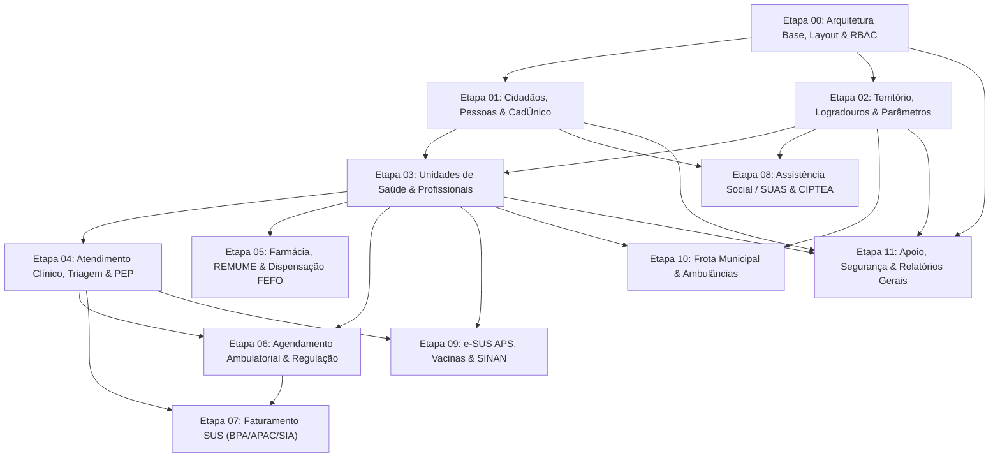

# Documento Mestre de Refatoração do Ecossistema Prefeitura (Ciclo 2.0)

> **Documento Canônico de Arquitetura e Engenharia de Software**  
> **Versão**: 2.0 (Reinicialização Auditada com 100% de Cobertura de Telas)  
> **Status**: Vigente / Oficial  
> **Base de Telas Auditadas**: **1.467 Telas** ([1.334 formulários legados](file:///d:/Projetos/Delphi/refatoracao/documentacao/catalogo_mestre_telas_prefeitura.md) + [133 telas estruturadas](file:///d:/Projetos/Delphi/refatoracao/documentacao/catalogo_mestre_telas_prefeitura.md))  
> **Inventário Estruturado**: [`telas_inventario.json`](file:///d:/Projetos/Delphi/refatoracao/documentacao/telas_inventario.json)

---

## 1. Visão Geral da Reinicialização

Este Documento Mestre orienta o novo ciclo de migração do sistema monolítico desktop **Delphi 7** (`Prefeitura.exe`) para a **Stack Web Oficial Moderna**.

O projeto foi reiniciado para superar as inconsistências e omissões dos planos anteriores (arquivados em [`refatoracao/documentacao/OLD/`](file:///d:/Projetos/Delphi/refatoracao/documentacao/OLD/)), garantindo que **absolutamente todos os 1.467 formulários e telas do projeto original sejam rigorosamente contemplados e mapeados para a arquitetura web**.

### 1.1. Stack Tecnológica de Destino

| Camada | Tecnologia Adotada | Finalidade no Projeto |
| :--- | :--- | :--- |
| **Backend Framework** | **AdonisJS v6** (Node.js 22+, TypeScript) | Núcleo MVC/IoC corporativo, roteamento seguro, controllers, validações e eventos |
| **Persistência / ORM** | **Lucid ORM** + Migrations & Seeds | Mapeamento relacional estrito, transações atômicas ACID, integridade referencial |
| **Bancos Suportados** | **PostgreSQL / SQL Server / MySQL** | Suporte a banco corporativo de alta concorrência com pool configurado |
| **Camada de Integração** | **Inertia.js v2** (Protocolo Server-Driven) | Integração backend-frontend sem necessidade de criar APIs REST redundantes |
| **Frontend Framework** | **React 19 + TypeScript** | Componentes reativos, interfaces declarativas e tipagem compartilhada |
| **Estilização & UI** | **Tailwind CSS v4 + shadcn/ui + Lucide** | Design system municipal moderno, responsivo, acessível e consistente |
| **Validação de Dados** | **VineJS / Zod** | Validação centralizada e estrita de payloads antes da persistência |
| **Cache & Fila Assíncrona**| **Redis 7 + BullMQ** | Sessões distribuídas, filas de processamento pesado (e-SUS, BPA) e cotas |

---

## 2. Auditoria Matemática do Acervo Delphi

Todas as telas foram extraídas e decodificadas a partir dos arquivos binários/texto `.dfm` e unidades `.pas` do projeto:

```
Total Global de Telas do Projeto: 1.467 Telas (100% Auditadas)
├── Prefeitura/Forms: 1.334 Telas (Formulários Centrais Delphi UPMxxx / UCOxxx / UME000)
└── Prefeitura/view:   133 Telas (Telas Especializadas de Assistência Social, Educação e e-SUS)
```

| Domínio Funcional | Telas Auditadas | Documento Analítico de Telas |
| :--- | :---: | :--- |
| **01. Cidadãos e Identificação Social** | **34** | [`01_Cidadaos_e_Social.md`](file:///d:/Projetos/Delphi/refatoracao/documentacao/catalogo_telas/01_Cidadaos_e_Social.md) |
| **02. Território e Estrutura Municipal** | **29** | [`02_Territorio_e_Logradouros.md`](file:///d:/Projetos/Delphi/refatoracao/documentacao/catalogo_telas/02_Territorio_e_Logradouros.md) |
| **03. Unidades de Saúde e Profissionais** | **45** | [`03_Profissionais_e_Unidades.md`](file:///d:/Projetos/Delphi/refatoracao/documentacao/catalogo_telas/03_Profissionais_e_Unidades.md) |
| **04. Atendimento Clínico e PEP** | **66** | [`04_Atendimento_Clinico_PEP.md`](file:///d:/Projetos/Delphi/refatoracao/documentacao/catalogo_telas/04_Atendimento_Clinico_PEP.md) |
| **05. Farmácia Municipal e Medicamentos** | **50** | [`05_Farmacia_e_Medicamentos.md`](file:///d:/Projetos/Delphi/refatoracao/documentacao/catalogo_telas/05_Farmacia_e_Medicamentos.md) |
| **06. Agendamento e Regulação de Cotas** | **95** | [`06_Agendamento_e_Regulacao.md`](file:///d:/Projetos/Delphi/refatoracao/documentacao/catalogo_telas/06_Agendamento_e_Regulacao.md) |
| **07. Faturamento SUS (BPA / APAC / SIA)** | **23** | [`07_Faturamento_SUS.md`](file:///d:/Projetos/Delphi/refatoracao/documentacao/catalogo_telas/07_Faturamento_SUS.md) |
| **08. Assistência Social / SUAS e CIPTEA** | **32** | [`08_Assistencia_Social_SUAS.md`](file:///d:/Projetos/Delphi/refatoracao/documentacao/catalogo_telas/08_Assistencia_Social_SUAS.md) |
| **09. e-SUS APS, Vacinas e SINAN** | **117** | [`09_eSUS_Vigilancia_Vacinas.md`](file:///d:/Projetos/Delphi/refatoracao/documentacao/catalogo_telas/09_eSUS_Vigilancia_Vacinas.md) |
| **10. Frota Municipal e Transporte** | **10** | [`10_Frota_e_Transporte.md`](file:///d:/Projetos/Delphi/refatoracao/documentacao/catalogo_telas/10_Frota_e_Transporte.md) |
| **11. Cadastros de Apoio e Segurança** | **606** | [`11_Apoio_Seguranca_Configuracoes.md`](file:///d:/Projetos/Delphi/refatoracao/documentacao/catalogo_telas/11_Apoio_Seguranca_Configuracoes.md) |
| **12. Relatórios e Impressos** | **360** | [`12_Relatorios_e_Estatisticas.md`](file:///d:/Projetos/Delphi/refatoracao/documentacao/catalogo_telas/12_Relatorios_e_Estatisticas.md) |
| **TOTAL GERAL** | **1.467** | [Catálogo Mestre Consolidado](file:///d:/Projetos/Delphi/refatoracao/documentacao/catalogo_mestre_telas_prefeitura.md) |

---

## 3. Divisão Estratégica em Etapas de Entrega (Roadmap)

A refatoração é estruturada em **12 Etapas Consecutivas**, organizadas em ordem estrita de dependência de dados:



---

### ETAPA 00: Infraestrutura Base, Layout Reativo, Multi-Tenant e Autenticação (RBAC)
- 📄 **Planejamento Detalhado da Etapa**: [`planos_etapas/etapa_00_infraestrutura_layout_rbac.md`](file:///d:/Projetos/Delphi/refatoracao/documentacao/planos_etapas/etapa_00_infraestrutura_layout_rbac.md)
- **Objetivo**: Fornecer os alicerces do sistema web, garantindo segurança, controle de acesso baseado em papéis (RBAC), multi-tenancy municipal e layout responsivo.
- **Telas Delphi Substituídas**:
  - `UME000` (Menu de Opções Principal)
  - `UPM000` (Login do Sistema)
  - Telas de troca de senha, bloqueio de estação e preferências.
- **Entidades Lucid ORM**: `User`, `Tenant`, `Role`, `Permission`, `UserRole`, `RolePermission`, `AuditLog`.
- **Rotas e Páginas Web**:
  - `/login`, `/logout`, `/recuperar-senha`
  - `/dashboard` (Painel executivo com cards e atalhos rápidos)
  - `/sistema/usuarios`, `/sistema/perfis-permissoes`, `/sistema/auditoria`
- **Critérios de Homologação**:
  - Login operacional com autenticação por sessão segura e proteção contra força bruta.
  - Sidebar reativa adaptável a desktop e mobile com controle de visibilidade baseado em `Permission`.
  - Registro de log de auditoria para cada ação de escrita no sistema.

---

### ETAPA 01: Gestão de Cidadãos, Pessoas e Identificação Social (CadÚnico)
- 📄 **Planejamento Detalhado da Etapa**: [`planos_etapas/etapa_01_cidadaos_pessoas_cadunico.md`](file:///d:/Projetos/Delphi/refatoracao/documentacao/planos_etapas/etapa_01_cidadaos_pessoas_cadunico.md)
- **Objetivo**: Unificar a base de pessoas físicas do município, garantindo unicidade por CPF/CNS/NIS, histórico familiar e prevenção de homônimos e duplicidades.
- **Telas Delphi Substituídas**:
  - `UPM002` (PM002 - Cadastro do Cidadão) e `UPM002R` (Relatórios Cidadão)
  - `UPM001` e `UPM001R` (Parentesco e Relação de Parentesco)
  - `UPM003` (Pesquisa de Parentesco)
  - `UJuncaoPessoa` (PM1026 - Junção de Cadastro de Pessoas)
  - `UPesquisaJuncao` (PM1027 - Pesquisa de Pessoas)
  - `UPM073` (PM073 - Pessoa com mesmo CPF)
  - `UPM074` (PM074 - Pesquisa do Cidadão)
  - `UPM526` (PM526 - Cadastro de Pessoas)
  - Demais telas de `01_Cidadaos_e_Social.md` (total de 34 telas).
- **Entidades Lucid ORM**: `Cidadao`, `Pessoa`, `Parentesco`, `Filiacao`, `DocumentoCidadao`, `JuncaoPessoaLog`, `CertidaoNascimento`.
- **Rotas e Páginas Web**:
  - `/cidadaos` (Listagem reativa com filtros rápidos por CPF, CNS, Nome e Data de Nascimento)
  - `/cidadaos/novo` e `/cidadaos/:id/editar` (Formulário completo com abas: Dados Pessoais, Contato, Endereço, Documentos, Família e Vínculos SUS)
  - `/cidadaos/juncao` (Assistente interativo de unificação de cadastros duplicados com transferência segura de prontuários)
- **Critérios de Homologação**:
  - Algoritmo de validação de CPF e cálculo de dígitos do Cartão Nacional de Saúde (CNS).
  - Rotina de unificação de duplicidades com histórico e rastreamento integral de transação.

---

### ETAPA 02: Território, Logradouros, Bairros e Parâmetros Municipais
- 📄 **Planejamento Detalhado da Etapa**: [`planos_etapas/etapa_02_territorio_parametros.md`](file:///d:/Projetos/Delphi/refatoracao/documentacao/planos_etapas/etapa_02_territorio_parametros.md)
- **Objetivo**: Mapear a malha territorial municipal, logradouros oficiais, códigos de CEP, secretarias municipais e parametrizações globais do sistema.
- **Telas Delphi Substituídas**:
  - `UJuncaoEndereco` (PM1004 - Junção de Endereços)
  - `UPesquisaJuncaoEndereco` (PM1005 - Pesquisa de endereços para junção)
  - `UPM010` (Bairros), `UPM020` (Logradouros), `UPM021` (Ruas por Bairro)
  - Demais telas de `02_Territorio_e_Logradouros.md` (total de 29 telas).
- **Entidades Lucid ORM**: `Bairro`, `Logradouro`, `TipoLogradouro`, `Secretaria`, `Departamento`, `ParametroMunicipal`, `JuncaoEnderecoLog`.
- **Rotas e Páginas Web**:
  - `/territorio/bairros`, `/territorio/logradouros`, `/territorio/secretarias`
  - `/territorio/juncao-enderecos`
  - `/configuracoes/parametros-municipais`
- **Critérios de Homologação**:
  - Busca rápida de logradouros por auto-complete com CEP integrado.
  - Parâmetros municipais carregados com cache em Redis para alto desempenho.

---

### ETAPA 03: Unidades de Saúde, Profissionais, Especialidades e Lotações
- 📄 **Planejamento Detalhado da Etapa**: [`planos_etapas/etapa_03_unidades_profissionais_lotacoes.md`](file:///d:/Projetos/Delphi/refatoracao/documentacao/planos_etapas/etapa_03_unidades_profissionais_lotacoes.md)
- **Objetivo**: Gestão de todas as Unidades Municipais de Saúde (CNES), postos de atendimento, salas/consultórios, profissionais, conselhos de classe (CRM, COREN, CRO), ocupações (CBO), equipes da ESF (INE / e-SUS), especialidades médicas e matrizes de bloqueio de agendamento/exames.
- **Telas Delphi Substituídas**:
  - `UPM356`, `UPM356R`, `UPM357`, `UPM630` (Unidades Municipais de Saúde / CNES)
  - `Saude.View.Form.CadastroSala` (Cadastro de salas/consultórios e impressoras)
  - `UPM325` e `UPM325R` (Setores internos da Unidade de Saúde)
  - `UPM763`, `UPM028`, `UPM747`, `UPM758`, `UPM770` (Ocupações e CBOs do Profissional)
  - `UPM089` (Inclusão de Equipes INE / e-SUS por Profissional)
  - `UPM033`, `UPM033R`, `UPM034`, `UPM050R` (Especialidades e Restrições Clínicas)
  - `UPM059R` (Impressão dos Horários e Escala do Profissional)
  - `UPM420` (Protocolos Clínicos de Encaminhamento por Especialidade)
  - `UPM414`, `UPM565`, `UPM566`, `UPM809` (Tipos e Gestão de Guias de Especialidades)
  - `UPM575` (Alta por Especialidade)
  - `UPM710` e `Prefeitura.View.Form.ClonarConfigEspExa` (Bloqueios e Clonagem de Regras entre Unidades)
  - `Prefeitura.View.Relatorio.Etiqueta.Identificacao.UPA` (Pulseiras e Etiquetas Térmicas de Atendimento)
  - Demais telas de `03_Profissionais_e_Unidades.md` (total de 45 telas auditadas).
- **Entidades Lucid ORM**: `UnidadeSaude`, `SetorUnidade`, `SalaUnidade`, `EquipeIne`, `ConselhoProfissional`, `Cbo`, `EspecialidadeMedica`, `ProtocoloEspecialidade`, `Profissional`, `VinculoLotacao`, `EscalaTrabalho`, `BloqueioUnidade`, `GuiaEspecialidade`, `AltaEspecialidade`.
- **Rotas e Páginas Web**:
  - `/saude/unidades` (Cadastro de estabelecimentos de saúde com CNES, salas e setores)
  - `/saude/unidades/clonar-configuracoes` (Assistente de replicação de regras de bloqueio)
  - `/saude/profissionais` (Cadastro do corpo clínico, conselhos, lotações, equipes INE e escalas)
  - `/saude/especialidades` (Especialidades médicas, restrições e protocolos de encaminhamento)
  - `/regulacao/guias-especialidades` (Controle de solicitações e altas por especialidade)
- **Critérios de Homologação**:
  - Validação estrita de formato e unicidade do código CNES da unidade e CNS/CBO do profissional.
  - Bloqueio automático de sobreposição de horários de trabalho do profissional na mesma ou em diferentes unidades.
  - Exigência e validação de protocolos clínicos e exames obrigatórios para liberação de guias especializadas.

---

### ETAPA 04: Recepção, Acolhimento, Triagem Manchester e Atendimento Clínico (PEP)
- 📄 **Planejamento Detalhado da Etapa**: [`planos_etapas/etapa_04_atendimento_clinico_pep.md`](file:///d:/Projetos/Delphi/refatoracao/documentacao/planos_etapas/etapa_04_atendimento_clinico_pep.md)
- **Objetivo**: Modernização completa do fluxo assistencial: recepção e acolhimento do paciente (FAA), triagem e classificação de risco por cores (Protocolo de Manchester), chamada por TV com WebSockets, Prontuário Eletrônico do Paciente (PEP) estruturado no método SOAP, prescrição eletrônica com validação de bulário, atestados médicos com código de autenticidade pública, odontograma interativo, procedimentos de enfermagem, escalas clínicas especializadas (IVCF-20 e M-CHAT) e ações psicossociais (RAAS / CAPS).
- **Telas Delphi Substituídas**:
  - `UPM067`, `UPM764`, `UPM177`, `UPM610`, `UPM611` (Recepção, Pronto Atendimento e Fila de Espera)
  - `UPM976` (Triagem Manchester, Sinais Vitais e Antropometria)
  - `Prefeitura.View.Form.IVCF` (PM1021 - Índice de Vulnerabilidade Clínico-Funcional / Idoso)
  - `Prefeitura.View.Form.Pesquisa.Autismo` (PM1039 - Rastreio de Autismo M-CHAT)
  - `Prefeitura.View.Form.Sae` (PM1048 - Sistematização da Assistência de Enfermagem - SAE)
  - `UPM748` (Procedimentos de Enfermagem, Curativos e Cálculo Obstétrico DUM/Semana Gestacional)
  - `UPM045`, `UPM045R`, `UPM166`, `UPM608`, `UPM542` (Prontuário Eletrônico Mestre, Timeline e Auditoria)
  - `UPM243`, `UPM246`, `UPM344`, `UPM247` (Templates de Evolução, Sigilo Médico/LGPD e Auditoria de Impressões)
  - `Prefeitura.View.Form.NovoAtestado` (PM1044) e `UPM876` (Emissão de Atestados com QR Code)
  - `UPM341`, `UPM217`, `UPM219`, `UPM220`, `UPM231`, `UPM231R` (Recepção e Coleta de Exames no Atendimento)
  - `UPM093`, `UPM977`, `UPM978`, `UPM979`, `UPM979R` (Saúde Bucal, Odontograma e Procedimentos Odontológicos)
  - `UPM046`, `UPM048`, `UPM037`, `UPM038`, `UPM039` (Atendimentos em Grupo e Ações Coletivas)
  - `UPM153` (Atendimento Domiciliar / Melhor em Casa)
  - `Prefeitura.View.Form.Raas` (PM1012 - Ações Ambulatoriais de Saúde Mental - RAAS / CAPS)
  - `UPM195`, `UPM314`, `UPM712`, `UPM765`, `UPM766`, `UPM768`, `UPM768R`, `UPM897` (Encaminhamentos, Leitos de Observação e Conferência Médica)
  - Demais telas de `04_Atendimento_Clinico_PEP.md` (total de 66 telas auditadas).
- **Entidades Lucid ORM**: `Atendimento`, `SinalVital`, `EvolucaoClinica`, `DiagnosticoAtendimento`, `PrescricaoMedicamento`, `SolicitacaoExame`, `AtestadoMedico`, `AtendimentoOdontologico`, `ProcedimentoEnfermagem`, `EscalaIvcf`, `EscalaMchat`, `SaeEnfermagem`, `RaasPsicossocial`, `AuditoriaPepLog`.
- **Rotas e Páginas Web**:
  - `/assistencial/recepcao` (Abertura de ficha de atendimento por biometria, cartão SUS ou CPF)
  - `/assistencial/triagem` (Painel Manchester com temporizador e alertas de gravidade)
  - `/assistencial/painel-chamada` (Interface para TV com chamada sonora e voz sintetizada)
  - `/assistencial/pep/:atendimentoId` (PEP moderno: Perfil, Histórico, SOAP, Prescrição e Exames)
  - `/assistencial/odontologia/:atendimentoId` (Odontograma interativo com dentição decídua e permanente)
  - `/assistencial/procedimentos-enfermagem` (Livro de procedimentos e calculadora obstétrica)
  - `/assistencial/raas` (Lançamento de ações psicossociais CAPS)
- **Critérios de Homologação**:
  - Atualização do painel de chamada e das filas de consultório em tempo real via WebSockets / SSE.
  - Alerta visual e sonoro para tempos de espera estourados conforme a cor do Protocolo de Manchester.
  - Registro de prontuário estruturado no método SOAP com validação de CID-10 e sigilo médico por permissão.
  - Emissão de receitas e atestados com QR Code e página pública de verificação de autenticidade.
  - Emissão de receitas com assinatura digital e código de autenticidade para validação em farmácia.

---

### ETAPA 05: Farmácia Municipal, Estoque, REMUME e Dispensação FEFO
- 📄 **Planejamento Detalhado da Etapa**: [`planos_etapas/etapa_05_farmacia_remume_dispensacao_fefo.md`](file:///d:/Projetos/Delphi/refatoracao/documentacao/planos_etapas/etapa_05_farmacia_remume_dispensacao_fefo.md)
- **Objetivo**: Gestão completa da assistência farmacêutica municipal: catálogo REMUME integrado ao padrão federal CATMAT, controle rigoroso de lotes e datas de validade pelo algoritmo FEFO (First-Expire, First-Out), dispensação ágil por receita eletrônica com controle de uso contínuo, rastreabilidade de estoque em rede inter-unidades, gestão de processos judiciais de medicamentos (Judicialização da Saúde), medicamentos de alto custo e integração federal com BNAFAR/Hórus e RNDS (REDFM).
- **Telas Delphi Substituídas**:
  - `UPM266`, `UPM266R`, `UPM428`, `UPM473`, `UPM734`, `UPM937` (Catálogo REMUME, Grupos Farmacológicos e Apresentações)
  - `UPM908`, `UPM908R`, `UPM909`, `UPM915`, `UPM945` (Controle de Lotes, Validades e Algoritmo FEFO)
  - `UPM271`, `UPM953`, `UPM967`, `UPM183`, `UPM284` (Dispensação no Balcão, Receitas Externas e Extrato do Cidadão)
  - `Prefeitura.View.Relatorio.DispensacaoProxEntrega` (Controle de Próxima Retirada para Uso Contínuo)
  - `Saude.View.Form.Farmacia.Receita.Estorno` (PM1002 - Estorno Parcial de Receita)
  - `Prefeitura.View.Form.Farmacia.MedicamentosEmUso` (PM1003 - Farmacovigilância de Medicamentos em Uso)
  - `Saude.View.Form.Farmacia.RecepcaoChamado` (PM1046 - Painel de Chamada de Senhas na Farmácia)
  - `UPM327` (Visualização do Saldo do Medicamento em Outras Unidades da Rede Municipal)
  - `UPM228`, `Saude.View.Relatorio.ProcJud.Medicamentos`, `Saude.View.Relatorio.ProcJud.Medicamentos.Consumo` (Judicialização da Saúde)
  - `UPM360`, `UPM360R`, `UPM274`, `UPM885`, `UPM888`, `UPM889` (Medicamentos Não Padronizados e Alto Custo)
  - `Prefeitura.View.Form.Rnds.Redfm` (PM1040 - Registro Eletrônico de Dispensação de Medicamentos / RNDS)
  - `UPM931`, `UPM939`, `UPM956` (Farmácia Viva e Manipulação de Fórmulas)
  - `Saude.View.Form.CadastroPosologia` (PM1037), `Saude.View.Form.Farmacia.ReceitaAvulsa.MedsSemelhantes` (PM1025), `Saude.View.Form.Farmacia.Produto.AjustaValorUnitario` (PM1035), `UPM273` (Doações)
  - Demais telas de `05_Farmacia_e_Medicamentos.md` (total de 50 telas auditadas).
- **Entidades Lucid ORM**: `GrupoMedicamento`, `Medicamento`, `LoteMedicamento`, `MovimentacaoEstoque`, `Dispensacao`, `ItemDispensacao`, `ProcessoJudicialMedicamento`, `EstornoDispensacao`, `RndsRedfmEnvio`.
- **Rotas e Páginas Web**:
  - `/farmacia/dashboard` (Painel executivo com alertas críticos FEFO de lotes com vencimento < 30 dias e < 90 dias)
  - `/farmacia/catalogo-remume` (Catálogo oficial com código CATMAT, apresentação, dosagem e Portaria 344)
  - `/farmacia/estoque-lotes` (Visão de estoque em tempo real por unidade, lote e ordenação FEFO)
  - `/farmacia/dispensacao` (Balcão de dispensação por QR Code ou CPF com cálculo automático de próxima entrega)
  - `/farmacia/estoque-em-rede` (Consulta de saldos do medicamento em todas as outras UBSs e Almoxarifado)
  - `/farmacia/judicializacao` (Controle de processos judiciais de medicamentos, cotas e mandados)
  - `/farmacia/painel-chamada` (Painel para TV de chamada de senhas por guichê na farmácia central)
- **Critérios de Homologação**:
  - O sistema impede sumariamente a dispensação de lotes com validade expirada ou em quarentena.
  - Baixa de estoque estritamente atômica em transação ACID, com trava contra concorrência e estoque negativo.
  - Bloqueio de dispensação precoce de medicamentos de uso contínuo antes da data autorizada de retorno.
  - Segregação lógica de estoque para ordens de fornecimento judicial e geração de payloads REDFM para a RNDS.

---

### ETAPA 06: Agendamento Ambulatorial, Regulação Municipal de Vagas/Cotas e TFD
- 📄 **Planejamento Detalhado da Etapa**: [`planos_etapas/etapa_06_agendamento_regulacao_tfd.md`](file:///d:/Projetos/Delphi/refatoracao/documentacao/planos_etapas/etapa_06_agendamento_regulacao_tfd.md)
- **Objetivo**: Centralizar e modernizar a gestão de agendas ambulatoriais médicas e odontológicas, exames especializados, o Complexo Regulador Municipal com gestão de Demanda Reprimida (Fila de Espera SUS) e critérios de gravidade, pactuação e distribuição de cotas municipais e externas (AME, Consórcios, Prestadores Credenciados), automação de convocações via WhatsApp/SMS substituindo o executável autônomo Delphi `RoboAgendamento` por filas assíncronas no BullMQ + Redis 7, e controle das rotas e passageiros do Tratamento Fora de Domicílio (TFD).
- **Telas Delphi Substituídas**:
  - `UPM592`, `UPM591`, `UPM201`, `UPM201R`, `UPM848`, `UPM848R`, `UPM849` (Grades de Horários, Manutenção e Agendas Médicas/Odontológicas)
  - `upM047`, `UPM045`, `UPM045R`, `UPM520`, `UPM569`, `UPM665`, `UPM413`, `UPM249` (Marcação de Consultas, Agendamentos Recorrentes e Seriados)
  - `UPM599`, `UPM600`, `UPM601`, `UPM601R`, `UPM987`, `UPM987R` (Geração e Marcação de Exames Especializados)
  - `Saude.View.Form.Agenda.GuiaEspecialidade.Exame` (PM1007 - Agendamento de Exames por Guia Regulada)
  - `Saude.View.Form.Agenda.Exame.ImpressaoEtiqueta` (PM1016), `Saude.View.Relatorio.Agenda.Exame.Etiquetas`, `Brother2211` (Impressão de Etiquetas Térmicas de Tubos e Frascos)
  - `Saude.View.Form.Guia`, `Saude.View.Form.Agenda.GuiaEspecialidade` (PM1000 - Fila de Demanda Reprimida da Regulação)
  - `Saude.View.Form.Agenda.GuiaEspecialidade.Vagas` (PM1001 - Seleção de Vagas Reguladas)
  - `Saude.View.Form.Agenda.GuiaEspecialidade.Comunicado` (PM1006) e `Notificacao` (Comunique-se / Convocação de Pacientes)
  - `UPM211`, `UPM211R`, `UPM212`, `UPM213`, `UPM216`, `UPM216_P`, `UPM216R`, `UPM218`, `UPM218_P`, `UPM236`, `UPM236R` (Gestão de Cotas Externas de Consultas e Exames - AME, Consórcios e Credenciados)
  - `Prefeitura.View.Form.Agenda.ExameCota.Cancelar` (PM1019 - Cancelamento de Exames por Cota)
  - `UPM263`, `UPM263R`, `UPM337`, `UPM501`, `UPM501R`, `UPM738`, `UPM738R`, `UPM739`, `UPM958`, `UPM960`, `UPM972` (Controle, Cópia Mensal e Extratos de Cotas Municipais)
  - `UPM594`, `UPM606`, `UPM295`, `UPM296`, `UPM607`, `UPM635` (Bloqueios e Desbloqueios de Agendas por Férias ou Recessos)
  - `UPM174`, `UPM349`, `UPM465` (Remanejamento e Transferência de Agendamentos)
  - `UPM590`, `UPM617`, `UPM627`, `UPM664`, `UPM664R`, `UPM623` (Cancelamentos e Confirmações de Agendamentos)
  - `UPM736`, `UPM737`, `UPM022R`, `Prefeitura.View.Relatorio.AgendaConsulta.Cancelamentos` (Gestão de Absenteísmo e Faltas Injustificadas)
  - `UPM877`, `UPM877R`, `UPM878`, `UPM816`, `UPM816R`, `UPM521`, `UPM521R` (Transporte Sanitário e TFD: Veículos, Motoristas e Passageiros)
  - `refatoracao/RoboAgendamento` (Executável autônomo Delphi substituído por workers BullMQ + Redis 7)
  - Demais telas de `06_Agendamento_e_Regulacao.md` (total de 95 telas auditadas).
- **Entidades Lucid ORM**: `ProcedimentoSigtap`, `GradeHorario`, `GradeHorarioExcecao`, `Agendamento`, `AgendamentoHistorico`, `CotaAgendamento`, `DemandaReprimida`, `DemandaReprimidaHistorico`, `NotificacaoConvocacao`, `TfdViagem`, `TfdPassageiro`.
- **Rotas e Páginas Web**:
  - `/agendamento/grade-horarios` (Configurador visual e gerador de grades recorrentes por profissional e consultório)
  - `/agendamento/consultas-calendario` (Grade reativa mensal/semanal/diária com encaixes, drag-and-drop e status em tempo real via WebSockets)
  - `/agendamento/exames` (Marcação de exames laboratoriais/imagem com impressão de etiquetas térmicas)
  - `/regulacao/complexo-regulador` (Central de Regulação Municipal com classificação de risco e fila de espera cronológica/clínica)
  - `/regulacao/painel-cotas` (Matriz interativa de distribuição de cotas entre UBSs e Prestadores)
  - `/regulacao/comunicados-convocacoes` (Gestão de convocações com status de disparo de WhatsApp e SMS)
  - `/regulacao/tfd-viagens` (Escalação de veículos, motoristas, rotas e manifestos de passageiros para TFD)
- **Critérios de Homologação**:
  - Concorrência zero: bloqueio atômico de agendamento simultâneo no mesmo horário/vaga utilizando travas distribuídas no Redis (`redlock`).
  - Cumprimento rigoroso do teto de cotas por UBS com impossibilidade de overbooking desautorizado.
  - Funcionamento ininterrupto dos jobs de convocação e cancelamento por absenteísmo no BullMQ.
  - Rastreabilidade completa de todas as alterações, remanejamentos e cancelamentos de agendamentos com justificativa obrigatória.

---

### ETAPA 07: Faturamento SUS Municipal (BPA, APAC, SIA/SIH e SIGTAP)
- 📄 **Planejamento Detalhado da Etapa**: [`planos_etapas/etapa_07_faturamento_sus_bpa_apac_sigtap.md`](file:///d:/Projetos/Delphi/refatoracao/documentacao/planos_etapas/etapa_07_faturamento_sus_bpa_apac_sigtap.md)
- **Objetivo**: Apurar a produção assistencial de saúde (médica, enfermagem, odontológica e procedimentos), consistir regras da tabela unificada oficial SIGTAP do Ministério da Saúde (CBO x Procedimento x CID x Faixa Etária x Sexo), gerar as remessas oficiais em formato magnético posicional de BPA-I (Individualizado), BPA-C (Consolidado) e APAC (Procedimentos de Alta Complexidade), e substituir o subsistema Delphi autônomo `IntegraFaturamento`.
- **Telas Delphi Substituídas**:
  - `Prefeitura.View.Form.Faturamento.Exportacao` (PM1008 - Exportação do Faturamento)
  - `Prefeitura.View.Form.FtpDatasus` (FTP Datasus - Transmissão de Arquivos)
  - `UPM278` (PM278 - Manutenção no Faturamento e Auditoria de Glosas)
  - `UPM720`, `UPM721`, `UPM722`, `UPM723` (Órgãos de Destino e Responsáveis pelo BPA)
  - `UPM771`, `UPM771R` (Relatórios de Faturamento por Tabela Unificada SIGTAP)
  - `UPM792` a `UPM802` (Doenças, Segmentos, Áreas e Micro-Áreas de Faturamento SIAB)
  - `refatoracao/IntegraFaturamento` (`IntegraFaturamento.dpr`, `UExportaFaturamentoBPAMagnetivoUBS`, `UITF000`, `UITF001`, `UITF003`)
  - Demais telas de `07_Faturamento_SUS.md` (total de 23 telas auditadas).
- **Entidades Lucid ORM**: `SigtapProcedimento`, `SigtapCboCompativel`, `SigtapCidCompativel`, `FaturamentoOrgao`, `RemessaFaturamento`, `ItemFaturamentoProducao`, `LaudoApac`.
- **Rotas e Páginas Web**:
  - `/faturamento/dashboard` (Painel executivo com teto financeiro MAC/PAB e comparativo de produção)
  - `/faturamento/apuracao` (Motor assíncrono de consistência e apuração da produção da competência)
  - `/faturamento/manutencao-glosas` (Grid de auditoria e correção em lote de inconsistências de CBO/CID)
  - `/faturamento/remessas-bpa` (Geração dos arquivos magnéticos posicionais oficiais `.bpa` e espelhos em PDF)
  - `/faturamento/apac` (Controle de laudos, autorizações de alta complexidade e faturamento continuado)
  - `/faturamento/tabela-sigtap` (Importador mensal dos pacotes oficiais de release da tabela SIGTAP)
- **Critérios de Homologação**:
  - Paridade total com o validador SIA/SUS do DATASUS (importação de arquivos sem rejeição estrutural).
  - Bloqueio prévio de inconsistências com alerta explícito antes do fechamento do lote.

---

### ETAPA 08: Assistência Social / SUAS, CRAS, CREAS, CIPTEA e Benefícios
- 📄 **Planejamento Detalhado da Etapa**: [`planos_etapas/etapa_08_assistencia_social_suas_cras_creas_ciptea.md`](file:///d:/Projetos/Delphi/refatoracao/documentacao/planos_etapas/etapa_08_assistencia_social_suas_cras_creas_ciptea.md)
- **Objetivo**: Gestão completa da política de Assistência Social do município sob as diretrizes do SUAS: prontuário familiar eletrônico articulado ao CadÚnico, acompanhamentos no CRAS (PAIF) e CREAS (PAEFI - violações de direitos), concessão auditada de benefícios eventuais (cestas básicas, auxílio funeral, natalidade) e sistema municipal de emissão da Carteira de Identificação da Pessoa com Autismo (CIPTEA - Lei 13.977/2020) com validação pública via QR Code.
- **Telas Delphi Substituídas**:
  - `Prefeitura.View.Frame.Cidadao.Social` (Programas Sociais e Renda Familiar)
  - `Social.View.Form.RelatoriosCiptea`, `Social.View.Form.RequerimentoCiptea`, `Social.View.Relatorio.Ciptea.*` (Requerimento e Emissão CIPTEA)
  - `Social.View.Relatorio.Atendimento.Agenda.Comprovante` / `Termica` (Comprovantes de Atendimento no CRAS/CREAS)
  - `Social.View.Relatorio.Paefi.FamiliasCadastradasIndividuos`, `Social.View.Relatorio.Paefi.Historico` (Relatórios do PAEFI)
  - `UPM050`, `UPM051` (Parecer Técnico do Assistente Social)
  - `UPM069`, `UPM197`, `UPM222`, `UPM222R`, `UPM262`, `UPM328` (Agenda, Cotas, Configurações e Logs da Assistência)
  - `UPM332` a `UPM336R` (Grupos, Subgrupos, Itens e Prontuário PAEFI no CREAS)
  - `UPM464`, `UPM508`, `UPM516`, `UPM716` (Usuários API Social, Projetos Sociais e Intersetorialidade Saúde x Social)
  - Demais telas de `08_Assistencia_Social_SUAS.md` (total de 32 telas auditadas).
- **Entidades Lucid ORM**: `UnidadeSuas`, `FamiliaSuas`, `MembroFamiliaSuas`, `AtendimentoSuas`, `BeneficioEventual`, `CarteiraCiptea`, `PaefiAcompanhamento`.
- **Rotas e Páginas Web**:
  - `/social/familias` (Diagnóstico sociodemográfico, vulnerabilidades e prontuário familiar)
  - `/social/beneficios-eventuais` (Pipeline de concessão de benefícios com parecer social e comprovante digital)
  - `/social/ciptea` (Central de aprovação, emissão da carteira em formato PVC com QR Code e portal público de autenticidade)
  - `/social/paefi` (Módulo sigiloso e restrito do CREAS para famílias e indivíduos com direitos violados)
- **Critérios de Homologação**:
  - Sigilo ético estrito de prontuário PAEFI restrito a assistentes sociais (CRESS) e psicólogos (CRP).
  - Emissão de carteiras CIPTEA em plena conformidade com a Lei Federal nº 13.977/2020.

---

### ETAPA 09: e-SUS APS, Vigilância Epidemiológica, Imunização/Vacinas e SINAN
- 📄 **Planejamento Detalhado da Etapa**: [`planos_etapas/etapa_09_esus_aps_vigilancia_imunizacao_sinan.md`](file:///d:/Projetos/Delphi/refatoracao/documentacao/planos_etapas/etapa_09_esus_aps_vigilancia_imunizacao_sinan.md)
- **Objetivo**: Conexão nativa com a Atenção Primária à Saúde federal (e-SUS APS) através de motor de serialização Apache Thrift, implementação das 7 Fichas CDS/PEC oficiais, carteira de vacinação digital do cidadão com aprazamento do PNI, monitoramento de temperatura da cadeia de frio em câmaras frias (+2°C a +8°C), envio de imunobiológicos para a RNDS (RIA) e notificações compulsórias de agravos para o SINAN.
- **Telas Delphi Substituídas**:
  - `Prefeitura.View.Form.EsusConfig`, `Prefeitura.View.Form.EsusProducao`, `UPM134`, `UPM134R`, `UPM185`, `UPM257` (Configurações e Inconsistências e-SUS)
  - `UPM123`, `UPM124` (FAI), `UPM090`, `UPM091` (FAP), `UPM092` (FAO), `UPM083_30` (FAC), `UPM079_21`, `UPM080` (CadInd), `UPM132_21`, `UPM133` (CadDom), `UPM152_30` (FAD), `UPM148_30` (Consumo Alimentar), `UPM081_21`, `UPM082` (Visita Domiciliar)
  - `Saude.View.Form.VulnerabilidadeFAM` (PM1017 - EVFAM-BR), `UPM294`, `UPM294R` (Escala Coelho-Savassi)
  - `UPM198`, `UPM199`, `UPM522`, `UPM522R`, `UPM523`, `UPM854` a `UPM870` (Cadastro e Aplicação de Vacinas, Doses, Carteiras e Campanhas)
  - `Prefeitura.View.Relatorio.Vacinas.*` (Relatórios Quantitativos e RNDS RIA)
  - `UPM828`, `UPM829`, `UPM839` (Odontograma e Faces dos Dentes e-SUS)
  - Demais telas de `09_eSUS_Vigilancia_Vacinas.md` (total de 117 telas auditadas).
- **Entidades Lucid ORM**: `VacinaCatalogo`, `VacinaLote`, `VacinaAplicacao`, `CamaraFriaLeitura`, `EsusRemessa`, `SinanNotificacao`.
- **Rotas e Páginas Web**:
  - `/imunizacao/carteira/:cidadaoId` (Carteira de vacinação digital com calendário oficial do PNI e doses de reforço)
  - `/imunizacao/sala-vacinas` (Aplicação de doses com leitor de código de barras para lote/validade)
  - `/imunizacao/camaras-frias` (Gráfico contínuo de temperatura em tempo real com alertas de excursão térmica)
  - `/esus/painel-producao` (Acompanhamento das 7 fichas CDS/PEC com motor de inconsistências prévio)
  - `/vigilancia/sinan` (Notificação compulsória de agravos à saúde pública)
- **Critérios de Homologação**:
  - Serialização Thrift compatível com o Centralizador e-SUS APS sem divergência de schemas.
  - Bloqueio de aplicação de doses fora do aprazamento mínimo preconizado pelo Ministério da Saúde.

---

### ETAPA 10: Gestão de Frotas, Ambulâncias, Viagens e Abastecimento
- 📄 **Planejamento Detalhado da Etapa**: [`planos_etapas/etapa_10_gestao_frotas_ambulancias_transporte.md`](file:///d:/Projetos/Delphi/refatoracao/documentacao/planos_etapas/etapa_10_gestao_frotas_ambulancias_transporte.md)
- **Objetivo**: Gestão completa da frota de veículos municipais, ambulâncias de suporte básico e UTI móvel, vans de TFD, ônibus escolares, caminhões e máquinas pesadas, absorvendo e substituindo integralmente o subsistema desktop Delphi `Frota.dpr` (composto por mais de 356 arquivos de código-fonte).
- **Telas Delphi Substituídas**:
  - Telas de `10_Frota_e_Transporte.md` (`UPM348`, `UPM546`, `UPM546R`, `UPM547`, `UPM673`, `UPM962`, `UPM963`, `Saude.View.Form.Viagem.Estorno`, `UPM317R`, `UPM322R`)
  - Todo o subsistema `d:/Projetos/Delphi/refatoracao/Frota` (`UVeiculo`, `UMaquina`, `UCadastroMotorista`, `UAbastecimento`, `UOrdemServico`, `URoteiro`, `UControleTacografo`, `UCacamba`, `UPrimeImportacao`, etc. - totalizando 356 arquivos).
- **Entidades Lucid ORM**: `FrotaVeiculo`, `FrotaMotorista`, `FrotaViagem`, `FrotaAbastecimento`, `FrotaManutencao`.
- **Rotas e Páginas Web**:
  - `/frota/painel-ativos` (Painel com status em tempo real de veículos, ambulâncias e máquinas)
  - `/frota/diario-bordo` (Registro de saídas, retornos, destinos, condutor e quilometragem)
  - `/frota/abastecimento` (Controle de consumo km/l e litros/hora com alertas de anomalias e desvios)
  - `/frota/manutencoes-os` (Ordens de serviço de manutenção preventiva por odômetro e corretiva)
- **Critérios de Homologação**:
  - Bloqueio automático de saída para motoristas com CNH vencida ou sem curso de veículo de emergência.
  - Impossibilidade de registro de odômetro regressivo ou inconsistente.

---

### ETAPA 11: Cadastros de Apoio, Segurança, Configurações Gerais e Central de Relatórios
- 📄 **Planejamento Detalhado da Etapa**: [`planos_etapas/etapa_11_cadastros_apoio_seguranca_relatorios.md`](file:///d:/Projetos/Delphi/refatoracao/documentacao/planos_etapas/etapa_11_cadastros_apoio_seguranca_relatorios.md)
- **Objetivo**: Conclusão da migração de todo o acervo remanescente: consolidação de 606 tabelas de apoio e parâmetros em um motor dinâmico orientado a metadados (Dynamic Lookup Engine), central unificada de relatórios gerenciais e estatísticos substituindo 360 impressos legados por templates em Chromium Headless (Puppeteer) e ExcelJS, mensageria interna da prefeitura (UCO001 a UCO010) e trilha global de auditoria LGPD.
- **Telas Delphi Substituídas**:
  - 606 Telas de tabelas de apoio, menus, parâmetros e correio interno listadas em [`11_Apoio_Seguranca_Configuracoes.md`](file:///d:/Projetos/Delphi/refatoracao/documentacao/catalogo_telas/11_Apoio_Seguranca_Configuracoes.md)
  - 360 Telas e relatórios de impressão em QuickReport/FortesReport listados em [`12_Relatorios_e_Estatisticas.md`](file:///d:/Projetos/Delphi/refatoracao/documentacao/catalogo_telas/12_Relatorios_e_Estatisticas.md)
- **Entidades Lucid ORM**: `SistemaTabelaApoio`, `MensagemInterna`, `MensagemDestinatario`, `RelatorioCatalogo`, `RelatorioExecucao`, `AuditoriaGeral`.
- **Rotas e Páginas Web**:
  - `/configuracoes/tabelas-apoio` (Interface universal orientada a metadados para manutenção de tabelas auxiliares)
  - `/relatorios/central` (Catálogo visual de emissão e agendamento de relatórios em PDF institucional e planilhas Excel)
  - `/mensageria` (Correio eletrônico e comunicados internos entre secretarias com alertas via WebSockets)
  - `/auditoria/painel-lgpd` (Trilha de auditoria completa de visualizações e alterações de dados sensíveis)
- **Critérios de Homologação**:
  - 100% de paridade de apuração entre os relatórios legados e as emissões na nova central.
  - Trilha de auditoria persistida e imutável para todas as operações críticas do sistema.

---

## 4. Matriz de Homologação e Critérios de Conclusão

Para cada uma das etapas executadas, a conclusão só será considerada formalmente aprovada quando atender aos 4 pilares:

```
[ P1: Mapeamento de Telas ] ---> 100% dos formulários da etapa presentes no novo sistema
[ P2: Integridade de Dados] ---> Migrations executadas sem perda ou truncamento de campos
[ P3: Testes de Validação ] ---> Testes automatizados (Unitários e E2E) passando com sucesso
[ P4: Aceite do Usuário   ] ---> Validação manual com registro em walkthrough oficial
```

---
*Este documento é a referência única e soberana de escopo da refatoração do sistema Prefeitura.*
