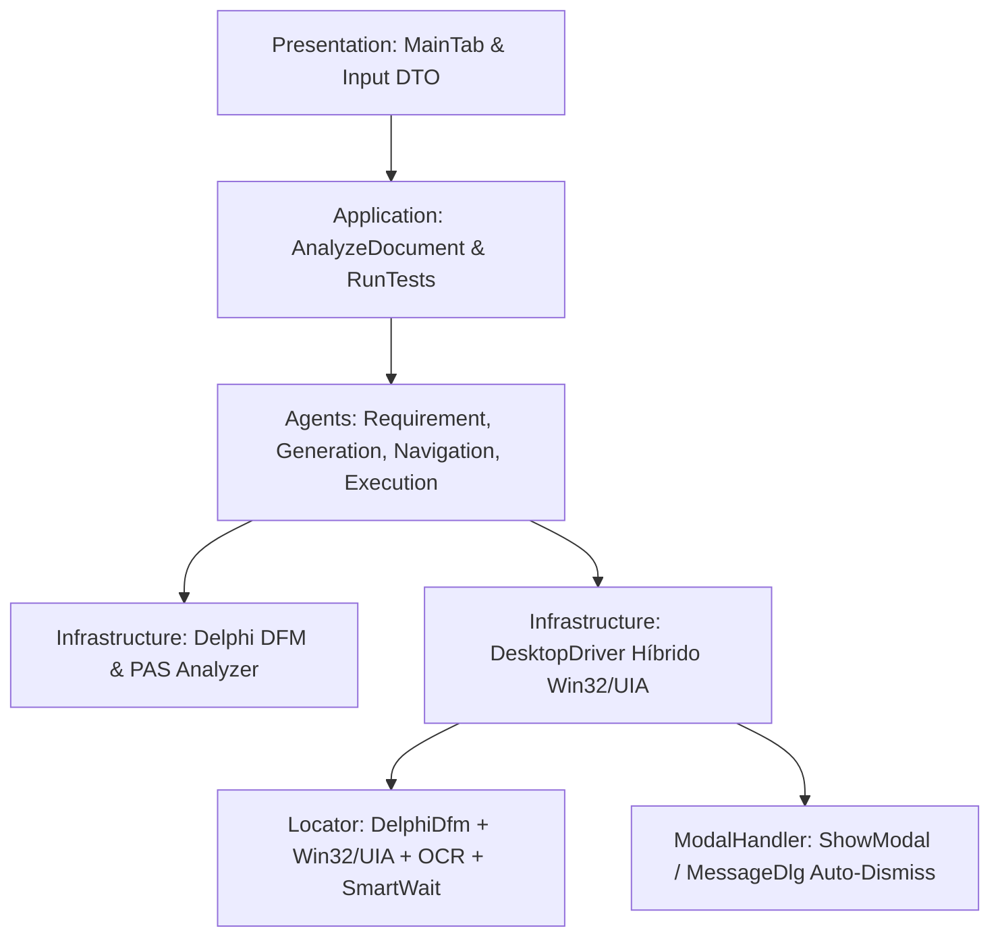

# Plano de Análise e Refatoração: AI Test Agent (Foco em Delphi Desktop)

## Objetivo do Projeto e Contexto
O **AI Test Agent** é uma aplicação desktop em Python (CustomTkinter + Clean Architecture + LLM + OCR + pywinauto) projetada para automatizar testes funcionais a partir de Ordens de Serviço (documentação, descrição e artefatos).
O foco prioritário imediato da automação são **aplicações desktop construídas em Delphi (VCL / Win32)**.

Aplicações Delphi VCL possuem particularidades arquiteturais críticas no ecossistema Windows:
1. **Controles Windowed (`TWinControl`) vs Não-Windowed (`TGraphicControl`)**:
   - `TEdit`, `TButton`, `TComboBox`, `TMemo`, `TBitBtn`, etc. possuem um identificador nativo do Windows (`HWND`).
   - `TSpeedButton`, `TLabel`, `TImage`, `TPaintBox`, etc. **não possuem HWND** e são desenhados diretamente no Canvas do container (Form/Panel), sendo invisíveis para a árvore de janelas do Win32 tradicional e frequentemente opacos para UI Automation (UIA).
2. **Backend Win32 vs UIA**:
   - Delphi clássico (Delphi 7 a Delphi 10/11/12 sem provedores MSAA/UIA customizados) expõe classes VCL nativas (`TEdit`, `TDBGrid`, etc.).
   - Conectar exclusivamente via `backend="uia"` (como o código atual faz) faz com que muitos controles apareçam sem nome, como `Pane` genérico ou simplesmente inacessíveis. O `backend="win32"` acessa diretamente classes VCL e mensagens nativas (`WM_GETTEXT`, `BM_CLICK`, `CB_SETCURSEL`).
3. **Diálogos Modais e Loops VCL (`ShowModal`, `MessageDlg`, `Application.MessageBox`)**:
   - Diálogos modais congelam o formulário pai. Se o driver não interceptar o modal ativamente, as chamadas para a janela principal sofrem timeout.
4. **Comportamento de Teclado e Navegação VCL**:
   - Frequente uso de `Enter` para mudar de campo (`Form.KeyPreview = True` com `Perform(WM_NEXTDLGCTL, 0, 0)`), além de atalhos aceleradores (`&Salvar` -> `Alt+S`) e teclas de função (`F2`, `F10`, etc.).

---

## Diagnóstico do Estado Atual: Pontos Críticos e Código Desconectado

Ao analisar o código atual, identificou-se que existem **módulos valiosos já implementados, mas que estão 100% desconectados do fluxo principal de execução e da interface**, além de lacunas técnicas importantes para Delphi:

| Componente | Estado Atual no Código | Impacto / Problema |
|---|---|---|
| **`infrastructure/delphi/dfm_parser.py`** | Pronto com extração de árvore, cálculo relativo/absoluto e classificação de botões. | **Órfão**: Nunca é chamado pelo pipeline, nem pela UI (`MainTab`), nem pelos Use Cases. |
| **`infrastructure/delphi/pas_analyzer.py`** | Pronto com extração de `raise Exception`, `ShowMessage`, `MessageDlg` e regras de validação. | **Órfão**: Nunca é chamado em lugar nenhum do sistema. |
| **`infrastructure/drivers/locator.py` (`DelphiDfmElementSearcher`)** | Classe implementada para buscar via `DelphiScreenMap`. | **Órfão**: Nunca é registrada no `ElementLocator` nem instanciada pelo `DesktopDriver`. |
| **`infrastructure/drivers/modal_handler.py` (`ModalHandler`)** | Implementado para detectar `#32770`, `TMessageForm` e fechar modais. | **Órfão**: Nunca é instanciado nem chamado pelo `DesktopDriver` ou `ExecutionAgent`. |
| **`agents/navigation_agent.py` (`NavigationAgent`)** | Possui lógica de login com fallback e inspeção de tela (`describe_ui`). | **Desconectado**: O `ExecutionAgent` e o `pipeline.py` reimplementaram lógica ad-hoc duplicada. |
| **`infrastructure/drivers/desktop.py`** | Hardcoded em `Application(backend="uia")`. | **Crítico para Delphi**: Falha em enxergar controles padrão VCL que não implementam UIA. |
| **Coordenadas de tela no DFM (`locator.py:731`)** | Soma `cx = rect.left + left` usando o retângulo total da janela (`window.rectangle()`). | **Incorreto**: Inclui bordas e barra de título. Em coordenadas VCL, a origem é a *Client Area* (`client_rectangle`). Ignora ainda DPI scaling (`PixelsPerInch`). |
| **Alvos sintéticos gerados (`test_generation_agent.py`)** | Gera cliques em `"Botão Salvar/Confirmar"`. | **Incompatível**: No Delphi os botões são `btnSalvar`, `btnGravar`, `&Salvar` ou atalhos (`F10`/`Alt+S`). |
| **Validações sintéticas de texto** | Espera textos fictícios como `"Confirmação de sucesso para CPF"`. | **Falsos Negativos**: Não usa as mensagens reais capturadas do `.pas` ou do banco. |
| **`readers.py` / `extractor.py`** | Filtra apenas `.pdf`, `.docx`, `.txt`, `.md`, `.csv`, `.png`, etc. | **Bloqueio**: Rejeita arquivos `.dfm` ou `.pas` com erro `InvalidValueError`. |

---

## User Review Required

> [!IMPORTANT]
> **Modo de Conexão com Aplicações Delphi (UIA vs Win32):**
> Recomendamos implementar uma estratégia híbrida ou configurável no `DesktopDriver`: tentar primeiro UIA (útil para controles modernos ou wrappers), com fallback automático para Win32 nativo (padrão absoluto do Delphi VCL).
> Deseja que a detecção de backend seja automática com base na classe de janela ou configurável por perfil de projeto?

> [!NOTE]
> **Fonte dos Metadados Delphi (DFM e PAS):**
> Para aproveitar o mapa exato de controles e as regras de negócio sem depender exclusivamente de OCR visual, a interface permitirá que o usuário aponte opcionalmente o arquivo `.dfm` e `.pas` da tela (ou uma pasta de fontes Delphi do projeto). Se não fornecido, o agente continuará operando por heurística, UIA/Win32 e OCR.

---

## Open Questions

> [!QUESTION]
> 1. **Grades de Dados (Grids):** As telas Delphi que você irá testar utilizam `TDBGrid` padrão do Delphi ou componentes de terceiros como **DevExpress (cxGrid)**, **TMS** ou **InfoPower**? (O tratamento de células de grade varia dependendo da suíte de componentes).
> 2. **Navegação com tecla Enter:** O sistema em teste utiliza a tecla `Enter` para avançar o foco entre campos (comum em sistemas corporativos Delphi), ou utiliza a tecla `Tab` padrão?

---

## Proposta de Refatoração Estruturada em Fases

A refatoração proposta está dividida em 5 pilares modulares, respeitando a Clean Architecture e garantindo que cada mudança seja acompanhada de testes unitários e de integração.



---

### Pilar 1: Unificação e Integração dos Módulos Delphi (`infrastructure/delphi`)

Conectar o `dfm_parser.py` e o `pas_analyzer.py` ao fluxo de entrada de documentos e geração de cenários.

#### [MODIFY] `infrastructure/documents/readers.py` e `extractor.py`
- Permitir leitura direta de arquivos `.dfm` e `.pas` através do `PlainTextReader` (com tratamento de encoding `cp1252` e `utf-8` típico do Delphi).

#### [MODIFY] `application/dto/order_of_service.py`
- Adicionar campos opcionais no `OrderOfServiceInput`:
  - `dfm_path: Path | None = None`
  - `pas_path: Path | None = None`
  - `backend: str = "auto"` ("auto", "win32", "uia")
  - `advance_field_key: str = "tab"` ("tab" ou "enter")

#### [MODIFY] `presentation/views/main_tab.py`
- Permitir seleção de arquivos `.dfm` e `.pas` na seção de documentos ou campo dedicado "Formulário Delphi (.dfm / .pas)".
- Atualizar filtro de extensões para incluir `*.dfm;*.pas;*.dpr`.

---

### Pilar 2: Motor de Automação Desktop Especializado em Delphi (`infrastructure/drivers`)

Garantir que o `DesktopDriver` consiga interagir com qualquer controle VCL (com ou sem HWND).

#### [MODIFY] `infrastructure/drivers/desktop.py`
1. **Suporte Híbrido Win32 / UIA**:
   - Permitir inicialização com `backend="win32"` ou `backend="uia"`, com tentativa de reconexão Win32 caso o UIA não retorne a árvore de controles esperada.
2. **Integração Real do `ModalHandler`**:
   - Instanciar `self._modal_handler = ModalHandler(get_app=lambda: self._app)` no `start()`.
   - Antes de cada ação (`type_text`, `click`) e no tratamento de erro/espera, verificar se um modal abriu inesperadamente (ex.: mensagem de validação ou aviso).
   - Extrair a mensagem do modal para enriquecer o resultado do teste e dispensá-lo (`dismiss_modal()`).
3. **Integração do `DelphiDfmElementSearcher`**:
   - Injetar o `DelphiScreenMap` no `ElementLocator` quando um DFM for associado à execução.
4. **Correção de Coordenadas de Janela e DPI**:
   - Utilizar a *Client Area* da janela do formulário (`GetClientRect` / `client_rectangle()`) para somar com o `abs_x` e `abs_y` do DFM.
   - Adicionar cálculo de proporção baseado no `PixelsPerInch` declarado no DFM vs DPI do monitor atual (96 DPI base).

#### [MODIFY] `infrastructure/drivers/locator.py`
- Corrigir o cálculo em `DelphiDfmElementSearcher._resolve_control_or_coords` para usar coordenadas de cliente.
- Suportar busca por aceleradores Windows (ex.: `target="Salvar"` casa com botão com caption `&Salvar` ou `&Gravar`).
- Permitir busca por atalho (`hotkey` como `Alt+G`, `F10`, `F2`).

---

### Pilar 3: Refatoração dos Agentes de IA e Geração de Cenários (`agents/`)

Eliminar alvos genéricos fictícios e aproveitar a semântica do Delphi.

#### [MODIFY] `agents/test_generation_agent.py`
1. **Alvos Reais de Ação**:
   - Se houver `DelphiScreenMap`, usar o botão de ação real retornado por `screen_map.find_action("save")` (ex.: `btnSalvar` ou `&Gravar`), em vez da string fixa `"Botão Salvar/Confirmar"`.
   - Se o botão possuir `hotkey` associado (ex.: `Alt+G` ou `F10`), registrar como alternativa de acionamento.
2. **Mensagens Esperadas Concretas**:
   - Se o `PasAnalyzer` encontrou regras no código Pascal (ex.: `raise Exception.Create('CPF deve ser informado')`), usar essa mensagem exata no passo de verificação (`TestStep(action=EXPECT, expected="CPF deve ser informado")`).
3. **Navegação com Tecla Delphi**:
   - Respeitar a configuração de avanço de campo (`advance_field_key`) gerando passos com tecla `Enter` quando configurado.

#### [MODIFY] `agents/execution_agent.py`
1. **Remoção de Código Duplicado / Integração com `NavigationAgent`**:
   - Delegar a navegação e autenticação ao `NavigationAgent`.
2. **Validação Ativa de Modais**:
   - No passo `StepAction.EXPECT` ou `StepAction.VALIDATE`, consultar o `ModalHandler` para verificar se o sistema disparou um diálogo modal contendo a mensagem esperada.
3. **Registro de Diagnóstico Específico para Delphi**:
   - Caso o elemento não seja encontrado, inspecionar a classe de controle Win32 sob o cursor e registrar se é um `TGraphicControl` (sem HWND).

---

### Pilar 4: Clean Architecture e Desacoplamento de Serviços (`application` & `services`)

#### [MODIFY] `application/use_cases/analyze_document.py` e `extract_requirements.py`
- Quando houver arquivos `.dfm` e/ou `.pas` entre os documentos:
  1. Executar `DfmParser.parse_file()` gerando `DelphiScreenMap`.
  2. Executar `PasAnalyzer.analyze_file(screen_map=screen_map)`.
  3. Preencher campos (`Field`) e regras de negócio (`BusinessRule`) com base nos controles e validações reais extraídas do código Delphi.
  4. Injetar essas informações no contexto do LLM para complementar a análise da OS.

#### [MODIFY] `services/pipeline.py`
- Passar o `DelphiScreenMap` e as configurações do Delphi para o `RunTestsUseCase` e `AutoRunAgent`.

---

### Pilar 5: Cobertura de Testes Automatizados para o Módulo Delphi (`tests/`)

Atualmente não há testes unitários para o pacote `infrastructure/delphi`.

#### [NEW] `tests/unit/test_dfm_parser.py`
- Testar parsing de DFM com formulário contendo `TEdit`, `TLabel`, `TDBGrid`, `TBitBtn`, `TPageControl`.
- Testar cálculo de coordenadas absolutas em contêineres aninhados (`TPanel` dentro de `TTabSheet`).
- Testar correlação de `TLabel` com `TEdit` por `FocusControl` e proximidade espacial.
- Testar classificação de botões padrão e extração de acelerador `&`.

#### [NEW] `tests/unit/test_pas_analyzer.py`
- Testar extração de `raise Exception.Create(...)`.
- Testar extração de `ShowMessage(...)` e `MessageDlg(...)`.
- Testar enriquecimento de campos obrigatórios no `DelphiScreenMap`.

#### [NEW] `tests/unit/test_modal_handler.py`
- Testar detecção de janelas `#32770` e `TMessageForm`.
- Testar clique em botões OK, Sim, Cancelar e fechamento por atalho de teclado.

---

## Plano de Verificação

### Testes Automatizados
```bash
# Executar suíte completa de testes unitários e de integração
.venv\Scripts\python.exe -m pytest tests -q --no-cov

# Testar especificamente os novos testes Delphi
.venv\Scripts\python.exe -m pytest tests/unit/test_dfm_parser.py tests/unit/test_pas_analyzer.py tests/unit/test_modal_handler.py -v

# Validação estática e linting
.venv\Scripts\ruff.exe check . --exclude .venv
.venv\Scripts\python.exe -m mypy infrastructure/delphi infrastructure/drivers
```

### Verificação Manual
1. Abrir a aplicação através de `.venv\Scripts\python.exe main.py`.
2. Criar uma nova Ordem de Serviço anexando um par `.dfm` / `.pas` de exemplo (ou tela existente do sistema).
3. Verificar na aba de análise se os campos e botões reais do formulário Delphi foram reconhecidos e exibidos na tela de revisão de cenários.
4. Executar um cenário e verificar nos logs e evidências (`evidence/`) o acionamento dos botões pelos nomes/atalhos corretos e o fechamento automático de eventuais caixas de diálogo modais.
