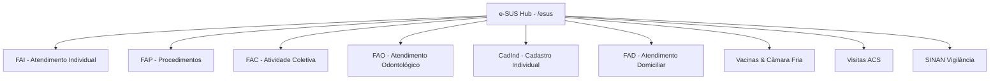

# Plano de Implementação: Fichas Complementares do e-SUS APS (Etapa 8)

## 1. Diagnóstico e Contexto
Na **Etapa 8** da refatoração da Prefeitura Web (`database/migrations/1761885935175_create_esus_vacinas_tables.ts`), foram implementados os módulos de:
- Imunobiológicos e Lotes de Câmara Fria;
- Registro Nominal de Vacinações (`vacinacoes_registro`);
- Cadastro Domiciliar Territorial (`esus_cadastros_domiciliares`);
- Visitas Domiciliares do ACS (`esus_visitas_domiciliares`);
- Notificações Compulsórias SINAN (`vigilancia_notificacoes`).

Conforme verificado na documentação técnica municipal, no gabarito `social_SMA`, nos scripts de conversão (`CONV_PFZ/Scripts/06_Atencao_Primaria_eSUS`), no controlador central Delphi `Shared.Esus.pas` e nos formulários legados (`UPM123`, `UPM090`, `UPM083`, `UPM092`, `UPM132`, `UPM152`, `UPM251`), faltavam as seguintes fichas fundamentais do e-SUS APS:

1. **Ficha de Atendimento Individual (FAI - etfFAI / 3)**: Atendimentos médicos e de enfermagem, classificação CIAP-2, diagnóstico CID-10, condições crônicas, exames solicitados/avaliados e condutas clínicas.
2. **Ficha de Procedimentos (FAP - etfFAP / 1)**: Procedimentos ambulatoriais, curativos, suturas, aferições, exames rápidos e procedimentos SIGTAP da Atenção Primária.
3. **Ficha de Atividade Coletiva (FAC - etfFAC / 5)**: Reuniões de equipe, reuniões intersetoriais, grupos de educação em saúde (hipertensos, diabéticos, gestantes, PSE nas escolas) e registro de participantes.
4. **Ficha de Atendimento Odontológico Individual (FAO - etfFAO / 4)**: Consultas de saúde bucal, primeira consulta programática, vigilância em saúde bucal e procedimentos odontológicos clínicos.
5. **Ficha de Cadastro Individual (CadInd - etfCadInd / 7)**: Cadastro individual no território da UBS com condições de saúde crônicas, dados sociodemográficos e fatores de risco.
6. **Ficha de Atendimento Domiciliar (FAD - etfFAD / 10)**: Atenção Domiciliar / Programa Melhor em Casa (EMAD/EMAP).
7. **Ficha de Marcadores de Consumo Alimentar (FAM - etfFAM / 8)**: Questionários alimentares e vigilância nutricional SISVAN.

---

## 2. Arquitetura da Solução

### Componentes a Implementar:
1. **Migration AdonisJS**: `database/migrations/1761885935176_create_esus_fichas_complementares_tables.ts`
2. **Models Lucid ORM**:
   - `app/models/esus_atendimento_individual.ts`
   - `app/models/esus_atendimento_procedimento.ts`
   - `app/models/esus_atividade_coletiva.ts`
   - `app/models/esus_atendimento_odontologico.ts`
   - `app/models/esus_cadastro_individual.ts`
   - `app/models/esus_atendimento_domiciliar.ts`
   - `app/models/esus_consumo_alimentar.ts`
3. **Validators VineJS**: `app/validators/esus_validator.ts`
4. **Service**: `app/services/esus_service.ts`
5. **Controller**: `app/controllers/esus_controller.ts`
6. **Rotas**: `start/routes.ts`
7. **Frontend Inertia (React + Tailwind + Lucide)**:
   - Atualização do painel central `inertia/pages/esus/index.tsx`
   - `inertia/pages/esus/fai.tsx`
   - `inertia/pages/esus/procedimentos.tsx`
   - `inertia/pages/esus/atividades_coletivas.tsx`
   - `inertia/pages/esus/odontologia.tsx`
   - `inertia/pages/esus/cadastros_individuais.tsx`
   - `inertia/pages/esus/domiciliar.tsx`

---

## 3. Plano de Verificação
1. Executar a migração via `node ace migration:run`.
2. Verificar integridade do schema do banco SQLite.
3. Executar checagem de tipos TypeScript (`npm run typecheck` ou `tsc --noEmit`).
4. Validar o carregamento dos componentes e endpoints no servidor.
