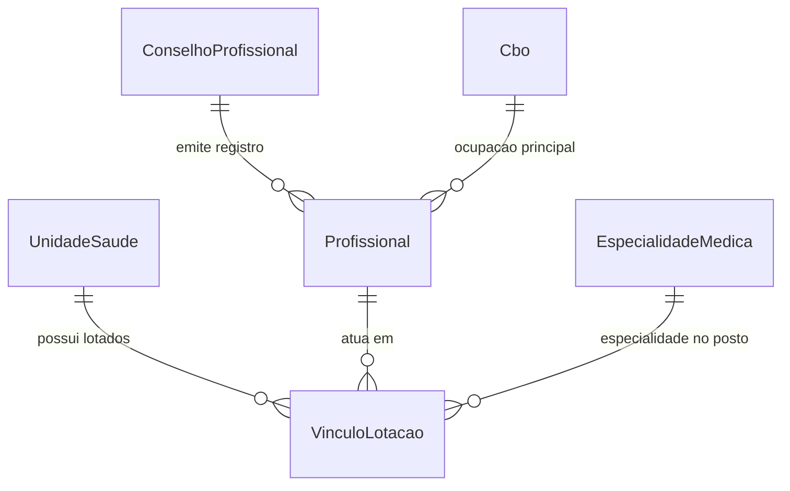

# Plano de Execução - Etapa 3: Domínio Profissionais, Especialidades (CBO) & Unidades de Saúde
## Com Conciliação Canônica do Dicionário de Dados `social_SMA`

## 1. Goal Description
O objetivo deste plano é **reconciliar e corrigir formalmente a nomenclatura das tabelas legadas do banco `social_SMA`** em todo o projeto de refatoração, com foco imediato na execução da **Etapa 3: Domínio Profissionais, Especialidades (CBO) & Unidades de Saúde**, contemplando **46 telas do executável Delphi original**.

Conforme apontado pelo usuário e confirmado na auditoria canônica do catálogo oficial [`04_dominio_profissionais_e_unidades.md`](file:///d:/Projetos/Delphi/Documentacao/IA/Antigravity%20-rodrigo/output/dicionario/04_dominio_profissionais_e_unidades.md):
- A tabela mestra de Profissionais e Operadores de Saúde no ecossistema Delphi é **`ARQ020`** (chave `codope`, sequenciador ARQ999 `CodOpe`, referenciada em **456 formulários Delphi**).
- A tabela mestra de Estabelecimentos e Unidades de Saúde é **`ARQ005`** / **`tb_Estabelecimento`** / **`PMD099`** (chave `codfor`/`CodUni`, campo obrigatório `cnes` com 7 dígitos do Datasus).
- A tabela de Especialidades Médicas é **`PMD006`** (chave `codesp`, referenciada em 123 formulários Delphi).
- A tabela de Conselhos de Classe (CRM, COREN, CRO, etc.) é **`PMD024`** (`codcon`, `sigcon`).
- As tabelas de Classificação Brasileira de Ocupações são **`tb_CBOUnificado`** (catálogo oficial CBO 2002) e **`tb_CBOUnificadoProfissional`** (vínculo profissional x ocupação).
- A tabela de lotação e permissão de acesso por unidade de atendimento é **`UnidadeUsuario`** (vinculando `ARQ020.codope` com `ARQ005.codfor`).

---

## 2. User Review Required

> [!IMPORTANT]
> **Auditoria Completa de Nomenclatura das Tabelas por Etapa (social_SMA)**:
> Abaixo está a conciliação completa de todas as tabelas do ecossistema municipal, corrigindo nomenclaturas que constavam simplificadas no planejamento preliminar:

| Etapa | Nome Preliminar | Tabela Canônica em `social_SMA` | Descrição & Rastreabilidade |
| :--- | :--- | :--- | :--- |
| **Etapa 1: Cidadãos** | `ARQ002` | **`PMD018`** | Tabela mestra ativa de Cidadãos (`numcid`), CPF, CNS, NIS e filiação |
| **Etapa 2: Território** | `ARQ004`, `ARQ005` | **`IMO001`**, **`IMO002`**, **`IMO004`**, **`tb_Municipio`** | Bairros (`IMO001`), Logradouros (`IMO002`), Imóveis (`IMO004`), Municípios (`tb_Municipio`) |
| **Etapa 3: Profissionais** | `PMD020` *(Incorreto)* | **`ARQ020`** ✅ | Tabela mestra de Profissionais e Operadores (`codope`, `numcon`, `cpf`, `cns`) |
| **Etapa 3: Unidades** | `tb_Unidade` *(Incorreto)*| **`ARQ005`** / **`tb_Estabelecimento`** ✅ | Unidades de Saúde e Estabelecimentos (campo `cnes` de 7 dígitos) |
| **Etapa 3: Especialidades**| `PMD021` *(Incorreto)*| **`PMD006`** ✅ | Catálogo de Especialidades Médicas (`codesp`, `nomesp`) |
| **Etapa 3: Conselhos** | *(Omitido)* | **`PMD024`** ✅ | Conselhos de Classe Profissional (CRM, COREN, CRO, CRF, CRESS) |
| **Etapa 3: CBO** | `tb_CBO` | **`tb_CBOUnificado`** e **`tb_CBOUnificadoProfissional`** ✅ | Catálogo oficial CBO 2002 e vínculo com profissional |
| **Etapa 3: Lotações** | `ARQ021` *(Incorreto)* | **`UnidadeUsuario`** ✅ | Vínculo e permissão de acesso do operador em cada unidade |
| **Etapa 4: Atendimento** | `FTD001` a `FTD008` | **`FTD001`**, **`FTD002`**, **`FTD005`**, **`FTD007`**, **`FTD008`** | FAA (Ficha de Atendimento Ambulatorial) e Receituário Eletrônico |
| **Etapa 5: Farmácia** | `PMD010` *(Legado)* | **`tb_CatMatMaterial`**, **`ARQ036`**, **`tb_BaixaLote`** | Padrão CatMat, movimentações (`ARQ036`) e baixas por lote FEFO (`tb_BaixaLote`) |
| **Etapa 6: Agendamento** | `PMD044` | **`PMD044`**, **`tb_AgendaExame`**, **`tb_AgendaExameExternoItem`** | Consultas (`PMD044`), Exames e Regulação de Cotas |
| **Etapa 7: Assistência** | `CAD001`, `SOC001` *(Leg.)*| **`tb_Familia`**, **`PMD083`**, **`PMD029`**, **`PMD030`** | Prontuário SUAS, Composição Familiar, PAIF e Benefícios Eventuais |
| **Etapa 8: e-SUS APS** | `tb_EsusFAP` | **`tb_EsusCadDom`**, **`tb_EsusCadInd`**, **`tb_EsusFAI`**, **`tb_EsusFAP`**, **`tb_EsusFichaVacinacao`** | Cadastros Domiciliares/Individuais, FAI, FAP e Sala de Vacina |
| **Etapa 9: Frota & RBAC** | `Frota`, `ARQ020` | **`tb_AgendaVeiculo`**, **`ARQ024`**, **`tb_EventoSistema`**, **`tb_LogCadastro`** | Veículos TFD, Classes RBAC e Auditoria Transacional |

---

## 3. Escopo da Etapa 3: Telas Delphi Contempladas (46 Telas)

O módulo substitui integralmente **46 telas e relatórios** do sistema original, incluindo:
- **Profissionais e Conselhos**: [UPM020.pas](file:///d:/Projetos/Delphi/Social/Prefeitura/Forms/UPM020.pas) (Pesquisa de Usuários/Profissionais), `UPM177.pas` (Dados da Unidade e do Profissional), `UPM059R.pas` (Horários do Profissional), `UPM589.pas` (Profissionais por Especialidade e Unidade).
- **Especialidades Médicas**: `UPM033.pas` (Cadastro de Especialidades), `UPM033R.pas` (Relação de Especialidades), `UPM034.pas` (Pesquisa de Especialidades), `UPM588.pas` (Especialidades por Unidade).
- **Unidades Básicas de Saúde (UBS / CAPS)**: `UPM356.pas` (Cadastro de Unidades Municipais), `UPM356R.pas` (Relação de Unidades), `UPM357.pas` (Pesquisa de Unidades), `UPM457.pas` (Unidades de Atendimento), `UPM630.pas` (Inclusão de Unidades), `UPM618.pas` (Relação de Unidades).
- **CBO (Ocupações do Ministério da Saúde)**: `UPM028.pas` (Pesquisa CBO), `UPM747.pas` (Pesquisa CBO), `UPM758.pas` (CBO por Profissional), `UPM763.pas` (Inclusão de Ocupações para o Profissional), `UPM770.pas` (Tabela CBO Unificada).
- **INE (Identificador Nacional de Equipes)**: `UPM089.pas` (Inclusão de Equipe INE por Profissional).

---

## 4. Arquitetura da Solução Web Moderna



### 4.1. Banco de Dados & Lucid ORM
1. **Migration**: `database/migrations/1761885935171_create_profissionais_unidades_tables.ts`
   - `unidades_saude`: id, cnes (7 dígitos), razao_social, nome_fantasia, tipo_unidade (`UBS`, `USF`, `UPA`, `CAPS`, `POLICLINICA`, `FARMACIA`), diretor_tecnico, telefone, email, endereco, bairro_id, horario_funcionamento, ativa (boolean).
   - `conselhos_profissionais`: id, sigla (`CRM`, `COREN`, `CRO`, `CRF`, `CRESS`, `CREFITO`, `CRP`), nome, uf.
   - `especialidades_medicas`: id, codigo, nome, descricao, registro_conselho.
   - `cbos`: id, codigo (6 dígitos), ocupacao, tipo.
   - `profissionais`: id, codope, nome, cpf, cns (15 dígitos), email, telefone, conselho_id, numero_conselho, cbo_id, status (`ativo`, `inativo`).
   - `vinculos_lotacoes`: id, profissional_id, unidade_saude_id, especialidade_id, carga_horaria, cargo, ativo.

2. **Models Lucid**:
   - `app/models/unidade_saude.ts`
   - `app/models/conselho_profissional.ts`
   - `app/models/especialidade_medica.ts`
   - `app/models/cbo.ts`
   - `app/models/profissional.ts`
   - `app/models/vinculo_lotacao.ts`

3. **Seeder Canônico**:
   - `database/seeders/profissionais_unidades_seeder.ts`:
     - 4 Unidades de Saúde municipais com CNES reais (UBS Central, USF Vila Esperança, CAPS II, UPA 24h).
     - Conselhos de Classe (CRM-SP, COREN-SP, CRO-SP, CRF-SP, CRESS-SP).
     - 12 Especialidades Médicas (Clínica Geral, Pediatria, Ginecologia/Obstetrícia, Cardiologia, Ortopedia, Odontologia, Psiquiatria, Enfermagem Geral, Assistência Social).
     - Catálogo de CBOs oficiais (2251-25 Clínico Geral, 2235-05 Enfermeiro, 2232-08 Cirurgião Dentista, 2516-05 Assistente Social, 5151-05 ACS).
     - 8 Profissionais com lotações e vínculos definidos.

### 4.2. Backend & Controllers
- **Validators VineJS**:
  - `app/validators/unidade_validator.ts`: Validação de CNES (7 dígitos), razão social, tipo de unidade e contatos.
  - `app/validators/profissional_validator.ts`: Validação de CPF, CNS (15 dígitos), número de conselho e vínculos.
- **Controllers**:
  - `app/controllers/unidades_controller.ts`: Listagem com filtros por tipo e status, detalhes da unidade com equipes lotadas, criação e edição.
  - `app/controllers/profissionais_controller.ts`: Listagem paginada, busca reativa com debounce, visualização de lotações, cadastro e vinculação de CBO e Conselho.
  - Endpoint de busca de profissionais para autocompletion: `GET /api/profissionais/search?q=...`.

### 4.3. Frontend React 19 + shadcn/ui
- `inertia/pages/unidades/index.tsx`:
  - Cards de métricas (Total de UBS, Leitos/Salas, CNES ativos).
  - Tabela responsiva com badges de tipo de unidade (`UBS`, `UPA`, `CAPS`).
  - Modal shadcn/ui de cadastro e edição de Unidades.
- `inertia/pages/profissionais/index.tsx`:
  - Tabela com foto/avatar, nome, registro no Conselho (ex: `CRM-SP 123456`), CBO principal e unidades de lotação.
  - Filtros por Especialidade e Unidade.
  - Modal de cadastro e vinculação de operadores.

---

## 5. Verification Plan

### Testes Automatizados & Checagens Estáticas:
```bash
# 1. Checagem de tipagem estática (TypeScript strict mode)
npm run typecheck

# 2. Compilação de assets de produção com Vite 6
npm run build

# 3. Teste das rotas no servidor local
curl -I http://localhost:3333/unidades
curl -I http://localhost:3333/profissionais
curl -I http://localhost:3333/api/profissionais/search?q=Dra
```

### Verificação Manual no Navegador:
- Acessar `http://localhost:3333/unidades`: Verificar se as 4 unidades com CNES aparecem listadas com seus tipos e responsáveis.
- Acessar `http://localhost:3333/profissionais`: Verificar a busca reativa de profissionais e conferência dos conselhos (CRM/COREN).
- Testar o modal de novo cadastro de profissional.

---

Por favor, revise o plano detalhado no painel e confirme a aprovação para iniciarmos imediatamente a codificação da **Etapa 3**.
