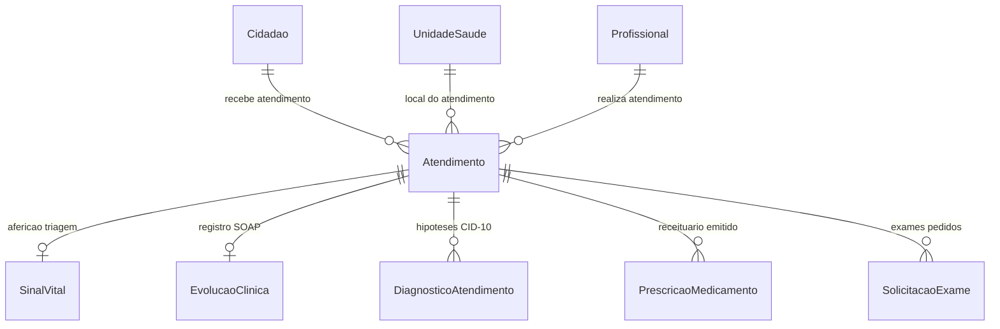

# Plano de Execução - Etapa 4: Domínio Atendimento Clínico, Recepção & Prontuário Eletrônico (PEP)
## Com Conciliação Canônica do Dicionário `social_SMA`

## 1. Goal Description
O objetivo da **Etapa 4** é implementar a modernização integral do fluxo ambulatorial e clínico municipal, abrangendo desde a **recepção e check-in do munícipe**, passando pelo **acolhimento com classificação de risco (Protocolo Manchester)**, até o **Prontuário Eletrônico do Paciente (PEP)** com anamnese estruturada (método SOAP), hipóteses diagnósticas (CID-10/CIAP-2), sinais vitais/antropometria e prescrição médica eletrônica.

Este módulo substitui e unifica **99 telas e relatórios do sistema Delphi original** ([`UPM045.pas`](file:///d:/Projetos/Delphi/Social/Prefeitura/Forms/UPM045.pas), [`UPM045R.pas`](file:///d:/Projetos/Delphi/Social/Prefeitura/Forms/UPM045R.pas), `UPM046.pas`, `UPM166.pas`, `UPM195.pas`, `UPM247.pas`, etc.) e se conecta de forma direta com:
- Os **Cidadãos** cadastrados na **Etapa 1** ([`Cidadao.ts`](file:///d:/Projetos/Delphi/refatoracao/prefeitura-web/app/models/cidadao.ts) / `PMD018`).
- As **Unidades de Saúde** e **Profissionais** cadastrados na **Etapa 3** ([`UnidadeSaude.ts`](file:///d:/Projetos/Delphi/refatoracao/prefeitura-web/app/models/unidade_saude.ts) / `ARQ005`, [`Profissional.ts`](file:///d:/Projetos/Delphi/refatoracao/prefeitura-web/app/models/profissional.ts) / `ARQ020`).

---

## 2. User Review Required

> [!IMPORTANT]
> **Mapeamento Canônico do Banco Gabarito `social_SMA` (25M+ Registros Clínicos)**:
> No banco gabarito `social_SMA`, as tabelas do motor clínico FAA (Ficha de Atendimento Ambulatorial) são:
> - **`FTD001`** (2,22M registros): Tabela mestre da FAA (`numate`, `datate`, `horate`, `numcid`, `codfor`, `codope`).
> - **`FTD005`** (2,52M registros): Sinais vitais e antropometria (`pa_sistolica`, `pa_diastolica`, `fc`, `temperatura`, `peso`, `altura`, `imc`, `glicemia`).
> - **`FTD008`** (2,34M registros): Anamnese, queixa principal, evolução clínica e conduta médica.
> - **`FTD007`** (1,11M registros): Hipóteses diagnósticas codificadas em CID-10.
> - **`FTD003`** (616k registros): Receituário e medicamentos prescritos.
> - **`FTD004`** (437k registros): Solicitações de exames laboratoriais e radiológicos.
> - **`tb_ClassificacaoTriagem`**: Classificação de risco e prioridades de Manchester.

---

## 3. Escopo Delphi Contemplado (99 Telas)

O módulo moderniza os seguintes grupos de telas do executável original:
- **Prontuário Eletrônico do Paciente**: `UPM045.pas`, `UPM045R.pas`, `UPM166.pas`, `UPM247.pas`, `UME001.pas`, `UME002.pas`.
- **Triagem e Acolhimento**: `UPM077.pas`, `UPM181.pas`, `UPM976.pas`.
- **Atendimento Ambulatorial & Procedimentos**: `UPM067.pas`, `UPM125.pas`, `UPM127.pas`, `UPM128.pas`, `UPM138.pas`, `UPM170.pas`, `UPM195.pas`.
- **Atendimentos Coletivos / Grupos**: `UPM046.pas`, `UPM048.pas`.
- **Histórico e Relatórios Clínicos**: `UPM004.pas`, `UPM014.pas`, `UPM240.pas`, `UPM243.pas`, `UPM246.pas`, `UPM284R.pas`.

---

## 4. Arquitetura da Solução Web Moderna



### 4.1. Banco de Dados & Lucid ORM
1. **Migration**: `database/migrations/1761885935172_create_atendimentos_pep_tables.ts`
   - `atendimentos` (`FTD001`): id, numero_atendimento (sequencial formatado FAA), cidadao_id, unidade_saude_id, profissional_id, status (`aguardando_triagem`, `aguardando_atendimento`, `em_atendimento`, `finalizado`, `cancelado`), tipo_atendimento (`ambulatorial`, `urgencia`, `retorno`, `demanda_espontanea`), prioridade_manchester (`vermelho`, `laranja`, `amarelo`, `verde`, `azul`), queixa_principal, data_hora_chegada, data_hora_atendimento, data_hora_finalizacao, timestamps.
   - `sinais_vitais` (`FTD005`): id, atendimento_id, pressao_arterial_sistolica, pressao_arterial_diastolica, frequencia_cardiaca, frequencia_respiratoria, temperatura, saturacao_o2, peso, altura, imc, glicemia_capilar, timestamps.
   - `evolucoes_clinicas` (`FTD008`): id, atendimento_id, profissional_id, subjetivo (queixa/anamnese), objetivo (exame físico), avaliacao (julgamento clínico), plano_conduta (encaminhamentos e orientações), timestamps.
   - `diagnosticos_atendimento` (`FTD007`): id, atendimento_id, cid10_codigo, cid10_descricao, tipo (`principal`, `secundario`), timestamps.
   - `prescricoes_medicamentos` (`FTD003`): id, atendimento_id, medicamento, dosagem, via_administracao, posologia, duracao, orientacoes, timestamps.
   - `solicitacoes_exames` (`FTD004`): id, atendimento_id, procedimento_exame, justificativa_clinica, urgente, timestamps.

2. **Models Lucid**:
   - `app/models/atendimento.ts`
   - `app/models/sinal_vital.ts`
   - `app/models/evolucao_clinica.ts`
   - `app/models/diagnostico_atendimento.ts`
   - `app/models/prescricao_medicamento.ts`
   - `app/models/solicitacao_exame.ts`

3. **Seeder Canônico**:
   - `database/seeders/atendimentos_pep_seeder.ts`:
     - Popula atendimentos em vários estados na fila (aguardando triagem, classificados em Manchester, e finalizados com prontuário completo).
     - Casos clínicos realistas (hipertensão descompensada, pneumonia infantil, dor abdominal aguda, consulta de pré-natal, renovação de receita).
     - Dados de sinais vitais, evolução SOAP, diagnósticos CID-10 e prescrições.

### 4.2. Backend & Controllers
- **Validators VineJS**:
  - `app/validators/atendimento_validator.ts`: Validação de check-in na recepção e dados de triagem/sinais vitais.
  - `app/validators/pep_validator.ts`: Validação de evolução clínica SOAP, diagnósticos e itens de prescrição.
- **Controllers**:
  - `app/controllers/atendimentos_controller.ts`:
    - `index`: Fila de Atendimento visual com ordenação pela prioridade Manchester e tempo de espera.
    - `checkin`: Recepção do paciente e entrada na fila de espera.
    - `triagem`: Acolhimento, aferição de sinais vitais e definição de cor de risco.
    - `chamar`: Chamada do paciente no painel de atendimento.
  - `app/controllers/pep_controller.ts`:
    - `show`: Tela completa do PEP para o médico/enfermeiro, com histórico de atendimentos anteriores do cidadão, sinais vitais atuais e formulário de evolução SOAP.
    - `salvarConsulta`: Gravação transacional da evolução, hipóteses diagnósticas CID-10, prescrição de medicamentos e pedidos de exames.
    - `apiSearchCid`: Endpoint `GET /api/cid10/search?q=...` com autocompletion dos principais códigos de CID-10 e cache Redis.

### 4.3. Frontend React 19 + shadcn/ui
1. `inertia/pages/atendimentos/index.tsx` (**Fila de Atendimento Manchester**):
   - Cards com contadores de pacientes por nível de prioridade (Vermelho - Emergência, Laranja - Muito Urgente, Amarelo - Urgente, Verde - Pouco Urgente, Azul - Não Urgente).
   - Tabela em tempo real com tempo de espera decorrido, foto/nome do munícipe, unidade e botão de ação ("Iniciar Triagem" ou "Atender no PEP").
   - Modal de Recepção / Novo Acolhimento para inclusão instantânea de paciente na fila.
2. `inertia/pages/atendimentos/triagem.tsx` (**Acolhimento & Classificação de Risco**):
   - Aferição de sinais vitais (PA, FC, Temp, SatO2, Glicemia).
   - Antropometria com cálculo automático de IMC e classificação nutricional.
   - Seletor visual do Protocolo de Manchester com discriminadores clínicos.
3. `inertia/pages/atendimentos/pep.tsx` (**Prontuário Eletrônico do Paciente**):
   - **Cabeçalho Clínico**: Dados do cidadão, idade, alergias, cartão SUS, sinais vitais aferidos na triagem e cor Manchester.
   - **Histórico Pregresso**: Linha do tempo de consultas, vacinas e receitas anteriores.
   - **Evolução SOAP**:
     - *Subjetivo*: Queixa principal, história da moléstia atual (HDA).
     - *Objetivo*: Exame físico direcionado.
     - *Avaliação*: Hipótese diagnóstica com busca reativa de CID-10.
     - *Plano*: Conduta terapêutica, orientações e atestados.
   - **Prescrição Eletrônica**: Grade dinâmica de inclusão de medicamentos, dosagens e horários.
   - **Solicitação de Exames**: Grade de exames laboratoriais e imagem.

---

## 5. Verification Plan

### Testes Automatizados & Checagens Estáticas:
```bash
# 1. Execução da migration e seeders
node ace migration:run
node ace db:seed

# 2. Checagem de tipagem estática (TypeScript strict mode)
npm run typecheck

# 3. Compilação de assets de produção com Vite 6
npm run build

# 4. Teste de rotas HTTP
curl -I http://localhost:3333/atendimentos
curl -I http://localhost:3333/api/cid10/search?q=hipertensao
```

### Verificação Manual no Navegador:
- Acessar `http://localhost:3333/atendimentos`: Validar a visualização da fila com as cores de Manchester.
- Realizar o check-in de um novo paciente na recepção.
- Realizar a triagem com preenchimento de sinais vitais e cálculo de IMC.
- Abrir o atendimento no Prontuário Eletrônico (PEP) e salvar uma consulta completa com método SOAP e prescrição médica.

---

Por favor, revise o plano de execução no painel e aprove para iniciarmos imediatamente a codificação da **Etapa 4**.
