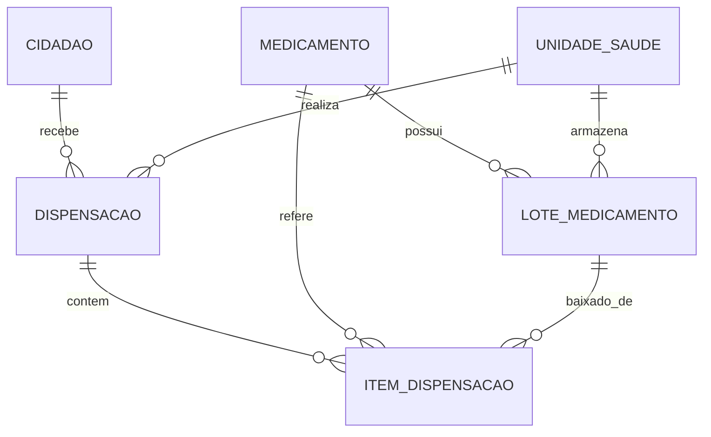

# Plano de Execução Técnica: Etapa 5 - Farmácia Municipal & Dispensação FEFO

## 1. Escopo & Contexto
Modernização completa do módulo de almoxarifado farmacêutico, controle de lotes, rastreamento de validade e balcão de dispensação com conferência automática pelo critério **FEFO** (*First Expire, First Out*), integrando a prescrição gerada no PEP (Etapa 4) ou receitas externas avulsas.

- **Telas Delphi contempladas**: **83 telas** (centradas em `UPM271.pas` - Entrega de Medicamentos, `UPM266.pas` - Cadastro de Medicamentos, `UPM049.pas` - Receita Avulsa, `UPM908.pas` - Lote e Validade, `UPM980.pas` - Estoque Mínimo).
- **Tabelas Canônicas `social_SMA`**: `ARQ036` (Estoque/Movimentação), `tb_CatMatMaterial` (CatMat), `tb_SaldoLote` / `tb_LoteInventario` / `tb_BaixaLote` (Lotes e saldos), `tb_PosologiaMedicamento`, `Ftd007` (Receitas/Autorizações), `Ftd008` (Itens de dispensação).

---

## 2. Modelagem do Banco de Dados (Lucid ORM)

### Tabelas a serem criadas na Migration:
1. `medicamentos` (ARQ027 / ARQ036 / tb_CatMatMaterial):
   - Código municipal, código CatMat BR, nome comercial, princípio ativo, concentração, forma farmacêutica, via, grupo terapêutico, tipo de controle (comum, controlado, alto custo), estoque mínimo, estoque ideal, código de barras EAN.
2. `lotes_medicamentos` (tb_SaldoLote / tb_LoteInventario / tb_BaixaLote):
   - Medicamento FK, Unidade de Saúde FK, número do lote, fabricante, data de fabricação, **data de validade** (chave do FEFO), quantidade inicial, quantidade atual (saldo), preço unitário, status (ativo, quarentena, vencido, esgotado).
3. `dispensacoes` (Ftd007 / tb_Dispensacao):
   - Número (DISP-2026-XXXX), Cidadão FK, Unidade FK, Profissional Prescritor FK, Atendimento FK (opcional), número da receita, validade da receita, tipo de dispensação, status, data/hora.
4. `itens_dispensacao` (Ftd008 / tb_BaixaLote):
   - Dispensação FK, Medicamento FK, Lote FK (de onde saiu pelo FEFO), quantidade prescrita, quantidade dispensada, posologia, orientações.

---

## 3. Algoritmo de Baixa Atômica FEFO (*First Expire, First Out*)
Quando uma quantidade $Q$ de um medicamento é dispensada em uma unidade $U$:
1. A transação busca os lotes com saldo $> 0$ na unidade $U$, ordenados rigorosamente por `data_validade ASC`.
2. O sistema consome primeiro o lote mais próximo do vencimento até esgotar seu saldo ou satisfazer $Q$.
3. Se a quantidade necessária exceder o lote mais antigo, o saldo é abatido do lote seguinte, gerando itens de rastreabilidade para cada lote afetado.
4. Toda a operação é executada sob uma transação SQL atômica (`db.transaction()`), garantindo que não ocorra concorrência de estoque.

---

## 4. Telas Modernas em React 19 + Inertia
1. **Painel Farmacêutico** (`/farmacia`):
   - KPIs: Total de itens em estoque, lotes com vencimento em < 30 dias (alerta vermelho), < 90 dias (alerta amarelo) e medicamentos abaixo do estoque mínimo.
   - Gráfico de dispensações e atalhos rápidos.
2. **Balcão de Dispensação** (`/farmacia/dispensacao`):
   - Identificação do munícipe (CPF / CNS / Nome).
   - Localização automática de prescrições ativas geradas no PEP ou lançamento de receita externa avulsa.
   - Sugestão automática do lote FEFO ideal para cada item.
   - Confirmação de entrega e impressão de comprovante para o cidadão.
3. **Catálogo de Medicamentos & Gestão de Lotes** (`/farmacia/medicamentos`):
   - Listagem com busca reativa (Redis cache), código CatMat, grupo terapêutico e saldos por lote.
   - Modal para cadastro de novo medicamento e entrada de lotes (remessa/nota fiscal).
