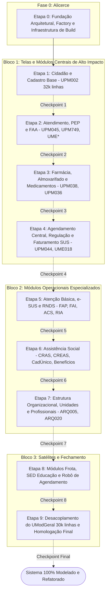

# Plano Mestre de Modelagem e Refatoração Arquitetural do Ecossistema Delphi (`Social`)

## Goal Description
O objetivo deste plano é executar a **modernização, modelagem orientada a objetos e refatoração arquitetural de 100% do projeto Delphi** (solução [Social.groupproj](file:///d:/Projetos/Delphi/Social/Social.groupproj)), transformando o legado monolítico e fortemente acoplado em uma arquitetura limpa e sustentável baseada em **MVC / MVP**, utilizando integralmente a **stack tecnológica já instalada** no ambiente.

A refatoração segue a estratégia do **Padrão Estrangulador (*Strangler Fig Pattern*)**, iniciando pelas **telas e fluxos principais** com maior impacto operacional e volumetria, garantindo que o sistema continue compilando e operando perfeitamente a cada incremento.

> [!IMPORTANT]
> **Regra de Governança Estrita (Human-in-the-Loop)**:
> O plano é estritamente faseado em **etapas sequenciais**. Para cada etapa finalizada, a execução **será pausada** para apresentação dos artefatos produzidos, testes de compilação e validação do usuário, **aguardando comando explícito para iniciar a próxima etapa**.

---

## Stack Tecnológica Instalada e Padrões Adotados

A refatoração utilizará estritamente as bibliotecas, ferramentas e padrões já consolidados no repositório:

1. **Compilador e IDE**:
   - **Embarcadero Delphi 10.4 Sydney / 21.0** (RAD Studio - [DCC32.EXE](file:///C:/Program%20Files%20(x86)/Embarcadero/Studio/21.0/bin/DCC32.EXE)).
   - Suporte nativo a Generics (`TCadastro<T>`), Métodos Anônimos, RTTI Avançada e Interfaces COM/CORBA.
2. **Frameworks Instalados em `d:\Projetos\Delphi\Frameworks`**:
   - **Neon** (`Neon.Core.Attributes`): Serialização/desserialização JSON de objetos e DTOs de domínio.
   - **dataset-serialize**: Serialização bidirecional de DataSets para JSON / APIs.
   - **RestRequest4Delphi**: Comunicação REST desacoplada para microserviços e integrações nacionais (e-SUS / RNDS).
   - **SynPDF**: Geração de documentos e relatórios médicos em PDF desacoplados de impressoras VCL.
   - **LeakCheck**: Auditoria estática e dinâmica de vazamentos de memória (`ReportMemoryLeaksOnShutdown`).
3. **Padrão Arquitetural Alvo**:
   - **View**: Telas (`TForm`) e Frames (`TFrame`) desacoplados de queries SQL diretas. Consomem apenas Controllers via Interfaces.
   - **Controller**: Classes herdando de `TController`, implementando `I...Controller`, orquestrando regras de negócio e validações.
   - **Model**: Entidades puras fortemente tipadas (`TCidadao`, `TPaciente`, `TAtendimentoSaude`) com Generics e atributos Neon.
   - **DAO / SQL**: Desacoplamento das queries inline em classes de SQL especializadas ([Saude.Model.SQL.pas](file:///d:/Projetos/Delphi/Social/Shared/model/saude/Saude.Model.SQL.pas) e DAOs com `conFabrica`).
4. **Governança de Codificação**:
   - Arquivos Delphi (`.pas`, `.dfm`): Codificação **Windows-1252 (ANSI)** sem BOM e quebras de linha em **CRLF**.
   - Scripts e Documentações: **UTF-8 sem BOM**.

---

## User Review Required

> [!WARNING]
> **Coexistência de Telas Legadas e Modernas**:
> Os formulários monolíticos centrais (como [UPM002.pas](file:///d:/Projetos/Delphi/Social/Prefeitura/Forms/UPM002.pas) com **32.436 linhas**) não serão reescritos de uma só vez em um "Big Bang". 
> Eles serão desacoplados em **TFrames especializados** por aba funcional (Identificação, Endereço, Documentos, Biometria, Família/Social, Histórico Clínico), ligando cada frame ao seu respectivo `Controller` e `Model`, mantendo a interface visual intacta para o operador final.

> [!CAUTION]
> **Desacoplamento do DataModule Central (`UModGeral`)**:
> [UModGeral.dfm](file:///d:/Projetos/Delphi/Social/Prefeitura/DataModulos/UModGeral.dfm) possui **30.393 linhas** e dezenas de `TADODataSet` compartilhados globalmente. As queries serão migradas progressivamente para DAOs/SQL Models das etapas correspondentes. O `UModGeral` só terá datasets removidos quando 100% dos formulários consumidores estiverem desacoplados.

---

## Open Questions

1. **Estratégia de Acesso a Dados**: Deseja manter o encapsulamento via **ADO** (`TADOConnection` / `TADOQuery`) envelopado pelos DAOs ou prefere que novos DAOs já utilizem componentes de conexão **FireDAC** (`TFDConnection` / `TFDQuery`)?
2. **Formato das Views Modernizadas**: Prefere manter os formulários existentes em `Prefeitura\Forms` refatorados internamente via `TFrames`, ou prefere criar novas telas completas na pasta `Prefeitura\view` com abertura condicional/chave de feature?

---

## Proposed Changes: Roadmap de Refatoração em 10 Etapas



---

### Detalhamento das Etapas de Execução

---

### Etapa 0: Fundação Arquitetural, Factory e Infraestrutura de Build
**Objetivo**: Estabelecer a esteira técnica e as abstrações fundamentais que sustentarão toda a refatoração sem quebrar compilações.

- **Ações Técnicas**:
  1. Revisão e padronização da Factory [conFabrica](file:///d:/Projetos/Delphi/Social/Shared/model/Shared.Model.Fabrica.pas) e das interfaces base: `IModel`, `IController`, `IDAO`, `ISistema`.
  2. Implementação do script mestre de compilação contínua [compilar_projeto_delphi.ps1](file:///d:/Projetos/Delphi/Documentacao/IA/Antigravity%20-rodrigo/scripts/) utilizando `rsvars.bat` e `MSBuild.exe` para validar a compilação de todos os 10 projetos do `Social.groupproj` em segundos.
  3. Criação de classes utilitárias de validação desacopladas (Validador de CPF com DV, CNS com algoritmo nacional, CBO, P.A. Média e CNES).
- **Entregáveis**:
  - `Shared\controller\Shared.Controller.Validadores.pas`
  - `Shared\model\Shared.Model.Interfaces.pas` atualizado
  - Script de validação de compilação automatizada
- **Checkpoint de Parada**: Execução do script de compilação limpa (0 erros) em toda a solução. **Aguardar comando do usuário**.

---

### Etapa 1: Telas Principais — Cidadão e Cadastro Base
**Objetivo**: Refatorar o coração do sistema: o cadastro unificado de cidadãos e pacientes.

- **Telas Principais**:
  - [Prefeitura\Forms\UPM002.pas](file:///d:/Projetos/Delphi/Social/Prefeitura/Forms/UPM002.pas) (**32.436 linhas** — `TPM002` Cadastro Central do Cidadão).
  - [Prefeitura\Forms\UJuncaoPessoa.pas](file:///d:/Projetos/Delphi/Social/Prefeitura/Forms/UJuncaoPessoa.pas) (Unificação de homônimos e duplicidades).
  - [Prefeitura\Forms\UPesquisaJuncao.pas](file:///d:/Projetos/Delphi/Social/Prefeitura/Forms/UPesquisaJuncao.pas).
- **Tabelas do Banco Gabarito**:
  - `PMD018` (104.951 cidadãos), `tb_TelefonesCidadao`, `tb_DocumentoCidadao`, `tb_CartaoSus`, `tb_AnexoCidadao`, `tb_CidadaoBiometria`.
- **Ações de Modelagem e Refatoração**:
  1. **Model**: Expandir [Saude.Model.Cidadao.pas](file:///d:/Projetos/Delphi/Social/Shared/model/saude/Saude.Model.Cidadao.pas) e [Saude.Model.Paciente.pas](file:///d:/Projetos/Delphi/Social/Shared/model/saude/Saude.Model.Paciente.pas) cobrindo todos os campos físicos de `PMD018` e tabelas satélites com propriedades tipadas e atributos Neon.
  2. **Controller**: Expandir [Saude.Controller.Cidadao.pas](file:///d:/Projetos/Delphi/Social/Shared/controller/saude/Saude.Controller.Cidadao.pas) com métodos de negócio: `Salvar`, `ValidarDocumentos`, `GerarCodigoBarras` (`fn_PadLeft`), `ConsultarPorCpfOuCns`, `UnificarCadastros`.
  3. **Sequenciamento**: Encapsular a obtenção de `NumCid` via `ARQ999` dentro do controller.
  4. **View**: Fatiar o monolito `UPM002` extraindo abas complexas para `TFrames` desacoplados (`FrameCidadaoIdentificacao`, `FrameCidadaoEndereco`, `FrameCidadaoDocumentos`, `FrameCidadaoSocial`).
- **Checkpoint de Parada**: Compilação sem erros, testes de CRUD de cidadão e unificação. **Aguardar comando do usuário**.

---

### Etapa 2: Telas Principais — Atendimento, Prontuário Eletrônico (PEP) e FAA
**Objetivo**: Refatorar o fluxo clínico de maior volumetria (mais de 13 milhões de registros somados).

- **Telas Principais**:
  - [Prefeitura\Forms\UPM045.pas](file:///d:/Projetos/Delphi/Social/Prefeitura/Forms/UPM045.pas) (Prontuário Médico / FAA).
  - [Prefeitura\Forms\UPM749.pas](file:///d:/Projetos/Delphi/Social/Prefeitura/Forms/UPM749.pas) (**388 KB** — Inclusão de Procedimentos Ambulatoriais).
  - [Prefeitura\Forms\UPM976.pas](file:///d:/Projetos/Delphi/Social/Prefeitura/Forms/UPM976.pas) (Triagem e Acolhimento).
  - Módulo PEP: `ProntuarioEletronico\Forms\UME000.pas` a `UME018.pas` (Anamnese, Evolução, Prescrição, Odontograma, Sistematização de Enfermagem SAE).
- **Tabelas do Banco Gabarito**:
  - `FTD001` (2,22M FAA), `FTD002` (2,18M detalhes médicos), `FTD005` (2,52M serviços), `FTD008` (2,34M itens), `PMD016` (1,64M atendimentos), `tb_LancamentoProcedimento` (3,6M), `tb_ItensLancamentoProcedimento` (5,75M).
- **Ações de Modelagem e Refatoração**:
  1. **Model**: Enriquecer [Saude.Model.Atendimento.pas](file:///d:/Projetos/Delphi/Social/Shared/model/saude/Saude.Model.Atendimento.pas) e models de Procedimento (`Saude.Model.Procedimento.pas`).
  2. **Controller**: Refatorar [Saude.Controller.Atendimento.pas](file:///d:/Projetos/Delphi/Social/Shared/controller/saude/Saude.Controller.Atendimento.pas) e `Saude.Controller.Procedimento.pas` para gerenciar o ciclo de vida completo do atendimento (Acolhimento -> Triagem com classificação de risco -> Consulta Médica -> Faturamento SIA/SUS).
  3. **Sequenciamento**: Governança de `NumAte` em `FTD001` e `SeqAge` em `PMD016`.
  4. **View**: Desacoplar `UPM749` e as telas `UME*` de queries diretas no banco, consumindo o atendimento via `IAtendimentoController`.
- **Checkpoint de Parada**: Compilação sem erros, simulação de atendimento completo e auditoria de memória. **Aguardar comando do usuário**.

---

### Etapa 3: Telas Principais — Farmácia, Almoxarifado e Medicamentos
**Objetivo**: Modelar e refatorar a dispensação, rastreabilidade de lotes, controle de psicotrópicos e estoques.

- **Telas Principais**:
  - [Prefeitura\Forms\UPM038.pas](file:///d:/Projetos/Delphi/Social/Prefeitura/Forms/UPM038.pas) (Dispensação de Medicamentos).
  - [Prefeitura\Forms\UPM036.pas](file:///d:/Projetos/Delphi/Social/Prefeitura/Forms/UPM036.pas) (Pesquisa de Medicamentos / Estoque).
  - Telas de requisições, perdas, devoluções e livros de psicotrópicos (Portaria SVS/MS nº 344/98).
- **Tabelas do Banco Gabarito**:
  - `ARQ036` (2,55M movimentações), `tb_SaldoLote`, `tb_BaixaLote` (1,44M), `tb_RequisicaoEstoqueLote`, `tb_Psicotropico`, `CatMat`.
- **Ações de Modelagem e Refatoração**:
  1. **Model**: Criação do pacote `Shared\model\saude\farmacia`:
     - `Farmacia.Model.Dispensacao.pas`, `Farmacia.Model.Lote.pas`, `Farmacia.Model.Psicotropico.pas`.
  2. **Controller**: Criação do pacote `Shared\controller\saude\farmacia`:
     - `Farmacia.Controller.Dispensacao.pas` (regras de bloqueio por validade, limite de dispensação por período, baixa atômica de saldo e controle de receita azul/branca).
  3. **Sequenciamento**: Controle de `SeqReg` em `ARQ036` via `ARQ999`.
  4. **View**: Refatorar `UPM038` eliminando queries SQL inline de baixa de estoque.
- **Checkpoint de Parada**: Compilação sem erros, testes de validação de lote e dispensação. **Aguardar comando do usuário**.

---

### Etapa 4: Telas Principais — Agendamento Central, Regulação e Faturamento SUS
**Objetivo**: Refatorar a marcação de consultas/exames, cotas de vagas, regulação municipal e geração de faturamento BPA/APAC.

- **Telas Principais**:
  - [Prefeitura\Forms\UPM044.pas](file:///d:/Projetos/Delphi/Social/Prefeitura/Forms/UPM044.pas) (Agendamento Central de Consultas e Exames).
  - [ProntuarioEletronico\Forms\UME018.pas](file:///d:/Projetos/Delphi/Social/ProntuarioEletronico/Forms/UME018.pas) (Guias de Especialidades e Encaminhamentos).
  - Módulos de faturamento SUS (BPA Magnético, APAC e RAAS).
- **Tabelas do Banco Gabarito**:
  - `PMD044` (2,07M agendamentos), `tb_GuiaEspecialidade`, `tb_AgendaExameExternoItem` (1,15M), `tb_LiberaAgendaUnidade`, `tb_StatusGuia`.
- **Ações de Modelagem e Refatoração**:
  1. **Model**: Criação de `Agendamento.Model.Agenda.pas`, `Agendamento.Model.Guia.pas`, `Faturamento.Model.Bpa.pas`.
  2. **Controller**: `Agendamento.Controller.Agenda.pas` (verificação de concorrência de horário, trava de cotas por unidade/especialidade e confirmação biométrica).
  3. **Sequenciamento**: Controle de `NovAge` em `PMD044` via `ARQ999`.
- **Checkpoint de Parada**: Compilação sem erros, testes de agendamento concorrente e exportação de remessa. **Aguardar comando do usuário**.

---

### Etapa 5: Atenção Básica, e-SUS e Integração RNDS
**Objetivo**: Refatorar o ecossistema de dados da Atenção Primária em conformidade com as regras federais do Ministério da Saúde.

- **Telas Principais**:
  - Telas e-SUS do PEP (`UME003` a `UME017`).
  - Telas RNDS: [Prefeitura.View.Form.Rnds.RIA.pas](file:///d:/Projetos/Delphi/Social/Prefeitura/view/Prefeitura.View.Form.Rnds.RIA.pas) e `Prefeitura.View.Form.Rnds.Redfm.pas`.
  - [wsACS](file:///d:/Projetos/Delphi/Social/wsACS) (Módulo de importação de dados dos tablets dos Agentes Comunitários de Saúde).
- **Tabelas do Banco Gabarito**:
  - `tb_EsusFAPConsolidado` (4,1M), `LogCadInd` (2,16M), `tb_RndsLog` (220k), `tb_EsusFAIPaciente` (715k), `tb_EsusFAP` (1,02M).
- **Ações de Modelagem e Refatoração**:
  1. **Model**: Fortalecimento dos models em `Shared\model\saude\esus`:
     - `Saude.Model.Ficha.Esus.Fap.pas`, `Saude.Model.Ficha.Esus.Fai.pas`, `Saude.Model.Rnds.pas`.
  2. **Controller**: Desacoplamento da geração dos payloads Thrift/XML e envio assíncrono para o PEC / e-SUS e barramento RNDS.
  3. **Auditoria**: Padronização dos registros em `tb_RndsLog` e logs de importação.
- **Checkpoint de Parada**: Compilação sem erros e validação de geração de lote e-SUS. **Aguardar comando do usuário**.

---

### Etapa 6: Assistência Social (CRAS, CREAS e CadÚnico)
**Objetivo**: Modelar e refatorar a gestão de famílias, vulnerabilidades, benefícios eventuais e prontuário socioassistencial.

- **Telas Principais**:
  - `Prefeitura\Forms\UPM029.pas` (Ordens de Benefício Social), `UPM030.pas` (Itens de Benefício).
  - `Prefeitura\Forms\UPM116.pas` (Projetos Sociais), `UPM050`, `UPM054`, `UPM075`, `UPM097`.
  - `Prefeitura\view\AssistenciaSocial\*` (Views MVC do SUAS).
- **Tabelas do Banco Gabarito**:
  - `tb_Familia` (19.642 famílias), `PMD083` (parentescos), `PMD029` (87k benefícios), `PMD030` (96k itens), `tb_DespesaFamilia`, `tb_ReceitaFamilia`, `tb_VisitasDomiciliares`, `tb_Curso`.
- **Ações de Modelagem e Refatoração**:
  1. **Model**: Integrar os models de [Prefeitura\model\AssistenciaSocial](file:///d:/Projetos/Delphi/Social/Prefeitura/model/AssistenciaSocial) com o padrão unificado em `Shared`:
     - `Assistencia.Model.Familia.pas`, `Assistencia.Model.Beneficio.pas`, `Assistencia.Model.AvaliacaoSocial.pas`.
  2. **Controller**: Refatorar [Prefeitura\controller\AssistenciaSocial](file:///d:/Projetos/Delphi/Social/Prefeitura/controller/AssistenciaSocial) com cálculo automático de Renda Familiar Per Capita, regras de concessão de cesta básica/auxílios e frequência no PAIF/SCFV.
- **Checkpoint de Parada**: Compilação sem erros, testes de concessão de benefícios e cálculo per capita. **Aguardar comando do usuário**.

---

### Etapa 7: Estrutura Organizacional, Unidades e Profissionais
**Objetivo**: Modelar e refatorar o controle de estabelecimentos de saúde/sociais, vínculos profissionais, especialidades e permissões.

- **Telas Principais**:
  - `Prefeitura\Forms\UPM020.pas` (Operadores e Usuários do Sistema).
  - `Prefeitura\Forms\UPM024.pas` (Profissionais e Médicos).
  - Telas de unidades ([ARQ005](file:///d:/Projetos/Delphi/Documentacao/IA/Antigravity%20-rodrigo/output/dicionario/04_dominio_profissionais_e_unidades.md)) e matriz de acessos (`ACESSOSISTEMAS`).
- **Tabelas do Banco Gabarito**:
  - `ARQ005` (548 unidades), `ARQ020` (1.409 operadores/profissionais), `ARQ023` (grupos), `ARQ024` (vínculos Unidade x Profissional x Especialidade x CBO).
- **Ações de Modelagem e Refatoração**:
  1. **Model**: `Saude.Model.Profissional.pas`, `Saude.Model.Unidade.pas`, `Saude.Model.Acesso.pas`.
  2. **Controller**: `Saude.Controller.Profissional.pas`, `Saude.Controller.Unidade.pas`, com controle seguro de senhas com hash e validação de permissão granular em tempo de execução.
  3. **Sequenciamento**: Controle de `CodOpe` via `ARQ999`.
- **Checkpoint de Parada**: Compilação sem erros, testes de controle de acesso e vínculos de especialidades. **Aguardar comando do usuário**.

---

### Etapa 8: Módulos Satélites — Frota, SED (Educação) e Integrações
**Objetivo**: Refatorar os subsistemas satélites independentes da solução `Social.groupproj`.

- **Subprojetos Envolvidos**:
  - [Social\Frota\Frota.dproj](file:///d:/Projetos/Delphi/Social/Frota/Frota.dproj) (374 arquivos — gestão de veículos, motoristas, abastecimentos, rotas e manutenções).
  - [Social\SED\SED.dproj](file:///d:/Projetos/Delphi/Social/SED/SED.dproj) (Gestão escolar municipal: escolas, turmas, matrículas, alunos).
  - [Social\RoboAgendamento\src\RoboAgendamento.dproj](file:///d:/Projetos/Delphi/Social/RoboAgendamento/src/RoboAgendamento.dproj) (Serviço autônomo de envio de notificações/SMS).
  - [Social\IntegraFaturamento\IntegraFaturamento.dproj](file:///d:/Projetos/Delphi/Social/IntegraFaturamento/IntegraFaturamento.dproj).
  - [Social\Atualizador\Atualizador.dproj](file:///d:/Projetos/Delphi/Social/Atualizador/Atualizador.dproj) e [UpdateSocial.dproj](file:///d:/Projetos/Delphi/Social/UpdateSocial/UpdateSocial.dproj).
- **Ações de Modelagem e Refatoração**:
  1. Padronizar as camadas `controller` e `model` existentes nesses subprojetos para reutilizar as interfaces e padrões de `Shared`.
  2. Desacoplar o DataModule `UFrotaModulo` e `USedModulo`.
- **Checkpoint de Parada**: Compilação sem erros dos 5 executáveis satélites. **Aguardar comando do usuário**.

---

### Etapa 9: Desacoplamento dos Data Modules Monolíticos e Homologação Final
**Objetivo**: Concluir a refatoração extinguindo as dependências espaguete do `UModGeral` e garantindo integridade arquitetural total.

- **Ações Técnicas**:
  1. **Refatoração Cirúrgica de `UModGeral.dfm`** (30.393 linhas):
     - Mapear e migrar os últimos datasets globais para DAOs especializados das etapas 1 a 8.
     - Reduzir o `UModGeral` apenas a funções estritamente globais de infraestrutura ou encapsulá-lo como um Service Provider.
  2. **Auditoria de Vazamentos de Memória**:
     - Executar suíte de validação com `LeakCheck` / `FastMM` garantindo que todas as novas classes, interfaces e controllers liberem memória corretamente (`0 bytes leaked`).
  3. **Validação de Banco de Dados**:
     - Executar verificação com o script [validar_integridade_fks.ps1](file:///d:/Projetos/Delphi/.agents/skills/social-database-migration/scripts/validar_integridade_fks.ps1) e [recalibrar_arq999.ps1](file:///d:/Projetos/Delphi/.agents/skills/social-database-migration/scripts/recalibrar_arq999.ps1) no banco `social_SMA`.
- **Checkpoint Final**: Homologação completa com o usuário e entrega do projeto 100% modernizado.

---

## Verification Plan

### Automated Tests
1. **Compilação Contínua da Solução (0 Erros)**:
   ```powershell
   cmd.exe /c "call ""C:\Program Files (x86)\Embarcadero\Studio\21.0\bin\rsvars.bat"" && msbuild ""d:\Projetos\Delphi\Social\Social.groupproj"" /t:Build /p:Configuration=Debug"
   ```
2. **Validação Estática e Formatação**:
   - Verificação de encoding Windows-1252 (ANSI) e quebras CRLF em todos os `.pas` e `.dfm` modificados.
3. **Auditoria de Sequenciadores ARQ999**:
   ```powershell
   powershell -NoProfile -ExecutionPolicy Bypass -File "d:\Projetos\Delphi\.agents\skills\social-database-migration\scripts\recalibrar_arq999.ps1"
   ```

### Manual Verification
1. **Inspeção de Telas Refatoradas**:
   - Abertura e teste interativo da tela principal de cada etapa (ex: `UPM002` na Etapa 1, `UPM045`/`UPM749` na Etapa 2, `UPM038` na Etapa 3).
   - Teste de fluxo de inclusão, alteração, pesquisa e impressão para garantir fidelidade visual e funcional para o usuário final.
2. **Aprovação Formal por Etapa**:
   - O usuário revisa o diff e os testes executados, concedendo autorização formal antes do avanço para a etapa seguinte.
