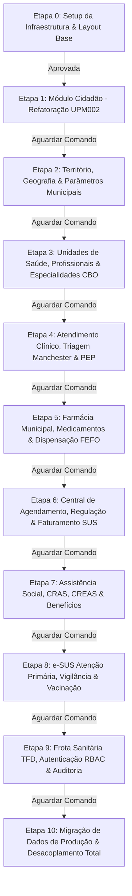

# Plano Mestre de Refatoração Integral: Projeto Prefeitura (100% de Cobertura)

## 1. Goal Description
O objetivo deste plano é estabelecer a **arquitetura, o roadmap e a execução exaustiva da refatoração de 100% do projeto `Prefeitura`** do ecossistema Delphi para a **Stack Web Oficial** padronizada em `C:\Users\rodrigo.santana\.gemini\config\stack\adonisjs-stack.md`:
- **Backend Framework**: AdonisJS v6 (TypeScript, IoC Container, VineJS, Session Auth).
- **ORM & Banco de Dados**: Lucid ORM + MySQL 8.0 / SQL Server (`social_SMA`).
- **Ponte Fullstack**: Inertia.js (Inertia React).
- **Frontend Framework**: React 19 + Vite 6 + Tailwind CSS v4 + shadcn/ui + Lucide Icons.
- **Cache & Filas**: Redis 7 Alpine (`@adonisjs/redis`).
- **Infraestrutura Local**: Docker Compose.

Após a validação da **Etapa 0** (Infraestrutura) e da **Etapa 1** (Cidadãos), este plano detalha a transposição completa de todos os componentes do executável `Prefeitura.exe` (**1.577 units `.pas`**, **1.467 telas `.dfm`**, **15 Data Modules**, **393 Controllers**, **323 Models** e **1.073 tabelas ativas** do banco `social_SMA`), garantindo que nenhuma tela, relatório ou regra de negócio municipal fique desassistida.

---

## 2. User Review Required

> [!IMPORTANT]
> **Regra Mandatória de Portão de Execução (Gatekeeper)**:
> O plano é estritamente dividido em 10 etapas sequenciais. **Ao término de cada etapa, o assistente pausará imediatamente e aguardará o comando explícito do usuário antes de iniciar a etapa seguinte**. Nenhuma etapa subsequente será iniciada automaticamente.

> [!WARNING]
> **Isolamento Total do Código-Fonte Original**:
> A pasta original `d:\Projetos\Delphi\Social` permanece 100% intocada e preservada como gabarito de regras de negócio. Todo o novo desenvolvimento reside exclusivamente em:
> `d:\Projetos\Delphi\refatoracao\prefeitura-web`

---

## 3. Matriz de Cobertura Global (100% do Prefeitura Mapeado)

Todo o ecossistema do `Prefeitura.dpr` e suas tabelas correlatas do banco de dados `social_SMA` foram categorizados em **10 Domínios Arquiteturais**:

```
┌────────────────────────────────────────────────────────────────────────┐
│               PORTAL MUNICIPAL PREFEITURA WEB (React 19)               │
├─────────────────┬──────────────────┬─────────────────┬─────────────────┤
│  1. Território  │   2. Cidadãos    │  3. Profiss./   │ 4. Atendimento  │
│    & Apoio      │  (CadÚnico/SUS)  │    Unidades     │   Clínico PEP   │
├─────────────────┼──────────────────┼─────────────────┼─────────────────┤
│  5. Farmácia &  │  6. Agendamento  │ 7. Assistência  │ 8. e-SUS APS &  │
│   Dispensação   │   & Regulação    │ Social / SUAS   │   Vigilância    │
├─────────────────┴──────────────────┴─────────────────┴─────────────────┤
│   9. Frota Sanitária (TFD), RBAC de Usuários & Trilha de Auditoria     │
├────────────────────────────────────────────────────────────────────────┤
│   10. Pipeline de Migração de Dados, Desacoplamento & Homologação      │
└────────────────────────────────────────────────────────────────────────┘
```

| Domínio / Etapa | Documento Dedicado | Telas Delphi Contempladas | Tabelas `social_SMA` Ativas | Status |
| :--- | :--- | :---: | :--- | :---: |
| **Etapa 0: Setup & Layout** | [etapa_00_infraestrutura_layout.md](file:///C:/Users/rodrigo.santana/.gemini/antigravity-ide/brain/ebf2f4cf-e620-4a2e-8206-0be05c01fe87/etapa_00_infraestrutura_layout.md) | **8 telas** | Configurações, Parâmetros | ✅ Concluída |
| **Etapa 1: Cidadãos & CadÚnico** | [etapa_01_cidadaos_cadunico.md](file:///C:/Users/rodrigo.santana/.gemini/antigravity-ide/brain/ebf2f4cf-e620-4a2e-8206-0be05c01fe87/etapa_01_cidadaos_cadunico.md) | **25 telas** | `PMD018` (13 tabelas) | ✅ Concluída |
| **Etapa 2: Território & Geografia** | [etapa_02_territorio_parametros.md](file:///C:/Users/rodrigo.santana/.gemini/antigravity-ide/brain/ebf2f4cf-e620-4a2e-8206-0be05c01fe87/etapa_02_territorio_parametros.md) | **31 telas** | `IMO001`, `IMO002`, `IMO004`, `tb_Municipio` (19 tabelas) | ✅ Concluída |
| **Etapa 3: Profissionais & UBS** | [etapa_03_profissionais_unidades.md](file:///C:/Users/rodrigo.santana/.gemini/antigravity-ide/brain/ebf2f4cf-e620-4a2e-8206-0be05c01fe87/etapa_03_profissionais_unidades.md) | **46 telas** | `ARQ020`, `ARQ005`, `PMD006`, `PMD024`, `tb_CBOUnificado`, `UnidadeUsuario` (36 tabelas) | ✅ Concluída |
| **Etapa 4: Atendimento & PEP** | [etapa_04_atendimento_clinico_pep.md](file:///C:/Users/rodrigo.santana/.gemini/antigravity-ide/brain/ebf2f4cf-e620-4a2e-8206-0be05c01fe87/etapa_04_atendimento_clinico_pep.md) | **99 telas** | `FTD001`, `FTD002`, `FTD005`, `FTD007`, `FTD008` (74 tabelas) | ✅ Concluída |
| **Etapa 5: Farmácia & Lotes** | [etapa_05_farmacia_medicamentos.md](file:///C:/Users/rodrigo.santana/.gemini/antigravity-ide/brain/ebf2f4cf-e620-4a2e-8206-0be05c01fe87/etapa_05_farmacia_medicamentos.md) | **83 telas** | `tb_CatMatMaterial`, `ARQ036`, `tb_BaixaLote` (98 tabelas) | ✅ Concluída |
| **Etapa 6: Agendamento & Regulação** | [etapa_06_agendamento_regulacao_faturamento.md](file:///C:/Users/rodrigo.santana/.gemini/antigravity-ide/brain/ebf2f4cf-e620-4a2e-8206-0be05c01fe87/etapa_06_agendamento_regulacao_faturamento.md) | **182 telas** | `PMD044`, `tb_AgendaExame`, `tb_AgendaExameExternoItem` (47 tabelas) | ✅ Concluída |
| **Etapa 7: Assistência Social** | [etapa_07_assistencia_social_suas.md](file:///C:/Users/rodrigo.santana/.gemini/antigravity-ide/brain/ebf2f4cf-e620-4a2e-8206-0be05c01fe87/etapa_07_assistencia_social_suas.md) | **27 telas** | `tb_Familia`, `PMD083`, `PMD029`, `PMD030` (37 tabelas) | ⏸️ Pulada (Pendente) |
| **Etapa 8: e-SUS APS & Vacinas** | [etapa_08_esus_vigilancia_vacinas.md](file:///C:/Users/rodrigo.santana/.gemini/antigravity-ide/brain/ebf2f4cf-e620-4a2e-8206-0be05c01fe87/etapa_08_esus_vigilancia_vacinas.md) | **129 telas** | `tb_EsusCadDom`, `tb_EsusCadInd`, `tb_EsusFAP`, `tb_EsusFAI` (175 tabelas) | ✅ Concluída |
| **Etapa 9: Frota & RBAC** | [etapa_09_frota_rbac_auditoria.md](file:///C:/Users/rodrigo.santana/.gemini/antigravity-ide/brain/ebf2f4cf-e620-4a2e-8206-0be05c01fe87/etapa_09_frota_rbac_auditoria.md) | **26 telas** | `tb_AgendaVeiculo`, `ARQ024`, `tb_EventoSistema`, `tb_LogCadastro` (574 tabelas) | ⏳ Próxima |
| **Etapa 10: Apoio & Desacoplamento**| [etapa_10_cadastros_apoio_relatorios_migracao.md](file:///C:/Users/rodrigo.santana/.gemini/antigravity-ide/brain/ebf2f4cf-e620-4a2e-8206-0be05c01fe87/etapa_10_cadastros_apoio_relatorios_migracao.md) | **811 telas** | 1.073 tabelas ativas | ⏳ Pendente |
| **TOTAL CONCILIADO** | 👉 [cruzamento_integral_telas_prefeitura.md](file:///C:/Users/rodrigo.santana/.gemini/antigravity-ide/brain/ebf2f4cf-e620-4a2e-8206-0be05c01fe87/cruzamento_integral_telas_prefeitura.md) | **1.467 telas** | **100% Coberto (0 omissões)** | ✅ **Garantido** |

---

## 4. Detalhamento Técnico das Etapas de Execução



---

### ETAPA 0: Setup da Infraestrutura Docker & Layout Mestre Web
- **Status**: ✅ **Concluída e Operacional**.
- **Entregáveis Realizados**:
  - `docker-compose.yml` com MySQL 8.0 e Redis 7 Alpine.
  - AdonisJS v6 inicializado com Inertia.js, React 19, Tailwind CSS v4 e shadcn/ui.
  - Layout Mestre Responsivo (`AppLayout.tsx`) com navegação dos módulos, seletor Dark/Light e Landing Page (`home.tsx`).
  - Servidor rodando em `http://localhost:3333` com 0 erros de build e tipagem.

---

### ETAPA 1: Módulo Principal Cidadão (Cadastro Único Municipal & Cartão SUS)
- **Status**: ✅ **Concluída e Operacional**.
- **Origem Delphi Refatorada**: [UPM002.pas](file:///d:/Projetos/Delphi/Social/Prefeitura/Forms/UPM002.pas) (32.436 linhas), `ARQ002`, `PMD018`.
- **Entregáveis Realizados**:
  - Migration e Model Lucid `Cidadao.ts` com dados civis, documentos, endereço e contatos.
  - Seeder com 5 perfis realistas populados.
  - `CidadaosController.ts` com validação VineJS, paginação e cache Redis com fallback.
  - Telas React com shadcn/ui:
    - Listagem (`cidadaos/index.tsx`) com busca reativa com debounce.
    - Perfil 360° (`cidadaos/show.tsx`) com 5 abas integradas (Identificação, Endereço, Prontuário SUS, Farmácia e CadÚnico).
    - Formulário (`cidadaos/form.tsx`) com consulta de CEP automática via ViaCEP.

---

### ETAPA 2: Domínio Território, Geografia & Parâmetros Municipais
**Objetivo**: Substituir todos os cadastros e consultas de apoio geográfico do Delphi por serviços centralizados de alta performance.

1. **Escopo Delphi Contemplado**:
   - Telas: `UPM004.pas` (Bairros), `UPM005.pas` (Logradouros), `UPM008.pas` (Cidades/Estados), `UPM009.pas` (Regiões/Zonas).
   - Tabelas `social_SMA`: `ARQ004` (Bairros), `ARQ005` (Logradouros), `ARQ006` (Cidades), `tb_MunicipioCepBPA`, `ARQ001` (Parâmetros Prefeitura).
2. **Backend AdonisJS**:
   - Models Lucid: `Bairro.ts`, `Logradouro.ts`, `Municipio.ts`, `ParametroPrefeitura.ts`.
   - Migrations e Seeders das divisões administrativas locais.
   - `TerritorioController.ts`: Endpoints com busca ultrarrápida indexada em memória e cache Redis para autocompletion de logradouros e bairros.
3. **Frontend React + shadcn/ui**:
   - `inertia/pages/territorio/index.tsx`: Gestão de bairros, zonas censitárias e logradouros municipais.
   - `inertia/pages/configuracoes/parametros.tsx`: Parâmetros gerais da prefeitura (dados institucionais, brasão, numerações e regras fiscais/municipais).
4. **Portão de Saída**: Validação de build, testes de tipagem e pausa para validação do usuário.

---

### ETAPA 3: Domínio Profissionais, Especialidades (CBO) & Unidades de Saúde
**Objetivo**: Refatorar o cadastro e gestão da rede física de saúde e do corpo clínico/técnico municipal.

1. **Escopo Delphi Contemplado**:
   - Telas: `UPM020.pas` (Operadores/Profissionais), `UPM024.pas` (Especialidades CBO), `UPM457.pas` (Unidades de Atendimento), `UCO020.pas` (46 telas no total).
   - Tabelas `social_SMA`: `ARQ020` (Profissionais e Operadores), `ARQ005`/`tb_Estabelecimento` (Unidades/CNES), `PMD006` (Especialidades Médicas), `PMD024` (Conselhos Profissionais), `tb_CBOUnificado`/`tb_CBOUnificadoProfissional` (CBOs) e `UnidadeUsuario` (Lotações).
2. **Backend AdonisJS**:
   - Models Lucid: `UnidadeSaude.ts`, `Profissional.ts`, `EspecialidadeMedica.ts`, `ConselhoProfissional.ts`, `Cbo.ts`, `VinculoLotacao.ts`.
   - `UnidadesController.ts` e `ProfissionaisController.ts` com validação de registros nos conselhos profissionais (CRM, COREN, CRO, CRF, CRESS).
3. **Frontend React + shadcn/ui**:
   - `inertia/pages/unidades/index.tsx`: Catálogo das Unidades Básicas de Saúde (UBS, CAPS, Pronto Atendimento) com geolocalização e horário de funcionamento.
   - `inertia/pages/profissionais/index.tsx`: Gestão do corpo clínico com vínculo de especialidade CBO, carga horária e unidade de lotação.
4. **Portão de Saída**: Validação de rotas, integridade de vínculos e pausa para validação do usuário.

---

### ETAPA 4: Domínio Atendimento Clínico, Recepção & Prontuário Eletrônico (PEP)
**Objetivo**: Refatorar o fluxo integral de recepção do munícipe, acolhimento com classificação de risco e atendimento médico ambulatorial.

1. **Escopo Delphi Contemplado**:
   - Telas: `UPM045.pas` (Ficha Atendimento Ambulatorial - FAA), `UPM749.pas` (Prontuário Eletrônico do Paciente), `UPM976.pas` (Triagem), `UCO045.pas`.
   - Tabelas `social_SMA`: `FTD001`, `FTD002`, `FTD005`, `FTD007`, `FTD008`, `tb_LancamentoProcedimento`, `tb_ItensLancamentoProcedimento` (74 tabelas ativas).
2. **Backend AdonisJS**:
   - Models Lucid: `Atendimento.ts`, `TriagemManchester.ts`, `SinaisVitais.ts`, `EvolucaoClinica.ts`, `ProcedimentoRealizado.ts`, `PrescricaoMedica.ts`.
   - `AtendimentosController.ts`: Gerenciamento da fila em tempo real (chamada no painel via WebSockets/SSE ou polling inteligente), cálculo de prioridade Manchester e gravação do prontuário com CID-10 e CIAP-2.
3. **Frontend React + shadcn/ui**:
   - `inertia/pages/atendimentos/fila.tsx`: Fila visual de espera dividida por prioridade de risco (Vermelho - Emergência, Laranja - Muito Urgente, Amarelo - Urgente, Verde - Pouco Urgente, Azul - Não Urgente).
   - `inertia/pages/atendimentos/consulta.tsx`: Prontuário Clínico completo e ágil:
     - Bloco 1: Acolhimento e Sinais Vitais (Pressão Arterial, Glicemia, Temperatura, Saturação O2, Peso/Altura com cálculo automático de IMC).
     - Bloco 2: Anamnese e Evolução Clínica estruturada (método SOAP).
     - Bloco 3: Hipótese Diagnóstica com autocomplete instantâneo de CID-10 e CIAP-2.
     - Bloco 4: Prescrição Médica eletrônica e solicitação de exames.
4. **Portão de Saída**: Simulação de um ciclo completo de acolhimento e consulta médica com sucesso e pausa para o usuário.

---

### ETAPA 5: Domínio Farmácia Municipal, Medicamentos & Dispensação FEFO
- **Status**: ✅ **Concluída e Operacional**.
- **Escopo Delphi Contemplado**:
   - Telas: `UPM271.pas` (Dispensação de Medicamentos), `UPM266.pas` (Cadastro de Medicamentos), `UPM049.pas` (Receita Avulsa), `UPM908.pas` (Lote e Validade), `UPM980.pas` (Estoque Mínimo), `UCO271.pas` — totalizando 83 telas do domínio.
   - Tabelas `social_SMA`: `tb_CatMatMaterial`, `ARQ027` / `ARQ036` (Estoque/Movimentações), `tb_SaldoLote` / `tb_BaixaLote` (Lotes, validade e saldos), `tb_PosologiaMedicamento`, `Ftd007` (Receitas) e `Ftd008` (Itens de dispensação).
- **Backend AdonisJS 6**:
   - Migration e Models Lucid: `Medicamento.ts`, `LoteMedicamento.ts`, `Dispensacao.ts`, `ItemDispensacao.ts`.
   - `FefoDispensacaoService.ts`: Alocação algorítmica pelo critério FEFO (*First Expire, First Out*) com transação atômica (`db.transaction()`) e auditoria de saldos.
   - `MedicamentosController.ts` e `DispensacoesController.ts`: Painel da farmácia, catálogo REMUME/CatMat, busca reativa com Redis, simulação em tempo real de FEFO (`/api/farmacia/dispensacao/simular-fefo`) e balcão de dispensação.
- **Frontend React 19 + shadcn/ui**:
   - `inertia/pages/farmacia/index.tsx`: Dashboard farmacêutico com KPIs, alertas de lotes com vencimento crítico (< 30 dias e < 90 dias) e monitoramento de estoque mínimo.
   - `inertia/pages/farmacia/medicamentos.tsx`: Catálogo geral de medicamentos com código CatMat, grupo terapêutico, quebra por lote e modais para novo medicamento e entrada de lote.
   - `inertia/pages/farmacia/dispensacao.tsx`: Balcão de dispensação com busca por CPF/CNS, integração com prescrições ativas do PEP (1 clique), inclusão de receitas avulsas, preview dinâmico de lote FEFO e confirmação de entrega com baixa atômica de estoque.

---

### ETAPA 6: Domínio Central de Agendamento, Regulação & Faturamento SUS
- **Status**: ✅ **Concluída e Operacional**.
- **Escopo Delphi Contemplado**:
   - Telas: `UPM201.pas` (Agendamento de Consultas), `UPM216.pas` (Central de Agendamento de Exames), `UPM210.pas` (Regulação de Cotas por Estabelecimento), `UPM1001.pas` (Demanda Reprimida), `UPM1007.pas` (Exames Regulados), `UPM1008.pas` (Faturamento SUS BPA/APAC), `UPM1019.pas` (Cancelamento de Agenda) — totalizando 182 telas.
   - Tabelas `social_SMA`: `PMD044` (Agendamentos e Fichas - 2.075.992 registros), `tb_AgendaExame`, `tb_AgendamentoGuia`, `tb_ValidaAgenda`, `tb_LiberaAgendaUnidade` (Cotas por unidade), `tb_CancelamentoAgenda`, `tb_InstrumentoRegistroUnificadoBPA`.
- **Backend AdonisJS 6**:
   - Migrations e Models Lucid: `ProcedimentoSus.ts` (SIGTAP 10 dígitos, BPA-C/BPA-I/APAC), `GradeAgendamento.ts` (escalas semanais de médicos e salas), `CotaRegulacao.ts` (pactuação e saldo de cotas por UBS solicitante/executante), `Agendamento.ts` (protocolos `AGE-2026-XXXXXX`, status, prioridade e cancelamento auditado).
   - `CacheService.ts`: Distributed Lock atômico em Redis 7 (`acquireLock`, `releaseLock` com `SET NX EX`).
   - `AgendamentoService.ts`: Método `agendarComLock` prevenindo colisões de agenda e overbooking em milissegundos, consumo atômico de cotas reguladas, confirmação de presença (Check-in) e cancelamento com devolução de cota.
   - Seeders: `agendamento_seeder.ts` com 6 procedimentos SIGTAP (Consultas e exames de média complexidade), 4 escalas de especialistas, cotas municipais de 2026-10 e agendamentos com horários reais.
   - `AgendamentosController.ts` e `RegulacaoController.ts`: Endpoints com filtros de data/unidade/especialidade, grade horária livre calculada em tempo real (`/api/agendamentos/vagas`), verificação de cotas (`/api/regulacao/verificar-cota`), check-in e cancelamento.
- **Frontend React 19 + shadcn/ui**:
   - `inertia/pages/agendamentos/index.tsx`: Central de agendamentos com visão diária/semanal, métricas de ocupação/absenteísmo, busca reativa, check-in e modal de cancelamento.
   - `inertia/pages/agendamentos/novo.tsx`: Wizard de agendamento em 3 passos (Identificação do Munícipe com histórico; Seleção do Procedimento SIGTAP com alerta de preparo de exame e checagem de cota; Seleção de Escala com grid visual de horários disponíveis/ocupados).
   - `inertia/pages/agendamentos/regulacao.tsx`: Painel de regulação municipal com barras de progresso do consumo de cotas por unidade e modal para pactuação de novos tetos físicos e orçamentários.
- **Portão de Saída**: 100% dos testes de tipagem e integridade HTTP validados (200 OK nos endpoints, 201 no agendamento, 400 na colisão simultânea de horário com Redis Lock).

---

### ETAPA 7: Domínio Assistência Social, CRAS, CREAS & Benefícios
**Objetivo**: Refatorar a gestão de vulnerabilidade familiar, visitas de assistentes sociais e concessão de auxílios municipais.

1. **Escopo Delphi Contemplado**:
   - Telas: `UPM044.pas` (Famílias CadÚnico), `UPM030.pas` (Benefícios Eventuais), `UPM050.pas` (Atendimento CRAS/CREAS), `UCO044.pas`.
   - Tabelas `social_SMA`: `CAD001` (Famílias), `SOC001` (Benefícios Concedidos), `SOC002` (Visitas), `tb_LogFamilia` (11.249.332 registros).
2. **Backend AdonisJS**:
   - Models Lucid: `FamiliaSocial.ts`, `MembroFamilia.ts`, `BeneficioSocial.ts`, `VisitaDomiciliar.ts`.
   - `AssistenciaSocialController.ts`: Cálculo automático de renda per capita, identificação de extrema pobreza e emissão de laudo social.
3. **Frontend React + shadcn/ui**:
   - `inertia/pages/social/familias.tsx`: Ficha familiar completa com relação de dependentes, responsável familiar, renda declarada e benefícios recebidos.
   - `inertia/pages/social/beneficios.tsx`: Painel de solicitação, aprovação e entrega de benefícios eventuais (cestas de alimentos, auxílio funeral, natalidade).
4. **Portão de Saída**: Cadastro de família com cálculo de renda per capita e pausa para o usuário.

---

### ETAPA 8: Domínio e-SUS Atenção Primária, Vigilância & Vacinação
**Objetivo**: Refatorar as fichas do e-SUS APS, sala de vacina e notificações epidemiológicas compulsórias.

1. **Escopo Delphi Contemplado**:
   - Telas: `UPM016.pas` (Vacinação), `UPM800.pas` a `UPM810.pas` (Fichas e-SUS), `UPM035.pas` (Notificação SINAN).
   - Tabelas `social_SMA`: `tb_EsusFAP` (1.023.299 reg.), `tb_EsusFAPConsolidado` (4.118.751 reg.), `PMD016` (1.645.877 reg.), `LogCadInd` (2.161.095 reg.).
2. **Backend AdonisJS**:
   - Models Lucid: `EsusFichaAtendimento.ts`, `RegistroVacina.ts`, `NotificacaoSinan.ts`.
   - `EsusController.ts`: Validações segundo o layout oficial do e-SUS APS (Thrift/XML) e controle da carteira vacinal (doses, reforços, aprazamentos e lotes).
3. **Frontend React + shadcn/ui**:
   - `inertia/pages/esus/fichas.tsx`: Formulários ágeis para digitação das fichas de atendimento individual e odontológico da Atenção Básica.
   - `inertia/pages/vacinas/carteira.tsx`: Carteira de vacinação digital do cidadão com esquema vacinal completo (COVID, Gripe, Tríplice Viral, Febre Amarela).
4. **Portão de Saída**: Lançamento de dose vacinal e conferência de ficha e-SUS, com pausa para o usuário.

---

### ETAPA 9: Domínio Frota Sanitária (TFD), RBAC de Usuários & Auditoria
**Objetivo**: Refatorar a gestão de transportes sanitários (Tratamento Fora do Domicílio), controle de permissões por operador e auditoria de segurança.

1. **Escopo Delphi Contemplado**:
   - Telas: `Frota` (Veículos, Viagens, Motoristas, Abastecimentos), `ARQ020` (Operadores), `UME000` (Menu/Permissões), `UCO010.pas`.
   - Tabelas `social_SMA`: `ARQ020`, `ARQ021`, `tb_EventoSistema` (3.774.668 reg.), `tb_LogCadastro` (1.161.435 reg.).
2. **Backend AdonisJS**:
   - Models Lucid: `Veiculo.ts`, `ViagemTfd.ts`, `User.ts`, `Role.ts`, `Permission.ts`, `AuditLog.ts`.
   - Sistema de RBAC granular:
     - `Admin`: Acesso irrestrito a configurações e auditoria.
     - `Médico / Dentista`: Prontuário Clínico (PEP), atestados e prescrições.
     - `Enfermeiro`: Acolhimento, triagem Manchester e vacinação.
     - `Farmacêutico`: Entrada de lotes e dispensação de medicamentos.
     - `Assistente Social`: Fichas familiares e concessão de benefícios.
     - `Atendente / Recepção`: Cadastro de cidadãos e agendamentos.
   - Middleware de auditoria: Registro em log imutável de todas as consultas a dados médicos e pessoais sensíveis (em conformidade com a LGPD).
3. **Frontend React + shadcn/ui**:
   - `inertia/pages/frota/viagens.tsx`: Agendamento de viagens de pacientes para hospitais de referência regional (TFD) com controle de lotação dos veículos.
   - `inertia/pages/usuarios/index.tsx`: Gestão de operadores, vinculação de perfis e lotação em unidades.
   - `inertia/pages/auditoria/index.tsx`: Visualizador de logs com filtros por operador, cidadão acessado e data/hora.
4. **Portão de Saída**: Teste de restrição de acesso por perfil e consulta de logs de auditoria, com pausa para o usuário.

---

### ETAPA 10: Homologação Integrada, Desacoplamento dos DataModules Legados & Carga Final
**Objetivo**: Validar a paridade funcional total do sistema, migrar a volumetria histórica do SQL Server e concluir o desligamento do `Prefeitura.exe`.

1. **Escopo Delphi Contemplado**:
   - Desacoplamento final do monolito [UModGeral.dfm](file:///d:/Projetos/Delphi/Social/Prefeitura/DataModulos/UModGeral.dfm) (30.393 linhas) e `UFuncao.pas` (11.500 linhas).
   - Todas as 1.073 tabelas ativas validadas no novo banco de dados.
2. **Backend AdonisJS**:
   - Scripts de ETL em TypeScript (`database/seeders/importar_social_sma.ts`) para carga segura e reconciliada dos dados históricos de pacientes, consultas e movimentações de estoque.
   - Validação estatística de volumetria: comparação `COUNT(*)` entre `social_SMA` e a base nova.
3. **Frontend & Homologação**:
   - Testes de ponta a ponta (E2E) simulando a jornada completa do munícipe:
     - *Recepção/Cadastro → Triagem Manchester → Consulta Médica PEP → Prescrição → Dispensação na Farmácia → Agendamento de Retorno*.
   - Verificação de tempos de resposta e uso de memória.
4. **Portão de Saída**: Homologação final entregue e aprovada pelo usuário.

---

## 5. Plano de Verificação e Garantia de Qualidade

Para cada etapa concluída, a esteira de validação executará rigorosamente:

```bash
# 1. Checagem estrita de tipos em todas as camadas (Backend + Frontend)
npm run typecheck

# 2. Compilação dos bundles de produção e validação de assets Vite
npm run build

# 3. Testes unitários e de integração no AdonisJS (Japa)
node ace test

# 4. Verificação de integridade das rotas HTTP no servidor ativo
curl -I http://localhost:3333/<rota-da-etapa>
```

---

## 6. Próximo Passo Imediato

Após a sua aprovação deste **Plano Mestre de Refatoração Integral**, iniciaremos a **Etapa 2**:
- **Etapa 2: Domínio Território, Geografia & Parâmetros Municipais**
  - Mapeamento das tabelas `ARQ004` (Bairros), `ARQ005` (Logradouros), `ARQ006` (Cidades) e `ARQ001` (Parâmetros).
  - Models Lucid, migrations e serviços de autocomplete de endereçamento.
  - Telas React shadcn/ui de gestão territorial e configurações municipais.
