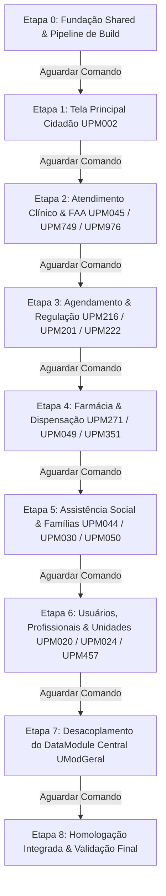

# Plano de Refatoração e Modelagem: Projeto Prefeitura (Prefeitura.dproj)

Este plano estabelece a estratégia técnica de modelagem e refatoração arquitetural focada **exclusivamente no projeto `Prefeitura`** ([Prefeitura.dproj](file:///d:/Projetos/Delphi/Social/Prefeitura/Prefeitura.dproj)) e nas camadas fundamentais compartilhadas estritamente necessárias para sua operação ([Shared](file:///d:/Projetos/Delphi/Social/Shared), [FormsCompartilhados](file:///d:/Projetos/Delphi/Social/FormsCompartilhados), [FramesCompartilhados](file:///d:/Projetos/Delphi/Social/FramesCompartilhados) e [Funcao](file:///d:/Projetos/Delphi/Social/Funcao)).

> [!IMPORTANT]
> **Regra Mandatória de Execução em Portões (Gatekeeper)**:
> Conforme solicitado, o plano é estritamente dividido em etapas sucessivas iniciando pelas telas principais. **Ao término de cada etapa, o assistente PAUSARÁ imediatamente e aguardará o comando explícito do usuário antes de iniciar a etapa seguinte**. Nenhuma etapa subsequente será iniciada de forma automática.

---

## 1. Contexto e Diagnóstico Técnico do Prefeitura

O executável `Prefeitura.exe` é o hub central de gestão municipal do ecossistema Delphi, agregando Saúde Pública, Assistência Social, Educação Básica e Administração Geral.

| Camada / Componente | Localização | Volume / Métricas | Papel Arquitetural |
| :--- | :--- | :--- | :--- |
| **Projeto Principal** | [Prefeitura.dproj](file:///d:/Projetos/Delphi/Social/Prefeitura/Prefeitura.dproj) | 1 projeto, 3.044 arquivos | Entry-point executável (`Prefeitura.exe`). |
| **Menu Central (Hub)** | [UME000.pas](file:///d:/Projetos/Delphi/Social/Prefeitura/Forms/UME000.pas) | 7.313 linhas, 196 KB | Roteador principal de telas, controle de sessão e perfis. |
| **Forms Legados** | [Prefeitura/Forms](file:///d:/Projetos/Delphi/Social/Prefeitura/Forms) | 1.334 forms (2.668 .pas/.dfm) | Telas monolíticas com ADOQuery e SQL inline acoplados à VCL. |
| **Views Modernas** | [Prefeitura/view](file:///d:/Projetos/Delphi/Social/Prefeitura/view) | 129 arquivos (.pas/.dfm) | Telas e Frames modernos (`Prefeitura.View.*` e `Saude.View.*`). |
| **Controllers Locais** | [Prefeitura/controller](file:///d:/Projetos/Delphi/Social/Prefeitura/controller) | 56 controllers | Orquestradores de regras de negócio locais. |
| **Models Locais** | [Prefeitura/model](file:///d:/Projetos/Delphi/Social/Prefeitura/model) | 53 models | Entidades e DAOs de domínio municipal. |
| **DataModules** | [Prefeitura/DataModulos](file:///d:/Projetos/Delphi/Social/Prefeitura/DataModulos) | 4 módulos (`UModGeral`, `UModInterface`...) | [UModGeral.dfm](file:///d:/Projetos/Delphi/Social/Prefeitura/DataModulos/UModGeral.dfm) possui 30.393 linhas de componentes. |
| **Shared (Fundação)** | [Shared](file:///d:/Projetos/Delphi/Social/Shared) | 227 models, 269 controllers | Núcleo de regras corporativas, DTOs e entidades SUS/Cidadão. |
| **Utilitários e Funções** | [Funcao](file:///d:/Projetos/Delphi/Social/Funcao) | 19 units | [UFuncao.pas](file:///d:/Projetos/Delphi/Social/Funcao/UFuncao.pas) (11.500+ linhas) e [UFuncaoSocial.pas](file:///d:/Projetos/Delphi/Social/Funcao/UFuncaoSocial.pas). |

### Desafios Identificados
1. **Monolitos Visuais com Sobrecarga de Linhas**: A tela de Cidadão ([UPM002.pas](file:///d:/Projetos/Delphi/Social/Prefeitura/Forms/UPM002.pas)) possui **32.436 linhas** e 1,23 MB de código mesclando regras civis, SUS, NIS/Bolsa Família, educação, interface gráfica e SQL direto.
2. **Dependência Monolítica de Dados**: [UModGeral.dfm](file:///d:/Projetos/Delphi/Social/Prefeitura/DataModulos/UModGeral.dfm) centraliza centenas de `TADODataSet` consumidos diretamente por formulários via acoplamento forte (`ModGeral.Pmd018.FieldByName(...)`).
3. **Bloqueio de Binário**: Duas instâncias de `Prefeitura.exe` foram detectadas em execução na máquina de desenvolvimento, gerando erro de linkagem (`F2039`) se não liberadas antes de gravar o executável de saída.

---

## 2. Decisões Arquiteturais e Padrão de Refatoração

Para assegurar estabilidade sem quebrar funcionalidades em produção, adotamos o seguinte padrão para o projeto `Prefeitura`:

```
┌────────────────────────────────────────────────────────────────────────┐
│                        Prefeitura.View (VCL)                           │
│  ┌──────────────────────┐  ┌────────────────────────────────────────┐  │
│  │ Form Hospedeiro Leve │  │ Frames Especializados (TFrame)         │  │
│  │ (Ex: TPM002 / View)  │◄─┼─ Frame Identificação / CPF / CNS       │  │
│  │                      │  │─ Frame Endereço / Contato              │  │
│  │                      │  │─ Frame Cartões / Histórico / SUS       │  │
│  └──────────┬───────────┘  └────────────────────────────────────────┘  │
└─────────────┼──────────────────────────────────────────────────────────┘
              │ (Invoca Comandos / Assina Eventos)
┌─────────────▼──────────────────────────────────────────────────────────┐
│              Prefeitura.Controller / Shared.Controller                 │
│  ┌──────────────────────────────────────────────────────────────────┐  │
│  │ Controladores Especializados (ICidadaoController, IAtendimento)  │  │
│  │ Validações de Negócio, Regras de SUS/NIS, Formatações            │  │
│  └──────────────────────────────────┬───────────────────────────────┘  │
└─────────────────────────────────────┼──────────────────────────────────┘
                                      │ (Manipula Entidades / DTOs)
┌─────────────────────────────────────▼──────────────────────────────────┐
│                 Prefeitura.Model / Shared.Model                        │
│  ┌──────────────────────────────────────────────────────────────────┐  │
│  │ Entidades Tipadas (TCidadao, TAtendimento, TFamilia)             │  │
│  │ Repositórios / DAOs Especializados (TCidadaoDAO, TAtendimentoDAO)│  │
│  └──────────────────────────────────┬───────────────────────────────┘  │
└─────────────────────────────────────┼──────────────────────────────────┘
                                      │ (Execução SQL Segura)
                                      ▼
             Banco de Dados SQL Server (`social_SMA`)
```

### Diretrizes de Código
- **Preservação de Enconding**: Todos os arquivos `.pas` e `.dfm` mantidos estritamente em **Windows-1252 (ANSI)** com quebras de linha **CRLF**.
- **Fatiamento em Frames (`TFrame`)**: Formulários gigantes são decompostos em componentes visuais reutilizáveis em `Prefeitura\view\frames`, desacoplando abas e painéis.
- **DTOs e Entidades Tipadas**: Substituição do acesso genérico `FieldByName('...')` por propriedades de entidades fortemente tipadas já mapeadas no dicionário de dados (1.073 tabelas ativas).
- **Sem Quebra do Legado**: Telas ainda não refatoradas continuam funcionando normalmente através da compatibilidade mantida em `UModGeral` e `Shared`.

---

## 3. Divisão do Trabalho em Etapas Sequenciais



---

### ETAPA 0: Fundação Arquitetural em `Shared` & Pipeline de Build do `Prefeitura`
**Objetivo**: Garantir que a esteira de compilação do `Prefeitura.dproj` execute de forma 100% confiável e que as interfaces e classes base do `Shared` atendam as necessidades do `Prefeitura`.

1. **Pipeline de Compilação & Detecção de Processos**:
   - Criação de rotina segura de compilação via MSBuild invocando `rsvars.bat` do RAD Studio 10.4 Sydney.
   - Script de pré-build para verificar e alertar processos `Prefeitura.exe` ativos antes do disparo de escrita do binário em `d:\Projetos\Delphi\Execs\Prefeitura\Prefeitura.exe`.
2. **Alinhamento de Contratos em `Shared`**:
   - Validação dos contratos de interfaces em `Shared\interfaces` ([Saude.Controller.Interfaces.pas](file:///d:/Projetos/Delphi/Social/Shared/interfaces/Saude.Controller.Interfaces.pas), [Social.Controller.Interfaces.pas](file:///d:/Projetos/Delphi/Social/Shared/interfaces/Social.Controller.Interfaces.pas), [Shared.Controller.Interfaces.pas](file:///d:/Projetos/Delphi/Social/Shared/interfaces/Shared.Controller.Interfaces.pas)).
   - Ajuste de DTOs comuns utilizados no fluxo municipal: Cidadão, Unidade, Operador e Sessão.
3. **Definição dos Templates de Frames**:
   - Criação da classe base `TFrameBaseCustom` para padronização de tratamento de eventos, validação de campos obrigatórios e injeção de controladores.

> [!CAUTION]
> **Portão de Saída da Etapa 0**: Relatório de status da esteira de build do `Prefeitura` entregue. **Parada obrigatória** aguardando comando do usuário para iniciar a Etapa 1.

---

### ETAPA 1: Tela Principal 1 - Cadastro Central do Munícipe / Cidadão (`UPM002.pas` / `TPM002`)
**Objetivo**: Refatorar o maior monolito do sistema (**32.436 linhas**, 1,23 MB), isolando suas responsabilidades em Frames e desacoplando seu SQL interno.

1. **Decomposição Visual do Formulário em Frames**:
   - Criar `Prefeitura.View.Frame.Cidadao.Identificacao` (Nome, CPF, CNS, RG, Certidões, Nome Social, Filiação).
   - Criar `Prefeitura.View.Frame.Cidadao.Endereco` (Logradouro, Bairro, CEP, Complemento, Geolocalização).
   - Criar `Prefeitura.View.Frame.Cidadao.Saude` (Condições predefinidas, Alergias, Risco, Deficiências, Histórico SUS).
   - Criar `Prefeitura.View.Frame.Cidadao.Social` (Vínculo familiar, NIS/PBF, Benefícios municipais, Programas).
   - Criar `Prefeitura.View.Frame.Cidadao.Educacao` (Matrícula escolar municipal, transporte universitário).
2. **Substituição dos Componentes de Acesso Direto a Dados**:
   - Eliminar `AcumulaBimestres: TADOQuery`, `Arq020: TADOQuery`, `BuscaBeneficioPessoa: TADOStoredProc` de dentro do form `UPM002.dfm`.
   - Delegar operações de busca e persistência para `Saude.Controller.Cidadao.pas` e `Saude.Model.Cidadao.pas` (tabelas `ARQ002`, `PMD018`, `ARQ026`, `ARQ027`).
3. **Encapsulamento das Telas Subordinadas**:
   - Readequar [UJuncaoPessoa.pas](file:///d:/Projetos/Delphi/Social/Prefeitura/Forms/UJuncaoPessoa.pas) e [UPesquisaJuncao.pas](file:///d:/Projetos/Delphi/Social/Prefeitura/Forms/UPesquisaJuncao.pas) para consumir a mesma camada de serviço de unificação de homônimos e duplicidades.
4. **Validação da Redução**:
   - Reduzir `UPM002.pas` de 32k linhas para um formulário orquestrador leve (< 2.500 linhas) que apenas instancia e gerencia o ciclo de vida dos Frames.

> [!CAUTION]
> **Portão de Saída da Etapa 1**: Walkthrough completo do Cidadão, compilação de `Prefeitura.exe` e teste de regressão do cadastro. **Parada obrigatória** aguardando comando do usuário para iniciar a Etapa 2.

---

### ETAPA 2: Tela Principal 2 - Atendimento Clínico, FAA e Prontuário (`UPM045`, `UPM749`, `UPM976`, `UPM968`)
**Objetivo**: Refatorar o núcleo de atendimento ambulatorial, prontuário médico e faturamento SUS do município.

1. **Acolhimento e Triagem com Classificação de Risco**:
   - Refatorar [UPM976.pas](file:///d:/Projetos/Delphi/Social/Prefeitura/Forms/UPM976.pas) (Triagem de Atendimentos / Protocolo Manchester).
   - Conectar aos Frames modernos de sinais vitais e riscos (`Prefeitura.View.Form.Riscos.pas`).
2. **Manutenção e Inclusão da FAA (Ficha de Atendimento Ambulatorial)**:
   - Desacoplar [UPM749.pas](file:///d:/Projetos/Delphi/Social/Prefeitura/Forms/UPM749.pas) (**9.295 linhas**): Inclusão de Procedimentos SIA/SUS.
   - Migrar validação de regras de faturamento e compatibilidade de procedimentos/CBO/CID para `Saude.Controller.Atendimento.pas` e `UFuncaoFaturamento.pas`.
   - Simplificar [UPM968.pas](file:///d:/Projetos/Delphi/Social/Prefeitura/Forms/UPM968.pas) (Manutenção de FAA).
3. **Prontuário Eletrônico do Cidadão**:
   - Refatorar [UPM045.pas](file:///d:/Projetos/Delphi/Social/Prefeitura/Forms/UPM045.pas) (**4.019 linhas**): Prontuário clínico integrado.
   - Desacoplar relatórios QuickReport/Impressão de dentro do formulário interativo, movendo para a camada de relatórios especializada em `Prefeitura\view\saude\relatorios`.

> [!CAUTION]
> **Portão de Saída da Etapa 2**: Walkthrough da esteira de atendimento/FAA, validação de procedimentos e compilação do binário. **Parada obrigatória** aguardando comando do usuário para iniciar a Etapa 3.

---

### ETAPA 3: Tela Principal 3 - Central de Agendamento e Regulação Municipal (`UPM216`, `UPM201`, `UPM222`, `UPM232`)
**Objetivo**: Modularizar as rotinas de agenda de consultas, exames especializados e regulação de vagas municipais.

1. **Agenda Médica e Grade de Especialistas**:
   - Refatorar [UPM222.pas](file:///d:/Projetos/Delphi/Social/Prefeitura/Forms/UPM222.pas) (Agenda de Atendimentos) e [UPM201.pas](file:///d:/Projetos/Delphi/Social/Prefeitura/Forms/UPM201.pas) (Pré-Agendamento de Consultas - 1.955 linhas).
   - Encapsular horários, bloqueios e encaixes em `Saude.Controller.Agenda.pas` e `Saude.Model.Agenda.pas`.
2. **Agenda de Exames Externos e Procedimentos Especializados**:
   - Refatorar [UPM216.pas](file:///d:/Projetos/Delphi/Social/Prefeitura/Forms/UPM216.pas) (**7.114 linhas**): Agenda de Exames Externos e Sessões.
   - Fatiar a interface em Frames de busca de vagas por protocolo, cotas e prestador (`Prefeitura.View.Frame.Selecao.BloqExaProtocolo.pas`).
3. **Regulação e Fila de Espera**:
   - Refatorar rotinas de lista de espera municipal ([UPM232.pas](file:///d:/Projetos/Delphi/Social/Prefeitura/Forms/UPM232.pas) e [UPM233.pas](file:///d:/Projetos/Delphi/Social/Prefeitura/Forms/UPM233.pas)), integrando com a camada de regras de prioridade clínica.

> [!CAUTION]
> **Portão de Saída da Etapa 3**: Walkthrough de agendamentos e regulação de cotas, validação de compilação. **Parada obrigatória** aguardando comando do usuário para iniciar a Etapa 4.

---

### ETAPA 4: Tela Principal 4 - Farmácia Municipal, Dispensação e Estoque (`UPM271`, `UPM049`, `UPM351`, `UPM266`, `UPM697`)
**Objetivo**: Reestruturar o fluxo de dispensação farmacêutica, controle de lotes/validades e conferência de receitas médicas.

1. **Dispensação de Medicamentos**:
   - Refatorar [UPM271.pas](file:///d:/Projetos/Delphi/Social/Prefeitura/Forms/UPM271.pas) (**2.068 linhas**): Entrega e Dispensação de Medicamentos.
   - Integrar com `Saude.Controller.Farmacia.Dispensacao.pas` para verificação de saldo de estoque, bloqueio de medicamentos controlados e histórico de retiradas do munícipe.
2. **Receitas Médicas e Autorizações Especiais**:
   - Refatorar [UPM049.pas](file:///d:/Projetos/Delphi/Social/Prefeitura/Forms/UPM049.pas) (Lançamento de Receita Avulsa) e [UPM697.pas](file:///d:/Projetos/Delphi/Social/Prefeitura/Forms/UPM697.pas) (Autorização de Receitas Especiais / Alto Custo).
   - Conectar com views modernas de medicamentos semelhantes (`Saude.View.Form.Farmacia.ReceitaAvulsa.MedsSemelhantes.pas`).
3. **Catálogo de Medicamentos e Estoque de Unidades**:
   - Refatorar [UPM266.pas](file:///d:/Projetos/Delphi/Social/Prefeitura/Forms/UPM266.pas) (Cadastro de Medicamentos) e [UPM351.pas](file:///d:/Projetos/Delphi/Social/Prefeitura/Forms/UPM351.pas) (Requisições de Estoque Farmacêutico por Unidade).

> [!CAUTION]
> **Portão de Saída da Etapa 4**: Walkthrough do módulo farmacêutico, validação de estoque e compilação do executável. **Parada obrigatória** aguardando comando do usuário para iniciar a Etapa 5.

---

### ETAPA 5: Tela Principal 5 - Assistência Social e Famílias (`UPM044`, `UPM030`, `UPM050`, `UPM332` a `UPM336`)
**Objetivo**: Refatorar os módulos de proteção social básica e especial (CRAS / CREAS / PAIF / PAEFI).

1. **Relação de Famílias no PAIF / CadÚnico**:
   - Refatorar [UPM044.pas](file:///d:/Projetos/Delphi/Social/Prefeitura/Forms/UPM044.pas) (PAIF - Proteção e Atendimento Integral à Família).
   - Desacoplar consultas de renda per capita, composição familiar e elegibilidade a benefícios para `Social.Controller.Familia.pas`.
2. **Vulnerabilidades e Diagnósticos Sociais**:
   - Refatorar [UPM030.pas](file:///d:/Projetos/Delphi/Social/Prefeitura/Forms/UPM030.pas) e [UPM035.pas](file:///d:/Projetos/Delphi/Social/Prefeitura/Forms/UPM035.pas) (Matriz de Vulnerabilidades Sociais).
3. **Pareceres Técnicos e Proteção Especial (CREAS / PAEFI)**:
   - Refatorar [UPM050.pas](file:///d:/Projetos/Delphi/Social/Prefeitura/Forms/UPM050.pas), [UPM054.pas](file:///d:/Projetos/Delphi/Social/Prefeitura/Forms/UPM054.pas) a [UPM056.pas](file:///d:/Projetos/Delphi/Social/Prefeitura/Forms/UPM056.pas) (Pareceres Técnicos Sociais e Atendimentos Coletivos).
   - Readequar telas de atendimento de violação de direitos ([UPM332.pas](file:///d:/Projetos/Delphi/Social/Prefeitura/Forms/UPM332.pas) a [UPM336.pas](file:///d:/Projetos/Delphi/Social/Prefeitura/Forms/UPM336.pas)).

> [!CAUTION]
> **Portão de Saída da Etapa 5**: Walkthrough da Assistência Social, validação de regras do PAIF e compilação. **Parada obrigatória** aguardando comando do usuário para iniciar a Etapa 6.

---

### ETAPA 6: Tela Principal 6 - Usuários, Profissionais de Saúde e Unidades (`UPM020`, `UPM024`, `UPM457`, `UPM356`)
**Objetivo**: Isolar as telas de segurança, autenticação, cadastro de operadores e estabelecimentos de saúde/assistência.

1. **Usuários e Operadores do Sistema**:
   - Refatorar [UPM020.pas](file:///d:/Projetos/Delphi/Social/Prefeitura/Forms/UPM020.pas) (`ARQ020`): Cadastro de Operadores, Senhas criptografadas e Níveis de Permissão.
   - Refatorar [UPM457.pas](file:///d:/Projetos/Delphi/Social/Prefeitura/Forms/UPM457.pas): Grupos de Usuários e Matriz de Acesso a Menus/Telas.
2. **Profissionais de Saúde e Conselhos Regionais**:
   - Refatorar [UPM024.pas](file:///d:/Projetos/Delphi/Social/Prefeitura/Forms/UPM024.pas) (`ARQ024`): Profissionais Médicos, Odontólogos e Enfermagem.
   - Validação de número de registro em conselho (CRM, CRO, COREN, CRP), CBO SUS e Cartão Nacional de Saúde (CNS) através de `Shared.Controller.Profissional.pas`.
3. **Unidades e Estabelecimentos Municipais**:
   - Refatorar [UPM356.pas](file:///d:/Projetos/Delphi/Social/Prefeitura/Forms/UPM356.pas) (`ARQ005` / CNES): Unidades Básicas de Saúde (UBS), Unidades de Pronto Atendimento (UPA), CRAS e Secretarias.

> [!CAUTION]
> **Portão de Saída da Etapa 6**: Walkthrough de gestão de acessos e profissionais, validação de compilação. **Parada obrigatória** aguardando comando do usuário para iniciar a Etapa 7.

---

### ETAPA 7: Desacoplamento Cirúrgico do DataModule Central (`UModGeral`) & Menu Hub (`UME000`)
**Objetivo**: Sanear o núcleo de dados do `Prefeitura` ([UModGeral.dfm](file:///d:/Projetos/Delphi/Social/Prefeitura/DataModulos/UModGeral.dfm) com **30.393 linhas**) e modernizar o acionamento de telas no formulário menu ([UME000.pas](file:///d:/Projetos/Delphi/Social/Prefeitura/Forms/UME000.pas)).

1. **Desacoplamento Gradual de Queries no `UModGeral`**:
   - As telas principais refatoradas nas Etapas 1 a 6 já estarão utilizando DAOs próprios em vez de queries em `ModGeral`.
   - Remoção de componentes `TADODataSet` órfãos ou redundantes no DFM de `UModGeral`.
   - Confinar `UModGeral` a seu verdadeiro propósito: conexão com os bancos de dados (`ACS`, `Almoxarifado`), controle de transações globais e variáveis de ambiente da sessão.
2. **Modernização do Hub [UME000.pas](file:///d:/Projetos/Delphi/Social/Prefeitura/Forms/UME000.pas)**:
   - Substituição de instanciações manuais diretas (`PM002 := TPM002.Create(Self); PM002.ShowModal;`) por um despachante de telas tipado ou registro de factories.
   - Padronização de liberação de memória para garantir conformidade com `LeakCheck`.

> [!CAUTION]
> **Portão de Saída da Etapa 7**: Relatório de saneamento do DataModule e compilação do binário. **Parada obrigatória** aguardando comando do usuário para iniciar a Etapa 8.

---

### ETAPA 8: Homologação Integrada, Testes de Memória & Validação Final de `Prefeitura.exe`
**Objetivo**: Homologação completa do executável consolidado com todas as melhorias em vigor.

1. **Compilação Final Completa**:
   - Compilação do `Prefeitura.dproj` em modo Debug e Release via MSBuild.
   - Verificação de ausência de novos Warnings ou Hints críticos do compilador DCC32.
2. **Auditoria de Vazamentos de Memória (`LeakCheck`)**:
   - Execução com flag `LEAKCHECK_DEBUG` ativa nas telas principais para certificar liberação de todos os Frames, DAOs e DTOs criados.
3. **Auditoria de Integridade Referencial e Sequenciadores**:
   - Execução do script [recalibrar_arq999.ps1](file:///d:/Projetos/Delphi/.agents/skills/social-database-migration/scripts/recalibrar_arq999.ps1) para assegurar que as tabelas movimentadas mantêm sequenciadores `ARQ999` calibrados com a base `social_SMA`.
4. **Entrega do Walkthrough Final**:
   - Geração do documento consolidado de walkthrough demonstrando antes/depois da arquitetura de telas do `Prefeitura`.

---

## 4. Plano de Verificação e Testes

### Verificação Automatizada (Build & Linters)
Para cada etapa executada, os seguintes comandos automatizados serão rodados:

```powershell
# 1. Verificar se há instâncias do executável travando a compilação
powershell -Command "Get-Process -Name Prefeitura -ErrorAction SilentlyContinue | Select-Object Id, ProcessName"

# 2. Compilar o projeto Prefeitura via MSBuild oficial do RAD Studio 10.4
cmd.exe /c "call ""C:\Program Files (x86)\Embarcadero\Studio\21.0\bin\rsvars.bat"" && msbuild ""d:\Projetos\Delphi\Social\Prefeitura\Prefeitura.dproj"" /t:Build /p:Configuration=Debug /v:m"

# 3. Auditar sequenciadores do banco de dados social_SMA
powershell -ExecutionPolicy Bypass -File "d:\Projetos\Delphi\.agents\skills\social-database-migration\scripts\recalibrar_arq999.ps1"
```

### Verificação Manual
1. **Navegação do Cidadão (Etapa 1)**: Abrir a tela de cadastro do cidadão, efetuar busca por CPF/CNS, navegar pelas abas refatoradas em Frames e validar a persistência.
2. **Atendimento / FAA (Etapa 2)**: Lançar um procedimento clínico na FAA, validar se os códigos de procedimento SUS e CBO são carregados e consistidos.
3. **Agendamento (Etapa 3)**: Acessar a grade de horários médicos e efetuar reserva de vaga para paciente.
4. **Dispensação Farmacêutica (Etapa 4)**: Consultar estoque de um medicamento na farmácia municipal e simular dispensação de receita.

---

## 5. Questões Abertas e Decisões para Alinhamento com o Usuário

> [!NOTE]
> Para o início da **Etapa 0**, solicitamos a confirmação dos seguintes pontos:
>
> 1. **Padrão de Acesso a Dados nos Novos DAOs**: Prefere que os novos DAOs em `Prefeitura\model` utilizem **FireDAC** (`TFDQuery` / `TFDConnection`) ou devemos manter a consistência da stack atual em **ADO** (`TADOQuery` / `TADOConnection`) já presente em `Shared`?
> 2. **Instâncias Ativas de `Prefeitura.exe`**: Antes de compilar o binário em cada etapa, podemos encerrar automaticamente eventuais processos órfãos `Prefeitura.exe` via comando PowerShell, ou prefere fechar manualmente quando solicitado?
