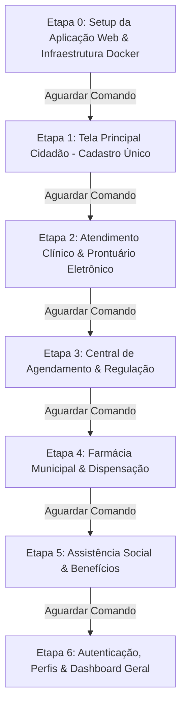

# Plano de Refatoração e Modernização: Projeto Prefeitura para Stack AdonisJS Fullstack

Este plano define a estratégia técnica para reengenharia e refatoração completa do sistema **Prefeitura** do ecossistema Delphi para a **Stack Web Oficial** padronizada em `C:\Users\rodrigo.santana\.gemini\config\stack\adonisjs-stack.md`.

> [!IMPORTANT]
> **Regra Mandatória de Portão de Execução (Gatekeeper)**:
> O plano é estritamente dividido em etapas modulares, iniciando pelas telas e domínios principais do sistema. **Ao concluir cada etapa, o assistente pausará imediatamente e aguardará o comando explícito do usuário antes de iniciar a etapa seguinte**. Nenhuma etapa subsequente será executada automaticamente.

> [!NOTE]
> **Preservação do Projeto Original**:
> A pasta original `d:\Projetos\Delphi\Social` permanecerá 100% intacta. Todo o código da nova aplicação será desenvolvido no diretório isolado:
> `d:\Projetos\Delphi\refatoracao\prefeitura-web`

---

## 1. Diagnóstico do Ambiente e Pré-requisitos da Máquina

Realizamos a verificação completa das ferramentas instaladas na máquina do desenvolvedor para suporte à Stack:

| Requisito | Versão Instalada | Status | Observação / Ação Necessária |
| :--- | :--- | :--- | :--- |
| **Node.js** | `v24.18.0` | ✅ Pronto | Versão atual suporta com folga o AdonisJS v6 (requer >= 20.6.0). |
| **npm** | `11.16.0` | ✅ Pronto | Gerenciador de pacotes moderno e atualizado. |
| **Git** | `2.55.0.windows.3` | ✅ Pronto | Controle de versão operacional. |
| **Docker CLI** | `29.2.1` | ✅ Pronto | Binário do cliente Docker instalado. |
| **Docker Compose** | `v5.0.2` | ✅ Pronto | Suporte a orquestração multi-container pronto. |
| **Docker Engine (Daemon)** | *Inativo no momento* | ⚠️ Ação do Usuário | O aplicativo **Docker Desktop** precisa ser aberto para subir os containers do MySQL 8 e Redis 7. |
| **Porta 3306 (MySQL)** | *Livre* | ✅ Pronta | Nenhuma colisão com instâncias locais. |
| **Porta 6379 (Redis)** | *Livre* | ✅ Pronta | Nenhuma colisão com instâncias locais. |
| **AdonisJS / Lucid / Inertia** | N/A | ✅ Via npm/npx | São bibliotecas de projeto, não exigem instalação global no Windows. |

> [!TIP]
> **O que você precisa fazer na sua máquina**:
> Apenas abrir o **Docker Desktop** no Windows para que o daemon do Docker responda. O MySQL 8.0 e o Redis 7 serão provisionados automaticamente em containers isolados via `docker compose up -d`, sem precisar instalar nada diretamente no Windows.

---

## 2. Identificação da Stack Oficial

Conforme especificado em `C:\Users\rodrigo.santana\.gemini\config\stack\adonisjs-stack.md`:

```
┌────────────────────────────────────────────────────────────────────────┐
│                        Frontend: React 19 + Vite 6                     │
│    shadcn/ui (Radix UI) + Tailwind CSS v4 + Lucide React + tw-animate   │
└───────────────────────────────────┬────────────────────────────────────┘
                                    │ (Inertia.js Protocol - Sem REST intermediário)
┌───────────────────────────────────▼────────────────────────────────────┐
│                    Backend: AdonisJS v6 (TypeScript)                   │
│   Controllers (inertia.render) │ VineJS Validators │ IoC Container     │
│   Auth Guard (Session)         │ Middlewares       │ Edge Root View    │
└───────────────────┬────────────────────────────────┬───────────────────┘
                    │                                │
    (Active Record / Queries)                (Cache, Filas & Sessions)
                    │                                │
┌───────────────────▼─────────────┐    ┌─────────────▼───────────────────┐
│     Lucid ORM + MySQL 8.0       │    │      Redis 7 Alpine             │
│   Migrations, Models & Seeders  │    │      @adonisjs/redis            │
└─────────────────────────────────┘    └─────────────────────────────────┘
```

---

## 3. Mapeamento de Domínio: Delphi para AdonisJS

O sistema `Prefeitura.dpr` foi mapeado a partir das telas de maior impacto municipal e das 1.073 tabelas catalogadas no dicionário de dados (`social_SMA`):

| Domínio Delphi (Legado) | Form / Componente Original | Tabela Origem | Model Lucid | Tela Inertia / React (shadcn/ui) |
| :--- | :--- | :--- | :--- | :--- |
| **Cadastro de Cidadãos** | `UPM002.pas` (32.436 linhas) | `ARQ002`, `PMD018` | `Cidadao` | `inertia/pages/cidadaos/` (index, show, form) |
| **Atendimento Clínico / PEP** | `UPM045.pas`, `UPM749.pas` | `PMD001`, `PMD002` | `Atendimento`, `Prontuario` | `inertia/pages/atendimentos/` (fila, consulta) |
| **Central de Agendamento** | `UPM216.pas`, `UPM201.pas` | `PMD032`, `PMD033` | `Agendamento`, `Escala` | `inertia/pages/agendamentos/` (calendario, vagas) |
| **Farmácia & Dispensação** | `UPM271.pas`, `PMD010` | `PMD010`, `PMD011` | `Medicamento`, `Dispensacao` | `inertia/pages/farmacia/` (balcao, estoque) |
| **Assistência Social / Famílias** | `UPM044.pas`, `UPM030.pas` | `CAD001`, `SOC001` | `FamiliaSocial`, `Beneficio` | `inertia/pages/social/` (familias, beneficios) |
| **Operadores e Permissões** | `UME000.pas`, `UPM020.pas` | `ARQ020`, `ARQ021` | `User`, `Role`, `Unidade` | `inertia/pages/auth/`, `inertia/pages/usuarios/` |

---

## 4. Divisão das Etapas de Execução



---

### ETAPA 0: Setup do Projeto Web & Infraestrutura Docker
**Objetivo**: Criar a estrutura base do projeto web com a stack oficial completa e operacional.

1. **Configuração de Infraestrutura**:
   - Criação do arquivo `docker-compose.yml` contendo:
     - **MySQL 8.0**: container `prefeitura-mysql`, banco `prefeitura_db`, credenciais e healthcheck.
     - **Redis 7-alpine**: container `prefeitura-redis`, porta `6379`, persistência e healthcheck.
2. **Inicialização do AdonisJS v6**:
   - Criação do projeto em `d:\Projetos\Delphi\refatoracao\prefeitura-web`:
     ```bash
     npm init adonisjs@latest prefeitura-web -- --kit=react -- --db=mysql --auth-guard=session
     ```
3. **Módulos e Drivers**:
   - Instalação do driver `mysql2`.
   - Instalação e configuração de `@adonisjs/redis`.
4. **Tailwind CSS v4 + shadcn/ui**:
   - Instalação das dependências: `tailwindcss`, `@tailwindcss/vite`, `clsx`, `tailwind-merge`, `class-variance-authority`, `tw-animate-css`, `lucide-react`.
   - Ajuste do `vite.config.ts` com aliases `@/*` e `~/`.
   - Configuração do `tsconfig.json` raiz com os path aliases.
   - Criação do `inertia/lib/utils.ts` com a função `cn()`.
   - Criação do `components.json` do shadcn/ui.
   - Definição do CSS com variáveis de tema HSL e `@theme` do Tailwind v4 em `inertia/css/app.css`.
   - Instalação dos primeiros componentes shadcn/ui via CLI (`button`, `card`, `input`, `badge`, `table`, `dropdown-menu`, `avatar`, `separator`).
5. **Layout Mestre Responsivo (`AppLayout.tsx`)**:
   - Sidebar retrátil com os módulos municipais (Saúde, Social, Farmácia, Agendamento, Configurações).
   - Topbar com busca global, alternador de tema Claro/Escuro e dados do operador.
   - Área central com suporte a breadcrumbs e mensagens flash do Inertia.
6. **Portão de Saída**: O servidor de desenvolvimento roda com sucesso (`npm run dev`) exibindo a página inicial institucional. **Pausa para validação do usuário.**

---

### ETAPA 1: Tela Principal Cidadão (Cadastro Único Municipal)
**Objetivo**: Refatorar o coração do sistema (`UPM002.pas`) para uma interface moderna, rápida e tipada.

1. **Modelagem Lucid ORM & Migrations**:
   - Tabela `cidadaos`:
     - Identificação: `id`, `cpf` (único, indexado), `cns` (Cartão SUS), `nis` (PIS/PASEP/Bolsa Família), `rg`, `orgao_emissor`.
     - Dados Pessoais: `nome_completo`, `nome_mae`, `nome_pai`, `data_nascimento`, `sexo`, `raca_cor`, `nacionalidade`.
     - Endereço & Contato: `cep`, `logradouro`, `numero`, `complemento`, `bairro`, `municipio`, `uf`, `telefone_celular`, `telefone_fixo`, `email`.
     - Vínculos Municipais: `unidade_referencia_id`, `situacao_cadastral` (ativo, inativo, óbito).
   - Seeder com massa de dados de teste baseada no padrão municipal real.
2. **Backend AdonisJS**:
   - `app/validators/cidadao_validator.ts`: Validações de CPF, CNS, campos obrigatórios com VineJS.
   - `app/controllers/cidadaos_controller.ts`:
     - `index`: Busca paginada com busca textual por nome, CPF, CNS ou NIS; ordenação dinâmica.
     - `show`: Carrega os dados do cidadão e seu histórico consolidado (atendimentos, receitas, programas sociais).
     - `store` e `update`: Criação e edição com transações seguras.
   - `app/services/cache_service.ts`: Cache de consultas frequentes no Redis.
3. **Frontend Inertia + React (shadcn/ui)**:
   - `inertia/pages/cidadaos/index.tsx`:
     - Tabela de cidadãos com paginação e ordenação.
     - Barra de filtros com busca em tempo real (debounce) via Inertia router.
     - Badges de situação cadastral e botões de ação rápida.
   - `inertia/pages/cidadaos/show.tsx`:
     - Visão 360° do munícipe organizada em abas (`Tabs` do shadcn):
       - Aba 1: Identificação e Dados Civis.
       - Aba 2: Endereço & Contato (com mapa/localização).
       - Aba 3: Prontuário SUS (histórico de consultas e vacinas).
       - Aba 4: Medicamentos e Histórico de Dispensação.
       - Aba 5: Composição Familiar e Programas Sociais.
   - `inertia/pages/cidadaos/form.tsx`:
     - Formulário moderno de cadastro/edição com máscaras reativas (CPF, CNS, CEP, Telefone).
     - Preenchimento automático do endereço via consulta de CEP.
4. **Portão de Saída**: O cadastro, listagem, visualização e busca de cidadãos funcionam 100% no navegador. **Pausa para validação do usuário.**

---

### ETAPA 2: Atendimento Clínico & Prontuário Eletrônico (PEP)
**Objetivo**: Refatorar o módulo de recepção, triagem/acolhimento e atendimento médico/enfermagem (`UPM045`, `UPM749`, `UPM976`).

1. **Modelagem Lucid ORM**:
   - Tabelas `atendimentos`, `sinais_vitais`, `evolucoes_clinicas`.
   - Classificação de Risco (Manchester: Vermelho, Laranja, Amarelo, Verde, Azul).
2. **Backend**:
   - `AtendimentosController.ts`: Gerenciamento da fila de espera em tempo real por unidade, chamada de paciente no painel e finalização de consulta com diagnóstico (CID-10 / CIAP-2).
3. **Frontend**:
   - `inertia/pages/atendimentos/fila.tsx`: Fila de triagem e consultórios com visualização por cards coloridos de acordo com a prioridade clínica.
   - `inertia/pages/atendimentos/consulta.tsx`: Prontuário eletrônico completo (Anamnese, Sinais Vitais, Hipóteses Diagnósticas com busca rápida de CID-10, Prescrição e Encaminhamentos).
4. **Portão de Saída**: Fila de atendimento e registro de consulta médica testados e validados. **Pausa para validação do usuário.**

---

### ETAPA 3: Central de Agendamento & Regulação
**Objetivo**: Refatorar a marcação de consultas, exames e transporte sanitário (`UPM216`, `UPM201`).

1. **Modelagem Lucid ORM**:
   - Tabelas `escalas_profissionais`, `agendamentos`, `vagas_ambulatoriais`.
2. **Backend**:
   - Controle de concorrência e bloqueio atômico de vagas via **Redis Locks** para evitar sobreposição de agendamentos no mesmo horário.
3. **Frontend**:
   - `inertia/pages/agendamentos/index.tsx`: Calendário mensal/semanal interativo com filtros por profissional, especialidade e UBS.
   - Modal de agendamento ágil com confirmação do cidadão e emissão de comprovante.
4. **Portão de Saída**: Marcação de consultas e emissão de comprovante operacionais. **Pausa para validação do usuário.**

---

### ETAPA 4: Farmácia Municipal & Dispensação de Medicamentos
**Objetivo**: Refatorar a gestão de estoque farmacêutico e dispensação de medicamentos (`UPM271`, `PMD010`).

1. **Modelagem Lucid ORM**:
   - Tabelas `medicamentos`, `lotes_medicamentos`, `dispensacoes`, `itens_dispensacao`.
2. **Backend**:
   - Baixa automática no lote pelo critério FEFO (primeiro que vence, primeiro que sai), validação de intervalo mínimo de retirada e alerta de posologia.
3. **Frontend**:
   - `inertia/pages/farmacia/dispensacao.tsx`: Balcão rápido de entrega de medicamentos com leitura de código de barras ou busca por CPF.
   - `inertia/pages/farmacia/estoque.tsx`: Painel de monitoramento de estoque com alertas visuais de lotes com vencimento próximo e estoque mínimo.
4. **Portão de Saída**: Balcão de dispensação e controle de estoque validados. **Pausa para validação do usuário.**

---

### ETAPA 5: Assistência Social & Benefícios Municipais
**Objetivo**: Refatorar o módulo de vulnerabilidade social, visitas e concessão de benefícios (`UPM044`, `UPM030`).

1. **Modelagem Lucid ORM**:
   - Tabelas `familias_sociais`, `beneficios_concedidos`, `visitas_domiciliares`.
2. **Backend**:
   - Cálculo automático de renda per capita familiar e enquadramento em faixas de benefício (extrema pobreza, pobreza, baixa renda).
3. **Frontend**:
   - `inertia/pages/social/familias.tsx`: Ficha familiar com relação de membros dependentes, responsáveis e benefícios recebidos.
   - Fluxo de concessão e prestação de contas de benefícios eventuais.
4. **Portão de Saída**: Gestão de famílias e benefícios operacionais. **Pausa para validação do usuário.**

---

### ETAPA 6: Autenticação, Perfis de Acesso & Auditoria Geral
**Objetivo**: Proteger o sistema com controle granular de acesso por unidade e perfil de operador (`ARQ020`, `UME000`).

1. **Modelagem & Auth**:
   - Tabelas `users`, `roles`, `permissions`, `audit_logs`.
   - AdonisJS Session Guard com proteção contra CSRF, rate-limiting no Redis e sessões persistidas.
2. **Frontend**:
   - `inertia/pages/auth/login.tsx`: Tela de login institucional segura com seletor de unidade de trabalho.
   - `inertia/pages/dashboard.tsx`: Dashboard executivo com indicadores gerais do município (atendimentos do dia, cidadãos cadastrados, receitas dispensadas e alertas críticos).
3. **Portão de Saída**: Autenticação, controle de permissões por perfil e dashboard operacional. **Pausa para validação do usuário.**

---

## 5. Plano de Verificação e Qualidade

### Testes Automatizados
- **Testes de Backend**: Suíte Japa (`node ace test`) validando regras de negócio em controllers, validações VineJS e persistência Lucid.
- **Typechecking**: `npm run typecheck` sem erros de TypeScript no backend e frontend.
- **Linting**: Validação de formatação e boas práticas com ESLint/Prettier.

### Testes Manuais no Navegador
- Navegação fluida entre telas via Inertia.js sem recarregamento de página.
- Responsividade e acessibilidade dos componentes shadcn/ui em monitores de resoluções variadas.
- Teste de alternância de tema Claro / Escuro.
- Comportamento de busca reativa e persistência de dados no MySQL e Redis.
