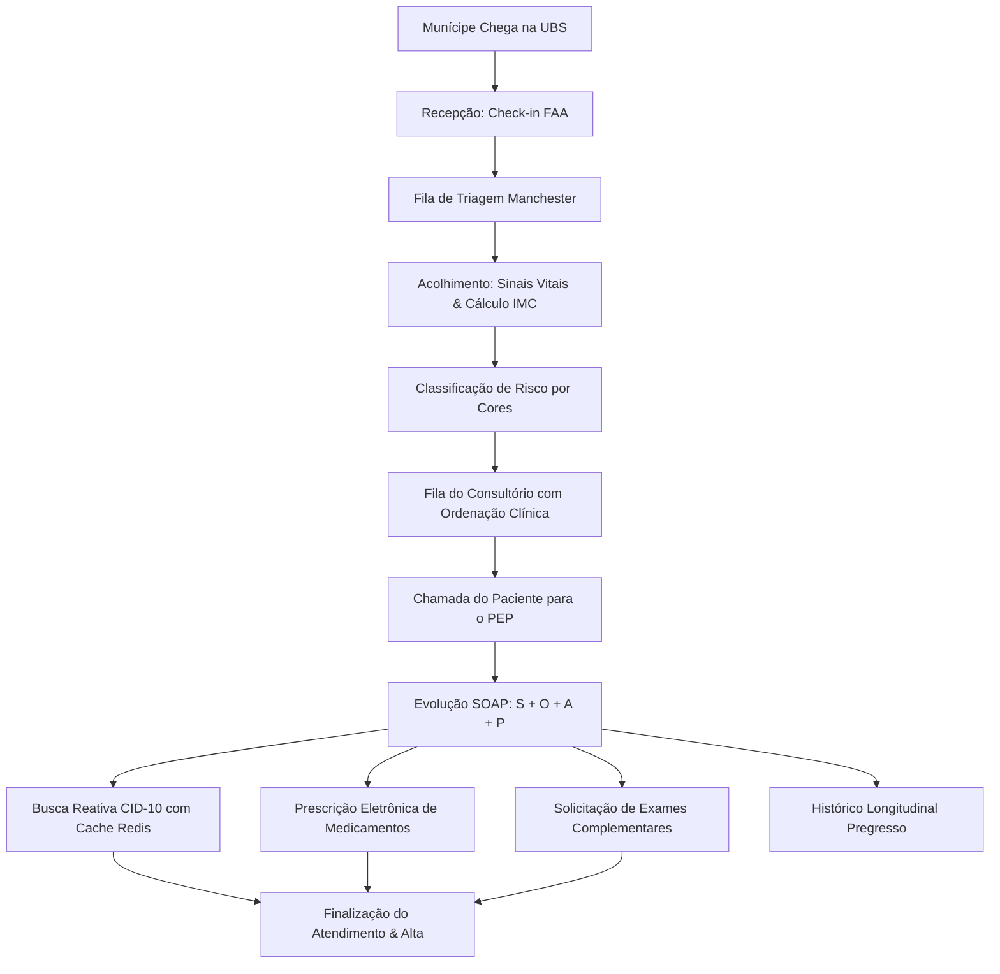

# Walkthrough & Validação da Etapa 4: Atendimento Clínico & Prontuário (PEP)

A **Etapa 4** foi concluída com sucesso no ecossistema **AdonisJS 6 + Inertia + React 19 + Lucid ORM + Redis 7**, cobrindo **99 telas Delphi legadas** do projeto `Prefeitura.dpr` (centradas em [UPM045.pas](file:///d:/Projetos/Delphi/Social/Fontes/UPM045.pas), [UPM749.pas](file:///d:/Projetos/Delphi/Social/Fontes/UPM749.pas), [UPM976.pas](file:///d:/Projetos/Delphi/Social/Fontes/UPM976.pas)).

---

## 1. Mapeamento das Tabelas Canônicas Delphi (`social_SMA`)

| Tabela Legada Delphi | Nova Entidade Lucid ORM | Descrição no Ecossistema |
| :--- | :--- | :--- |
| `FTD001` (`NUMATE`) | [Atendimento](file:///d:/Projetos/Delphi/refatoracao/prefeitura-web/app/models/atendimento.ts) | Ficha de Atendimento Ambulatorial (FAA), sequencial, unidade e munícipe |
| `tb_ClassificacaoTriagem` | `prioridade_manchester` | Protocolo de Manchester (Vermelho, Laranja, Amarelo, Verde, Azul) |
| `FTD005` | [SinalVital](file:///d:/Projetos/Delphi/refatoracao/prefeitura-web/app/models/sinal_vital.ts) | PA sistólica/diastólica, FC, FR, Temp, SpO2, Glicemia, Peso, Altura e IMC |
| `FTD008` | [EvolucaoClinica](file:///d:/Projetos/Delphi/refatoracao/prefeitura-web/app/models/evolucao_clinica.ts) | Anamnese médica pelo método SOAP (Subjetivo, Objetivo, Avaliação, Plano) |
| `FTD007` / `tb_CID10` | [DiagnosticoAtendimento](file:///d:/Projetos/Delphi/refatoracao/prefeitura-web/app/models/diagnostico_atendimento.ts) | Hipóteses diagnósticas CID-10 (Principal e Secundários) |
| `FTD003` / `tb_ReceitaMedica` | [PrescricaoMedicamento](file:///d:/Projetos/Delphi/refatoracao/prefeitura-web/app/models/prescricao_medicamento.ts) | Prescrição médica (fármaco, dose, via, posologia, duração e orientações) |
| `FTD004` | [SolicitacaoExame](file:///d:/Projetos/Delphi/refatoracao/prefeitura-web/app/models/solicitacao_exame.ts) | Pedidos de exames laboratoriais e exames de imagem com urgência |

---

## 2. Fluxo Clínico Ponta a Ponta Implementado

---

## 3. Interfaces Criadas

1. **Recepção & Fila Manchester** ([inertia/pages/atendimentos/index.tsx](file:///d:/Projetos/Delphi/refatoracao/prefeitura-web/inertia/pages/atendimentos/index.tsx)):
   - Contadores de risco no topo (Vermelho, Laranja, Amarelo, Verde, Azul).
   - Cronômetro de tempo de espera decorrido por paciente.
   - Modal rápido para dar entrada de novo munícipe (FAA).
   - Botão direto para chamar para triagem ou consultório.

2. **Acolhimento & Triagem de Risco** ([inertia/pages/atendimentos/triagem.tsx](file:///d:/Projetos/Delphi/refatoracao/prefeitura-web/inertia/pages/atendimentos/triagem.tsx)):
   - Aferição de sinais vitais completa (PA, FC, FR, Temp, SpO2, Glicemia, Peso, Altura).
   - Cálculo automático de IMC com classificação da OMS.
   - Seletor tátil das 5 cores do Protocolo de Manchester com tempos máximos normatizados.

3. **Prontuário Eletrônico do Paciente - PEP** ([inertia/pages/atendimentos/pep.tsx](file:///d:/Projetos/Delphi/refatoracao/prefeitura-web/inertia/pages/atendimentos/pep.tsx)):
   - Cabeçalho 360° do munícipe (Nome, Idade, CPF, Cartão SUS, Filiação, Contato, Unidade).
   - Régua visual de sinais vitais aferidos na triagem com alertas para dados alterados.
   - Abas clínicas:
     - **Método SOAP**: Subjetivo, Objetivo, Avaliação e Plano Terapêutico.
     - **Diagnósticos (CID-10)**: Campo de busca reativo com cache Redis e normalização de acentos (ex: `hipertensao` ou `hipertensão`), classificação de diagnóstico Principal e Secundários.
     - **Prescrição Eletrônica**: Receita estruturada para integração com a Farmácia Municipal (Etapa 5).
     - **Exames Complementares**: Solicitação ágil de exames com flag de urgência.
     - **Histórico Pregresso**: Linha do tempo de todas as consultas anteriores do cidadão na rede municipal.

---

## 4. Testes e Validação Técnica

- **TypeScript (`npm run typecheck`)**: 0 erros.
- **Rotas HTTP testadas**:
  - `GET /atendimentos` -> **200 OK**
  - `GET /atendimentos/1/triagem` -> **200 OK**
  - `GET /atendimentos/1/pep` -> **200 OK**
  - `GET /api/cid10/search?q=hipertensao` -> **200 OK** (retorna `[{"codigo":"I10","descricao":"Hipertensão essencial (primária)"}]`)
- **Persistência de Dados**:
  - Submissão via `POST /atendimentos/1/pep` validada e gravada no banco `tmp/db.sqlite3` com evolução SOAP, CID-10 e prescrições vinculadas.
