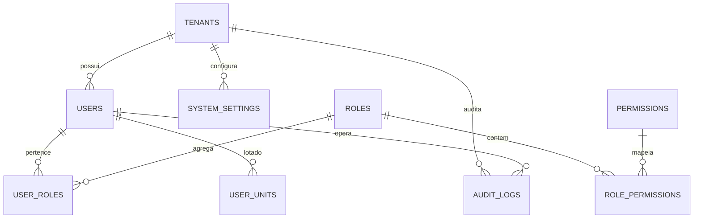

# Plano Detalhado de Execução: Etapa 00 - Fundação Arquitetural, Layout Reativo, Multi-Tenancy e RBAC

> **Status**: Pronto para Execução  
> **Documento Vinculado**: [DOCUMENTO_MESTRE_REFATORACAO.md](file:///d:/Projetos/Delphi/refatoracao/documentacao/DOCUMENTO_MESTRE_REFATORACAO.md)  
> **Stack Oficial**: AdonisJS v6, Lucid ORM, Inertia.js v2, React 19, TypeScript, Tailwind CSS v4, shadcn/ui, Redis 7

---

## 1. Visão Geral e Alinhamento com o Projeto Original

A **Etapa 00** é a fundação de todo o ecossistema web modernizado. Ela substitui a lógica de inicialização, controle de acesso, parametrização global e navegação contidas no projeto Delphi legado.

### 1.1. Mapeamento dos Formulários e Units Delphi Legadas

| Formulário / Unit Delphi Original | Papel no Delphi 7 | Solução Arquitetural na Stack Web Moderna |
| :--- | :--- | :--- |
| **`UPM000`** (`Forms/UPM000.dfm`, `.pas`) | **Login do Sistema**: Autenticação por login/CPF, seleção de sistema/módulo e seleção de unidade de atendimento. | **`/login`** e modal **`/selecionar-unidade`**: Autenticação segura com proteção contra força bruta, suporte a CPF ou e-mail, hash Scrypt e seleção de unidade de lotação ativa. |
| **`UME000`** (`Forms/UME000.dfm`, `.pas`) | **Menu Principal**: Estrutura de menus desktop, exibição do nome do município (`lblEmpresa`), usuário logado (`lbUsuario`), unidade ativa e correio de mensagens (`TimerCorreio`). | **`AppLayout.tsx`**: Layout mestre com Sidebar reativa e colapsável, Navbar com seletor de município/unidade, central de notificações e controle dinâmico de permissões por perfil. |
| **`UPM016`** (`Forms/UPM016.dfm`, `.pas`) | **Troca de Senha**: Diálogo modal para alteração da senha do operador. | **`/perfil/troca-senha`**: Formulário com validação de complexidade, checagem da senha atual e suporte a primeiro acesso obrigatório (`must_change_password`). |
| **`UPM017`** (`Forms/UPM017.dfm`, `.pas`) | **Permissões de Acesso**: Associação de permissões por tela e botão. | **Matriz RBAC Granular**: Controle de papéis (`roles`) e permissões (`permissions`) com diretiva `can('modulo.acao')` no frontend e middleware no backend. |
| **`UPM261`** (`Forms/UPM261.dfm`, `.pas`) | **Grupos de Usuários**: Cadastro de grupos de operadores. | **Gestão de Perfis de Acesso**: Tela reativa com permissões agrupadas por domínio funcional. |
| **`UModGeral`** (`DataModulos/UModGeral.pas`) | **DataModule Geral**: Parâmetros globais, data do servidor, conexão com banco e transações. | **AdonisJS IoC & Config**: Variáveis de ambiente tipadas (`env.ts`), pool de conexões do Lucid ORM e transações atômicas com `db.transaction()`. |
| **`UModInterface`** (`DataModulos/UModInterface.pas`) | **Interface Visual**: Cores, fontes e estilos do desktop. | **Design System Tailwind v4 + shadcn/ui**: Tokens semânticos, modo claro/escuro nativo e componentes acessíveis (Radix UI). |

---

## 2. Modelagem de Dados Relacional (Lucid ORM & Migrations)

Abaixo está a especificação DDL das tabelas que compõem a fundação do sistema:



### 2.1. Estrutura das Tabelas

#### Tabela `tenants` (Prefeituras / Municípios)
```sql
CREATE TABLE tenants (
    id UUID PRIMARY KEY DEFAULT gen_random_uuid(),
    nome_municipio VARCHAR(150) NOT NULL,
    codigo_ibge VARCHAR(7) NOT NULL UNIQUE,
    cnpj VARCHAR(14) NOT NULL UNIQUE,
    uf VARCHAR(2) NOT NULL,
    brasao_url VARCHAR(255),
    timezone VARCHAR(50) DEFAULT 'America/Sao_Paulo',
    ativo BOOLEAN DEFAULT TRUE,
    created_at TIMESTAMP WITH TIME ZONE DEFAULT CURRENT_TIMESTAMP,
    updated_at TIMESTAMP WITH TIME ZONE DEFAULT CURRENT_TIMESTAMP
);
```

#### Tabela `users` (Operadores do Sistema)
```sql
CREATE TABLE users (
    id UUID PRIMARY KEY DEFAULT gen_random_uuid(),
    tenant_id UUID NOT NULL REFERENCES tenants(id) ON DELETE RESTRICT,
    nome VARCHAR(150) NOT NULL,
    email VARCHAR(150) NOT NULL,
    cpf VARCHAR(11) NOT NULL,
    password_hash VARCHAR(255) NOT NULL,
    status VARCHAR(20) DEFAULT 'ativo' CHECK (status IN ('ativo', 'inativo', 'bloqueado')),
    must_change_password BOOLEAN DEFAULT FALSE,
    failed_login_attempts INTEGER DEFAULT 0,
    locked_until TIMESTAMP WITH TIME ZONE,
    last_login_at TIMESTAMP WITH TIME ZONE,
    created_at TIMESTAMP WITH TIME ZONE DEFAULT CURRENT_TIMESTAMP,
    updated_at TIMESTAMP WITH TIME ZONE DEFAULT CURRENT_TIMESTAMP,
    CONSTRAINT uq_users_tenant_email UNIQUE (tenant_id, email),
    CONSTRAINT uq_users_tenant_cpf UNIQUE (tenant_id, cpf)
);
```

#### Tabelas de Controle de Acesso (RBAC)
```sql
CREATE TABLE roles (
    id UUID PRIMARY KEY DEFAULT gen_random_uuid(),
    tenant_id UUID REFERENCES tenants(id) ON DELETE CASCADE,
    slug VARCHAR(50) NOT NULL,
    nome VARCHAR(100) NOT NULL,
    descricao TEXT,
    is_system BOOLEAN DEFAULT FALSE,
    created_at TIMESTAMP WITH TIME ZONE DEFAULT CURRENT_TIMESTAMP
);

CREATE TABLE permissions (
    id UUID PRIMARY KEY DEFAULT gen_random_uuid(),
    slug VARCHAR(80) NOT NULL UNIQUE,
    nome VARCHAR(100) NOT NULL,
    modulo VARCHAR(50) NOT NULL,
    descricao TEXT,
    created_at TIMESTAMP WITH TIME ZONE DEFAULT CURRENT_TIMESTAMP
);

CREATE TABLE role_permissions (
    role_id UUID NOT NULL REFERENCES roles(id) ON DELETE CASCADE,
    permission_id UUID NOT NULL REFERENCES permissions(id) ON DELETE CASCADE,
    PRIMARY KEY (role_id, permission_id)
);

CREATE TABLE user_roles (
    user_id UUID NOT NULL REFERENCES users(id) ON DELETE CASCADE,
    role_id UUID NOT NULL REFERENCES roles(id) ON DELETE CASCADE,
    PRIMARY KEY (user_id, role_id)
);
```

#### Tabela `user_units` (Lotações do Usuário por Unidade de Atendimento)
```sql
CREATE TABLE user_units (
    id UUID PRIMARY KEY DEFAULT gen_random_uuid(),
    user_id UUID NOT NULL REFERENCES users(id) ON DELETE CASCADE,
    unidade_id UUID NOT NULL, -- FK da tabela de Unidades de Saúde (Etapa 03)
    sala_padrao VARCHAR(50),
    is_default BOOLEAN DEFAULT FALSE,
    created_at TIMESTAMP WITH TIME ZONE DEFAULT CURRENT_TIMESTAMP
);
```

#### Tabela `audit_logs` (Trilha de Auditoria LGPD)
```sql
CREATE TABLE audit_logs (
    id BIGSERIAL PRIMARY KEY,
    tenant_id UUID NOT NULL REFERENCES tenants(id),
    user_id UUID REFERENCES users(id) ON DELETE SET NULL,
    acao VARCHAR(20) NOT NULL, -- LOGIN, LOGOUT, CREATE, UPDATE, DELETE
    entidade VARCHAR(80) NOT NULL,
    entidade_id VARCHAR(100),
    valores_anteriores JSONB,
    valores_novos JSONB,
    ip_address VARCHAR(45),
    user_agent TEXT,
    created_at TIMESTAMP WITH TIME ZONE DEFAULT CURRENT_TIMESTAMP
);
CREATE INDEX idx_audit_logs_tenant_entidade ON audit_logs (tenant_id, entidade, created_at DESC);
```

---

## 3. Backend: Arquitetura AdonisJS 6

### 3.1. Controllers da Etapa 00
- **`AuthController`**:
  - `showLogin()`: Renderiza a página `Auth/Login.tsx` com dados do tenant.
  - `login()`: Validação de credenciais via CPF ou e-mail, verificação de lockout por tentativas falhas e criação de sessão segura.
  - `selectUnit()`: Grava na sessão a unidade de atendimento ativa do profissional.
  - `logout()`: Destrói a sessão e registra log de auditoria.
  - `changePassword()`: Altera a senha do usuário e desativa a flag `must_change_password`.
- **`DashboardController`**:
  - `index()`: Carrega indicadores rápidos do município para a tela inicial.
- **`UsersController`**:
  - CRUD completo de operadores do município com validação de CPF e envio de senha provisória.
- **`RolesController`**:
  - Gestão de perfis e matriz de permissões.
- **`AuditLogsController`**:
  - Listagem com filtros por período, usuário, entidade e ação.

### 3.2. Middlewares Essenciais
1. **`SilentAuthMiddleware` / `AuthMiddleware`**: Protege rotas restritas e injeta o usuário autenticado no contexto.
2. **`TenantMiddleware`**: Extrai o tenant ativo e assegura que todas as queries do Lucid incluam automaticamente a cláusula `where('tenant_id', tenant.id)`.
3. **`RbacMiddleware`**: Valida a permissão requerida na rota (ex: `can:usuarios.gerenciar`).
4. **`ActiveUnitMiddleware`**: Para rotas clínicas/assistenciais, valida se o profissional selecionou uma unidade ativa no turno.

---

## 4. Frontend: Inertia.js React 19 + Design System

### 4.1. Estrutura do Layout Mestre (`AppLayout.tsx`)

O layout replica a capacidade de gestão do `UME000` em formato moderno:
- **Header Superior**:
  - Brasão e identificação da Prefeitura / Secretaria Municipal.
  - Seletor suspenso da **Unidade de Atendimento Ativa** (ex: *UBS Central - Consultório 02*).
  - Central de Notificações / Avisos em tempo real.
  - Menu de perfil do operador com avatar, dados da lotação e logout.
- **Sidebar Retrátil**:
  - Navegação hierárquica por módulos (Cidadãos, Atendimento Clínico, Farmácia, Regulação, Social, e-SUS, Frota, Configurações).
  - Filtragem reativa: somente exibe os módulos que o usuário tem permissão para visualizar.
- **Área Central (Main Content)**:
  - Breadcrumb automático.
  - Toasts flutuantes para feedback instantâneo de operações.

### 4.2. Telas a Desenvolver na Etapa 00

1. **`Auth/Login.tsx`**:
   - Campos: CPF ou E-mail, Senha.
   - Validação inline com feedback visual imediato.
   - Link "Esqueci minha senha" com fluxo de redefinição por e-mail.
2. **`Auth/SelectUnit.tsx`**:
   - Modal ou tela intermediária disparada caso o usuário possua mais de uma lotação (ex: atua na UBS 1 às segundas e na UPA às quartas).
3. **`Auth/ChangePassword.tsx`**:
   - Formulário com indicador de força da senha (mínimo 8 caracteres, maiúsculas, minúsculas, números e símbolos).
4. **`Dashboard/Index.tsx`**:
   - Cards com contadores em tempo real: Atendimentos em Fila, Dispensações no Dia, Consultas Agendadas, Alertas e-SUS.
5. **`Sistema/Usuarios/Index.tsx` e `Form.tsx`**:
   - Listagem paginada com busca instantânea, badges de status e formulário com abas de dados cadastrais e lotações.
6. **`Sistema/Perfis/Index.tsx` e `Form.tsx`**:
   - Matriz interativa de permissões organizadas por accordion (Módulo Cidadão, Módulo Farmácia, Módulo Atendimento, etc.).
7. **`Sistema/Auditoria/Index.tsx`**:
   - Tabela com visualizador de diff JSON mostrando o "Antes" e "Depois" de cada registro alterado.

---

## 5. Roteiro Passo a Passo de Implementação

| Passo | Tarefa Técnica | Entregáveis |
| :---: | :--- | :--- |
| **Passo 1** | Configuração do Projeto AdonisJS 6 e pacotes | AdonisJS 6 rodando com Inertia.js v2, React 19, Tailwind CSS v4, Lucide e Redis. |
| **Passo 2** | Migrations e Seeders da Etapa 00 | Tabelas `tenants`, `users`, `roles`, `permissions`, `role_permissions`, `user_roles`, `user_units`, `audit_logs` e seed inicial com perfil `Administrador Geral`. |
| **Passo 3** | Models Lucid ORM e Relacionamentos | Models fortemente tipados com hooks de hash de senha (`beforeSave`) e métodos auxiliares (`hasPermission`, `isSuperAdmin`). |
| **Passo 4** | Autenticação e Middlewares | Controllers de login/logout/senha, middlewares de Tenant, Auth, RBAC e Rate-Limit em Redis. |
| **Passo 5** | Design System Base e `AppLayout` | Componentes base (`Button`, `Input`, `Dialog`, `Card`, `Badge`, `Dropdown`) e `AppLayout` responsivo com Sidebar e Navbar. |
| **Passo 6** | Páginas da Interface | `Login.tsx`, `SelectUnit.tsx`, `Dashboard.tsx`, `Usuarios/Index.tsx`, `Perfis/Index.tsx` e `Auditoria/Index.tsx`. |
| **Passo 7** | Testes e Homologação | Testes unitários com Japa, validação de segurança e documentação do walkthrough da Etapa 00. |

---

## 6. Critérios de Aceitação e Homologação da Etapa 00

1. **Segurança e Autenticação**:
   - Usuário consegue realizar login tanto pelo CPF quanto pelo e-mail.
   - Bloqueio temporário da conta após 5 tentativas consecutivas de senha incorreta.
   - Senha armazenada exclusivamente com hash criptográfico seguro (Scrypt/Argon2).
2. **Multi-Tenancy e Isolamento**:
   - Dados de um município nunca são visíveis ou acessíveis por operadores de outro município.
3. **Navegação e Responsividade**:
   - Layout responsivo adaptado para resoluções de telas desktop (médicos e recepcionistas) e tablets/smartphones (agentes comunitários e supervisores).
   - Sidebar exibe estritamente as opções permitidas para o perfil do operador logado.
4. **Rastreabilidade e LGPD**:
   - Cada login, logout e alteração de usuário/perfil gera registro detalhado na tabela `audit_logs`.

---
*Este documento é a referência técnica detalhada para a execução da Etapa 00.*
