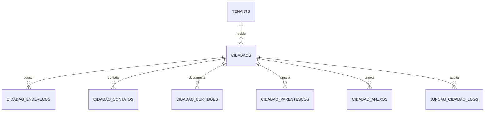

# Plano Detalhado de Execução: Etapa 01 - Gestão de Cidadãos, Pessoas e Identificação Social (CadÚnico)

> **Status**: Pronto para Execução  
> **Documento Vinculado**: [DOCUMENTO_MESTRE_REFATORACAO.md](file:///d:/Projetos/Delphi/refatoracao/documentacao/DOCUMENTO_MESTRE_REFATORACAO.md)  
> **Dependência**: [Etapa 00 (Infraestrutura, Layout e RBAC)](file:///d:/Projetos/Delphi/refatoracao/documentacao/planos_etapas/etapa_00_infraestrutura_layout_rbac.md)  
> **Stack Oficial**: AdonisJS v6, Lucid ORM, Inertia.js v2, React 19, TypeScript, Tailwind CSS v4, shadcn/ui, Redis 7

---

## 1. Visão Geral e Alinhamento com o Projeto Original

A **Etapa 01** estabelece a base cadastral de todas as pessoas físicas do município. No sistema Delphi legado, o cadastro de cidadãos era concentrado no gigantesco formulário `UPM002` (com mais de 800 campos e dezenas de abas), além de rotinas vitais de **junção de duplicidades** (`UJuncaoPessoa`), parentesco (`UPM001`), pesquisa de homônimos (`UPM073`) e anexos digitais.

A solução na stack web moderna modulariza essa complexidade em uma arquitetura limpa, responsiva e com validação estrita, unificando a identificação civil com as regras do **Ministério da Saúde (e-SUS APS / CNS)** e do **MDS (CadÚnico / NIS)**.

### 1.1. Mapeamento dos Formulários e Units Delphi Legadas

| Formulário / Unit Delphi Original | Papel no Delphi 7 | Solução Arquitetural na Stack Web Moderna |
| :--- | :--- | :--- |
| **`UPM002`** (`Forms/UPM002.dfm`, `.pas`) | **Cadastro do Cidadão**: Formulário mestre com identificação civil, endereço, contatos, saúde, dados sociais e histórico. | **`/cidadaos/novo` e `/cidadaos/:id/editar`**: Interface reativa em abas modernas (Identificação, Endereço, Contato, Certidão, Família, Anexos, e-SUS). |
| **`UPM002R`** (`Forms/UPM002R.dfm`, `.pas`) | **Relatórios do Cidadão**: Ficha cadastral e listagens gerais de munícipes. | **`/cidadaos/:id/ficha-pdf`**: Emissão em PDF da Ficha Cadastral Nacional do SUS e espelho do cidadão. |
| **`UPM001`** / **`UPM001R`** (`Forms/UPM001.dfm`, `.pas`) | **Cadastro de Parentesco**: Cadastro dos graus de parentesco e relação familiar. | **Tabela `parentesco_graus`**: Cadastro de graus de parentesco e relacionamento N:N entre cidadãos. |
| **`UPM003`** (`Forms/UPM003.dfm`, `.pas`) | **Pesquisa de Parentesco**: Busca e vínculo de familiares. | **Componente `SeletorFamiliar`**: Auto-complete com busca instantânea por CPF/Nome para adicionar membros à família. |
| **`UJuncaoPessoa`** (`Forms/UJuncaoPessoa.pas`, `.dfm`) | **Junção de Cadastro de Pessoas**: Rotina de fusão de cidadãos duplicados transferindo histórico de atendimentos, exames, vacinas e agendamentos. | **`/cidadaos/juncao`**: Assistente de unificação com comparação visual lado a lado, migração atômica de FKs em transação e log de auditoria reversível. |
| **`UPesquisaJuncao`** (`Forms/UPesquisaJuncao.dfm`, `.pas`) | **Pesquisa de Pessoas para Junção**: Localização dos cadastros duplicados. | **Interface de Detecção de Duplicidades**: Algoritmo de busca fonética e sugestão automática de possíveis homônimos. |
| **`UPM073`** (`Forms/UPM073.dfm`, `.pas`) | **Pessoas com Mesmo CPF**: Alerta e tratamento de cadastros com mesmo documento. | **Validação Inline Zod**: Trava imediata de CPF duplicado com opção direta de abrir o cadastro existente ou acionar a junção. |
| **`UPM074`** / **`UPM182`** (`Forms/UPM074.dfm`, `.pas`) | **Pesquisa Rápida do Cidadão**: Busca de pacientes na recepção e consultórios. | **Barra de Busca Global `/cidadaos`**: Pesquisa unificada com debounce (CPF, CNS, Nome, Mãe ou Data de Nascimento). |
| **`UPM145`** / **`UPM145R`** (`Forms/UPM145.dfm`, `.pas`) | **Locações por Pessoa**: Vínculos de serviços e locações municipais. | **Histórico de Vínculos**: Aba de histórico de atendimentos e serviços associados ao munícipe. |
| **`UPM248`** (`Forms/UPM248.dfm`, `.pas`) | **Relatório Geral de Cidadãos**: Filtros por bairro, sexo e idade. | **`/cidadaos/relatorios`**: Relatório customizável com exportação para PDF e planilhas Excel/CSV. |
| **`UPM324`** (`Forms/UPM324.dfm`, `.pas`) | **Log de Junção de Pessoas**: Histórico de fusões executadas. | **`/cidadaos/juncao/historico`**: Visualizador de registros de fusões com backup JSON dos dados originais. |
| **`UPM526`** (`Forms/upm526.dfm`, `.pas`) | **Cadastro de Pessoas Jurídicas/Físicas Gerais**: Cadastro complementar. | **Tabela Unificada `pessoas`**: Suporte unificado tanto a Cidadãos (SUS) quanto Pessoas Gerais/Fornecedores. |
| **`UPM700`** / **`UPM700R`** / **`UPM701`** | **Categorias de Pessoas**: Classificação de munícipes (Ex: Gestante, Hipertenso, Diabético, Idoso). | **Tags / Grupos Especiais**: Sistema de marcadores coloridos e condições clínicas prioritárias. |
| **`Saude.View.Form.Cidadao.Anexo`** | **Inclusão de Anexos**: Upload de documentos digitalizados. | **Componente `UploadAnexos`**: Upload assíncrono com suporte a imagens e PDFs armazenados de forma segura. |
| **`Prefeitura.View.Frame.Cidadao.*`** | **Frames de Endereço, Identificação e Saúde**: Modularização de interface. | **Componentes React Modulares**: `DadosPessoaisTab`, `EnderecoTab`, `ContatosTab`, `SaudeEsusTab`. |

---

## 2. Modelagem de Dados Relacional (Lucid ORM & Migrations)

A modelagem de dados da Etapa 01 divide a entidade `Cidadão` em tabelas normalizadas e relacionais:



### 2.1. Estrutura DDL das Tabelas

#### Tabela Mestre `cidadaos`
```sql
CREATE TABLE cidadaos (
    id UUID PRIMARY KEY DEFAULT gen_random_uuid(),
    tenant_id UUID NOT NULL REFERENCES tenants(id) ON DELETE RESTRICT,
    prontuario_numero VARCHAR(30), -- Prontuário físico legado
    nome_completo VARCHAR(150) NOT NULL,
    nome_social VARCHAR(150),
    cpf VARCHAR(11) UNIQUE,
    cns VARCHAR(15) UNIQUE, -- Cartão Nacional de Saúde (15 dígitos)
    nis_pis VARCHAR(15), -- Número de Identificação Social (CadÚnico)
    rg_numero VARCHAR(20),
    rg_orgao_emissor VARCHAR(20),
    rg_uf VARCHAR(2),
    data_nascimento DATE NOT NULL,
    sexo VARCHAR(1) NOT NULL CHECK (sexo IN ('M', 'F', 'I')), -- Masculino, Feminino, Indeterminado
    raca_cor VARCHAR(20) NOT NULL CHECK (raca_cor IN ('branca', 'preta', 'parda', 'amarela', 'indigena')),
    etnia_indigena_id INTEGER,
    nome_mae VARCHAR(150) NOT NULL,
    nome_pai VARCHAR(150),
    nacionalidade VARCHAR(50) DEFAULT 'Brasileira',
    municipio_nascimento_ibge VARCHAR(7),
    estado_civil VARCHAR(20) CHECK (estado_civil IN ('solteiro', 'casado', 'divorciado', 'viuvo', 'uniao_estavel')),
    escolaridade VARCHAR(50),
    ocupacao_cbo VARCHAR(6), -- Código CBO oficial
    religiao VARCHAR(50),
    
    -- Controle de Óbito
    obito BOOLEAN DEFAULT FALSE,
    data_obito DATE,
    numero_declaracao_obito VARCHAR(30),

    -- Identificadores e-SUS APS
    cns_provisorio BOOLEAN DEFAULT FALSE,
    responsavel_familiar BOOLEAN DEFAULT FALSE,
    situacao_cadastro_esus VARCHAR(30) DEFAULT 'ativo',

    foto_url VARCHAR(255),
    observacoes TEXT,
    ativo BOOLEAN DEFAULT TRUE,
    created_at TIMESTAMP WITH TIME ZONE DEFAULT CURRENT_TIMESTAMP,
    updated_at TIMESTAMP WITH TIME ZONE DEFAULT CURRENT_TIMESTAMP
);
CREATE INDEX idx_cidadaos_tenant_nome ON cidadaos (tenant_id, nome_completo);
CREATE INDEX idx_cidadaos_cpf ON cidadaos (cpf);
CREATE INDEX idx_cidadaos_cns ON cidadaos (cns);
CREATE INDEX idx_cidadaos_nome_mae ON cidadaos (nome_mae);
```

#### Tabela `cidadao_enderecos`
```sql
CREATE TABLE cidadao_enderecos (
    id UUID PRIMARY KEY DEFAULT gen_random_uuid(),
    cidadao_id UUID NOT NULL REFERENCES cidadaos(id) ON DELETE CASCADE,
    cep VARCHAR(8) NOT NULL,
    logradouro VARCHAR(150) NOT NULL,
    numero VARCHAR(20) NOT NULL,
    complemento VARCHAR(50),
    bairro VARCHAR(100) NOT NULL,
    municipio_ibge VARCHAR(7) NOT NULL,
    uf VARCHAR(2) NOT NULL,
    ponto_referencia VARCHAR(150),
    tipo_endereco VARCHAR(20) DEFAULT 'residencial' CHECK (tipo_endereco IN ('residencial', 'comercial', 'contato', 'temporario')),
    zona VARCHAR(10) DEFAULT 'urbana' CHECK (zona IN ('urbana', 'rural')),
    microarea VARCHAR(10), -- Microárea e-SUS da ESF
    area VARCHAR(10),      -- Área e-SUS da ESF
    is_principal BOOLEAN DEFAULT TRUE,
    created_at TIMESTAMP WITH TIME ZONE DEFAULT CURRENT_TIMESTAMP
);
```

#### Tabela `cidadao_contatos`
```sql
CREATE TABLE cidadao_contatos (
    id UUID PRIMARY KEY DEFAULT gen_random_uuid(),
    cidadao_id UUID NOT NULL REFERENCES cidadaos(id) ON DELETE CASCADE,
    tipo VARCHAR(20) NOT NULL CHECK (tipo IN ('celular', 'whatsapp', 'residencial', 'comercial', 'recado')),
    ddd VARCHAR(2) NOT NULL,
    numero VARCHAR(9) NOT NULL,
    nome_recado VARCHAR(100),
    autoriza_sms BOOLEAN DEFAULT TRUE,
    is_principal BOOLEAN DEFAULT TRUE,
    created_at TIMESTAMP WITH TIME ZONE DEFAULT CURRENT_TIMESTAMP
);
```

#### Tabela `cidadao_certidoes` (Registro Civil)
```sql
CREATE TABLE cidadao_certidoes (
    id UUID PRIMARY KEY DEFAULT gen_random_uuid(),
    cidadao_id UUID NOT NULL REFERENCES cidadaos(id) ON DELETE CASCADE,
    tipo_certidao VARCHAR(20) NOT NULL CHECK (tipo_certidao IN ('nascimento', 'casamento', 'obito')),
    matricula_cnj VARCHAR(32) UNIQUE, -- Formato unificado CNJ (32 dígitos)
    livro VARCHAR(10),
    folha VARCHAR(10),
    termo VARCHAR(10),
    cartorio_nome VARCHAR(150),
    created_at TIMESTAMP WITH TIME ZONE DEFAULT CURRENT_TIMESTAMP
);
```

#### Tabela `cidadao_parentescos` (Árvore Familiar)
```sql
CREATE TABLE cidadao_parentescos (
    id UUID PRIMARY KEY DEFAULT gen_random_uuid(),
    cidadao_origem_id UUID NOT NULL REFERENCES cidadaos(id) ON DELETE CASCADE,
    cidadao_vinculado_id UUID NOT NULL REFERENCES cidadaos(id) ON DELETE CASCADE,
    grau_parentesco VARCHAR(30) NOT NULL, -- pai, mae, filho, conjuge, irmao, avo, neto, tio, sobrinho, outro
    is_responsavel_legal BOOLEAN DEFAULT FALSE,
    created_at TIMESTAMP WITH TIME ZONE DEFAULT CURRENT_TIMESTAMP,
    CONSTRAINT uq_parentesco UNIQUE (cidadao_origem_id, cidadao_vinculado_id)
);
```

#### Tabela `cidadao_anexos` (Documentos Digitalizados)
```sql
CREATE TABLE cidadao_anexos (
    id UUID PRIMARY KEY DEFAULT gen_random_uuid(),
    cidadao_id UUID NOT NULL REFERENCES cidadaos(id) ON DELETE CASCADE,
    tipo_documento VARCHAR(50) NOT NULL, -- rg, cpf, comprovante_residencia, cartao_sus, laudo, certidao, outros
    nome_arquivo VARCHAR(255) NOT NULL,
    caminho_arquivo VARCHAR(500) NOT NULL,
    mime_type VARCHAR(100) NOT NULL,
    tamanho_bytes INTEGER NOT NULL,
    observacao TEXT,
    created_at TIMESTAMP WITH TIME ZONE DEFAULT CURRENT_TIMESTAMP
);
```

#### Tabela `juncao_cidadao_logs` (Histórico e Auditoria de Junções)
```sql
CREATE TABLE juncao_cidadao_logs (
    id UUID PRIMARY KEY DEFAULT gen_random_uuid(),
    tenant_id UUID NOT NULL REFERENCES tenants(id),
    cidadao_mantido_id UUID NOT NULL REFERENCES cidadaos(id),
    cidadao_unificado_id UUID NOT NULL, -- ID do cadastro inativado
    motivo VARCHAR(255) NOT NULL,
    dados_backup_json JSONB NOT NULL,    -- Snapshot completo do cadastro inativado
    tabelas_afetadas_json JSONB NOT NULL, -- Lista de tabelas e contagem de FKs migradas
    operador_id UUID REFERENCES users(id),
    created_at TIMESTAMP WITH TIME ZONE DEFAULT CURRENT_TIMESTAMP
);
```

---

## 3. Backend: Regras de Negócio e Serviços (AdonisJS 6)

### 3.1. Algoritmos de Validação e Consistência
1. **Validador Oficial de CNS (Cartão Nacional de Saúde)**:
   - Implementação estrita do algoritmo do Ministério da Saúde:
     - CNS que inicia com `1` ou `2`: Cálculo com pesos de 15 a 1 e verificação de resto de divisão.
     - CNS que inicia com `7`, `8` ou `9` (provisórios): Cálculo específico de dígito verificador.
2. **Validador de CPF**:
   - Verificação algorítmica de dígitos verificadores com rejeição automática de CPFs com todos os dígitos iguais.
3. **Detecção Inteligente de Homônimos**:
   - Ao preencher Nome e Data de Nascimento, o sistema faz uma consulta fonética preventiva para avisar o atendente se já existe um cadastro com os mesmos dados, evitando duplicidades na origem.

### 3.2. Serviço de Junção de Cadastros (`JuncaoCidadaoService`)
Executa a fusão de dois munícipes de forma totalmente atômica e segura via `db.transaction()`:
1. Valida se os dois cadastros pertencem ao mesmo tenant e se nenhum deles já foi inativado por junção anterior.
2. Faz snapshot completo em JSON de todos os dados do cidadão que será incorporado.
3. Atualiza as referências de FK em todas as tabelas dependentes do ecossistema:
   - `atendimentos` (`cidadao_id`)
   - `agendamentos` (`cidadao_id`)
   - `dispensacoes` (`cidadao_id`)
   - `registros_vacinacao` (`cidadao_id`)
   - `fichas_esus` (`cidadao_id`)
   - `prontuario_social_familias` (`cidadao_id`)
4. Inativa o cadastro duplicado marcando `ativo = false` e adicionando nota de encaminhamento para o cadastro mantido.
5. Registra o log detalhado em `juncao_cidadao_logs`.

---

## 4. Frontend: Telas e Componentes React 19

### 4.1. `Cidadaos/Index.tsx` (Central de Cidadãos)
- **Barra de Pesquisa Global**: Campo com suporte a leitura de código de barras do Cartão SUS e busca dinâmica por CPF, Nome, CNS ou Nome da Mãe.
- **Tabela Reativa de Pacientes**:
  - Colunas: Foto/Avatar, Nome Completo, CPF, CNS, Data de Nascimento, Nome da Mãe, Bairro, Ações.
  - Badges de alerta: CPF inconsistente, CNS provisório, óbito registrado.
  - Ações rápidas: Abrir Prontuário (PEP), Editar Cadastro, Visualizar Ficha SUS (PDF), Iniciar Atendimento.

### 4.2. `Cidadaos/Form.tsx` (Formulário Moderno em Abas)
Estruturado com componentes shadcn/ui (`Tabs`, `FormField`, `Input`, `Select`, `Dialog`):
- **Aba 1: Identificação Civil**: Nome, Nome Social, CPF, CNS, RG, Nascimento, Sexo, Raça/Cor, Nome da Mãe e Pai.
- **Aba 2: Endereço Residencial**: CEP com auto-preenchimento, Logradouro, Número, Bairro, Área/Microárea de Saúde da Família.
- **Aba 3: Telefones & Contatos**: DDD, Celular, WhatsApp, autorização para envio de lembretes de consultas por SMS.
- **Aba 4: Registro Civil / Certidão**: Matrícula unificada CNJ (32 dígitos) ou termo/livro/folha tradicional.
- **Aba 5: Família & Parentesco**: Listagem de familiares vinculados e botão para vincular novo familiar.
- **Aba 6: Documentos Digitalizados (Anexos)**: Dropzone de arquivos (fotos de documentos, laudos) com visualizador em modal.
- **Aba 7: Integração e-SUS**: CNS Provisório, Responsável Familiar e status de exportação federal.

### 4.3. `Cidadaos/Show.tsx` (Visão 360° do Cidadão)
- **Header do Paciente**: Banner com foto, nome, idade detalhada (anos, meses e dias), tipo sanguíneo, alergias conhecidas e contato de emergência.
- **Timeline de Histórico**: Linha do tempo unificada com as passagens do munícipe pelo sistema:
  - Atendimentos médicos e de enfermagem
  - Medicamentos dispensados na farmácia
  - Vacinas aplicadas e doses pendentes
  - Benefícios eventuais concedidos pelo CRAS/CREAS

### 4.4. `Cidadaos/Juncao.tsx` (Assistente de Junção de Cadastros)
- Tela comparativa dividida em duas colunas:
  - **Coluna 1 (Cadastro Primário / Mantido)**: Dados que permanecerão ativos.
  - **Coluna 2 (Cadastro Secundário / A Incorporar)**: Dados que serão transferidos.
- Resumo de impacto: "Serão transferidos 12 atendimentos médicos, 4 vacinas e 6 dispensações de medicamentos".
- Confirmação com modal de segurança e justificativa obrigatória.

---

## 5. Roteiro Passo a Passo de Implementação

| Passo | Tarefa Técnica | Entregáveis |
| :---: | :--- | :--- |
| **Passo 1** | Migrations e Seeders da Etapa 01 | Criação das tabelas `cidadaos`, `cidadao_enderecos`, `cidadao_contatos`, `cidadao_certidoes`, `cidadao_parentescos`, `cidadao_anexos` e `juncao_cidadao_logs`. |
| **Passo 2** | Models Lucid ORM e Relacionamentos | Model `Cidadao` com relacionamentos `hasMany` (enderecos, contatos, anexos, certidoes) e `manyToMany` (parentescos). |
| **Passo 3** | Validadores Zod/VineJS | Schemas de validação com cálculo de algoritmo de CPF e validação oficial de CNS (15 dígitos). |
| **Passo 4** | Controllers e Services | `CidadaosController`, `CidadaoAnexosController`, `JuncaoCidadaoService` e `CidadaosReportController`. |
| **Passo 5** | Telas de Listagem e Formulário | Páginas React `Cidadaos/Index.tsx`, `Cidadaos/Form.tsx` (com as 7 abas) e `Cidadaos/Show.tsx`. |
| **Passo 6** | Assistente de Junção | Página `Cidadaos/Juncao.tsx` e histórico de junções `Cidadaos/HistoricoJuncao.tsx`. |
| **Passo 7** | Testes e Homologação | Testes automatizados de validação de CPF/CNS, integridade de junção de cadastros e walkthrough da Etapa 01. |

---

## 6. Critérios de Aceitação e Homologação da Etapa 01

1. **Validação Rigorosa de Documentos**:
   - Rejeição imediata de CPF com dígitos verificadores incorretos.
   - Rejeição de CNS fora das regras e algoritmos do Ministério da Saúde.
   - Impedimento de cadastro de CPF duplicado no mesmo município.
2. **Navegação e Usabilidade**:
   - Busca de pacientes na recepção deve responder em menos de 200ms por nome ou documento.
   - Preenchimento rápido de endereço via CEP com integração automática de logradouro e bairro.
3. **Integridade da Junção**:
   - A rotina de junção de pessoas deve transferir todos os vínculos históricos sem deixar registros órfãos.
   - O cadastro unificado deve ficar inativo e referenciado ao cadastro principal no log de auditoria.
4. **Exportação de Ficha**:
   - Geração correta da ficha cadastral em formato PDF pronta para impressão.

---
*Este documento é a referência técnica detalhada para a execução da Etapa 01.*
