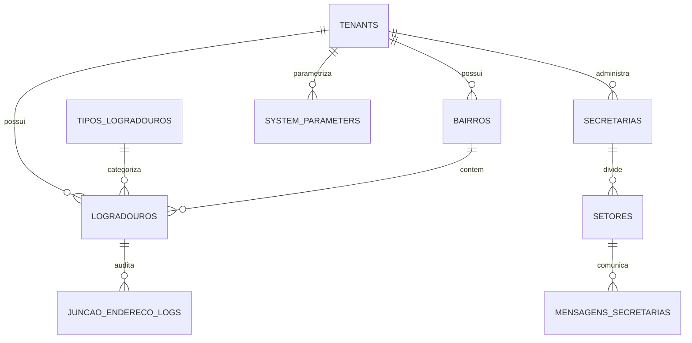

# Plano Detalhado de Execução: Etapa 02 - Divisão Territorial, Logradouros, Estrutura Municipal e Parâmetros

> **Status**: Pronto para Execução  
> **Documento Vinculado**: [DOCUMENTO_MESTRE_REFATORACAO.md](file:///d:/Projetos/Delphi/refatoracao/documentacao/DOCUMENTO_MESTRE_REFATORACAO.md)  
> **Dependências**: [Etapa 00 (Infraestrutura e RBAC)](file:///d:/Projetos/Delphi/refatoracao/documentacao/planos_etapas/etapa_00_infraestrutura_layout_rbac.md) | [Etapa 01 (Cidadãos)](file:///d:/Projetos/Delphi/refatoracao/documentacao/planos_etapas/etapa_01_cidadaos_pessoas_cadunico.md)  
> **Stack Oficial**: AdonisJS v6, Lucid ORM, Inertia.js v2, React 19, TypeScript, Tailwind CSS v4, shadcn/ui, Redis 7

---

## 1. Visão Geral e Alinhamento com o Projeto Original

A **Etapa 02** é responsável por estabelecer a malha territorial e organizacional do município, bem como a central de parametrizações e regras de negócio globais. No sistema Delphi legado, essa camada englobava o cadastro de bairros (`UPM985`), logradouros (`UPM983`), secretarias e departamentos municipais (`UPM393`), comunicação inter-secretarias (`UCO008`), rotinas de fusão e higienização de endereços (`UJuncaoEndereco`), e as dezenas de flags de parametrização herdadas das classes `Saude.Model.Parametro.pas`, `Social.Model.Parametro.pas` e `Shared.Model.Parametro.*`.

A modernização para a stack web centraliza esses cadastros, conecta o preenchimento de endereços ao DNE dos Correios, implementa cache de parâmetros em **Redis 7** para alto desempenho e fornece um assistente atômico de junção de logradouros duplicados.

### 1.1. Mapeamento dos Formulários e Units Delphi Legadas

| Formulário / Unit Delphi Original | Papel no Delphi 7 | Solução Arquitetural na Stack Web Moderna |
| :--- | :--- | :--- |
| **`UPM985`** (`Forms/UPM985.dfm`, `.pas`) | **Cadastro de Bairros**: Cadastro do código, nome do bairro, zona urbana/rural e flags de exclusão. | **`/territorio/bairros`**: Gestão reativa de bairros com zona (urbana, rural, expansão), região administrativa e vinculação territorial. |
| **`UPM985R`** / **`UPM986`** (`Forms/UPM985R.dfm`) | **Relatório e Pesquisa de Bairros**: Pesquisa e listagem para impressão. | **Filtros e Relatório `/territorio/bairros/relatorio`**: Exportação em PDF e Excel com total de munícipes por bairro. |
| **`UPM983`** (`Forms/UPM983.dfm`, `.pas`) | **Cadastro de Logradouros**: Código, tipo de logradouro (Rua, Avenida, etc.) e nome. | **`/territorio/logradouros`**: Cadastro de ruas com código oficial DNE, CEP, bairro principal e múltiplos bairros atendidos. |
| **`UPM983R`** / **`UPM984`** (`Forms/UPM983R.dfm`) | **Relatório e Pesquisa de Logradouros**: Listagem e consulta de vias públicas. | **Busca Unificada de Logradouros**: Auto-complete com busca rápida por nome ou CEP e exportação de listagens. |
| **`UJuncaoEndereco`** (`Forms/UJuncaoEndereco.pas`) | **Junção de Endereços**: Rotina de merge de logradouros e bairros duplicados (`tb_LogJuncaoEndereco`). | **`/territorio/juncao-enderecos`**: Assistente de fusão de logradouros/bairros com atualização atômica de munícipes e log auditável. |
| **`UPesquisaJuncaoEndereco`** / **`UPM445`** | **Pesquisa de Endereços para Junção**: Seleção de registros de vias a unificar. | **Assistente Comparativo de Endereços**: Comparação visual lado a lado com contagem de munícipes afetados. |
| **`UPM358`** / **`UPM358R`** (`Forms/UPM358.dfm`) | **Relatório de Junção de Endereço**: Histórico de fusões executadas. | **`/territorio/juncao-enderecos/historico`**: Visualizador de logs com histórico completo e reversibilidade. |
| **`UPM393`** (`Forms/UPM393.dfm`, `.pas`) | **Cadastro de Secretaria**: Secretarias municipais, orçamento e menus vinculados. | **`/estrutura/secretarias`**: Organograma municipal (Saúde, Educação, Assistência Social, Obras, etc.) com responsáveis e dados oficiais. |
| **`UPM008`** / **`UPM009R`** / **`UPM323R`** | **Pesquisa e Relatório de Secretarias**: Listagens oficiais. | **`/estrutura/secretarias/relatorio`**: Relatório da estrutura administrativa da Prefeitura. |
| **`UPM613`** / **`UPM614`** / **`UPM881`** / **`UPM882`** | **Cadastro e Pesquisa de Setores**: Departamentos e divisões internas. | **`/estrutura/setores`**: Gestão dos departamentos e setores com subordinação direta à respectiva secretaria. |
| **`UCO008`** (`Forms/UCO008.dfm`, `.pas`) | **Mensagens para Secretarias**: Comunicação interna entre setores. | **`/comunicacao/memorandos`**: Central de mensagens e despachos internos entre secretarias e setores. |
| **`Saude.Model.Parametro.pas`** | **Parâmetros da Saúde**: Flags de e-SUS, RNDS, WhatsApp, Cotas, BNAFAR, etc. | **`/configuracoes/parametros` (Aba Saúde)**: Parâmetros de atendimento, prontuário, cotas e integrações federais. |
| **`Social.Model.Parametro.pas`** | **Parâmetros do Social**: Regras do SUAS, CRAS e benefícios. | **`/configuracoes/parametros` (Aba Social)**: Parâmetros socioassistenciais, PAIF e benefícios. |
| **`Shared.Model.Parametro.*`** | **Parâmetros do Sistema**: Regras corporativas, timezone, logos e logs. | **`/configuracoes/parametros` (Aba Geral)**: Parâmetros institucionais e operacionais. |

---

## 2. Modelagem de Dados Relacional (Lucid ORM & Migrations)

A arquitetura de dados da Etapa 02 organiza a malha territorial e institucional do município:



### 2.1. Estrutura DDL das Tabelas

#### Tabela `tipos_logradouros` (Classificação Oficial DNE)
```sql
CREATE TABLE tipos_logradouros (
    id SERIAL PRIMARY KEY,
    codigo_dne VARCHAR(10) UNIQUE, -- R, AV, AL, TRV, PCA, ROD, EST
    abreviatura VARCHAR(10) NOT NULL,
    nome VARCHAR(50) NOT NULL,
    ativo BOOLEAN DEFAULT TRUE
);
```

#### Tabela `bairros`
```sql
CREATE TABLE bairros (
    id UUID PRIMARY KEY DEFAULT gen_random_uuid(),
    tenant_id UUID NOT NULL REFERENCES tenants(id) ON DELETE RESTRICT,
    codigo INTEGER NOT NULL,
    nome VARCHAR(100) NOT NULL,
    zona VARCHAR(20) DEFAULT 'urbana' CHECK (zona IN ('urbana', 'rural', 'expansao')),
    regiao_administrativa VARCHAR(50), -- Norte, Sul, Leste, Oeste, Central
    distrito VARCHAR(100),
    ativo BOOLEAN DEFAULT TRUE,
    created_at TIMESTAMP WITH TIME ZONE DEFAULT CURRENT_TIMESTAMP,
    updated_at TIMESTAMP WITH TIME ZONE DEFAULT CURRENT_TIMESTAMP,
    CONSTRAINT uq_bairros_tenant_codigo UNIQUE (tenant_id, codigo),
    CONSTRAINT uq_bairros_tenant_nome UNIQUE (tenant_id, nome)
);
CREATE INDEX idx_bairros_tenant_nome ON bairros (tenant_id, nome);
```

#### Tabela `logradouros`
```sql
CREATE TABLE logradouros (
    id UUID PRIMARY KEY DEFAULT gen_random_uuid(),
    tenant_id UUID NOT NULL REFERENCES tenants(id) ON DELETE RESTRICT,
    tipo_logradouro_id INTEGER NOT NULL REFERENCES tipos_logradouros(id),
    nome VARCHAR(150) NOT NULL,
    nome_completo VARCHAR(170) NOT NULL, -- Ex: "Avenida Brasil" (Tipo + Nome)
    cep VARCHAR(8) NOT NULL,
    bairro_id UUID NOT NULL REFERENCES bairros(id) ON DELETE RESTRICT,
    lei_denominacao VARCHAR(100), -- Lei municipal de criação da rua
    data_lei DATE,
    ativo BOOLEAN DEFAULT TRUE,
    created_at TIMESTAMP WITH TIME ZONE DEFAULT CURRENT_TIMESTAMP,
    updated_at TIMESTAMP WITH TIME ZONE DEFAULT CURRENT_TIMESTAMP
);
CREATE INDEX idx_logradouros_tenant_nome ON logradouros (tenant_id, nome);
CREATE INDEX idx_logradouros_cep ON logradouros (cep);
CREATE INDEX idx_logradouros_bairro ON logradouros (bairro_id);
```

#### Tabela `logradouro_bairros` (Vias que cortam mais de um bairro)
```sql
CREATE TABLE logradouro_bairros (
    logradouro_id UUID NOT NULL REFERENCES logradouros(id) ON DELETE CASCADE,
    bairro_id UUID NOT NULL REFERENCES bairros(id) ON DELETE CASCADE,
    trecho_inicio VARCHAR(50),
    trecho_fim VARCHAR(50),
    PRIMARY KEY (logradouro_id, bairro_id)
);
```

#### Tabela `secretarias`
```sql
CREATE TABLE secretarias (
    id UUID PRIMARY KEY DEFAULT gen_random_uuid(),
    tenant_id UUID NOT NULL REFERENCES tenants(id) ON DELETE RESTRICT,
    codigo INTEGER NOT NULL,
    nome VARCHAR(150) NOT NULL,
    sigla VARCHAR(20) NOT NULL,
    cnpj VARCHAR(14),
    responsavel_nome VARCHAR(150),
    responsavel_cargo VARCHAR(100),
    email VARCHAR(150),
    telefone VARCHAR(20),
    ativo BOOLEAN DEFAULT TRUE,
    created_at TIMESTAMP WITH TIME ZONE DEFAULT CURRENT_TIMESTAMP,
    updated_at TIMESTAMP WITH TIME ZONE DEFAULT CURRENT_TIMESTAMP,
    CONSTRAINT uq_secretarias_tenant_codigo UNIQUE (tenant_id, codigo)
);
```

#### Tabela `setores` (Departamentos e Divisões)
```sql
CREATE TABLE setores (
    id UUID PRIMARY KEY DEFAULT gen_random_uuid(),
    tenant_id UUID NOT NULL REFERENCES tenants(id) ON DELETE RESTRICT,
    secretaria_id UUID NOT NULL REFERENCES secretarias(id) ON DELETE CASCADE,
    codigo INTEGER NOT NULL,
    nome VARCHAR(150) NOT NULL,
    sigla VARCHAR(20),
    responsavel_nome VARCHAR(150),
    email VARCHAR(150),
    ramal VARCHAR(20),
    ativo BOOLEAN DEFAULT TRUE,
    created_at TIMESTAMP WITH TIME ZONE DEFAULT CURRENT_TIMESTAMP,
    updated_at TIMESTAMP WITH TIME ZONE DEFAULT CURRENT_TIMESTAMP,
    CONSTRAINT uq_setores_secretaria_codigo UNIQUE (secretaria_id, codigo)
);
```

#### Tabela `juncao_endereco_logs` (Histórico de Fusão de Endereços)
```sql
CREATE TABLE juncao_endereco_logs (
    id UUID PRIMARY KEY DEFAULT gen_random_uuid(),
    tenant_id UUID NOT NULL REFERENCES tenants(id),
    tipo_entidade VARCHAR(20) NOT NULL CHECK (tipo_entidade IN ('LOGRADOURO', 'BAIRRO')),
    entidade_mantida_id UUID NOT NULL,
    entidade_unificada_id UUID NOT NULL,
    nome_antigo VARCHAR(150) NOT NULL,
    nome_novo VARCHAR(150) NOT NULL,
    registros_cidadaos_afetados INTEGER DEFAULT 0,
    detalhes_json JSONB NOT NULL,
    operador_id UUID REFERENCES users(id),
    created_at TIMESTAMP WITH TIME ZONE DEFAULT CURRENT_TIMESTAMP
);
```

#### Tabela `mensagens_secretarias` (Comunicação Intersetorial - substitui `UCO008`)
```sql
CREATE TABLE mensagens_secretarias (
    id UUID PRIMARY KEY DEFAULT gen_random_uuid(),
    tenant_id UUID NOT NULL REFERENCES tenants(id),
    secretaria_origem_id UUID NOT NULL REFERENCES secretarias(id),
    setor_origem_id UUID REFERENCES setores(id),
    secretaria_destino_id UUID NOT NULL REFERENCES secretarias(id),
    setor_destino_id UUID REFERENCES setores(id),
    assunto VARCHAR(200) NOT NULL,
    conteudo TEXT NOT NULL,
    urgente BOOLEAN DEFAULT FALSE,
    lida BOOLEAN DEFAULT FALSE,
    data_leitura TIMESTAMP WITH TIME ZONE,
    operador_envio_id UUID REFERENCES users(id),
    created_at TIMESTAMP WITH TIME ZONE DEFAULT CURRENT_TIMESTAMP
);
```

#### Tabela `system_parameters` (Parâmetros Modulares do Município)
```sql
CREATE TABLE system_parameters (
    id UUID PRIMARY KEY DEFAULT gen_random_uuid(),
    tenant_id UUID NOT NULL REFERENCES tenants(id) ON DELETE CASCADE,
    modulo VARCHAR(30) NOT NULL CHECK (modulo IN ('GERAL', 'SAUDE', 'SOCIAL', 'FARMACIA', 'REGULACAO', 'ESUS', 'FROTA')),
    chave VARCHAR(100) NOT NULL,
    valor_json JSONB NOT NULL, -- Suporta booleanos, inteiros, strings ou objetos complexos
    descricao TEXT NOT NULL,
    tipo_dado VARCHAR(20) NOT NULL CHECK (tipo_dado IN ('BOOLEAN', 'NUMBER', 'STRING', 'JSON')),
    editavel BOOLEAN DEFAULT TRUE,
    updated_at TIMESTAMP WITH TIME ZONE DEFAULT CURRENT_TIMESTAMP,
    CONSTRAINT uq_tenant_modulo_chave UNIQUE (tenant_id, modulo, chave)
);
CREATE INDEX idx_parameters_tenant_modulo ON system_parameters (tenant_id, modulo);
```

---

## 3. Backend: Serviços e Cache em Redis (AdonisJS 6)

### 3.1. Gerenciamento de Parâmetros com Cache em Redis (`SystemParametersService`)
Para garantir alta performance (evitando centenas de queries repetidas em cada requisição médica ou de faturamento):
- Ao inicializar o tenant ou consultar um parâmetro:
  - O sistema busca primeiro no Redis: `redis.get('params:{tenantId}:{modulo}')`.
  - Se for cache miss, lê do PostgreSQL, serializa em JSON e armazena no Redis com TTL de 24 horas.
  - Ao atualizar qualquer parâmetro via tela de configurações, a chave no Redis é imediatamente invalidada e regerada de forma síncrona.

#### Parâmetros Críticos Mapeados do Delphi Legado
- **`saude.obrigar_endereco_completo`**: Impede fechamento de atendimento se o cidadão não possuir endereço completo.
- **`saude.priorizar_cpf_esus`**: Prioriza o envio de CPF em vez de CNS provisório para a base federal.
- **`saude.ferramenta_risco_familiar`**: Ferramenta oficial adotada (ex: *Escala de Coelho-Savassi*).
- **`saude.cancela_agenda_whats`**: Habilita bot de WhatsApp para confirmação e cancelamento de consultas.
- **`saude.utiliza_cota_guia`**: Controla cotas de exames e consultas especializadas.
- **`saude.is_rnds_producao`**: Alterna entre ambiente de Homologação e Produção da RNDS.
- **`saude.integra_bnafar`**: Integração com o Banco Nacional de Medicamentos (BNAFAR/Hórus).

### 3.2. Serviço de Junção de Endereços (`JuncaoEnderecoService`)
Executa a higienização de ruas e bairros duplicados através de transação atômica (`db.transaction()`):
1. Recebe o ID do logradouro a manter e o ID do logradouro a incorporar.
2. Atualiza em cascata:
   - `cidadao_enderecos` (`logradouro_id` e `bairro_id`)
   - `unidades_saude` (endereço físico do posto de saúde)
   - `imoveis_territoriais` (imóveis cadastrados)
3. Inativa o logradouro duplicado.
4. Gera registro detalhado na tabela `juncao_endereco_logs` com contagem de munícipes transferidos.

---

## 4. Frontend: Telas e Componentes React 19

### 4.1. `Territorio/Bairros/Index.tsx` e `Form.tsx`
- Tabela com filtros rápidos por Zona (Urbana, Rural, Expansão) e Região Administrativa.
- Totalizador de munícipes residentes por bairro em tempo real.
- Formulário modal com validação de duplicidade de código e nome.

### 4.2. `Territorio/Logradouros/Index.tsx` e `Form.tsx`
- Listagem paginada com busca inteligente por Nome ou CEP.
- Integração transparente com serviço de CEP para auto-completar tipo de logradouro e bairro.
- Mapeamento de leis municipais de denominação de vias.

### 4.3. `Territorio/JuncaoEnderecos.tsx` (Assistente de Higienização)
- Interface de 3 passos:
  - **Passo 1**: Seleção do Logradouro Principal (ex: *"Avenida Brasil"*).
  - **Passo 2**: Seleção dos registros duplicados (ex: *"Av. Brasil"*, *"Av Brasil"*).
  - **Passo 3**: Visualização de impacto ("248 cidadãos e 2 UBSs terão o endereço unificado") e confirmação.

### 4.4. `Estrutura/Secretarias/Index.tsx` e `Setores.tsx`
- Visualização em árvore hierárquica (Treeview) com as Secretarias e seus respectivos Departamentos/Setores.
- Exibição de contatos oficiais, responsáveis e e-mails de cada repartição pública.

### 4.5. `Configuracoes/ParametrosMunicipais.tsx`
- Painel moderno dividido em abas temáticas (`Geral`, `Saúde & PEP`, `Farmácia`, `Regulação & Cotas`, `e-SUS APS`, `Social & SUAS`).
- Componentes especializados: Switches para ativação de regras, inputs numéricos para prazos/dias de retenção, selects para modelos de escalas.
- Botão "Salvar e Atualizar Cache" com feedback instantâneo via Toast.

### 4.6. `Comunicacao/MensagensSecretarias.tsx` (Substitui `UCO008`)
- Interface no estilo caixa de entrada (inbox) para envio e recebimento de memorandos internos oficiais com status de leitura e anexo de documentos.

---

## 5. Roteiro Passo a Passo de Implementação

| Passo | Tarefa Técnica | Entregáveis |
| :---: | :--- | :--- |
| **Passo 1** | Migrations e Seeders da Etapa 02 | Criação das tabelas `tipos_logradouros`, `bairros`, `logradouros`, `logradouro_bairros`, `secretarias`, `setores`, `juncao_endereco_logs`, `mensagens_secretarias`, `system_parameters`. |
| **Passo 2** | Seed de Tipos de Logradouro e Parâmetros Padrão | Carga inicial da tabela DNE oficial (Rua, Avenida, etc.) e parâmetros padrão municipais de saúde, social e e-SUS. |
| **Passo 3** | Models Lucid ORM e Relacionamentos | Models `Bairro`, `Logradouro`, `TipoLogradouro`, `Secretaria`, `Setor`, `JuncaoEnderecoLog`, `SystemParameter`. |
| **Passo 4** | Serviços e Cache em Redis | Implementação de `SystemParametersService` (com cache Redis) e `JuncaoEnderecoService` (com transação atômica). |
| **Passo 5** | Controllers e Rotas | `BairrosController`, `LogradourosController`, `SecretariasController`, `JuncaoEnderecoController`, `SystemParametersController`. |
| **Passo 6** | Páginas React 19 + shadcn/ui | `Territorio/Bairros`, `Territorio/Logradouros`, `Territorio/JuncaoEnderecos`, `Estrutura/Secretarias`, `Configuracoes/ParametrosMunicipais`. |
| **Passo 7** | Testes e Homologação | Testes automatizados de unificação de logradouros, validação de cache de parâmetros em Redis e emissão do walkthrough da Etapa 02. |

---

## 6. Critérios de Aceitação e Homologação da Etapa 02

1. **Integridade Territorial**:
   - Impossibilidade de cadastrar logradouro sem associação a pelo menos um bairro válido.
   - Validação estrita do formato de CEP (8 dígitos).
2. **Eficiência da Junção de Endereços**:
   - A fusão de logradouros duplicados atualiza com sucesso todos os cidadãos e estabelecimentos vinculados sem perda de integridade referencial.
   - Registro de histórico detalhado contendo a lista das entidades que foram atualizadas.
3. **Desempenho e Confiabilidade dos Parâmetros**:
   - Tempo de leitura de parâmetros em cache de Redis inferior a 5ms.
   - Qualquer modificação de parâmetro no painel administrativo deve surtir efeito imediato em todos os módulos sem necessidade de reinicializar a aplicação.
4. **Estrutura Organizacional**:
   - Cada secretaria e setor possui identificação única no município para roteamento de documentos e permissões departamentais.

---
*Este documento é a referência técnica detalhada para a execução da Etapa 02.*
