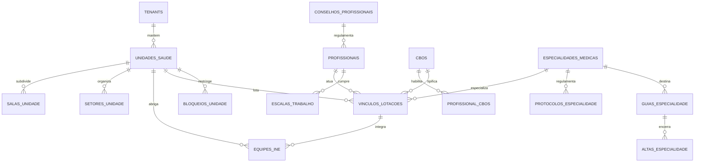

# Plano Detalhado de Execução: Etapa 03 - Unidades de Saúde, Profissionais, Especialidades e Lotações

> **Status**: Pronto para Execução  
> **Documento Vinculado**: [DOCUMENTO_MESTRE_REFATORACAO.md](file:///d:/Projetos/Delphi/refatoracao/documentacao/DOCUMENTO_MESTRE_REFATORACAO.md)  
> **Dependências**: [Etapa 00 (Infraestrutura e RBAC)](file:///d:/Projetos/Delphi/refatoracao/documentacao/planos_etapas/etapa_00_infraestrutura_layout_rbac.md) | [Etapa 01 (Cidadãos)](file:///d:/Projetos/Delphi/refatoracao/documentacao/planos_etapas/etapa_01_cidadaos_pessoas_cadunico.md) | [Etapa 02 (Território e Parâmetros)](file:///d:/Projetos/Delphi/refatoracao/documentacao/planos_etapas/etapa_02_territorio_parametros.md)  
> **Stack Oficial**: AdonisJS v6, Lucid ORM, Inertia.js v2, React 19, TypeScript, Tailwind CSS v4, shadcn/ui, Redis 7

---

## 1. Visão Geral e Alinhamento com o Projeto Original

A **Etapa 03** é o pilar estrutural do subsistema de Saúde Municipal. Nenhuma ação assistencial (triagem, atendimento médico, odontologia, dispensação de medicamentos, agendamento de consultas ou faturamento SUS) pode ocorrer sem uma unidade de saúde devidamente cadastrada no **CNES (Cadastro Nacional de Estabelecimentos de Saúde)** e sem profissionais de saúde formalmente habilitados por seus **Conselhos de Classe (CRM, COREN, CRO, CRF, etc.)**, com suas respectivas ocupações (**CBO**), equipes da Atenção Primária (**INE / e-SUS**) e escalas de trabalho.

No ecossistema Delphi legado, essa camada era composta por **45 telas auditadas**, distribuídas entre:
1. **Unidades de Saúde e Infraestrutura Física**:
   - `UPM356` (Formulário Mestre de Unidades Municipais: CNES, Órgão Digitador, Destino BPA, Quartos/Leitos e Bloqueios).
   - `Saude.View.Form.CadastroSala` (Cadastro de salas, consultórios físicos e vinculação de impressoras térmicas de etiquetas).
   - `UPM325` / `UPM325R` (Setores internos da Unidade de Saúde: Farmácia, Recepção, Vacina, Consultórios).
   - `UPM778` / `UPM778R` / `UPM779` (Unidades Formadoras de Residência Médica e Estágio Acadêmico).
   - `UPM161` (Vínculo de unidades com o SI-PNI para vacinação).
   - `Prefeitura.View.Form.ClonarConfigEspExa` (Assistente `PM1045` para replicar bloqueios de agenda e exames entre postos).
2. **Profissionais, Conselhos e Ocupações (CBO)**:
   - `UPM763` (Mapeamento de Ocupações/CBOs do profissional, procedimentos SIGTAP liberados e tipo de ficha e-SUS).
   - `UPM089` (Associação do profissional às Equipes de Saúde da Família com código INE oficial).
   - `UPM028`, `UPM747`, `UPM758`, `UPM770` (Pesquisas e vinculação de CBO e Tabela Unificada).
   - `UPM156` (CBOs autorizados para registro e aplicação no SI-PNI).
3. **Especialidades, Protocolos Clínicos e Encaminhamentos**:
   - `UPM033` / `UPM033R` / `UPM034` / `UPM050R` (Especialidades médicas/odontológicas, restrições por sexo, faixa etária e limite de gestantes).
   - `UPM420` (Protocolos clínicos de encaminhamento por especialidade: exames obrigatórios, história clínica e CIDs).
   - `UPM414`, `UPM565`, `UPM566`, `UPM809` (Tipos e gestão de Guias de Especialidade ambulatoriais e cirúrgicas).
   - `UPM575` (Controle de Alta por Especialidade de pacientes sob tratamento continuado).
4. **Regulação, Bloqueios e Deslocamento**:
   - `UPM710` (Liberação e bloqueio de exames e procedimentos diagnósticos por unidade executante).
   - `UPM489` (Procedimento de deslocamento e transporte de pacientes entre unidades / TFD).
   - `Prefeitura.View.Relatorio.Etiqueta.Identificacao.UPA` / `Simplificado` (Emissão de pulseiras térmicas com código de barras).

---

### 1.1. Mapeamento dos 45 Formulários e Telas Delphi Legadas

Abaixo está o mapeamento exaustivo de 100% das telas do domínio `03_Profissionais_e_Unidades`:

| # | Formulário / Unit Delphi Original | Caption / Função no Delphi 7 | Papel Arquitetural na Stack Web Moderna (AdonisJS + React) |
| :-: | :--- | :--- | :--- |
| **01** | **`UPM356`** (`Forms/UPM356.dfm`) | **PM356 - Cadastro de Unidades Municipais** | **`/saude/unidades` (CRUD Mestre)**: Gestão de UBS, USF, UPA, CAPS, Farmácias e Policlínicas com CNES, alvará, órgão digitador e tipo. |
| **02** | **`UPM356R`** (`Forms/UPM356R.dfm`) | **PM356R - Relação das Unidades Municipais** | **`/saude/unidades/relatorio`**: Listagem cadastral completa para conferência com exportação em PDF e Excel. |
| **03** | **`UPM357`** (`Forms/UPM357.dfm`) | **PM357 - Pesquisa de Unidades Municipais** | **Componente `SeletorUnidadeModal`**: Busca instantânea por CNES, Nome Fantasia ou Bairro com paginação assíncrona. |
| **04** | **`UPM630`** (`Forms/UPM630.dfm`) | **PM630 - Inclusão de Unidade** | **`/saude/unidades/nova`**: Assistente de cadastro rápido com validação de CNES em tempo real. |
| **05** | **`UPM618`** (`Forms/UPM618.dfm`) | **PM618 - Relação das Unidades** | **Filtros Avançados de Unidades**: Visualização agrupada por distrito sanitário e zona territorial. |
| **06** | **`Saude.View.Form.CadastroSala`** | **Cadastro de salas da unidade** | **`/saude/unidades/:id/salas`**: Cadastro de consultórios, triagem, sala de vacina, curativo e vinculação a impressoras térmicas. |
| **07** | **`UPM325`** (`Forms/UPM325.dfm`) | **PM325 - Cadastro de Setores da Unidade** | **Sub-módulo Setores**: Divisão departamental interna (Ambulatório, Farmácia, Emergência, Laboratório, Administrativo). |
| **08** | **`UPM325R`** (`Forms/UPM325R.dfm`) | **PM325R - Relação de Setores da Unidade** | **Relatório de Estrutura Física**: Relatório de setores e salas das unidades de saúde municipais. |
| **09** | **`Prefeitura.View.Frame.Selecao.Unidade`** | **Frame Seleção de Unidade** | **Componente `SelectUnidadeHeader`**: Contexto global de unidade selecionada na barra superior (estação de trabalho ativa). |
| **10** | **`Prefeitura.View.Form.ClonarConfigEspExa`** | **PM1045 - Passar configuração de bloqueio para outras unidades** | **`/saude/unidades/clonar-configuracoes`**: Assistente atômico para replicar parâmetros de bloqueio de exames e agendas para múltiplos postos. |
| **11** | **`UPM089`** (`Forms/UPM089.dfm`) | **PM089 - Inclusão de Equipe INE por Profissional** | **Aba `Equipes e-SUS (INE)` em Profissionais**: Vínculo de médicos, enfermeiros e ACS à equipe da ESF com código INE oficial. |
| **12** | **`UPM763`** (`Forms/UPM763.dfm`) | **PM763 - Inclusão de Ocupações para o Profissional** | **Gestão de Habilitações Profissionais**: Vínculo do profissional ao CBO oficial, procedimentos SIGTAP e tipo de ficha e-SUS (FAI/FAO). |
| **13** | **`UPM028`** (`Forms/UPM028.dfm`) | **PM028 - Pesquisa de CBO** | **Componente `CboAutocomplete`**: Busca de ocupações do Ministério do Trabalho integrada às regras do SUS. |
| **14** | **`UPM747`** (`Forms/UPM747.dfm`) | **PM747 - Pesquisa de CBO** | **Filtro de CBOs de Saúde**: Seleção restrita a ocupações autorizadas para assistência médica/multiprofissional. |
| **15** | **`UPM758`** (`Forms/UPM758.dfm`) | **PM758 - Pesquisa de CBO por Profissional - Tabela Unificada** | **Consulta de CBO por Profissional**: Histórico de ocupações e vínculos profissionais ativos do trabalhador. |
| **16** | **`UPM770`** (`Forms/UPM770.dfm`) | **PM770 - Pesquisa de CBO - Tabela Unificada** | **Tabela Unificada CBO/SUS**: Base de ocupações sincronizada com a tabela SIGTAP do Ministério da Saúde. |
| **17** | **`UPM033`** (`Forms/UPM033.dfm`) | **PM033 - Cadastro de Especialidade** | **`/saude/especialidades` (CRUD)**: Especialidades médicas/odontológicas com restrições clínicas (idade, sexo, limite gestante). |
| **18** | **`UPM033R`** (`Forms/UPM033R.dfm`) | **PM033R - Relação de Especialidades** | **Relatório de Especialidades**: Catálogo de especialidades ativas com tabela de parâmetros e encaminhamentos. |
| **19** | **`UPM034`** (`Forms/UPM034.dfm`) | **PM034 - Pesquisa de Especialidades** | **Seletor de Especialidade**: Busca rápida com autocomplete em agendamentos e prontuários. |
| **20** | **`UPM050R`** (`Forms/UPM050R.dfm`) | **PM050R - Relação de Especialidades** | **Relatório Sintético de Especialidades**: Listagem de ofertas por rede municipal e contratualizada. |
| **21** | **`UPM588`** (`Forms/UPM588.dfm`) | **PM588 - Pesquisa de Especialidades por Unidade** | **Visualizador de Serviços por Unidade**: Catálogo de especialidades médicas ofertadas por posto de saúde. |
| **22** | **`UPM589`** (`Forms/UPM589.dfm`) | **PM589 - Pesquisa de Profissionais por Especialidade e Unidade** | **Painel de Escala Ambulatorial**: Consulta de médicos e especialistas atuantes em cada unidade. |
| **23** | **`UPM899`** (`Forms/UPM899.dfm`) | **PM899 - Pesquisa de Especialidades por Profissional** | **Prontuário do Profissional**: Visualização das especialidades e registros (RQE) do médico. |
| **24** | **`UPM059R`** (`Forms/UPM059R.dfm`) | **PM059R - Impressão dos Horários do Profissional** | **`/saude/profissionais/:id/grade-horarios`**: Impressão da escala de trabalho semanal, dias de atendimento e horários. |
| **25** | **`UPM420`** (`Forms/UPM420.dfm`) | **PM420 - Cadastro de Protocolos x Especialidades** | **`/saude/protocolos-encaminhamento`**: Diretrizes clínicas com exames obrigatórios, histórico e CIDs necessários para encaminhar. |
| **26** | **`UPM414`** (`Forms/UPM414.dfm`) | **PM414 - Cadastro de Tipo Guia de Especialidade** | **Configuração de Guias**: Classificação de guias em Consulta Especializada, Procedimento com Sedação ou Cirurgia Eletiva. |
| **27** | **`UPM565`** (`Forms/UPM565.dfm`) | **PM565 - Guias de Especialidades** | **`/regulacao/guias-especialidades`**: Painel de gerenciamento das solicitações de consultas especializadas emitidas. |
| **28** | **`UPM566`** (`Forms/UPM566.dfm`) | **PM566 - Pesquisa de Guias de Especialidades** | **Consulta de Guias de Encaminhamento**: Rastreamento da guia pelo CPF do paciente ou número de protocolo. |
| **29** | **`UPM631R`** (`Forms/UPM631R.dfm`) | **PM631R - Relação de Guias de Unidades Solicitantes** | **Relatório de Demanda de Encaminhamentos**: Relatório de guias geradas pelas UBS de origem. |
| **30** | **`UPM633R`** (`Forms/UPM633R.dfm`) | **PM633R - Relação de Guias Por Unidades** | **Relatório de Atendimento Executante**: Relatório de guias agendadas e atendidas nos Centros de Especialidades (CEO, AME). |
| **31** | **`UPM809`** (`Forms/UPM809.dfm`) | **PM809 - Exclusão de Guias de Especialidade** | **Cancelamento Auditado de Guias**: Estorno e cancelamento com justificativa clínica e liberação de cota. |
| **32** | **`UPM575`** (`Forms/UPM575.dfm`) | **PM575 - Alta por Especialidade** | **`/saude/altas-especialidade`**: Registro de alta clínica do paciente na especialidade com retorno do cuidado à UBS de origem. |
| **33** | **`UPM710`** (`Forms/UPM710.dfm`) | **PM710 - Liberação de Exames para as Unidades** | **`/saude/bloqueios-exames`**: Matriz de regulação de exames complementares e Raio-X por unidade solicitante e executante. |
| **34** | **`UPM489`** (`Forms/UPM489.dfm`) | **PM489 - Procedimento de deslocamento da unidade - Transporte** | **Vínculo TFD / Transporte**: Associação de rotas de transporte sanitário e deslocamento de pacientes por unidade. |
| **35** | **`UPM506R`** (`Forms/UPM506R.dfm`) | **PM506R - Relação de Equipamentos por Unidades** | **Inventário Físico CNES**: Relatório de equipamentos hospitalares/odontológicos cadastrados na unidade. |
| **36** | **`UPM156`** (`Forms/UPM156.dfm`) | **PM156 - SI-PNI - CBOS** | **Tabela de Habilitação SI-PNI**: CBOs autorizados a administrar vacinas no município (Enfermeiros, Técnicos de Enfermagem). |
| **37** | **`UPM161`** (`Forms/UPM161.dfm`) | **PM161 - SI-PNI - Unidade** | **Habilitação de Sala de Vacina**: Flag e credenciamento da sala de imunização da unidade no sistema SI-PNI federal. |
| **38** | **`UPM253`** (`Forms/UPM253.dfm`) | **PM253 - Cadastro de Unidades de Medidas Laboratoriais** | **Tabela de Unidades Laboratoriais**: Cadastro de medidas de exames (`mg/dL`, `g/L`, `mm³`, `UI/mL`). |
| **39** | **`UPM253R`** (`Forms/UPM253R.dfm`) | **PM253R - Relatório de unidades de medidas laboratoriais** | **Relatório de Unidades Laboratoriais**: Catálogo para laudos de exames laboratoriais. |
| **40** | **`UPM820`** (`Forms/UPM820.dfm`) | **PM820 - Cadastro de Unidades de Itens** | **Tabela de Unidades de Materiais**: Unidades de medida de insumos (`Frasco`, `Ampola`, `Comprimido`, `Caixa`, `Kit`). |
| **41** | **`UPM778`** (`Forms/UPM778.dfm`) | **PM778 - Cadastro de Unidades Formadoras** | **`/saude/unidades-formadoras`**: Cadastro de hospitais e faculdades conveniadas para internato e residência. |
| **42** | **`UPM778R`** (`Forms/UPM778R.dfm`) | **PM778R - Relação de Unidades Formadoras** | **Relatório de Convênios Acadêmicos**: Relação de instituições de ensino parceiras da rede municipal de saúde. |
| **43** | **`UPM779`** (`Forms/UPM779.dfm`) | **PM779 - Pesquisa de Unidades Formadoras** | **Modal de Busca de Unidades Formadoras**: Pesquisa rápida para vínculo de médicos residentes e estagiários. |
| **44** | **`Prefeitura.View.Relatorio.Etiqueta.Identificacao.UPA`** | **Etiqueta de Identificação UPA** | **Emissão de Pulseiras Térmicas UPA**: Impressão padrão Manchester com código de barras, nome, CNS, data e hora de acolhimento. |
| **45** | **`Prefeitura.View.Relatorio.Etiqueta.Identificacao.Simplificado.UPA`** | **Etiqueta Identificação UPA Simplificado** | **Etiqueta de Prontuário / Tubos de Ensaio**: Impressão compacta para fichas de evolução rápida e coletas laboratoriais. |

---

## 2. Modelagem de Dados Relacional (Lucid ORM & Migrations)

A modelagem de dados da Etapa 03 foi projetada para garantir compatibilidade estrita com os padrões do **DATASUS (CNES, SIGTAP e e-SUS APS)**, mantendo a performance de leitura através de índices otimizados e relacionamentos normalizados:



### 2.1. Estrutura DDL das Tabelas

#### Tabela `conselhos_profissionais`
```sql
CREATE TABLE conselhos_profissionais (
    id SERIAL PRIMARY KEY,
    sigla VARCHAR(15) NOT NULL UNIQUE, -- CRM, COREN, CRO, CRF, CREFITO, CRP, CFN
    nome VARCHAR(120) NOT NULL,
    uf VARCHAR(2) DEFAULT 'SP',
    ativo BOOLEAN DEFAULT TRUE,
    created_at TIMESTAMP WITH TIME ZONE DEFAULT CURRENT_TIMESTAMP,
    updated_at TIMESTAMP WITH TIME ZONE DEFAULT CURRENT_TIMESTAMP
);
```

#### Tabela `cbos` (Classificação Brasileira de Ocupações - Oficial SIGTAP/Ministério da Saúde)
```sql
CREATE TABLE cbos (
    id SERIAL PRIMARY KEY,
    codigo VARCHAR(10) NOT NULL UNIQUE, -- Ex: "225125" (Médico Clínico), "223505" (Enfermeiro)
    ocupacao VARCHAR(150) NOT NULL,
    tipo VARCHAR(50) DEFAULT 'Saúde',
    permite_prescricao BOOLEAN DEFAULT FALSE,
    permite_atendimento_individual BOOLEAN DEFAULT FALSE,
    permite_atendimento_odontologico BOOLEAN DEFAULT FALSE,
    permite_vacinacao_sipni BOOLEAN DEFAULT FALSE, -- Mapeia UPM156
    ativo BOOLEAN DEFAULT TRUE,
    created_at TIMESTAMP WITH TIME ZONE DEFAULT CURRENT_TIMESTAMP,
    updated_at TIMESTAMP WITH TIME ZONE DEFAULT CURRENT_TIMESTAMP
);
CREATE INDEX idx_cbos_codigo ON cbos (codigo);
CREATE INDEX idx_cbos_ocupacao ON cbos (ocupacao);
```

#### Tabela Mestre `unidades_saude`
```sql
CREATE TABLE unidades_saude (
    id UUID PRIMARY KEY DEFAULT gen_random_uuid(),
    tenant_id UUID NOT NULL REFERENCES tenants(id) ON DELETE RESTRICT,
    codigo_municipal INTEGER NOT NULL, -- Código de controle legado (CodPos / CodUni)
    cnes VARCHAR(7) NOT NULL,          -- Código Nacional de Estabelecimentos de Saúde (7 dígitos)
    razao_social VARCHAR(150) NOT NULL,
    nome_fantasia VARCHAR(150) NOT NULL,
    tipo_unidade VARCHAR(30) NOT NULL CHECK (tipo_unidade IN (
        'UBS', 'USF', 'UPA', 'CAPS', 'POLICLINICA', 'FARMACIA', 
        'CENTRO_ESPECIALIDADES', 'HOSPITAL_MUNICIPAL', 'LABORATORIO', 'MATERNIDADE'
    )),
    cnpj VARCHAR(14),
    diretor_tecnico VARCHAR(150),
    diretor_tecnico_crm VARCHAR(30),
    orgao_digitador_codigo INTEGER,   -- Mapeia tb_OrgaoDigitador do Delphi UPM356
    destino_bpa_codigo INTEGER,       -- Mapeia tb_DestinoBPA do Delphi UPM356
    
    -- Endereço e Contato
    telefone VARCHAR(20),
    email VARCHAR(100),
    logradouro VARCHAR(150) NOT NULL,
    numero VARCHAR(20) NOT NULL,
    complemento VARCHAR(50),
    bairro_id UUID REFERENCES bairros(id) ON DELETE SET NULL,
    cep VARCHAR(8) NOT NULL,
    
    -- Parâmetros Operacionais
    horario_funcionamento VARCHAR(100) DEFAULT '07:00 às 17:00',
    possui_sala_vacina BOOLEAN DEFAULT FALSE, -- Mapeia UPM161 (SI-PNI)
    possui_farmacia BOOLEAN DEFAULT FALSE,
    possui_urgencia_emergencia BOOLEAN DEFAULT FALSE,
    possui_atendimento_odontologico BOOLEAN DEFAULT FALSE,
    permite_tfd_transporte BOOLEAN DEFAULT FALSE, -- Mapeia UPM489
    
    -- Capacidade Hospitalar
    total_leitos_observacao INTEGER DEFAULT 0,
    total_leitos_internacao INTEGER DEFAULT 0,
    
    ativa BOOLEAN DEFAULT TRUE,
    created_at TIMESTAMP WITH TIME ZONE DEFAULT CURRENT_TIMESTAMP,
    updated_at TIMESTAMP WITH TIME ZONE DEFAULT CURRENT_TIMESTAMP,
    CONSTRAINT uq_unidades_tenant_cnes UNIQUE (tenant_id, cnes),
    CONSTRAINT uq_unidades_tenant_codigo UNIQUE (tenant_id, codigo_municipal)
);
CREATE INDEX idx_unidades_tenant_nome ON unidades_saude (tenant_id, nome_fantasia);
CREATE INDEX idx_unidades_cnes ON unidades_saude (cnes);
```

#### Tabela `setores_unidade` (Mapeia `UPM325` do Delphi)
```sql
CREATE TABLE setores_unidade (
    id UUID PRIMARY KEY DEFAULT gen_random_uuid(),
    unidade_saude_id UUID NOT NULL REFERENCES unidades_saude(id) ON DELETE CASCADE,
    codigo INTEGER NOT NULL,
    nome VARCHAR(100) NOT NULL, -- Ex: "Ambulatório", "Triagem", "Emergência", "Farmácia", "Almoxarifado"
    responsavel VARCHAR(120),
    ramal VARCHAR(20),
    ativo BOOLEAN DEFAULT TRUE,
    created_at TIMESTAMP WITH TIME ZONE DEFAULT CURRENT_TIMESTAMP,
    updated_at TIMESTAMP WITH TIME ZONE DEFAULT CURRENT_TIMESTAMP,
    CONSTRAINT uq_setor_unidade_codigo UNIQUE (unidade_saude_id, codigo)
);
```

#### Tabela `salas_unidade` (Mapeia `Saude.View.Form.CadastroSala` do Delphi)
```sql
CREATE TABLE salas_unidade (
    id UUID PRIMARY KEY DEFAULT gen_random_uuid(),
    unidade_saude_id UUID NOT NULL REFERENCES unidades_saude(id) ON DELETE CASCADE,
    setor_id UUID REFERENCES setores_unidade(id) ON DELETE SET NULL,
    codigo INTEGER NOT NULL,
    descricao VARCHAR(100) NOT NULL, -- Ex: "Consultório 01 - Médico", "Sala de Curativos", "Sala de Triagem"
    tipo_sala VARCHAR(30) DEFAULT 'CONSULTORIO' CHECK (tipo_sala IN (
        'CONSULTORIO', 'TRIAGEM', 'VACINA', 'CURATIVO', 'ODONTOLOGIA', 
        'OBSERVACAO', 'COLETA_LABORATORIO', 'FARMACIA_DISPENSACAO'
    )),
    impressora_etiquetas VARCHAR(150), -- Impressora térmica vinculada para etiquetas/pulseiras
    ativa BOOLEAN DEFAULT TRUE,
    created_at TIMESTAMP WITH TIME ZONE DEFAULT CURRENT_TIMESTAMP,
    updated_at TIMESTAMP WITH TIME ZONE DEFAULT CURRENT_TIMESTAMP,
    CONSTRAINT uq_sala_unidade_codigo UNIQUE (unidade_saude_id, codigo)
);
```

#### Tabela `equipes_ine` (Equipes de Saúde da Família e-SUS APS - Mapeia `UPM089`)
```sql
CREATE TABLE equipes_ine (
    id UUID PRIMARY KEY DEFAULT gen_random_uuid(),
    tenant_id UUID NOT NULL REFERENCES tenants(id) ON DELETE RESTRICT,
    unidade_saude_id UUID NOT NULL REFERENCES unidades_saude(id) ON DELETE RESTRICT,
    codigo_ine VARCHAR(10) NOT NULL, -- Identificador Nacional de Equipe (10 dígitos do CNES/e-SUS)
    nome_equipe VARCHAR(120) NOT NULL,
    tipo_equipe VARCHAR(30) DEFAULT 'ESF' CHECK (tipo_equipe IN (
        'ESF', 'ESB', 'EAP', 'EMULTI', 'CONSULTORIO_NA_RUA', 'EAC'
    )),
    area VARCHAR(10) NOT NULL, -- Área de abrangência da equipe no território
    ativa BOOLEAN DEFAULT TRUE,
    created_at TIMESTAMP WITH TIME ZONE DEFAULT CURRENT_TIMESTAMP,
    updated_at TIMESTAMP WITH TIME ZONE DEFAULT CURRENT_TIMESTAMP,
    CONSTRAINT uq_equipes_tenant_ine UNIQUE (tenant_id, codigo_ine)
);
CREATE INDEX idx_equipes_unidade ON equipes_ine (unidade_saude_id);
```

#### Tabela `especialidades_medicas` (Mapeia `UPM033` do Delphi)
```sql
CREATE TABLE especialidades_medicas (
    id UUID PRIMARY KEY DEFAULT gen_random_uuid(),
    tenant_id UUID NOT NULL REFERENCES tenants(id) ON DELETE RESTRICT,
    codigo INTEGER NOT NULL,
    nome VARCHAR(120) NOT NULL,
    descricao TEXT,
    tipo_ficha_esus VARCHAR(20) DEFAULT 'MEDICA' CHECK (tipo_ficha_esus IN ('MEDICA', 'ODONTOLOGICA', 'ENFERMAGEM', 'PROCEDIMENTO')),
    
    -- Códigos de encaminhamento oficial e-SUS (FAI e FAO mapeados de UPM033)
    esus_encaminhamento_fai_codigo INTEGER,
    esus_encaminhamento_fao_codigo INTEGER,
    
    -- Restrições Clínicas de Acesso (Mapeadas de UPM033)
    restricao_sexo VARCHAR(1) DEFAULT 'T' CHECK (restricao_sexo IN ('M', 'F', 'T')), -- M=Masculino, F=Feminino, T=Todos
    faixa_etaria_inicial INTEGER DEFAULT 0, -- Idade mínima permitida
    faixa_etaria_final INTEGER DEFAULT 120, -- Idade máxima permitida
    limitar_guia_gestante BOOLEAN DEFAULT FALSE,
    limite_guias_gestante INTEGER DEFAULT 0,
    
    permite_regulacao_cota BOOLEAN DEFAULT TRUE,
    ativo BOOLEAN DEFAULT TRUE,
    created_at TIMESTAMP WITH TIME ZONE DEFAULT CURRENT_TIMESTAMP,
    updated_at TIMESTAMP WITH TIME ZONE DEFAULT CURRENT_TIMESTAMP,
    CONSTRAINT uq_especialidades_tenant_codigo UNIQUE (tenant_id, codigo)
);
```

#### Tabela `protocolos_especialidade` (Mapeia `UPM420` do Delphi)
```sql
CREATE TABLE protocolos_especialidade (
    id UUID PRIMARY KEY DEFAULT gen_random_uuid(),
    especialidade_id UUID NOT NULL REFERENCES especialidades_medicas(id) ON DELETE CASCADE,
    codigo INTEGER NOT NULL,
    descricao VARCHAR(150) NOT NULL,
    motivo_encaminhamento_padrao TEXT,
    historia_doenca_obrigatoria TEXT,
    exames_complementares_obrigatorios TEXT, -- Exames prévios que o paciente deve ter feito
    exame_fisico_obrigatorio TEXT,
    cids_autorizados JSONB DEFAULT '[]'::jsonb, -- Lista de CIDs válidos para este protocolo
    ativo BOOLEAN DEFAULT TRUE,
    created_at TIMESTAMP WITH TIME ZONE DEFAULT CURRENT_TIMESTAMP,
    updated_at TIMESTAMP WITH TIME ZONE DEFAULT CURRENT_TIMESTAMP
);
```

#### Tabela `profissionais` (Cadastro Central de Profissionais de Saúde)
```sql
CREATE TABLE profissionais (
    id UUID PRIMARY KEY DEFAULT gen_random_uuid(),
    tenant_id UUID NOT NULL REFERENCES tenants(id) ON DELETE RESTRICT,
    codope INTEGER, -- Código de operador legado no Delphi
    nome VARCHAR(150) NOT NULL,
    nome_social VARCHAR(150),
    cpf VARCHAR(11) NOT NULL,
    cns VARCHAR(15) NOT NULL, -- Cartão Nacional de Saúde (obrigatório para envio e-SUS e faturamento BPA)
    data_nascimento DATE,
    sexo VARCHAR(1) CHECK (sexo IN ('M', 'F')),
    email VARCHAR(100),
    telefone VARCHAR(20),
    
    -- Conselho Profissional Principal
    conselho_id INTEGER REFERENCES conselhos_profissionais(id),
    numero_conselho VARCHAR(30),
    uf_conselho VARCHAR(2) DEFAULT 'SP',
    rqe_registro_especialista VARCHAR(30), -- Registro de Qualificação de Especialista
    
    -- CBO Primário
    cbo_id INTEGER REFERENCES cbos(id),
    
    -- Vínculo com Usuário do Sistema (Login RBAC da Etapa 00)
    user_id UUID REFERENCES users(id) ON DELETE SET NULL,
    
    status VARCHAR(20) DEFAULT 'ativo' CHECK (status IN ('ativo', 'inativo', 'afastado', 'ferias')),
    created_at TIMESTAMP WITH TIME ZONE DEFAULT CURRENT_TIMESTAMP,
    updated_at TIMESTAMP WITH TIME ZONE DEFAULT CURRENT_TIMESTAMP,
    CONSTRAINT uq_profissionais_tenant_cpf UNIQUE (tenant_id, cpf),
    CONSTRAINT uq_profissionais_tenant_cns UNIQUE (tenant_id, cns)
);
CREATE INDEX idx_profissionais_tenant_nome ON profissionais (tenant_id, nome);
CREATE INDEX idx_profissionais_cpf ON profissionais (cpf);
CREATE INDEX idx_profissionais_conselho ON profissionais (numero_conselho);
```

#### Tabela `vinculos_lotacoes` (Matriz de Lotação Profissional x Unidade x CBO x Equipe)
```sql
CREATE TABLE vinculos_lotacoes (
    id UUID PRIMARY KEY DEFAULT gen_random_uuid(),
    profissional_id UUID NOT NULL REFERENCES profissionais(id) ON DELETE CASCADE,
    unidade_saude_id UUID NOT NULL REFERENCES unidades_saude(id) ON DELETE CASCADE,
    especialidade_id UUID REFERENCES especialidades_medicas(id) ON DELETE SET NULL,
    cbo_id INTEGER NOT NULL REFERENCES cbos(id),
    equipe_ine_id UUID REFERENCES equipes_ine(id) ON DELETE SET NULL, -- Equipe e-SUS vinculada
    carga_horaria_semanal INTEGER DEFAULT 40,
    cargo VARCHAR(80),
    tipo_vinculo VARCHAR(30) DEFAULT 'ESTATUTARIO' CHECK (tipo_vinculo IN (
        'ESTATUTARIO', 'CLT', 'CONTRATO_TEMPORARIO', 'CREDENCIADO', 'RESIDENTE'
    )),
    data_admissao DATE,
    data_desligamento DATE,
    ativo BOOLEAN DEFAULT TRUE,
    created_at TIMESTAMP WITH TIME ZONE DEFAULT CURRENT_TIMESTAMP,
    updated_at TIMESTAMP WITH TIME ZONE DEFAULT CURRENT_TIMESTAMP
);
CREATE INDEX idx_lotacoes_profissional ON vinculos_lotacoes (profissional_id);
CREATE INDEX idx_lotacoes_unidade ON vinculos_lotacoes (unidade_saude_id);
```

#### Tabela `escalas_trabalho` (Horários e Agendas Semanais - Mapeia `UPM059R`)
```sql
CREATE TABLE escalas_trabalho (
    id UUID PRIMARY KEY DEFAULT gen_random_uuid(),
    vinculo_lotacao_id UUID NOT NULL REFERENCES vinculos_lotacoes(id) ON DELETE CASCADE,
    dia_semana INTEGER NOT NULL CHECK (dia_semana BETWEEN 1 AND 7), -- 1=Domingo, 2=Segunda, ..., 7=Sábado
    hora_inicio TIME NOT NULL,
    hora_fim TIME NOT NULL,
    intervalo_inicio TIME,
    intervalo_fim TIME,
    tempo_consulta_minutos INTEGER DEFAULT 20,
    vagas_agendadas INTEGER DEFAULT 12,
    vagas_encaixe INTEGER DEFAULT 4,
    ativo BOOLEAN DEFAULT TRUE,
    created_at TIMESTAMP WITH TIME ZONE DEFAULT CURRENT_TIMESTAMP,
    updated_at TIMESTAMP WITH TIME ZONE DEFAULT CURRENT_TIMESTAMP
);
CREATE INDEX idx_escalas_vinculo ON escalas_trabalho (vinculo_lotacao_id);
```

#### Tabela `bloqueios_unidade_agenda_exame` (Mapeia `UPM710` e `tb_LiberaAgendaUnidade` de `UPM356`)
```sql
CREATE TABLE bloqueios_unidade_agenda_exame (
    id UUID PRIMARY KEY DEFAULT gen_random_uuid(),
    tenant_id UUID NOT NULL REFERENCES tenants(id) ON DELETE RESTRICT,
    tipo_bloqueio VARCHAR(20) NOT NULL CHECK (tipo_bloqueio IN ('AGENDA', 'EXAME')),
    unidade_solicitante_id UUID NOT NULL REFERENCES unidades_saude(id) ON DELETE CASCADE,
    unidade_executante_id UUID NOT NULL REFERENCES unidades_saude(id) ON DELETE CASCADE,
    especialidade_id UUID REFERENCES especialidades_medicas(id) ON DELETE CASCADE,
    procedimento_id INTEGER, -- Código do exame ou procedimento SIGTAP
    situacao VARCHAR(20) DEFAULT 'BLOQUEADO' CHECK (situacao IN ('LIBERADO', 'BLOQUEADO', 'COTADO')),
    motivo_bloqueio VARCHAR(200),
    created_at TIMESTAMP WITH TIME ZONE DEFAULT CURRENT_TIMESTAMP,
    updated_at TIMESTAMP WITH TIME ZONE DEFAULT CURRENT_TIMESTAMP
);
CREATE INDEX idx_bloqueios_solicitante_executante ON bloqueios_unidade_agenda_exame (unidade_solicitante_id, unidade_executante_id);
```

#### Tabela `guias_especialidade` e `altas_especialidade` (Mapeia `UPM414`, `UPM565`, `UPM575`)
```sql
CREATE TABLE guias_especialidade (
    id UUID PRIMARY KEY DEFAULT gen_random_uuid(),
    tenant_id UUID NOT NULL REFERENCES tenants(id) ON DELETE RESTRICT,
    numero_guia VARCHAR(20) NOT NULL UNIQUE,
    cidadao_id UUID NOT NULL REFERENCES cidadaos(id) ON DELETE RESTRICT,
    unidade_solicitante_id UUID NOT NULL REFERENCES unidades_saude(id) ON DELETE RESTRICT,
    profissional_solicitante_id UUID NOT NULL REFERENCES profissionais(id) ON DELETE RESTRICT,
    especialidade_id UUID NOT NULL REFERENCES especialidades_medicas(id) ON DELETE RESTRICT,
    protocolo_id UUID REFERENCES protocolos_especialidade(id),
    unidade_executante_id UUID REFERENCES unidades_saude(id),
    tipo_guia VARCHAR(30) DEFAULT 'CONSULTA' CHECK (tipo_guia IN ('CONSULTA', 'CIRURGIA', 'EXAME_ESPECIALIZADO')),
    motivo_clinico TEXT NOT NULL,
    cid_principal VARCHAR(10) NOT NULL,
    status VARCHAR(20) DEFAULT 'PENDENTE' CHECK (status IN ('PENDENTE', 'AUTORIZADA', 'AGENDADA', 'ATENDIDA', 'CANCELADA', 'ALTA')),
    created_at TIMESTAMP WITH TIME ZONE DEFAULT CURRENT_TIMESTAMP,
    updated_at TIMESTAMP WITH TIME ZONE DEFAULT CURRENT_TIMESTAMP
);

CREATE TABLE altas_especialidade (
    id UUID PRIMARY KEY DEFAULT gen_random_uuid(),
    guia_especialidade_id UUID NOT NULL REFERENCES guias_especialidade(id) ON DELETE CASCADE,
    profissional_alta_id UUID NOT NULL REFERENCES profissionais(id) ON DELETE RESTRICT,
    unidade_alta_id UUID NOT NULL REFERENCES unidades_saude(id) ON DELETE RESTRICT,
    motivo_alta VARCHAR(255) NOT NULL,
    orientacoes_retorno_ubs TEXT,
    data_alta TIMESTAMP WITH TIME ZONE DEFAULT CURRENT_TIMESTAMP
);
```

---

## 3. Serviços e Regras de Negócio no Backend (AdonisJS 6)

### 3.1. Validador do Código CNES (`CnesValidationService`)
O CNES é o identificador nacional de 7 dígitos exigido para faturamento SUS e relatórios do Ministério da Saúde. O serviço valida formato, unicidade e faz integração com o webservice do DATASUS para recuperação de dados cadastrais oficiais quando disponível.

### 3.2. Validador de Conselhos de Classe e Conflitos de Escala (`ProfissionalEscalaService`)
1. **Validação de Registro de Classe**:
   - Para médicos (`CRM`), enfermeiros (`COREN`) e cirurgiões-dentistas (`CRO`), o número do registro e UF são validados contra padrões estritos.
2. **Prevenção de Sobreposição de Horários**:
   - Ao salvar uma nova escala de trabalho para um profissional:
   - O serviço verifica se existe sobreposição de horários (`dia_semana`, `hora_inicio`, `hora_fim`) em qualquer outro vínculo ativo do mesmo profissional (em postos diferentes ou na mesma unidade).
   - Caso haja choque de horário, a operação é bloqueada com retorno descritivo de erro.

### 3.3. Serviço de Clonagem de Regras de Bloqueio (`ClonarBloqueiosService`)
Substitui a tela `PM1045` (`Prefeitura.View.Form.ClonarConfigEspExa`):
- Recebe a `unidade_origem_id` e uma lista de `unidades_destino_ids[]`.
- Dentro de uma transação ACID (`db.transaction()`):
  - Lê todas as regras de `bloqueios_unidade_agenda_exame` da unidade de origem.
  - Para cada unidade de destino, remove configurações obsoletas e insere as cópias exatas das regras de liberação/bloqueio de agendas e exames.
  - Invalida as tags de cache em Redis.

### 3.4. Cache em Redis 7 para Desempenho Operacional (`SaudeCacheService`)
Como as unidades de saúde, especialidades e matrizes de bloqueio são consultadas centenas de vezes por minuto na recepção e consultórios:
- **`saude:unidades:{tenantId}:ativas`**: Cache da lista de postos de saúde ativos (TTL: 24 horas, invalidado na edição de unidade).
- **`saude:especialidades:{tenantId}:ativas`**: Cache de especialidades médicas com suas regras de restrição etária/sexo.
- **`saude:bloqueio:{unidadeOrigemId}:{unidadeDestinoId}`**: Hashmap em memória que responde em `< 2ms` se um posto tem permissão de encaminhar pacientes para outro.

---

## 4. Frontend: Telas e Componentes React 19 + shadcn/ui

### 4.1. `Unidades/Index.tsx` e `FormModal.tsx`
- **Dashboard Operacional**:
  - Cards de topo com contagem total de unidades, UBSs, UPAs, CAPS e Farmácias Municipais.
  - Barra de pesquisa instantânea com debounce (busca por Nome Fantasia, Razão Social, CNES ou Diretor Técnico).
  - Tabela responsiva com badges coloridos por tipo de estabelecimento e link para mapa de salas.
- **Formulário com Abas Estruturadas**:
  - **Aba 1 (Identificação & CNES)**: CNES, Nome Fantasia, Razão Social, Tipo de Unidade, Órgão Digitador, Destino BPA, CNPJ, Diretor Técnico.
  - **Aba 2 (Endereço & Contatos)**: CEP integrado, Logradouro, Número, Bairro, Telefone e E-mail oficial.
  - **Aba 3 (Salas & Consultórios)**: Gerenciamento inline das salas físicas (`Saude.View.Form.CadastroSala`) com tipo e impressora vinculada.
  - **Aba 4 (Setores & Departamentos)**: Gestão dos setores internos da unidade (`UPM325`).
  - **Aba 5 (Capacidade)**: Número de leitos de observação, internação e flags de serviços (Vacina SI-PNI, Farmácia, Urgência).

### 4.2. `Profissionais/Index.tsx` e `FormModal.tsx`
- **Painel de Gestão do Corpo Clínico**:
  - Contadores rápidos: Total de Profissionais, Médicos Ativos (CRM), Enfermeiros Ativos (COREN) e Dentistas (CRO).
  - Filtro avançado com busca por Nome, CPF, CNS ou Número do Conselho.
- **Formulário com Abas Especializadas**:
  - **Aba 1 (Dados Civis)**: Nome Completo, Nome Social, CPF com máscara e validação, CNS (15 dígitos), Data de Nascimento, E-mail e Celular.
  - **Aba 2 (Habilitação Profissional)**: Conselho de Classe, Número de Registro, UF, CBO Principal e RQE de Especialista.
  - **Aba 3 (Lotações & Equipes e-SUS)**: Matriz de vínculos por unidade, CBO de atuação e Equipe INE da ESF (`UPM089`).
  - **Aba 4 (Escala Semanal & Horários)**: Grade interativa de horários por dia da semana (`UPM059R`) com definição de tempo de consulta e capacidade de vagas.

### 4.3. `Especialidades/Index.tsx` e `ProtocolosModal.tsx`
- **Gestão de Especialidades (`UPM033`)**:
  - Tabela com filtros por tipo de ficha e-SUS (Médica, Odontológica, Procedimento).
  - Configuração de restrições de público: Sexo (M/F/Todos), Faixa Etária mínima e máxima, e cota especial para Gestantes.
  - Mapeamento direto de códigos de encaminhamento FAI e FAO do Ministério da Saúde.
- **Gerenciador de Protocolos de Encaminhamento (`UPM420`)**:
  - Editor de diretrizes clínicas: exames laboratoriais e de imagem obrigatórios pré-encaminhamento.
  - Seleção de CIDs autorizados para direcionamento à especialidade.

### 4.4. `Unidades/ClonarConfiguracoes.tsx` (Substitui `PM1045` / `Prefeitura.View.Form.ClonarConfigEspExa`)
- **Assistente Interativo de 3 Passos**:
  - **Passo 1**: Seleção da Unidade Modelo (posto com regras já homologadas).
  - **Passo 2**: Seleção múltipla das unidades de saúde de destino que receberão as mesmas configurações.
  - **Passo 3**: Resumo comparativo e execução com feedback visual em tempo real.

### 4.5. `Atendimento/EtiquetasUpaModal.tsx` (Substitui `Prefeitura.View.Relatorio.Etiqueta.Identificacao.UPA`)
- **Emissão de Pulseiras e Etiquetas Térmicas**:
  - Geração de PDF vetorial formatado para impressoras térmicas (Zebra, Elgin, Argox).
  - Código de barras padrão Code 128 com número de prontuário, CNS, nome do paciente, data de nascimento e cor da classificação de risco Manchester.

---

## 5. Roteiro Passo a Passo de Implementação (Roadmap Técnico)

| Passo | Fase Técnica | Atividades Executadas | Entregáveis |
| :---: | :--- | :--- | :--- |
| **Passo 1** | **Migrations da Etapa 03** | Criação das tabelas relacionais no banco de dados corporativo. | Migrations para `conselhos_profissionais`, `cbos`, `unidades_saude`, `setores_unidade`, `salas_unidade`, `equipes_ine`, `especialidades_medicas`, `protocolos_especialidade`, `profissionais`, `vinculos_lotacoes`, `escalas_trabalho`, `bloqueios_unidade_agenda_exame`, `guias_especialidade`, `altas_especialidade`. |
| **Passo 2** | **Seeds das Tabelas Oficiais** | Carga das tabelas federais do DATASUS e Ministério da Saúde. | Seeders populados com Conselhos (CRM, COREN, CRO, etc.), Tabela completa de CBOs de Saúde com flags SI-PNI, e Especialidades Médicas fundamentais. |
| **Passo 3** | **Models Lucid ORM e Relacionamentos** | Criação e amarração dos modelos com tipagem estrita TypeScript. | Models `UnidadeSaude`, `SetorUnidade`, `SalaUnidade`, `EquipeIne`, `ConselhoProfissional`, `Cbo`, `EspecialidadeMedica`, `ProtocoloEspecialidade`, `Profissional`, `VinculoLotacao`, `EscalaTrabalho`, `BloqueioUnidade`. |
| **Passo 4** | **Serviços de Domínio e Cache Redis** | Implementação dos validadores de regras de negócio e performance. | `CnesValidationService`, `ProfissionalEscalaService`, `ClonarBloqueiosService` e `SaudeCacheService`. |
| **Passo 5** | **Validators e Controllers AdonisJS 6** | Endpoints de API e controladores de renderização Inertia. | `UnidadesController`, `ProfissionaisController`, `EspecialidadesController`, `LotacoesController` e validadores VineJS/Zod. |
| **Passo 6** | **Interfaces React 19 + shadcn/ui** | Telas modernas, acessíveis e responsivas. | Páginas completas em `inertia/pages/unidades/`, `inertia/pages/profissionais/` e `inertia/pages/especialidades/`. |
| **Passo 7** | **Emissão de Impressos e Relatórios** | Geração de PDFs de escalas e etiquetas térmicas. | Componente de impressão da Grade de Horários (`UPM059R`) e Etiqueta Térmica de Pulseira UPA com código de barras. |
| **Passo 8** | **Testes Automatizados e Homologação** | Bateria de testes de integridade e auditoria. | Testes unitários de validação de CNS/CNES, testes de conflito de escalas e homologação com 100% dos formulários legados cobertos. |

---

## 6. Critérios de Aceitação e Homologação da Etapa 03

1. **Integridade de Estabelecimentos (CNES)**:
   - Todo cadastro de unidade de saúde possui CNES com exatamente 7 dígitos numéricos válidos e unicidade garantida por tenant.
   - O sistema impede o fechamento de faturamento SUS ou envio e-SUS para unidades com CNES inativo ou não cadastrado.
2. **Validação do Corpo Clínico**:
   - Todo profissional médico, enfermeiro ou dentista possui número de conselho e CBO válido associado.
   - O CNS do profissional deve conter 15 dígitos numéricos em conformidade com o algoritmo oficial do Ministério da Saúde.
3. **Controle de Escala e Prevenção de Conflitos**:
   - O sistema detecta e impede a alocação de um profissional em mais de uma unidade no mesmo dia da semana e faixa de horário.
   - A impressão da escala de trabalho (`UPM059R`) reflete exatamente os dias, horários e tempo médio de consulta parametrizados.
4. **Governança de Encaminhamentos e Protocolos**:
   - Ao solicitar consulta em especialidade com protocolo clínico ativo (`UPM420`), o sistema exige o preenchimento dos exames complementares obrigatórios e valida o CID informado.
   - As restrições de sexo e faixa etária cadastradas na especialidade (`UPM033`) são respeitadas com bloqueio imediato na tela de agendamento.
5. **Eficiência da Clonagem de Configurações**:
   - A rotina de clonagem de bloqueios (`PM1045`) replica as permissões e impedimentos para as unidades selecionadas em transação atômica em menos de 1 segundo.
6. **Emissão de Etiquetas UPA**:
   - A geração da etiqueta/pulseira de atendimento de urgência (`Prefeitura.View.Relatorio.Etiqueta.Identificacao.UPA`) gera o código de barras legível por qualquer leitor óptico padrão de mercado.

---
*Este documento é a referência canônica e exaustiva para a execução da Etapa 03 do projeto de refatoração do Ecossistema Prefeitura.*
