# Plano Detalhado de Execução: Etapa 04 - Recepção, Acolhimento, Triagem Manchester e Atendimento Clínico (PEP)

> **Status**: Pronto para Execução  
> **Documento Vinculado**: [DOCUMENTO_MESTRE_REFATORACAO.md](file:///d:/Projetos/Delphi/refatoracao/documentacao/DOCUMENTO_MESTRE_REFATORACAO.md)  
> **Dependências**: [Etapa 00 (Infraestrutura e RBAC)](file:///d:/Projetos/Delphi/refatoracao/documentacao/planos_etapas/etapa_00_infraestrutura_layout_rbac.md) | [Etapa 01 (Cidadãos)](file:///d:/Projetos/Delphi/refatoracao/documentacao/planos_etapas/etapa_01_cidadaos_pessoas_cadunico.md) | [Etapa 02 (Território e Parâmetros)](file:///d:/Projetos/Delphi/refatoracao/documentacao/planos_etapas/etapa_02_territorio_parametros.md) | [Etapa 03 (Unidades e Profissionais)](file:///d:/Projetos/Delphi/refatoracao/documentacao/planos_etapas/etapa_03_unidades_profissionais_lotacoes.md)  
> **Stack Oficial**: AdonisJS v6, Lucid ORM, Inertia.js v2, React 19, TypeScript, Tailwind CSS v4, shadcn/ui, Redis 7, WebSockets / SSE

---

## 1. Visão Geral e Alinhamento com o Projeto Original

A **Etapa 04** constitui o coração assistencial do Ecossistema de Saúde Pública Municipal. É nesta etapa que ocorrem o primeiro contato do cidadão na unidade de saúde, a triagem com classificação de risco pelo **Protocolo de Manchester**, a chamada por painéis de TV em consultórios, a realização da consulta médica e odontológica com o **Prontuário Eletrônico do Paciente (PEP)** no método **SOAP**, a emissão de prescrições e atestados com assinatura digital, o registro de procedimentos de enfermagem, o lançamento de ações de saúde mental (**RAAS / CAPS**) e as escalas clínicas especializadas (**IVCF-20** e **M-CHAT**).

No sistema Delphi legado, essa camada englobava **66 telas auditadas**, distribuídas entre:
1. **Acolhimento, Recepção e Fila de Atendimento**:
   - `UPM067` (Formulário Mestre de Atendimentos / FAA - Ficha de Atendimento Ambulatorial).
   - `UPM764` (Pronto Atendimento - Tabela Unificada para portas de entrada de UPAs e PAs).
   - `UPM177` (Cancelamento de atendimentos marcados no dia por falta do paciente ou profissional).
   - `UPM610` (Central de Atendimento Telefônico ao Usuário - C.A.T.U.).
   - `UPM611` (Detalhes do atendimento e histórico de encaminhamentos).
2. **Triagem Clínica e Classificação de Risco (Manchester)**:
   - `UPM976` (Triagem de Atendimentos: aferição de sinais vitais, antropometria, saturação de O2, dor e classificação por cores: Vermelho, Laranja, Amarelo, Verde e Azul).
   - `Prefeitura.View.Form.IVCF` (PM1021 - Índice de Vulnerabilidade Clínico-Funcional para Idosos / IVCF-20).
   - `Prefeitura.View.Form.Pesquisa.Autismo` (PM1039 - Ficha de Triagem do Autismo / Escala M-CHAT para pediatria).
   - `Prefeitura.View.Form.Sae` (PM1048 - Sistematização da Assistência de Enfermagem - SAE).
   - `UPM748` (Procedimentos de Enfermagem: curativos, sondagens, administração de medicamentos, cálculo de DUM e semana gestacional).
3. **Prontuário Eletrônico do Paciente (PEP) e Consultório Clínico**:
   - `UPM045` / `UPM045R` (Prontuário Eletrônico Mestre e Relatório com suporte a certificado digital).
   - `UPM166` e `UPM608` (Manutenção e Inclusão de Prontuários).
   - `UPM542` (Histórico cronológico consolidado de atendimentos pregressos do munícipe).
   - `UPM243` e `UPM246` (Cadastro de locais e itens de evolução clínica por especialidade).
   - `UPM344` (Configuração de Sigilo e Confidencialidade no Prontuário Eletrônico).
   - `UPM247` (Histórico e auditoria de impressões do Prontuário Eletrônico com rastreamento do operador).
   - `UPM126` e `UPM291R` (Impressão de fichas de evolução clínica e sumário de alta).
4. **Prescrições, Atestados e Solicitações de Exames**:
   - `Prefeitura.View.Form.NovoAtestado` (PM1044) e `UPM876` (Emissão de Atestados Médicos com CID e dias de repouso).
   - `UPM341` (Acompanhamento de atendimentos com exames laboratoriais e de imagem solicitados no PEP).
   - `UPM217`, `UPM219`, `UPM220`, `UPM231`, `UPM231R`, `Saude.View.Relatorio.RecepcaoExames.ListaPresenca` (Recepção e triagem de exames complementares).
5. **Saúde Bucal e Atendimento Odontológico**:
   - `UPM093` (Pesquisa de Fichas de Atendimento Odontológico Individual).
   - `UPM977` e `UPM978` (Ficha Odontológica, vigilância de gestantes/hiperdia, procedimentos por dente/face e desfechos de alta/encaminhamento ao CEO).
   - `UPM979` / `UPM979R` (Estatísticas e relatórios da assistência odontológica municipal).
6. **Ações Coletivas, Atendimento Domiciliar e Saúde Mental (RAAS / CAPS)**:
   - `UPM046` e `UPM048` (Atendimentos em Grupo: hipertensos, diabéticos, gestantes, tabagismo).
   - `UPM037`, `UPM038`, `UPM039` (Grupos, Subgrupos e Itens de Atendimentos).
   - `UPM153` (Pesquisa de Fichas de Atendimento Domiciliar e Visita Médica).
   - `Prefeitura.View.Form.Raas` (PM1012 - Registro das Ações Ambulatoriais de Saúde / CAPS - Saúde Mental).
7. **Regulação Interna, Encaminhamentos e Conferência**:
   - `UPM195`, `UPM712`, `UPM765`, `UPM766`, `UPM897` (Encaminhamento de atendimentos entre consultórios e para a rede especializada).
   - `UPM314` (Retorno e encaminhamento de pacientes em leitos de observação médica na UPA).
   - `UPM768` / `UPM768R` (Conferência de atendimentos médicos e fechamento de turno).
   - `UPM510`, `UPM510R`, `UPM511`, `UPM761`, `UPM896`, `UPM898` (Tipos e caráteres de atendimento: Urgência, Eletivo, Acidente).
   - `UPM077` (Questionário de Atendimento / Anamnese customizada).
   - `UPM024R`, `UPM509`, `UPM509R`, `UPM618R`, `UPM805`, `UPM805R`, `UPM867`, `UPM867R`, `UPM969` (Relatórios de produção médica e evolução).

---

### 1.1. Mapeamento dos 66 Formulários e Telas Delphi Legadas

| # | Formulário / Unit Delphi Original | Caption / Função no Delphi 7 | Papel Arquitetural na Stack Web Moderna (AdonisJS + React) |
| :-: | :--- | :--- | :--- |
| **01** | **`UPM067`** (`Forms/UPM067.dfm`) | **PM067 - Atendimentos** | **`/assistencial/recepcao` (Abertura de FAA)**: Entrada do paciente, identificação por CPF/CNS, vínculo à unidade e encaminhamento à fila de triagem. |
| **02** | **`UPM764`** (`Forms/UPM764.dfm`) | **PM764 - Pronto Atendimento - Tabela Unificada** | **`/assistencial/pronto-atendimento`**: Visão de pronto atendimento com fluxo ágil de acolhimento e fila rápida de emergência. |
| **03** | **`UPM177`** (`Forms/UPM177.dfm`) | **PM177 - Cancelamento de Atendimentos marcados no dia - Falta do paciente/médico** | **Cancelamento com Justificativa Auditada**: Modal de cancelamento de atendimento com registro de motivo (falta, desistência, ausência de profissional). |
| **04** | **`UPM610`** (`Forms/UPM610.dfm`) | **PM610 - C.A.T.U. Central de Atendimento Telefônico ao Usuário** | **`/assistencial/teleatendimento`**: Módulo de teleconsulta e acolhimento remoto com registro de protocolo e teleorientação. |
| **05** | **`UPM611`** (`Forms/UPM611.dfm`) | **PM611 - Detalhes do Atendimento** | **Gaveta Lateral de Detalhes (`AtendimentoDrawer`)**: Exibição rápida de histórico, triagem, tempos de espera e equipe responsável. |
| **06** | **`UPM976`** (`Forms/UPM976.dfm`) | **PM976 - Triagem de Atendimentos** | **`/assistencial/triagem` (Painel Manchester)**: Classificação de risco com aferição de sinais vitais, cálculo de IMC e priorização visual por cores. |
| **07** | **`Prefeitura.View.Form.IVCF`** | **PM1021 - Índice de Vulnerabilidade Clínico-Funcional (IVCF-20)** | **Componente `EscalaIVCFModal`**: Avaliação multidimensional do idoso (20 questões) com cálculo automático e pontuação estratificada. |
| **08** | **`Prefeitura.View.Form.Pesquisa.Autismo`** | **PM1039 - Pesquisa de Ficha de Triagem do Autismo** | **Componente `EscalaMchatModal`**: Formulário padronizado de rastreio de Transtorno do Espectro Autista (TEA) para crianças de 16 a 30 meses. |
| **09** | **`Prefeitura.View.Form.Sae`** | **PM1048 - Sistematização da Assistência de Enfermagem (SAE)** | **`/assistencial/sae`**: Diagnósticos e intervenções de enfermagem estruturados segundo taxonomia oficial (NANDA/NIC/NOC). |
| **10** | **`UPM748`** (`Forms/UPM748.dfm`) | **PM748 - Lançamentos de Procedimentos de Enfermagem** | **`/assistencial/procedimentos-enfermagem`**: Lançamento de curativos, medicações, sondagens e cálculo automático de DUM e semana gestacional. |
| **11** | **`UPM045`** (`Forms/UPM045.dfm`) | **PM045 - Prontuário Eletrônico** | **`/assistencial/pep/:id` (PEP Mestre)**: Interface clínica de atendimento com método SOAP, alertas, histórico e impressão com assinatura digital. |
| **12** | **`UPM045R`** (`Forms/UPM045R.dfm`) | **PM045R - Prontuario Eletrônico** | **`/assistencial/pep/:id/espelho-pdf`**: Impressão em PDF do histórico completo do atendimento com carimbo médico e QR Code de autenticidade. |
| **13** | **`UPM166`** (`Forms/UPM166.dfm`) | **PM166 - Manutenção Prontuário** | **Auditoria de Registros Clínicos**: Retificação e retotalização de dados cadastrais do prontuário por supervisão médica autorizada. |
| **14** | **`UPM608`** (`Forms/UPM608.dfm`) | **PM608 - Inclusão de Prontuários** | **Abertura de Prontuário Físico/Digital**: Associação de número legado físico ao prontuário eletrônico unificado do cidadão. |
| **15** | **`UPM542`** (`Forms/UPM542.dfm`) | **PM542 - Histórico de atendimentos do paciente** | **Aba `Linha do Tempo Clínica`**: Timeline interativa com todas as consultas, exames, internações e passagens do paciente na rede municipal. |
| **16** | **`UPM243`** (`Forms/UPM243.dfm`) | **PM243 - Cadastro de Locais - Evolução** | **Configuração de Contextos de Evolução**: Parametrização de setores de evolução (Consultório, Leito de Observação, Centro Cirúrgico). |
| **17** | **`UPM246`** (`Forms/UPM246.dfm`) | **PM246 - Inclusão de Ítens no Local de Evolução** | **Templates e Textos Padrão**: Modelos pré-configurados de anamnese e exame físico para agilizar o preenchimento médico. |
| **18** | **`UPM344`** (`Forms/UPM344.dfm`) | **PM344 - Configuração do Sigilo no Prontuário Eletrônico** | **Módulo de Privacidade e Sigilo (LGPD/CFM)**: Bloqueio de acesso a evoluções sigilosas (Saúde Mental, HIV, Violência Doméstica) com senha de liberação. |
| **19** | **`UPM247`** (`Forms/UPM247.dfm`) | **PM247 - Histórico de Impressão do Prontuário Eletrônico** | **Trilha de Auditoria de Acesso ao Prontuário**: Log imutável registrando quem visualizou, exportou ou imprimiu as informações clínicas. |
| **20** | **`UPM126`** (`Forms/UPM126.dfm`) | **PM126 - Impressão dos relatórios do sistema de Prontuário Eletrônico** | **Central de Emissão de Documentos Clínicos**: Emissão em lote de atestados, receitas, sumários e declarações de comparecimento. |
| **21** | **`UPM291R`** (`Forms/UPM291R.dfm`) | **PM291R - Ficha de Atendimento** | **Ficha de Atendimento Ambulatorial (FAA Impressa)**: Espelho físico oficial para arquivamento ou trânsito hospitalar. |
| **22** | **`Prefeitura.View.Form.NovoAtestado`** | **PM1044 - Atestado Médico** | **Componente `EmissorAtestadoModal`**: Formulário moderno de emissão de atestados com seleção de CID-10, período de afastamento e hash verificador. |
| **23** | **`UPM876`** (`Forms/UPM876.dfm`) | **PM876 - Atestado Médico** | **Módulo Integrado de Declarações Médicas**: Atestados de aptidão física, saúde ocupacional, licença-maternidade e acompanhamento. |
| **24** | **`UPM341`** (`Forms/UPM341.dfm`) | **PM341 - Atendimentos com exames solicitados no Prontuário Eletrônico** | **Painel de Rastreamento de Exames Solicitados**: Acompanhamento de pedidos laboratoriais pendentes de coleta ou resultado. |
| **25** | **`UPM217`** (`Forms/UPM217.dfm`) | **PM217 - Lista de Exames cadastrados no Local de Atendimento** | **Catálogo de Procedimentos Diagnósticos Locais**: Lista de exames rápidos disponíveis na própria unidade (ECG, teste rápido, glicemia). |
| **26** | **`UPM219`** (`Forms/UPM219.dfm`) | **PM219 - Recepção de Exames** | **Check-in de Exames Laboratoriais**: Acolhimento do paciente que comparece para coleta ou realização de exame na unidade. |
| **27** | **`UPM220`** (`Forms/UPM220.dfm`) | **PM220 - Recepção de Exames** | **Lançamento de Coletas Realizadas**: Registro da execução das coletas laboratoriais com etiquetas de código de barras. |
| **28** | **`UPM231`** (`Forms/UPM231.dfm`) | **PM231 - Relatório de Recepção de Exames** | **Relatório Operacional de Coletas**: Listagem diária de coletas de exames para envio ao laboratório municipal central. |
| **29** | **`UPM231R`** (`Forms/UPM231R.dfm`) | **PM231R - Relatório de Recepção de Exames** | **Impressão do Mapa de Coleta de Exames**: Manifesto de transporte de amostras biológicas. |
| **30** | **`Saude.View.Relatorio.RecepcaoExames.ListaPresenca`** | **Lista de presenças - Recepção de Exames** | **Lista de Presença de Exames**: Folha de assinatura dos munícipes agendados para coleta de exames. |
| **31** | **`UPM093`** (`Forms/UPM093.dfm`) | **PM093 - Pesquisa de Fichas de Atendimento Odontológico Individual** | **`/assistencial/odontologia` (Busca e Fila)**: Fila de espera especializada de odontologia e consulta de prontuários bucais. |
| **32** | **`UPM977`** (`Forms/UPM977.dfm`) | **PM977 - Dados para Ficha Odontológica** | **Acolhimento em Saúde Bucal**: Triagem odontológica e identificação de grupos prioritários (Gestantes, Hiperdia, Pacientes Especiais). |
| **33** | **`UPM978`** (`Forms/UPM978.dfm`) | **PM978 - Dados para Ficha Odontológica** | **Atendimento Odontológico & Odontograma**: Interface gráfica de arcada dentária, procedimentos por face do dente e desfecho de alta/CEO. |
| **34** | **`UPM979`** (`Forms/UPM979.dfm`) | **PM979 - Estatísticas da Odontologia** | **Painel Epidemiológico de Saúde Bucal**: Índices CPO-D e CEO-D, procedimentos preventivos versus curativos. |
| **35** | **`UPM979R`** (`Forms/UPM979R.dfm`) | **PM979R - Relatório de Estatisticas da Odontologia** | **Relatório de Produção Odontológica**: Indicadores e relatórios para alimentação do e-SUS e repasses do Ministério da Saúde. |
| **36** | **`UPM153`** (`Forms/UPM153.dfm`) | **PM153 - Pesquisa de Fichas de Atendimento Domiciliar** | **`/assistencial/atendimento-domiciliar`**: Gestão de visitas médicas e de enfermagem no domicílio (Programa Melhor em Casa / EMAD). |
| **37** | **`UPM046`** (`Forms/UPM046.dfm`) | **PM046 - Atendimentos em Grupo** | **`/assistencial/atendimentos-grupo`**: Cadastro de atividades coletivas com múltiplos participantes, temas de saúde e equipe multidisciplinar. |
| **38** | **`UPM048`** (`Forms/UPM048.dfm`) | **PM048 - Pesquisa de Atendimentos em Grupo** | **Pesquisa de Grupos de Saúde**: Rastreamento de munícipes em grupos contínuos de promoção da saúde. |
| **39** | **`UPM037`** (`Forms/UPM037.dfm`) | **PM037 - Cadastro de Grupos de Atendimentos - PAIF** | **Grupos de Apoio e Prevenção**: Parametrização de grupos terapêuticos e preventivos municipais. |
| **40** | **`UPM038`** (`Forms/UPM038.dfm`) | **PM038 - Cadastro de Sub Grupos de Atendimentos - PAIF** | **Subgrupos Temáticos**: Detalhamento de temáticas (Tabagismo, Pré-natal Coletivo, Diabetes, Saúde Mental). |
| **41** | **`UPM039`** (`Forms/UPM039.dfm`) | **PM039 - Cadastro de Itens de Atendimentos - PAIF** | **Itens de Abordagem**: Cadastro de temas específicos abordados em reuniões coletivas. |
| **42** | **`Prefeitura.View.Form.Raas`** | **PM1012 - Lançamento de Atendimento - RAAS** | **`/assistencial/raas` (Módulo CAPS)**: Lançamento de Ações Ambulatoriais de Saúde Mental e Plano Terapêutico Singular (PTS). |
| **43** | **`UPM195`** (`Forms/UPM195.dfm`) | **PM195 - Encaminhamento de Atendimentos** | **Encaminhamento Interno**: Transferência do paciente entre consultórios (ex: da Enfermagem para o Médico, ou para Sala de Medicação). |
| **44** | **`UPM314`** (`Forms/UPM314.dfm`) | **PM314 - Retorno/Encaminhamento de atendimento em observação médica** | **Painel de Leitos de Observação (UPA)**: Gestão de pacientes sob observação clínica de até 24 horas com registro de reavaliação. |
| **45** | **`UPM712`** (`Forms/UPM712.dfm`) | **PM712 - Encaminhar Atendimento** | **Encaminhamento Direto**: Roteamento assistencial com justificativa clínica e transferência de responsabilidade. |
| **46** | **`UPM765`** (`Forms/UPM765.dfm`) | **PM765 - Encaminhar Atendimento - Tabela Unificada** | **Roteador Assistencial SIGTAP**: Encaminhamento compatibilizado com os códigos de faturamento da Tabela Unificada SUS. |
| **47** | **`UPM766`** (`Forms/UPM766.dfm`) | **PM766 - Atendimentos já Encaminhados - Tabela Unificada** | **Histórico de Encaminhamentos**: Monitoramento de pacientes em trânsito assistencial dentro da unidade de saúde. |
| **48** | **`UPM768`** (`Forms/UPM768.dfm`) | **PM768 - Conferência de Atendimentos - Tabela Unificada** | **Conferência de Produção Médica**: Auditoria e fechamento diário de fichas de atendimento antes do envio ao faturamento SUS. |
| **49** | **`UPM768R`** (`Forms/UPM768R.dfm`) | **PM768R - Relação dos Atendimentos Conferidos** | **Relatório de Conferência**: Espelho de produtividade com validação do profissional e auditoria clínica. |
| **50** | **`UPM897`** (`Forms/UPM897.dfm`) | **PM897 - Encaminhar Atendimento** | **Fluxo de Saída Assistencial**: Definição do desfecho do atendimento (Alta, Observação, Internação ou Encaminhamento Externo). |
| **51** | **`UPM510`** (`Forms/UPM510.dfm`) | **PM510 - Tipos de Atendimentos** | **Tabela de Tipos de Atendimento**: Cadastro dos tipos de consulta (Consulta Agendada, Demanda Espontânea, Urgência, Retorno). |
| **52** | **`UPM510R`** (`Forms/UPM510R.dfm`) | **PM510R - Relação de Tipos de Atendimentos** | **Relatório de Tipos de Atendimento**: Catálogo oficial de tipos assistenciais municipais. |
| **53** | **`UPM511`** (`Forms/UPM511.dfm`) | **PM511 - Pesquisa de Tipos de Atendimentos** | **Modal de Seleção de Tipo de Atendimento**: Pesquisa e filtro na abertura da ficha de atendimento. |
| **54** | **`UPM761`** (`Forms/UPM761.dfm`) | **PM761 - Pesquisa de Carater de atendimento** | **Caráter de Atendimento SUS**: Classificação oficial: 01-Eletivo, 02-Urgência, 03-Acidente no local de trabalho, etc. |
| **55** | **`UPM896`** (`Forms/UPM896.dfm`) | **PM896 - Pesquisa Tipo de Ficha de Atendimento** | **Pesquisa de Layouts de Ficha**: Seleção rápida do modelo de atendimento (Clínica Médica, Pediatria, Ginecologia, Cirurgia). |
| **56** | **`UPM898`** (`Forms/UPM898.dfm`) | **PM898 - Cadastro de Tipos de Ficha de Atendimento** | **Configurador de Fichas Especializadas**: Definição de campos específicos para cada tipo de consulta médica. |
| **57** | **`UPM077`** (`Forms/UPM077.dfm`) | **PM077 - Questionário Atendimento** | **Construtor de Questionários Clínicos**: Criação de formulários personalizados de anamnese para campanhas de saúde. |
| **58** | **`UPM024R`** (`Forms/UPM024R.dfm`) | **PM024R - Relatório por Periodo de Consultas** | **Relatório de Consultas por Período**: Produção médica consolidada com total de atendimentos por profissional e data. |
| **59** | **`UPM509`** (`Forms/UPM509.dfm`) | **PM509 - Relatório de Atendimentos** | **Painel Gerencial de Atendimentos**: Filtros dinâmicos por profissional, unidade, especialidade e diagnóstico CID. |
| **60** | **`UPM509R`** (`Forms/UPM509R.dfm`) | **PM509R - Relação de Atendimentos** | **Emissão em PDF de Produção Assistencial**: Listagem oficial para prestação de contas. |
| **61** | **`UPM618R`** (`Forms/UPM618R.dfm`) | **PM618R - Relação dos Horários Médicos Gerados** | **Relatório de Agendas Ofertadas**: Conferência de horários disponibilizados versus efetivamente atendidos. |
| **62** | **`UPM805`** (`Forms/UPM805.dfm`) | **PM805 - Relatório de Atendimentos Diários** | **Censo Diário da Unidade**: Quadro de movimentação diária com total de acolhidos, triados e consultados. |
| **63** | **`UPM805R`** (`Forms/UPM805R.dfm`) | **PM805R - Relatório de Atendimentos** | **Relatório Sintético Diário**: Resumo de atendimento para a chefia médica e direção técnica. |
| **64** | **`UPM867`** (`Forms/UPM867.dfm`) | **PM867 - Relatório de Evolução de Atendimentos** | **Auditoria de Evolução Clínica**: Relatório de atendimentos com monitoramento do tempo de consulta. |
| **65** | **`UPM867R`** (`Forms/UPM867R.dfm`) | **PM867R - Relatório de Atendimentos** | **Relatório Analítico de Evolução**: Detalhamento de condutas e encaminhamentos executados. |
| **66** | **`UPM969`** (`Forms/UPM969.dfm`) | **PM969 - Pesquisa de Atendimentos** | **Localizador Universal de Atendimentos**: Busca avançada por número de FAA, CPF, CNS, data ou profissional executante. |

---

## 2. Modelagem de Dados Relacional (Lucid ORM & Migrations)

A arquitetura de dados da Etapa 04 modela o ciclo de vida assistencial completo, garantindo integridade referencial, rastreabilidade auditável e conformidade com os modelos clínicos do DATASUS:

```mermaid
erDiagram
    TENANTS ||--o{ ATENDIMENTOS : registra
    CIDADAOS ||--o{ ATENDIMENTOS : acolhe
    UNIDADES_SAUDE ||--o{ ATENDIMENTOS : sedia
    PROFISSIONAIS ||--o{ ATENDIMENTOS : atende
    ATENDIMENTOS ||--o| TRIAGENS_MANCHESTER : estratifica
    ATENDIMENTOS ||--o| SINAIS_VITAIS : afere
    ATENDIMENTOS ||--o| EVOLUCOES_CLINICAS : relata
    ATENDIMENTOS ||--o{ DIAGNOSTICOS_ATENDIMENTO : diagnostica
    ATENDIMENTOS ||--o{ PRESCRICOES_MEDICAMENTOS : receita
    ATENDIMENTOS ||--o{ SOLICITACOES_EXAMES : requisita
    ATENDIMENTOS ||--o{ ATESTADOS_MEDICOS : atesta
    ATENDIMENTOS ||--o| ATENDIMENTOS_ODONTOLOGICOS : registra
    ATENDIMENTOS ||--o{ PROCEDIMENTOS_ENFERMAGEM : executa
    ATENDIMENTOS ||--o| ESCALAS_IVCF : avalia
    ATENDIMENTOS ||--o| ESCALAS_MCHAT : rastreia
    ATENDIMENTOS ||--o| SAE_ENFERMAGEM : sistematiza
    ATENDIMENTOS ||--o{ RAAS_PSICOSSOCIAL : fatura
    ATENDIMENTOS ||--o{ AUDITORIA_PEP_LOGS : audita
```



### 2.1. Estrutura DDL das Tabelas

#### Tabela Central `atendimentos` (Ficha de Atendimento Ambulatorial - FAA)
```sql
CREATE TABLE atendimentos (
    id UUID PRIMARY KEY DEFAULT gen_random_uuid(),
    tenant_id UUID NOT NULL REFERENCES tenants(id) ON DELETE RESTRICT,
    numero_atendimento VARCHAR(25) NOT NULL UNIQUE, -- Ex: "FAA-2026-000001"
    codigo_barras VARCHAR(30) NOT NULL UNIQUE,     -- Para leitor ótico (substitui ds_CodigoBarras de UPM976)
    senha_painel VARCHAR(10) NOT NULL,              -- Senha para chamada em TV (Ex: "VERM-01", "VER-14")
    
    cidadao_id UUID NOT NULL REFERENCES cidadaos(id) ON DELETE RESTRICT,
    unidade_saude_id UUID NOT NULL REFERENCES unidades_saude(id) ON DELETE RESTRICT,
    sala_id UUID REFERENCES salas_unidade(id) ON DELETE SET NULL,
    profissional_id UUID REFERENCES profissionais(id) ON DELETE SET NULL, -- Profissional em atendimento
    
    tipo_atendimento VARCHAR(30) NOT NULL CHECK (tipo_atendimento IN (
        'DEMANDA_ESPONTANEA', 'CONSULTA_AGENDADA', 'URGENCIA_EMERGENCIA', 
        'RETORNO', 'PRE_NATAL', 'PUERICULTURA', 'PROCEDIMENTO_ENFERMAGEM', 'ODONTOLOGIA'
    )),
    carater_atendimento VARCHAR(2) DEFAULT '01', -- Tabela SIGTAP (01-Eletivo, 02-Urgência, etc.)
    
    -- Status do Fluxo Assistencial em Tempo Real
    status VARCHAR(30) DEFAULT 'AGUARDANDO_TRIAGEM' CHECK (status IN (
        'AGUARDANDO_TRIAGEM', 'EM_TRIAGEM', 'AGUARDANDO_ATENDIMENTO', 
        'EM_ATENDIMENTO', 'EM_OBSERVACAO', 'FINALIZADO', 'CANCELADO', 'ENCAMINHADO'
    )),
    motivo_cancelamento VARCHAR(255),
    
    -- Classificação de Risco Manchester
    prioridade_manchester VARCHAR(10) DEFAULT 'VERDE' CHECK (prioridade_manchester IN (
        'VERMELHO', 'LARANJA', 'AMARELO', 'VERDE', 'AZUL'
    )),
    discriminador_manchester VARCHAR(100), -- Ex: "Dor Torácica Intensa", "Febre Alta", "Dispneia Aguda"
    tempo_alvo_minutos INTEGER DEFAULT 120, -- Vermelho: 0min, Laranja: 10min, Amarelo: 60min, Verde: 120min, Azul: 240min
    
    queixa_principal TEXT,
    sigiloso BOOLEAN DEFAULT FALSE, -- Flag de privacidade médica (UPM344)
    senha_sigilo VARCHAR(60),
    
    -- Rastreabilidade Temporal
    data_hora_chegada TIMESTAMP WITH TIME ZONE DEFAULT CURRENT_TIMESTAMP,
    data_hora_chamada_triagem TIMESTAMP WITH TIME ZONE,
    data_hora_triagem TIMESTAMP WITH TIME ZONE,
    data_hora_chamada_medico TIMESTAMP WITH TIME ZONE,
    data_hora_inicio_atendimento TIMESTAMP WITH TIME ZONE,
    data_hora_finalizacao TIMESTAMP WITH TIME ZONE,
    
    operador_recepcao_id UUID REFERENCES users(id),
    created_at TIMESTAMP WITH TIME ZONE DEFAULT CURRENT_TIMESTAMP,
    updated_at TIMESTAMP WITH TIME ZONE DEFAULT CURRENT_TIMESTAMP
);
CREATE INDEX idx_atendimentos_tenant_status ON atendimentos (tenant_id, status);
CREATE INDEX idx_atendimentos_unidade_data ON atendimentos (unidade_saude_id, data_hora_chegada);
CREATE INDEX idx_atendimentos_cidadao ON atendimentos (cidadao_id);
```

#### Tabela `sinais_vitais` (Mapeia Medições de `UPM976` e `UPM748`)
```sql
CREATE TABLE sinais_vitais (
    id UUID PRIMARY KEY DEFAULT gen_random_uuid(),
    atendimento_id UUID NOT NULL REFERENCES atendimentos(id) ON DELETE CASCADE,
    triador_profissional_id UUID NOT NULL REFERENCES profissionais(id),
    
    pa_sistolica INTEGER,               -- Pressão Arterial Sistólica (mmHg)
    pa_diastolica INTEGER,              -- Pressão Arterial Diastólica (mmHg)
    frequencia_cardiaca INTEGER,        -- Batimentos por minuto (bpm)
    frequencia_respiratoria INTEGER,    -- Respirações por minuto (rpm)
    temperatura DECIMAL(4, 1),          -- Temperatura corporal (°C)
    saturacao_o2 INTEGER,               -- Oximetria de pulso (% SpO2)
    peso DECIMAL(5, 2),                 -- Peso corporal (kg)
    altura DECIMAL(4, 2),               -- Altura (m)
    imc DECIMAL(4, 1),                  -- Índice de Massa Corporal (kg/m²) calculado
    perimetro_cefalico DECIMAL(4, 1),   -- Para puericultura / pediatria (cm)
    perimetro_toracico DECIMAL(4, 1),   -- ds_PToracico legado
    perimetro_abdominal DECIMAL(4, 1),  -- ds_PAbdominal legado
    glicemia_capilar INTEGER,           -- Glicemia em jejum ou pós-prandial (mg/dL)
    escala_dor INTEGER CHECK (escala_dor BETWEEN 0 AND 10), -- Escala Visual Analógica (EVA)
    
    observacoes_triagem TEXT,
    created_at TIMESTAMP WITH TIME ZONE DEFAULT CURRENT_TIMESTAMP
);
```

#### Tabela `evolucoes_clinicas` (Anamnese Estruturada no Método SOAP - Mapeia `UPM045`)
```sql
CREATE TABLE evolucoes_clinicas (
    id UUID PRIMARY KEY DEFAULT gen_random_uuid(),
    atendimento_id UUID NOT NULL REFERENCES atendimentos(id) ON DELETE CASCADE,
    profissional_id UUID NOT NULL REFERENCES profissionais(id) ON DELETE RESTRICT,
    
    -- Método Clínico SOAP (Padrão Internacional e Ministério da Saúde)
    subjetivo TEXT NOT NULL,  -- S: Queixa principal, anamnese, história da moléstia atual (HMA), sintomas relatados
    objetivo TEXT NOT NULL,    -- O: Exame físico direcionado, achados clínicos, ausculta, inspeção
    avaliacao TEXT NOT NULL,   -- A: Raciocínio clínico, hipóteses diagnósticas, estratificação de risco
    plano_conduta TEXT NOT NULL, -- P: Orientações ao paciente, conduta terapêutica, recomendações
    
    -- Assinatura Digital
    assinado_digitalmente BOOLEAN DEFAULT FALSE,
    certificado_digital_thumbprint VARCHAR(100),
    data_hora_assinatura TIMESTAMP WITH TIME ZONE,
    
    created_at TIMESTAMP WITH TIME ZONE DEFAULT CURRENT_TIMESTAMP,
    updated_at TIMESTAMP WITH TIME ZONE DEFAULT CURRENT_TIMESTAMP
);
```

#### Tabela `diagnosticos_atendimento` (Mapeamento CID-10 e CIAP-2)
```sql
CREATE TABLE diagnosticos_atendimento (
    id UUID PRIMARY KEY DEFAULT gen_random_uuid(),
    atendimento_id UUID NOT NULL REFERENCES atendimentos(id) ON DELETE CASCADE,
    cid10_codigo VARCHAR(10) NOT NULL, -- Ex: "I10" (Hipertensão), "E11" (Diabetes Mellitus Tipo 2)
    cid10_descricao VARCHAR(255) NOT NULL,
    ciap2_codigo VARCHAR(10),          -- Classificação Internacional de Atenção Primária
    tipo VARCHAR(15) DEFAULT 'PRINCIPAL' CHECK (tipo IN ('PRINCIPAL', 'SECUNDARIO', 'HIPOTESE')),
    created_at TIMESTAMP WITH TIME ZONE DEFAULT CURRENT_TIMESTAMP
);
CREATE INDEX idx_diag_cid10 ON diagnosticos_atendimento (cid10_codigo);
```

#### Tabela `prescricoes_medicamentos` (Receituário Médico com Validação de Bulário)
```sql
CREATE TABLE prescricoes_medicamentos (
    id UUID PRIMARY KEY DEFAULT gen_random_uuid(),
    atendimento_id UUID NOT NULL REFERENCES atendimentos(id) ON DELETE CASCADE,
    medicamento_id UUID,                -- Vínculo com REMUME da Etapa 05
    nome_medicamento VARCHAR(150) NOT NULL,
    forma_farmaceutica VARCHAR(50),     -- Comprimido, Xarope, Solução Injetável, Pomada
    concentracao_dosagem VARCHAR(60),   -- Ex: "500 mg", "50 mg/mL"
    via_administracao VARCHAR(30) DEFAULT 'ORAL' CHECK (via_administracao IN (
        'ORAL', 'TOPICA', 'INALATORIA', 'INJETAVEL_IM', 'INJETAVEL_IV', 'SUBLINGUAL', 'RETAL', 'OCULAR', 'NASAL'
    )),
    posologia VARCHAR(200) NOT NULL,    -- Ex: "Tomar 1 comprimido de 8 em 8 horas por 7 dias"
    quantidade_prescrita INTEGER NOT NULL,
    duracao_dias INTEGER,
    uso_continuo BOOLEAN DEFAULT FALSE,
    controle_especial BOOLEAN DEFAULT FALSE, -- Notificação de Receita A, B ou C
    orientacoes TEXT,
    codigo_autenticidade_receita VARCHAR(30) UNIQUE, -- Para validação na farmácia
    created_at TIMESTAMP WITH TIME ZONE DEFAULT CURRENT_TIMESTAMP
);
```

#### Tabela `solicitacoes_exames` (Pedidos de Exames Complementares - Mapeia `UPM341`)
```sql
CREATE TABLE solicitacoes_exames (
    id UUID PRIMARY KEY DEFAULT gen_random_uuid(),
    atendimento_id UUID NOT NULL REFERENCES atendimentos(id) ON DELETE CASCADE,
    procedimento_sigtap_codigo VARCHAR(10) NOT NULL, -- Código SIGTAP oficial
    descricao_exame VARCHAR(150) NOT NULL,
    tipo_exame VARCHAR(30) DEFAULT 'LABORATORIAL' CHECK (tipo_exame IN ('LABORATORIAL', 'IMAGEM', 'GRAFICO', 'ENDOSCOPIA')),
    justificativa_clinica TEXT NOT NULL,
    urgente BOOLEAN DEFAULT FALSE,
    status VARCHAR(20) DEFAULT 'SOLICITADO' CHECK (status IN ('SOLICITADO', 'COLETADO', 'EM_ANALISE', 'CONCLUIDO', 'CANCELADO')),
    created_at TIMESTAMP WITH TIME ZONE DEFAULT CURRENT_TIMESTAMP
);
```

#### Tabela `atestados_medicos` (Mapeia `PM1044` e `UPM876`)
```sql
CREATE TABLE atestados_medicos (
    id UUID PRIMARY KEY DEFAULT gen_random_uuid(),
    atendimento_id UUID NOT NULL REFERENCES atendimentos(id) ON DELETE CASCADE,
    profissional_id UUID NOT NULL REFERENCES profissionais(id) ON DELETE RESTRICT,
    cidadao_id UUID NOT NULL REFERENCES cidadaos(id) ON DELETE RESTRICT,
    tipo_atestado VARCHAR(30) DEFAULT 'AFASTAMENTO' CHECK (tipo_atestado IN (
        'AFASTAMENTO', 'COMPARECIMENTO', 'APTIDAO_FISICA', 'SANIDADE_MENTAL', 'ACOMPANHAMENTO'
    )),
    dias_afastamento INTEGER DEFAULT 0,
    data_inicio_afastamento DATE,
    cid10_codigo VARCHAR(10),
    autoriza_divulgacao_cid BOOLEAN DEFAULT TRUE,
    observacoes TEXT,
    codigo_autenticidade VARCHAR(36) NOT NULL UNIQUE, -- UUID de validação pública na web
    hash_seguranca VARCHAR(64) NOT NULL,
    created_at TIMESTAMP WITH TIME ZONE DEFAULT CURRENT_TIMESTAMP
);
```

#### Tabela `atendimentos_odontologicos` (Mapeia `UPM093`, `UPM977`, `UPM978`)
```sql
CREATE TABLE atendimentos_odontologicos (
    id UUID PRIMARY KEY DEFAULT gen_random_uuid(),
    atendimento_id UUID NOT NULL REFERENCES atendimentos(id) ON DELETE CASCADE,
    dentista_profissional_id UUID NOT NULL REFERENCES profissionais(id),
    
    -- Flags de Vigilância em Saúde Bucal (UPM977/978)
    gestante BOOLEAN DEFAULT FALSE,
    hiperdia BOOLEAN DEFAULT FALSE,
    paciente_necessidades_especiais BOOLEAN DEFAULT FALSE,
    acao_coletiva BOOLEAN DEFAULT FALSE,
    
    -- Odontograma e Procedimentos Realizados (Armazenado em JSON estruturado por dente/face)
    procedimentos_dentes_json JSONB NOT NULL DEFAULT '[]'::jsonb, 
    -- Exemplo: [{"dente": 16, "faces": ["O", "M"], "procedimento": "Restauracao Resina", "sigtap": "0307010023"}]
    
    desfecho VARCHAR(30) DEFAULT 'TRATAMENTO_CONTINUA' CHECK (desfecho IN (
        'TRATAMENTO_CONTINUA', 'ALTA_TRATAMENTO_CONCLUIDO', 'ENCAMINHAMENTO_CEO', 'URGENCIA_ATENDIDA'
    )),
    conduta_observacoes TEXT,
    created_at TIMESTAMP WITH TIME ZONE DEFAULT CURRENT_TIMESTAMP
);
```

#### Tabela `procedimentos_enfermagem` (Mapeia `UPM748`)
```sql
CREATE TABLE procedimentos_enfermagem (
    id UUID PRIMARY KEY DEFAULT gen_random_uuid(),
    atendimento_id UUID NOT NULL REFERENCES atendimentos(id) ON DELETE CASCADE,
    enfermeiro_profissional_id UUID NOT NULL REFERENCES profissionais(id),
    
    procedimento_sigtap VARCHAR(10) NOT NULL, -- Curativo, Sondagem, Administração de Medicamento
    descricao_procedimento VARCHAR(150) NOT NULL,
    quantidade INTEGER DEFAULT 1,
    
    -- Parâmetros Obstétricos (UPM748)
    data_ultima_menstruacao DATE,
    idade_gestacional_semanas INTEGER,
    idade_gestacional_dias INTEGER,
    
    observacoes_enfermagem TEXT,
    created_at TIMESTAMP WITH TIME ZONE DEFAULT CURRENT_TIMESTAMP
);
```

#### Tabela `escalas_ivcf` (Índice de Vulnerabilidade Clínico-Funcional do Idoso - IVCF-20 - Mapeia `PM1021`)
```sql
CREATE TABLE escalas_ivcf (
    id UUID PRIMARY KEY DEFAULT gen_random_uuid(),
    atendimento_id UUID NOT NULL REFERENCES atendimentos(id) ON DELETE CASCADE,
    cidadao_id UUID NOT NULL REFERENCES cidadaos(id) ON DELETE RESTRICT,
    profissional_id UUID NOT NULL REFERENCES profissionais(id) ON DELETE RESTRICT,
    
    respostas_questoes JSONB NOT NULL, -- 20 respostas (pontuações de 0 a 4 por domínio)
    pontuacao_total INTEGER NOT NULL,  -- 0 a 40 pontos
    estratificacao_risco VARCHAR(20) NOT NULL CHECK (estratificacao_risco IN (
        'ROBUSTO',      -- 0 a 6 pontos: Baixo risco
        'PRE_FRAGIL',   -- 7 a 14 pontos: Risco moderado
        'FRAGIL'        -- 15 ou mais pontos: Alto risco clínico-funcional
    )),
    plano_cuidado_geriatrico TEXT,
    created_at TIMESTAMP WITH TIME ZONE DEFAULT CURRENT_TIMESTAMP
);
```

#### Tabela `escalas_mchat` (Rastreio de Autismo em Pediatria - M-CHAT - Mapeia `PM1039`)
```sql
CREATE TABLE escalas_mchat (
    id UUID PRIMARY KEY DEFAULT gen_random_uuid(),
    atendimento_id UUID NOT NULL REFERENCES atendimentos(id) ON DELETE CASCADE,
    cidadao_id UUID NOT NULL REFERENCES cidadaos(id) ON DELETE RESTRICT,
    profissional_id UUID NOT NULL REFERENCES profissionais(id) ON DELETE RESTRICT,
    
    idade_crianca_meses INTEGER NOT NULL,
    respostas_questoes JSONB NOT NULL, -- 23 perguntas (Sim/Não)
    pontuacao_falhas INTEGER NOT NULL,
    risco_autismo VARCHAR(20) NOT NULL CHECK (risco_autismo IN ('BAIXO', 'MODERADO', 'ALTO')),
    necessita_encaminhamento_neuroinfantil BOOLEAN DEFAULT FALSE,
    created_at TIMESTAMP WITH TIME ZONE DEFAULT CURRENT_TIMESTAMP
);
```

#### Tabela `sae_enfermagem` (Sistematização da Assistência de Enfermagem - Mapeia `PM1048`)
```sql
CREATE TABLE sae_enfermagem (
    id UUID PRIMARY KEY DEFAULT gen_random_uuid(),
    atendimento_id UUID NOT NULL REFERENCES atendimentos(id) ON DELETE CASCADE,
    enfermeiro_id UUID NOT NULL REFERENCES profissionais(id) ON DELETE RESTRICT,
    
    diagnosticos_nanda JSONB NOT NULL,    -- Lista de diagnósticos de enfermagem
    intervencoes_nic JSONB NOT NULL,      -- Ações e cuidados prescritos pela enfermagem
    resultados_noc JSONB NOT NULL,        -- Metas e avaliação de resultados
    evolucao_enfermagem TEXT NOT NULL,
    created_at TIMESTAMP WITH TIME ZONE DEFAULT CURRENT_TIMESTAMP
);
```

#### Tabela `raas_psicossocial` (Ações Ambulatoriais de Saúde Mental / CAPS - Mapeia `PM1012`)
```sql
CREATE TABLE raas_psicossocial (
    id UUID PRIMARY KEY DEFAULT gen_random_uuid(),
    atendimento_id UUID NOT NULL REFERENCES atendimentos(id) ON DELETE CASCADE,
    profissional_id UUID NOT NULL REFERENCES profissionais(id) ON DELETE RESTRICT,
    
    carater_atendimento VARCHAR(2) DEFAULT '01',
    origem_encaminhamento VARCHAR(50),
    destino_encaminhamento VARCHAR(50),
    forma_realizacao VARCHAR(30) CHECK (forma_realizacao IN ('INDIVIDUAL', 'GRUPO', 'FAMILIA', 'DOMICILIAR')),
    procedimento_raas_codigo VARCHAR(10) NOT NULL, -- Procedimento CAPS SIGTAP
    plano_terapeutico_singular TEXT,
    created_at TIMESTAMP WITH TIME ZONE DEFAULT CURRENT_TIMESTAMP
);
```

#### Tabela `auditoria_pep_logs` (Mapeia `UPM247` e Sigilo `UPM344`)
```sql
CREATE TABLE auditoria_pep_logs (
    id UUID PRIMARY KEY DEFAULT gen_random_uuid(),
    tenant_id UUID NOT NULL REFERENCES tenants(id),
    atendimento_id UUID NOT NULL REFERENCES atendimentos(id) ON DELETE CASCADE,
    usuario_id UUID NOT NULL REFERENCES users(id),
    acao VARCHAR(30) NOT NULL CHECK (acao IN (
        'VISUALIZOU_PRONTUARIO', 'IMPRIMIU_RECEITA', 'IMPRIMIU_ATESTADO', 
        'ALTEROU_REGISTRO', 'DESBLOQUEOU_SIGILO', 'CANCELOU_ATENDIMENTO'
    )),
    justificativa TEXT,
    ip_origem VARCHAR(45),
    created_at TIMESTAMP WITH TIME ZONE DEFAULT CURRENT_TIMESTAMP
);
CREATE INDEX idx_auditoria_pep ON auditoria_pep_logs (atendimento_id, usuario_id);
```

---

## 3. Serviços de Domínio e Tempo Real (AdonisJS 6 + Redis + WebSockets)

### 3.1. Gerenciamento de Filas e Chamada em TV (`PainelChamadaService`)
Para reproduzir e superar o comportamento dos painéis legados:
- **WebSockets / SSE (Server-Sent Events)**:
  - Canal: `unidade:{unidadeId}:chamadas`.
  - Ao clicar em "Chamar Próximo" no consultório, o evento `NOVA_CHAMADA_PAINEL` é disparado para a TV da recepção em `< 50ms`.
  - O painel exibe a cor do Manchester, emite alerta sonoro (gongo) e utiliza a API de síntese de voz (Web Speech API) para anunciar: *"Senha Verde 14, dirigir-se ao Consultório 02"*.

### 3.2. Motor da Classificação de Manchester (`TriagemManchesterService`)
- Implementa a árvore de decisão clínica oficial do Protocolo de Manchester:
  - Identifica discriminadores gerais e específicos (Vias Aéreas, Respiração, Circulação, Nível de Consciência, Dor).
  - Define o temporizador de segurança decrescente (countdown) exibido na fila de espera do médico.
  - Calcula o Índice de Massa Corporal (IMC) e alerta sobre valores extremos de pressão arterial sistólica/diastólica e saturação de oxigênio (`< 92%`).

### 3.3. Emissor de Documentos com Assinatura Digital (`DocumentosClinicosService`)
- Gera PDFs vetoriais com layout profissional do município:
  - **Receituário Médico**: Cabeçalho oficial, dados do cidadão, posologia, instruções, hash SHA-256 e QR Code apontando para `/validar-receita/:codigo`.
  - **Atestado Médico**: Validação pública de autenticidade (impede adulterações e atestados falsos).
  - Suporte a assinatura digital com certificado ICP-Brasil (PAdES padrão A3/A1) para fechamento oficial da evolução médica.

### 3.4. Cache e Desempenho Operacional (`AtendimentoCacheService`)
- **`fila:{unidadeId}:espera`**: Lista ordenada no Redis com as senhas ordenadas pela prioridade Manchester e tempo de chegada.
- Reduz a carga de consultas repetidas de pooling a zero, garantindo que o posto opere com centenas de atendimentos simultâneos sem lentidão.

---

## 4. Frontend: Telas e Componentes React 19 + shadcn/ui

### 4.1. `/assistencial/recepcao` (Abertura Rápida de Atendimentos)
- Campo de busca global com suporte a leitor de código de barras, Cartão SUS ou CPF (debounce de 150ms).
- Card de identificação imediata do cidadão com foto, alergias prévias e alertas de saúde.
- Seleção de tipo de demanda em 1 clique e emissão de ticket térmico com número de senha.

### 4.2. `/assistencial/triagem` (Painel Manchester & Classificação)
- Tabela dinâmica ordenada por tempo de espera com badges coloridos Manchester.
- Painel modal de acolhimento:
  - Inputs ergonômicos de sinais vitais com formatação automática.
  - Botões de seleção de discriminadores de risco por cores.
  - Botões de atalho para acionar as escalas especializadas: **IVCF-20 (Idosos)** e **M-CHAT (Autismo)**.

### 4.3. `/assistencial/painel-chamada` (Interface Dedicada para TV)
- Layout full-screen dark-mode com tipografia grande e de alto contraste.
- Card central destacado com a última chamada e histórico das últimas 5 senhas chamadas no rodapé.

### 4.4. `/assistencial/pep/:id` (Prontuário Eletrônico do Paciente de Alta Produtividade)
Interface clínica dividida em três colunas inteligentes:
- **Coluna Esquerda (Perfil do Paciente)**:
  - Dados demográficos, alertas clínicos permanentes (Alergias, Hipertensão, Diabetes, Gestação).
  - Linha do tempo retrátil com atendimentos, receitas e exames anteriores.
- **Coluna Central (Evolução SOAP)**:
  - Abas ou seções contínuas para Subjetivo, Objetivo, Avaliação e Plano.
  - Campo de busca de diagnósticos CID-10 com busca fonética inteligente.
- **Coluna Direita (Prescrição, Exames e Atestados)**:
  - Adição rápida de medicamentos do REMUME com sugestão automática de posologia padrão.
  - Seleção de exames laboratoriais e emissão de atestados com cálculo de retorno.
  - Botão de ação primária: *"Finalizar e Assinar Atendimento"*.

### 4.5. `/assistencial/odontologia/:id` (Prontuário de Saúde Bucal)
- Componente SVG interativo de **Odontograma**:
  - Dentição permanente (32 dentes) e decídua (20 dentes).
  - Seleção de faces (Oclusal, Mesial, Distal, Vestibular, Lingual) e aplicação de procedimentos (Restauração, Extração, Profilaxia, Selante).
  - Painel de desfecho do tratamento (Alta, Retorno, Encaminhamento ao CEO).

### 4.6. `/assistencial/enfermagem` (Livro de Procedimentos & SAE)
- Grade ágil de lançamento em lote de procedimentos de enfermagem.
- Calculadora obstétrica automática (DUM -> Idade Gestacional em semanas e DPP - Data Provável do Parto).

---

## 5. Roteiro Passo a Passo de Implementação (Roadmap Técnico)

| Passo | Fase Técnica | Atividades Executadas | Entregáveis |
| :---: | :--- | :--- | :--- |
| **Passo 1** | **Migrations da Etapa 04** | Estruturação de todas as tabelas do ecossistema clínico. | Migrations para `atendimentos`, `sinais_vitais`, `evolucoes_clinicas`, `diagnosticos_atendimento`, `prescricoes_medicamentos`, `solicitacoes_exames`, `atestados_medicos`, `atendimentos_odontologicos`, `procedimentos_enfermagem`, `escalas_ivcf`, `escalas_mchat`, `sae_enfermagem`, `raas_psicossocial` e `auditoria_pep_logs`. |
| **Passo 2** | **Carga de Tabelas Clínicas (Seeds)** | Importação de tabelas oficiais do SUS. | Carga completa do CID-10 oficial, procedimentos ambulatoriais SIGTAP e discriminadores do Protocolo de Manchester. |
| **Passo 3** | **Models Lucid ORM & Tipagem TypeScript** | Criação das entidades com relacionamentos complexos. | Models `Atendimento`, `SinalVital`, `EvolucaoClinica`, `DiagnosticoAtendimento`, `PrescricaoMedicamento`, `SolicitacaoExame`, `AtestadoMedico`, `AtendimentoOdontologico`, `ProcedimentoEnfermagem`, etc. |
| **Passo 4** | **Serviços de Domínio e Fila em Tempo Real** | Lógica de negócio, validações clínicas e WebSockets. | `RecepcaoFilaService`, `TriagemManchesterService`, `PepClinicoService`, `DocumentosClinicosService`, `AtendimentoCacheService` e canais de WebSockets. |
| **Passo 5** | **Controllers e Validadores VineJS/Zod** | Endpoints de ação, transições de status e consultas. | `AtendimentosController`, `TriagemController`, `PepController`, `OdontologiaController`, `EnfermagemController`, `AtestadosController`. |
| **Passo 6** | **Interfaces React 19 + shadcn/ui** | Telas modernas com alta usabilidade médica. | Telas `/assistencial/recepcao`, `/assistencial/triagem`, `/assistencial/painel-chamada`, `/assistencial/pep/:id`, `/assistencial/odontologia/:id` e `/assistencial/sae`. |
| **Passo 7** | **Emissão e Validação de Documentos** | Geração de PDFs de receitas, atestados e pulseiras. | Emissor de PDF vetorial com QR Code e página pública `/validar-documento/:codigo`. |
| **Passo 8** | **Auditoria e Homologação das 66 Telas** | Testes de carga e conferência integral do inventário. | Testes automatizados de transição de status, verificação de sigilo médico LGPD e cobertura das 66 telas legadas. |

---

## 6. Critérios de Aceitação e Homologação da Etapa 04

1. **Eficiência da Recepção e Fila de Espera**:
   - Abertura de atendimento executada em menos de 30 segundos, com emissão do ticket de senha.
   - Atualização da lista de espera na recepção e consultórios em tempo real via WebSockets sem necessidade de recarregar a página (F5).
2. **Conformidade do Protocolo de Manchester**:
   - Cada classificação de risco gera automaticamente o tempo máximo recomendado para atendimento (Vermelho: Imediato, Laranja: 10m, Amarelo: 60m, Verde: 120m, Azul: 240m).
   - O painel exibe alerta visual intermitente para pacientes cujo tempo de espera exceder o limite de segurança da cor.
3. **Qualidade do Prontuário Eletrônico (PEP)**:
   - Estruturação estrita no método SOAP com pelo menos um diagnóstico CID-10 principal vinculado para fechamento do atendimento.
   - Histórico clínico prévio do munícipe exibido de forma imediata na tela do médico.
4. **Segurança e Sigilo Médico (LGPD e CFM)**:
   - Atendimentos marcados com a flag de sigilo (`UPM344`) só podem ser visualizados pelo próprio profissional emissor ou mediante senha/justificativa registrada na auditoria.
   - Toda visualização ou impressão de prontuário gera log imutável em `auditoria_pep_logs`.
5. **Autenticidade de Prescrições e Atestados**:
   - Toda receita ou atestado emitido contém código único e QR Code que permite validação pública de veracidade na farmácia ou pelo empregador.
6. **Odontologia e Enfermagem Especializadas**:
   - Registro de procedimentos no odontograma com identificação exata dos dentes tratados.
   - Registro de procedimentos de enfermagem compatível com os códigos de procedimento do faturamento BPA/SUS.

---
*Este documento é a referência técnica canônica e exaustiva para a execução da Etapa 04 do projeto de refatoração do Ecossistema Prefeitura.*
