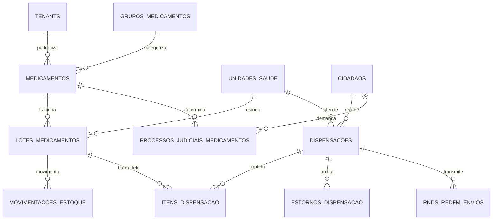

# Plano Detalhado de Execução: Etapa 05 - Farmácia Municipal, Estoque, REMUME e Dispensação FEFO

> **Status**: Pronto para Execução  
> **Documento Vinculado**: [DOCUMENTO_MESTRE_REFATORACAO.md](file:///d:/Projetos/Delphi/refatoracao/documentacao/DOCUMENTO_MESTRE_REFATORACAO.md)  
> **Dependências**: [Etapa 00 (Infraestrutura e RBAC)](file:///d:/Projetos/Delphi/refatoracao/documentacao/planos_etapas/etapa_00_infraestrutura_layout_rbac.md) | [Etapa 01 (Cidadãos)](file:///d:/Projetos/Delphi/refatoracao/documentacao/planos_etapas/etapa_01_cidadaos_pessoas_cadunico.md) | [Etapa 02 (Território e Parâmetros)](file:///d:/Projetos/Delphi/refatoracao/documentacao/planos_etapas/etapa_02_territorio_parametros.md) | [Etapa 03 (Unidades e Profissionais)](file:///d:/Projetos/Delphi/refatoracao/documentacao/planos_etapas/etapa_03_unidades_profissionais_lotacoes.md) | [Etapa 04 (Atendimento Clínico e PEP)](file:///d:/Projetos/Delphi/refatoracao/documentacao/planos_etapas/etapa_04_atendimento_clinico_pep.md)  
> **Stack Oficial**: AdonisJS v6, Lucid ORM, Inertia.js v2, React 19, TypeScript, Tailwind CSS v4, shadcn/ui, Redis 7, WebSockets / SSE

---

## 1. Visão Geral e Alinhamento com o Projeto Original

A **Etapa 05** moderniza toda a cadeia de suprimentos farmacêuticos e assistência farmacêutica do município. O ecossistema de farmácia pública municipal é de altíssima criticidade: ele é responsável pela guarda, controle de temperatura, rastreabilidade por lote e data de validade, abastecimento das Unidades Básicas de Saúde (UBSs), UPAs e farmácias distritais, controle de medicamentos sob regime especial (**Portaria SVS/MS nº 344/98**), atendimento a **Processos Judiciais (Judicialização da Saúde)**, componente especializado de **Alto Custo**, integração com o sistema federal **BNAFAR / Hórus** e transmissão de eventos à **RNDS (Registro Eletrônico de Dispensação de Medicamentos - REDFM)**.

No sistema Delphi legado, essa camada englobava **50 telas auditadas**, distribuídas em 6 frentes operacionais:
1. **Catálogo REMUME e Classificação Farmacêutica**:
   - `UPM266` / `UPM266R` (Formulário Mestre de Cadastro de Medicamentos: princípio ativo, forma, concentração, via, grupo terapêutico, estoque mínimo e ideal).
   - `UPM428` (Cadastro de Grupo de Medicamentos: antibióticos, psicotrópicos, anti-hipertensivos, insulinas).
   - `UPM473`, `UPM734`, `UPM937` (Inclusão e manutenção de itens farmacêuticos).
   - `UPM725`, `UPM726`, `UPM820R` (Unidades de medidas farmacêuticas: comprimido, ampola, frasco, tubo e vias de administração).
   - `Saude.View.Form.CadastroPosologia` (PM1037 - Posologias e regras de uso pré-configuradas).
   - `Saude.View.Form.Farmacia.ReceitaAvulsa.MedsSemelhantes` (PM1025 - Relação de intercambialidade, medicamentos genéricos e similares).
2. **Controle Rigoroso de Lotes, Validades e Algoritmo FEFO**:
   - `UPM908` / `UPM908R` (Módulo Mestre de Lotes e Validades com alertas e relatórios de vencimento).
   - `UPM909`, `UPM915`, `UPM945` (Controle de lotes, datas de fabricação, fornecedores e produção).
   - Implementação estrita do algoritmo **FEFO (First-Expire, First-Out)**: o sistema força a baixa automática do lote mais próximo do vencimento, impedindo desperdício de dinheiro público e bloqueando qualquer dispensação de lotes expirados.
3. **Dispensação no Balcão da Farmácia e Próxima Entrega**:
   - `UPM271` (Entrega de Medicamentos: conferência da receita eletrônica ou avulsa, baixa no estoque por lote e emissão do comprovante).
   - `UPM953` e `UPM967` (Inclusão e entrega de itens de receita).
   - `UPM183` e `UPM284` (Relatórios de dispensação e extrato histórico de retiradas por munícipe com rastreamento de fidelidade).
   - `Prefeitura.View.Relatorio.DispensacaoProxEntrega` (Controle de medicamentos de uso contínuo, prevenindo retiradas duplicadas antes do prazo terapêutico).
   - `Saude.View.Form.Farmacia.Receita.Estorno` (PM1002 - Estorno parcial e devolução de medicamentos ao estoque).
   - `Saude.View.Form.Farmacia.RecepcaoChamado` (PM1046 - Painel de chamada de senhas no balcão da farmácia).
4. **Rede Distribuída e Saldo Inter-Unidades**:
   - `UPM327` (Visualização do saldo do medicamento em outros locais de atendimento: consulta em tempo real se outra UBS possui o medicamento em falta).
   - `Saude.View.Form.Farmacia.Produto.AjustaValorUnitario` (PM1035 - Atualização do custo médio ponderado e valor de aquisição).
   - `UPM273` (Entradas por doações de órgãos estaduais ou entidades parceiras).
   - `UPM429` / `UPM429R` (Dispensação hospitalar para pacientes em observação na UPA/Hospital).
5. **Judicialização da Saúde e Medicamentos Não Padronizados**:
   - `UPM228` (Inclusão de Medicamentos no Processo Judicial: vínculo da ordem judicial, vara, juiz e cota do paciente).
   - `Saude.View.Relatorio.ProcJud.Medicamentos`, `Saude.View.Relatorio.ProcJud.Medicamentos.Consumo`, `Saude.View.Relatorio.ProcJud.Medicamentos.Pacientes` (Monitoramento do custo e estoque reservado para liminares judiciais).
   - `UPM360` / `UPM360R` (Gestão de Medicamentos Não Padronizados / Excepcionais fora da REMUME).
   - `UPM274`, `UPM885`, `UPM888`, `UPM889` (Componente Especializado / Alto Custo estadual e federal).
6. **Integração RNDS (REDFM) e Farmácia de Manipulação**:
   - `Prefeitura.View.Form.Rnds.Redfm` (PM1040 - Geração e transmissão do Registro Eletrônico de Dispensação de Medicamentos para a RNDS).
   - `UPM931`, `UPM939`, `UPM945`, `UPM956` (Farmácia Viva e manipulação de fitoterápicos).
   - `UPM084`, `UPM175`, `UPM699`, `UPM938`, `UPM950` (Consultas e pesquisas gerais).

---

### 1.1. Mapeamento dos 50 Formulários e Telas Delphi Legadas

| # | Formulário / Unit Delphi Original | Caption / Função no Delphi 7 | Papel Arquitetural na Stack Web Moderna (AdonisJS + React) |
| :-: | :--- | :--- | :--- |
| **01** | **`UPM266`** (`Forms/UPM266.dfm`) | **PM266 - Cadastro de Medicamentos** | **`/farmacia/catalogo-remume` (CRUD Mestre)**: Gestão de medicamentos com código CATMAT, forma, concentração, via, controle especial e estoques mínimo/ideal. |
| **02** | **`UPM266R`** (`Forms/UPM266R.dfm`) | **PM266R - Relatório de Cadastro de Medicamentos** | **Relatório REMUME**: Emissão em PDF do catálogo oficial de medicamentos essenciais do município para distribuição às equipes médicas. |
| **03** | **`UPM428`** (`Forms/UPM428.dfm`) | **PM428 - Cadastro de Grupo de Medicamentos** | **Sub-módulo Grupos Farmacológicos**: Classificação por classes terapêuticas (Anti-hipertensivos, Antibióticos, Antidiabéticos, Psicotrópicos). |
| **04** | **`UPM473`** (`Forms/UPM473.dfm`) | **PM473 - Inclusão de medicamentos** | **Assistente de Inclusão no Catálogo**: Modal com busca por código CATMAT federal e preenchimento de campos farmacológicos. |
| **05** | **`UPM734`** (`Forms/UPM734.dfm`) | **PM734 - Inclusão de Medicamentos** | **Cadastro Rápido de Itens Farmacêuticos**: Cadastro simplificado de novos insumos com validação de duplicidade por princípio ativo e dosagem. |
| **06** | **`UPM937`** (`Forms/UPM937.dfm`) | **PM937 - Cadastro de Medicamentos** | **Manutenção Centralizada de Insumos**: Gestão unificada de medicamentos e correlatos da assistência farmacêutica. |
| **07** | **`UPM725`** (`Forms/UPM725.dfm`) | **PM725 - Pesquisa de Unidade de Medicamento** | **Tabela de Unidades de Fornecimento**: Parametrização de unidades de dispensação (`Comprimido`, `Frasco`, `Ampola`, `Bisnaga`, `Envelope`). |
| **08** | **`UPM726`** (`Forms/UPM726.dfm`) | **PM726 - Pesquisa de Via de Medicamento** | **Tabela de Vias de Administração**: Cadastro das vias de uso (`Oral`, `Injetável`, `Tópica`, `Inalatória`, `Oftálmica`). |
| **09** | **`UPM820R`** (`Forms/UPM820R.dfm`) | **PM820R - Relação de Unidades de Medicamentos** | **Relatório de Unidades de Medida**: Listagem padrão de formas de apresentação e conversão para estoque. |
| **10** | **`Saude.View.Form.CadastroPosologia`** | **PM1037 - Cadasto de Posologia de Medicamentos** | **Biblioteca de Posologias Padrão**: Cadastro de regras de uso frequentes para auxílio rápido na prescrição médica e dispensação. |
| **11** | **`Saude.View.Form.Farmacia.ReceitaAvulsa.MedsSemelhantes`** | **PM1025 - Medicamentos semelhantes já cadastrados** | **Módulo de Intercambialidade / Genéricos**: Sugestão de medicamentos semelhantes ou genéricos disponíveis em estoque na falta da marca prescrita. |
| **12** | **`UPM908`** (`Forms/UPM908.dfm`) | **PM908 - Lote e Validade** | **`/farmacia/estoque-lotes` (Painel FEFO)**: Gestão de lotes, datas de validade, alertas visuais de vencimento (< 30d, < 90d) e bloqueio de vencidos. |
| **13** | **`UPM908R`** (`Forms/UPM908R.dfm`) | **PM908R - Relatorios de Lote e Validade** | **Relatório de Validades**: Listagem de lotes com ordenação cronológica decrescente para priorização de consumo e prevenção de perdas. |
| **14** | **`UPM909`** (`Forms/UPM909.dfm`) | **PM909 - Lote e Validade** | **Filtros Avançados de Validade**: Localização de lotes por fabricante, número de nota fiscal e período de fabricação. |
| **15** | **`UPM915`** (`Forms/UPM915.dfm`) | **PM915 - Lotes de Medicamentos** | **Rastreabilidade de Lotes**: Consulta do histórico de movimentações (entradas, saídas, perdas e dispensações) de um lote específico. |
| **16** | **`UPM945`** (`Forms/UPM945.dfm`) | **PM945 - Produção de Lotes de Medicamentos** | **Registro de Entrada de Lotes**: Cadastro de novos lotes recebidos com vinculação de nota fiscal de fornecedor e certificado de análise. |
| **17** | **`UPM271`** (`Forms/UPM271.dfm`) | **PM271 - Entrega de Medicamentos** | **`/farmacia/dispensacao` (Balcão de Dispensação)**: Leitura de receita por QR Code ou CPF, alocação automática FEFO e baixa atômica de estoque. |
| **18** | **`UPM953`** (`Forms/UPM953.dfm`) | **PM953 - Inclusão de Medicamentos na Receita** | **Dispensação de Receita Externa/Avulsa**: Lançamento de receitas oriundas de hospitais estaduais, clínicas particulares ou convênios. |
| **19** | **`UPM967`** (`Forms/UPM967.dfm`) | **PM967 - Entrega de Medicamentos da Receita** | **Conclusão e Assinatura da Dispensação**: Registro do responsável pela retirada (próprio paciente ou procurador/familiar) com carimbo de entrega. |
| **20** | **`UPM183`** (`Forms/UPM183.dfm`) | **PM183 - Relatório de Dispensação** | **`/farmacia/relatorios/dispensacoes`**: Relatório de saídas com filtros por período, unidade, profissional prescritor e paciente. |
| **21** | **`UPM284`** (`Forms/UPM284.dfm`) | **PM284 - Extrato de Medicamentos por Pessoa** | **Histórico Farmacoterapêutico do Cidadão**: Extrato completo de todos os medicamentos já retirados pelo munícipe com datas e quantidades. |
| **22** | **`Prefeitura.View.Relatorio.DispensacaoProxEntrega`** | **RelDispensacaoProximaEntrega** | **Controle de Medicamentos de Uso Contínuo**: Bloqueio e alerta contra dispensação precoce (calcula data mínima para a próxima retirada). |
| **23** | **`Saude.View.Form.Farmacia.Receita.Estorno`** | **PM1002 - Estorno parcial de receita** | **Módulo de Devolução / Estorno Auditado**: Devolução de itens ao estoque com justificativa clínica e cancelamento de baixa. |
| **24** | **`Prefeitura.View.Form.Farmacia.MedicamentosEmUso`** | **PM1003 - Medicamentos em uso** | **Painel de Farmacovigilância**: Visualização dos medicamentos atualmente em uso pelo cidadão para prevenir interações medicamentosas. |
| **25** | **`Saude.View.Form.Farmacia.RecepcaoChamado`** | **PM1046 - Recepção/Chamada da Farmácia** | **`/farmacia/painel-chamada`**: Painel para TV com chamada de senhas por guichê no balcão da farmácia central. |
| **26** | **`UPM327`** (`Forms/UPM327.dfm`) | **PM327 - Visualização do saldo do medicamento em outros locais** | **`/farmacia/estoque-em-rede`**: Consulta em tempo real do estoque do medicamento em todas as outras UBSs, UPAs e Almoxarifado Central. |
| **27** | **`Saude.View.Form.Farmacia.Produto.AjustaValorUnitario`** | **PM1035 - Ajustar valor unitário** | **Gestão de Custos Farmacêuticos**: Ajuste de preço médio ponderado e custo contábil dos insumos estocados. |
| **28** | **`UPM273`** (`Forms/UPM273.dfm`) | **PM273 - Doação do Medicamento** | **Entrada por Doação Municipal/Estadual**: Lançamento de medicamentos recebidos por doação com rastreabilidade de origem. |
| **29** | **`UPM429`** (`Forms/UPM429.dfm`) | **PM429 - Relatório de Dispensação para Pacientes em Observação** | **Dispensação Hospitalar / UPA**: Controle de medicamentos ministrados em pacientes internados ou em leitos de observação. |
| **30** | **`UPM429R`** (`Forms/UPM429R.dfm`) | **PM429R - Relatório de Dispensação para Pacientes em Observação** | **Espelho de Consumo Hospitalar**: Ficha de consumo de medicação por leito e prescrição interna. |
| **31** | **`UPM228`** (`Forms/UPM228.dfm`) | **PM228 - Inclusão de Medicamentos no Processo Judicial** | **`/farmacia/judicializacao`**: Vínculo de medicamentos a ordens judiciais (Processos, Varas, Liminares e cotas obrigatórias). |
| **32** | **`Saude.View.Relatorio.ProcJud.Medicamentos`** | **Relatorio de Processo Judicial - Pacientes por Medicamentos** | **Relatório de Demandas Judiciais**: Listagem de pacientes atendidos por mandados judiciais e controle orçamentário. |
| **33** | **`Saude.View.Relatorio.ProcJud.Medicamentos.Consumo`** | **Processo Judicial - Consumo de medicamentos** | **Consumo de Insumos Judiciais**: Análise de gastos e previsibilidade de compras para cumprimento de ordens da justiça. |
| **34** | **`Saude.View.Relatorio.ProcJud.Medicamentos.Pacientes`** | **Relatório Processo Judicial - Medicamentos por Paciente** | **Extrato Individual de Processo Judicial**: Relatório de fornecimento para prestação de contas à Procuradoria Geral do Município. |
| **35** | **`UPM360`** (`Forms/UPM360.dfm`) | **PM360 - Medicamentos Não Padronizados** | **Catálogo de Medicamentos Excepcionais**: Gestão de medicamentos não contemplados na REMUME adquiridos para casos específicos. |
| **36** | **`UPM360R`** (`Forms/UPM360R.dfm`) | **PM360R - Relatório de Medicamentos Não Padronizados** | **Relatório de Itens Excepcionais**: Demonstração de justificativas e pareceres da comissão de farmácia e terapêutica (CFT). |
| **37** | **`UPM274`** (`Forms/UPM274.dfm`) | **PM274 - Informações para Medicamento Especializado** | **Componente Especializado da Assistência Farmacêutica (CEAF)**: Mapeamento de regras do Alto Custo e protocolo LME federal. |
| **38** | **`UPM885`** (`Forms/UPM885.dfm`) | **PM885 - Medicamentos de Alto Custo** | **Gestão de Medicamentos de Alto Custo**: Acompanhamento de insumos de dispensação excepcional de alto impacto financeiro. |
| **39** | **`UPM888`** (`Forms/UPM888.dfm`) | **PM888 - Pesquisa de Medicamentos de Alto Custo Lançados** | **Consulta de Alto Custo**: Localização de pacientes ativos no programa de medicamentos especiais. |
| **40** | **`UPM889`** (`Forms/UPM889.dfm`) | **PM889 - Relação de Medicamentos de Alto Custo Lançados** | **Relatório de Alto Custo**: Relatório analítico para envio à Diretoria Regional de Saúde (DRS/Estado). |
| **41** | **`Prefeitura.View.Form.Rnds.Redfm`** | **PM1040 - Produção do REDFM - Registro Eletrônico de Dispensação** | **`/farmacia/integracao-rnds`**: Painel de transmissão do payload FHIR para a RNDS e BNAFAR com controle de logs e recibos. |
| **42** | **`UPM931`** (`Forms/UPM931.dfm`) | **PM931 - Pesquisa de Farmácias de Manipulação Locais** | **Cadastro de Farmácias de Manipulação**: Vínculo de farmácias magistrais conveniadas para fórmulas personalizadas. |
| **43** | **`UPM939`** (`Forms/UPM939.dfm`) | **PM939 - Inclusão de Matéria-Prima no Medicamento** | **Módulo Farmácia Viva**: Controle de matérias-primas, reagentes e fitoterápicos manipulados municipalmente. |
| **44** | **`UPM956`** (`Forms/UPM956.dfm`) | **PM956 - Relatórios Farmácia Manipulação** | **Relatórios de Manipulação Magistral**: Livro de registro de receituário da farmácia de manipulação. |
| **45** | **`UPM084`** (`Forms/UPM084.dfm`) | **PM084 - Pesquisa de Produtos ou Medicamentos** | **Componente `MedicamentoAutocomplete`**: Busca instantânea por Nome Comercial, Princípio Ativo, Código de Barras ou CATMAT. |
| **46** | **`UPM175`** (`Forms/UPM175.dfm`) | **PM175 - Pesquisa de Usuários da Farmácia** | **Busca de Cidadãos na Farmácia**: Localização rápida de munícipes cadastrados para atendimento no balcão. |
| **47** | **`UPM210R`** (`Forms/UPM210R.dfm`) | **PM210R - Relatório de Cadastro de Medicamentos** | **Relatório de Preços e Posição Cadastral**: Exportação em PDF e Excel do inventário de medicamentos cadastrados. |
| **48** | **`UPM699`** (`Forms/UPM699.dfm`) | **PM699 - Pesquisa de Medicamentos** | **Modal Universal de Medicamentos**: Componente de seleção em pedidos de compra, almoxarifado e farmácia. |
| **49** | **`UPM938`** (`Forms/UPM938.dfm`) | **PM938 - Pesquisa de Medicamentos** | **Filtros por Tipo de Controle**: Pesquisa refinada por Portaria 344 (Receita A/Amarela, B/Azul, C/Branca em 2 vias). |
| **50** | **`UPM950`** (`Forms/UPM950.dfm`) | **PM950 - Prontuários de Farmácias** | **Arquivo Histórico de Farmácia**: Gestão e arquivamento digital de notificações de receita retidas no balcão. |

---

## 2. Modelagem de Dados Relacional (Lucid ORM & Migrations)

A arquitetura de dados da Etapa 05 modela o ciclo completo de suprimento e assistência farmacêutica, garantindo controle atômico de estoque, rastreabilidade sanitária e conformidade com a Anvisa e Ministério da Saúde:



### 2.1. Estrutura DDL das Tabelas

#### Tabela `grupos_medicamentos` (Mapeia `UPM428` do Delphi)
```sql
CREATE TABLE grupos_medicamentos (
    id SERIAL PRIMARY KEY,
    tenant_id UUID NOT NULL REFERENCES tenants(id) ON DELETE RESTRICT,
    codigo INTEGER NOT NULL,
    nome VARCHAR(100) NOT NULL, -- Ex: "Anti-hipertensivos", "Antibióticos", "Psicotrópicos", "Insulinas"
    tipo_controle_especial VARCHAR(30) DEFAULT 'COMUM' CHECK (tipo_controle_especial IN (
        'COMUM', 'PORTARIA_344_A', 'PORTARIA_344_B', 'PORTARIA_344_C', 'ANTIMICROBIANO', 'ALTO_CUSTO'
    )),
    ativo BOOLEAN DEFAULT TRUE,
    created_at TIMESTAMP WITH TIME ZONE DEFAULT CURRENT_TIMESTAMP,
    updated_at TIMESTAMP WITH TIME ZONE DEFAULT CURRENT_TIMESTAMP,
    CONSTRAINT uq_grupos_tenant_codigo UNIQUE (tenant_id, codigo)
);
```

#### Tabela Mestre `medicamentos` (Catálogo REMUME - Mapeia `UPM266`, `UPM473`, `UPM734`)
```sql
CREATE TABLE medicamentos (
    id UUID PRIMARY KEY DEFAULT gen_random_uuid(),
    tenant_id UUID NOT NULL REFERENCES tenants(id) ON DELETE RESTRICT,
    codigo VARCHAR(30) NOT NULL,                  -- Código municipal legado
    catmat_codigo VARCHAR(30),                    -- Código no Catálogo de Materiais do Governo Federal (CATMAT)
    nome_comercial VARCHAR(150),
    principio_ativo VARCHAR(150) NOT NULL,        -- Denominação Comum Brasileira (DCB)
    concentracao VARCHAR(80) NOT NULL,            -- Ex: "500 mg", "20 mg/mL", "100 UI/mL"
    forma_farmaceutica VARCHAR(80) NOT NULL,      -- Comprimido, Cápsula, Xarope, Suspensão, Solução Injetável
    via_administracao VARCHAR(50) NOT NULL,       -- Oral, Intravenosa, Intramuscular, Tópica, Inalatória
    unidade_fornecimento VARCHAR(30) DEFAULT 'COMPRIMIDO', -- Comprimido, Frasco, Ampola, Bisnaga, Envelope
    
    grupo_id INTEGER REFERENCES grupos_medicamentos(id) ON DELETE SET NULL,
    tipo_controle VARCHAR(30) DEFAULT 'COMUM' CHECK (tipo_controle IN (
        'COMUM', 'CONTROLADO_PORTARIA_344', 'ANTIMICROBIANO', 'ALTO_CUSTO', 'JUDICIAL'
    )),
    pertence_remume BOOLEAN DEFAULT TRUE,         -- Flag oficial da Relação Municipal de Medicamentos
    cesta_basica BOOLEAN DEFAULT TRUE,            -- Flag cbCestaBasica legado
    permite_fracionamento BOOLEAN DEFAULT FALSE,
    exige_receita_retida BOOLEAN DEFAULT FALSE,
    
    -- Parâmetros de Gestão e Ressuprimento
    estoque_minimo INTEGER DEFAULT 100,           -- Ponto de pedido / disparo de alerta de compra
    estoque_ideal INTEGER DEFAULT 500,            -- Nível de segurança de estoque
    custo_medio_ponderado DECIMAL(10, 4) DEFAULT 0.0000,
    codigo_barras VARCHAR(50),                    -- EAN / Código de barras comercial
    
    bloqueado BOOLEAN DEFAULT FALSE,              -- Flag cbBloqueio legado (suspensão de dispensação)
    motivo_bloqueio VARCHAR(200),
    ativo BOOLEAN DEFAULT TRUE,
    created_at TIMESTAMP WITH TIME ZONE DEFAULT CURRENT_TIMESTAMP,
    updated_at TIMESTAMP WITH TIME ZONE DEFAULT CURRENT_TIMESTAMP,
    CONSTRAINT uq_medicamentos_tenant_codigo UNIQUE (tenant_id, codigo)
);
CREATE INDEX idx_medicamentos_principio_ativo ON medicamentos (tenant_id, principio_ativo);
CREATE INDEX idx_medicamentos_catmat ON medicamentos (catmat_codigo);
CREATE INDEX idx_medicamentos_codigo_barras ON medicamentos (codigo_barras);
```

#### Tabela `lotes_medicamentos` (Lotes, Validades e Algoritmo FEFO - Mapeia `UPM908`, `UPM915`)
```sql
CREATE TABLE lotes_medicamentos (
    id UUID PRIMARY KEY DEFAULT gen_random_uuid(),
    tenant_id UUID NOT NULL REFERENCES tenants(id) ON DELETE RESTRICT,
    medicamento_id UUID NOT NULL REFERENCES medicamentos(id) ON DELETE RESTRICT,
    unidade_saude_id UUID NOT NULL REFERENCES unidades_saude(id) ON DELETE RESTRICT,
    
    numero_lote VARCHAR(50) NOT NULL,
    fabricante VARCHAR(120),
    data_fabricacao DATE,
    data_validade DATE NOT NULL,                  -- Chave prioritária de ordenação para baixa FEFO
    
    quantidade_inicial INTEGER NOT NULL,
    quantidade_atual INTEGER NOT NULL CHECK (quantidade_atual >= 0), -- Trava contra saldo negativo
    preco_unitario_compra DECIMAL(10, 4),
    numero_nota_fiscal VARCHAR(50),
    fornecedor_cnpj VARCHAR(14),
    
    status VARCHAR(20) DEFAULT 'ATIVO' CHECK (status IN (
        'ATIVO', 'QUARENTENA', 'VENCIDO', 'ESGOTADO', 'BLOQUEADO_ANVISA'
    )),
    
    created_at TIMESTAMP WITH TIME ZONE DEFAULT CURRENT_TIMESTAMP,
    updated_at TIMESTAMP WITH TIME ZONE DEFAULT CURRENT_TIMESTAMP,
    CONSTRAINT uq_lote_medicamento_unidade UNIQUE (unidade_saude_id, medicamento_id, numero_lote)
);
CREATE INDEX idx_lotes_fefo ON lotes_medicamentos (medicamento_id, unidade_saude_id, data_validade, status);
CREATE INDEX idx_lotes_validade ON lotes_medicamentos (data_validade);
```

#### Tabela `movimentacoes_estoque` (Kardex e Auditoria Completa de Entradas/Saídas)
```sql
CREATE TABLE movimentacoes_estoque (
    id UUID PRIMARY KEY DEFAULT gen_random_uuid(),
    tenant_id UUID NOT NULL REFERENCES tenants(id) ON DELETE RESTRICT,
    medicamento_id UUID NOT NULL REFERENCES medicamentos(id) ON DELETE RESTRICT,
    lote_id UUID NOT NULL REFERENCES lotes_medicamentos(id) ON DELETE RESTRICT,
    unidade_saude_id UUID NOT NULL REFERENCES unidades_saude(id) ON DELETE RESTRICT,
    
    tipo_movimentacao VARCHAR(30) NOT NULL CHECK (tipo_movimentacao IN (
        'ENTRADA_NOTA_FISCAL', 'DISPENSACAO_PACIENTE', 'TRANSFERENCIA_SAIDA', 
        'TRANSFERENCIA_ENTRADA', 'DOACAO_ENTRADA', 'PERDA_AVARIA', 
        'PERDA_VALIDADE_EXPIRADA', 'ESTORNO_DISPENSACAO', 'AJUSTE_INVENTARIO'
    )),
    quantidade INTEGER NOT NULL,                  -- Quantidade movimentada (sempre positiva)
    saldo_anterior INTEGER NOT NULL,
    saldo_posterior INTEGER NOT NULL,
    
    numero_documento VARCHAR(50),                 -- Número da NF, Receita ou Guia de Transferência
    motivo_ajuste TEXT,
    usuario_operador_id UUID NOT NULL REFERENCES users(id),
    created_at TIMESTAMP WITH TIME ZONE DEFAULT CURRENT_TIMESTAMP
);
CREATE INDEX idx_movimentacoes_lote ON movimentacoes_estoque (lote_id, created_at);
CREATE INDEX idx_movimentacoes_unidade_data ON movimentacoes_estoque (unidade_saude_id, created_at);
```

#### Tabela `dispensacoes` (Atendimento no Balcão da Farmácia - Mapeia `UPM271`, `UPM967`)
```sql
CREATE TABLE dispensacoes (
    id UUID PRIMARY KEY DEFAULT gen_random_uuid(),
    tenant_id UUID NOT NULL REFERENCES tenants(id) ON DELETE RESTRICT,
    numero_dispensacao VARCHAR(30) NOT NULL UNIQUE, -- Ex: "DISP-2026-000001"
    
    cidadao_id UUID NOT NULL REFERENCES cidadaos(id) ON DELETE RESTRICT,
    unidade_saude_id UUID NOT NULL REFERENCES unidades_saude(id) ON DELETE RESTRICT,
    profissional_prescritor_id UUID REFERENCES profissionais(id) ON DELETE SET NULL,
    atendimento_id UUID REFERENCES atendimentos(id) ON DELETE SET NULL, -- Vínculo com PEP da Etapa 04
    farmaceutico_dispensador_id UUID NOT NULL REFERENCES users(id),
    
    tipo_dispensacao VARCHAR(30) DEFAULT 'RECEITA_AMBULATORIAL' CHECK (tipo_dispensacao IN (
        'RECEITA_AMBULATORIAL', 'USO_CONTINUO', 'JUDICIAL', 'RECEITA_AVULSA', 'PACIENTE_OBSERVACAO'
    )),
    numero_receita VARCHAR(50),
    data_receita DATE NOT NULL,
    data_validade_receita DATE,
    
    nome_retirante VARCHAR(150),                  -- Caso seja retirado por terceiro (familiar/cuidador)
    cpf_retirante VARCHAR(11),
    parentesco_retirante VARCHAR(50),
    
    status VARCHAR(20) DEFAULT 'DISPENSADO' CHECK (status IN (
        'DISPENSADO', 'PARCIAL', 'ESTORNADO', 'CANCELADO'
    )),
    observacoes TEXT,
    data_hora_dispensacao TIMESTAMP WITH TIME ZONE DEFAULT CURRENT_TIMESTAMP,
    created_at TIMESTAMP WITH TIME ZONE DEFAULT CURRENT_TIMESTAMP,
    updated_at TIMESTAMP WITH TIME ZONE DEFAULT CURRENT_TIMESTAMP
);
CREATE INDEX idx_dispensacoes_cidadao ON dispensacoes (cidadao_id);
CREATE INDEX idx_dispensacoes_unidade_data ON dispensacoes (unidade_saude_id, data_hora_dispensacao);
```

#### Tabela `itens_dispensacao` (Baixa de Estoque por Lote FEFO - Mapeia `UPM271`)
```sql
CREATE TABLE itens_dispensacao (
    id UUID PRIMARY KEY DEFAULT gen_random_uuid(),
    dispensacao_id UUID NOT NULL REFERENCES dispensacoes(id) ON DELETE CASCADE,
    medicamento_id UUID NOT NULL REFERENCES medicamentos(id) ON DELETE RESTRICT,
    lote_id UUID NOT NULL REFERENCES lotes_medicamentos(id) ON DELETE RESTRICT, -- Lote baixado pelo FEFO
    
    quantidade_prescrita INTEGER NOT NULL,
    quantidade_dispensada INTEGER NOT NULL,
    posologia VARCHAR(255) NOT NULL,
    dias_tratamento INTEGER,
    data_proxima_retirada DATE,                   -- Campo crucial para controle de uso contínuo (UPM284R)
    
    status_item VARCHAR(20) DEFAULT 'ATENDIDO' CHECK (status_item IN (
        'ATENDIDO', 'PARCIAL', 'EM_FALTA'
    )),
    created_at TIMESTAMP WITH TIME ZONE DEFAULT CURRENT_TIMESTAMP
);
CREATE INDEX idx_itens_disp_lote ON itens_dispensacao (lote_id);
```

#### Tabela `processos_judiciais_medicamentos` (Judicialização da Saúde - Mapeia `UPM228`, `Saude.View.Relatorio.ProcJud.*`)
```sql
CREATE TABLE processos_judiciais_medicamentos (
    id UUID PRIMARY KEY DEFAULT gen_random_uuid(),
    tenant_id UUID NOT NULL REFERENCES tenants(id) ON DELETE RESTRICT,
    numero_processo VARCHAR(50) NOT NULL,         -- Número oficial do processo judicial (CNJ)
    vara_judicial VARCHAR(100) NOT NULL,          -- Ex: "1ª Vara da Fazenda Pública"
    nome_juiz VARCHAR(150),
    
    cidadao_id UUID NOT NULL REFERENCES cidadaos(id) ON DELETE RESTRICT,
    medicamento_id UUID NOT NULL REFERENCES medicamentos(id) ON DELETE RESTRICT,
    
    quantidade_mensal_determinada INTEGER NOT NULL,
    posologia_judicial TEXT NOT NULL,
    data_inicio_fornecimento DATE NOT NULL,
    data_termino_fornecimento DATE,
    valor_bloqueio_judicial DECIMAL(12, 2) DEFAULT 0.00,
    
    status VARCHAR(20) DEFAULT 'ATIVO' CHECK (status IN ('ATIVO', 'SUSPENSO', 'ENCERRADO', 'EM_RECURSO')),
    motivo_suspensao TEXT,
    created_at TIMESTAMP WITH TIME ZONE DEFAULT CURRENT_TIMESTAMP,
    updated_at TIMESTAMP WITH TIME ZONE DEFAULT CURRENT_TIMESTAMP,
    CONSTRAINT uq_procjud_processo_med UNIQUE (tenant_id, numero_processo, medicamento_id)
);
CREATE INDEX idx_procjud_cidadao ON processos_judiciais_medicamentos (cidadao_id);
```

#### Tabela `estornos_dispensacao` (Mapeia `Saude.View.Form.Farmacia.Receita.Estorno`)
```sql
CREATE TABLE estornos_dispensacao (
    id UUID PRIMARY KEY DEFAULT gen_random_uuid(),
    dispensacao_id UUID NOT NULL REFERENCES dispensacoes(id) ON DELETE RESTRICT,
    item_dispensacao_id UUID NOT NULL REFERENCES itens_dispensacao(id) ON DELETE RESTRICT,
    quantidade_estornada INTEGER NOT NULL,
    motivo_estorno VARCHAR(255) NOT NULL,
    farmaceutico_responsavel_id UUID NOT NULL REFERENCES users(id),
    created_at TIMESTAMP WITH TIME ZONE DEFAULT CURRENT_TIMESTAMP
);
```

#### Tabela `rnds_redfm_envios` (Registro Eletrônico de Dispensação - Mapeia `Prefeitura.View.Form.Rnds.Redfm`)
```sql
CREATE TABLE rnds_redfm_envios (
    id UUID PRIMARY KEY DEFAULT gen_random_uuid(),
    tenant_id UUID NOT NULL REFERENCES tenants(id),
    dispensacao_id UUID NOT NULL REFERENCES dispensacoes(id) ON DELETE CASCADE,
    payload_fhir JSONB NOT NULL,                  -- Mensagem oficial FHIR MedicationDispense
    protocolo_rnds VARCHAR(80),                   -- ID de recebimento retornado pelo Ministério da Saúde
    status_transmissao VARCHAR(20) DEFAULT 'PENDENTE' CHECK (status_transmissao IN (
        'PENDENTE', 'ENVIADO_SUCESSO', 'ERRO_VALIDACAO', 'REJEITADO'
    )),
    mensagem_erro TEXT,
    data_hora_envio TIMESTAMP WITH TIME ZONE,
    created_at TIMESTAMP WITH TIME ZONE DEFAULT CURRENT_TIMESTAMP
);
```

---

## 3. Serviços e Regras de Negócio no Backend (AdonisJS 6)

### 3.1. Algoritmo Transacional de Baixa FEFO (`DispensacaoFefoService`)
A dispensação executa dentro de uma transação com isolamento estrito (`db.transaction()`):
1. **Seleção Automática de Lote**:
   - Para o medicamento solicitado na unidade de saúde, localiza os lotes com `quantidade_atual > 0` e `status = 'ATIVO'`.
   - Ordena exclusivamente por `data_validade ASC` (First-Expire, First-Out).
2. **Validação de Vencimento**:
   - Caso a `data_validade` seja menor ou igual à data atual, o lote é automaticamente classificado como `VENCIDO` e impedido de dispensação.
3. **Fracionamento Multi-Lote**:
   - Se o lote mais próximo do vencimento possuir saldo inferior à quantidade prescrita (ex: prescrito: 30 comp, lote A possui 10 comp), o sistema consome os 10 do lote A e complementa automaticamente os 20 do lote subsequente B.
4. **Atualização Atômica**:
   - Subtrai as quantidades dos lotes envolvidos.
   - Registra as movimentações no Kardex (`movimentacoes_estoque`).
   - Dispara evento para atualização instantânea dos saldos em cache.

### 3.2. Prevenção de Dispensação Precoce de Uso Contínuo (`UsoContinuoValidatorService`)
Substitui a regra de `Prefeitura.View.Relatorio.DispensacaoProxEntrega`:
- Ao iniciar uma dispensação de medicamento de uso contínuo para o cidadão:
  - O sistema busca a última dispensação do mesmo princípio ativo nos últimos 90 dias.
  - Com base na quantidade fornecida e na posologia prescrita, calcula a `data_proxima_retirada`.
  - Se a data atual for anterior à data autorizada (com tolerância máxima de 3 dias de antecedência), a dispensação é bloqueada, alertando o farmacêutico: *"Paciente retirou 30 comprimidos em 10/10/2026. Próxima retirada liberada apenas a partir de 07/11/2026."*

### 3.3. Painel de Estoque em Rede Inter-Unidades (`EstoqueRedeService`)
Substitui a tela `UPM327`:
- Quando um paciente comparece à farmácia de uma UBS e o medicamento prescrito está em falta local (`saldo = 0`):
  - A API executa consulta federada em todas as unidades de saúde municipais conectadas.
  - Retorna em `< 10ms` a lista das unidades mais próximas com saldo positivo, incluindo telefone e endereço, permitindo orientar o munícipe ou solicitar remessa de transferência interna.

### 3.4. Gestão de Cota Judicial (`JudicializacaoService`)
- Medicamentos designados a processos judiciais têm seus saldos segregados virtualmente do estoque geral da REMUME.
- Impede que a demanda espontânea de balcão consuma o lote reservado para cumprimento de ordem judicial, prevenindo multas diárias (astreintes) ou prisão de gestores públicos.

### 3.5. Cache de Saldos em Redis 7 (`FarmaciaCacheService`)
- **`farmacia:saldo:{unidadeId}:{medicamentoId}`**: Saldo total em unidades físicas estocadas (atualizado a cada transação atômica).
- **`farmacia:alerta_fefo:{tenantId}`**: Lista consolidada de lotes com vencimento inferior a 30 dias para ação rápida de remanejamento.

---

## 4. Frontend: Telas e Componentes React 19 + shadcn/ui

### 4.1. `/farmacia/dashboard` (Painel Executivo da Farmácia)
- **KPIs em Cards Vivos**:
  - Saldo Total de Itens Estocados na Rede.
  - Alertas Críticos de Validade: Badges vermelhos piscantes para lotes com vencimento em menos de 30 dias (`UPM908`).
  - Alertas Amarelos: Lotes com vencimento entre 30 e 90 dias para priorização de consumo.
  - Medicamentos Abaixo do Estoque Mínimo (Ponto de Encomenda).
- **Gráficos Reativos**:
  - Curva ABC de consumo de medicamentos nos últimos 6 meses.
  - Distribuição percentual de gastos: REMUME Básica vs Judicialização vs Alto Custo.

### 4.2. `/farmacia/catalogo-remume` (`Index.tsx` e `FormModal.tsx`)
- Tabela com filtros rápidos por Grupo Farmacológico, Tipo de Controle (Comum, Portaria 344, Alto Custo, Judicial) e Código CATMAT.
- Formulário modal com campos: Princípio Ativo, Nome Comercial, Concentração, Forma, Via, Estoque Mínimo e parâmetros da Portaria 344.

### 4.3. `/farmacia/estoque-lotes` (Visão FEFO em Tempo Real)
- Tabela de lotes agrupada por medicamento e unidade de saúde.
- Indicadores visuais claros por lote:
  - 🟢 **Verde**: Validade superior a 90 dias.
  - 🟡 **Amarelo**: Validade entre 30 e 90 dias (prioridade de dispensação).
  - 🔴 **Vermelho**: Validade inferior a 30 dias (urgência de remanejamento).
  - ⚫ **Cinza**: Vencido (bloqueado automaticamente pelo sistema).
- Ação rápida: *"Transferir Lote para Unidade de Maior Consumo"*.

### 4.4. `/farmacia/dispensacao` (Balcão de Alta Produtividade)
- **Fluxo Ágil em 3 Etapas**:
  1. **Identificação do Paciente / Receita**:
     - Leitura do QR Code da receita eletrônica do PEP da Etapa 04 ou digitação do CPF/CNS do cidadão.
     - Carregamento instantâneo da prescrição médica com todas as drogas receitadas.
  2. **Conferência e Alocação FEFO**:
     - O sistema já sugere os lotes ideais ordenados pelo vencimento mais próximo.
     - Exibição de alertas de interação medicamentosa ou dispensação precoce de uso contínuo.
  3. **Conclusão da Entrega**:
     - Identificação de quem está retirando (o próprio paciente ou terceiro).
     - Botão *"Dispensar e Imprimir Comprovante"*: Emissão do comprovante térmico com datas das próximas retiradas e instruções de posologia.

### 4.5. `/farmacia/judicializacao` (Gestão de Processos Judiciais)
- Painel dedicado com busca por Número de Processo CNJ ou Nome do Paciente.
- Acompanhamento da cota mensal fornecida, saldo restante e alertas de vencimento da decisão judicial.

### 4.6. `/farmacia/painel-chamada` (Substitui `PM1046` / `Saude.View.Form.Farmacia.RecepcaoChamado`)
- Interface para TV de sala de espera da farmácia central.
- Chamada por guichê de atendimento com voz sintetizada: *"Senha Farmácia 45, dirigir-se ao Guichê 03"*.

---

## 5. Roteiro Passo a Passo de Implementação (Roadmap Técnico)

| Passo | Fase Técnica | Atividades Executadas | Entregáveis |
| :---: | :--- | :--- | :--- |
| **Passo 1** | **Migrations da Etapa 05** | Modelagem das tabelas de catálogo, estoque, lotes e dispensação. | Migrations para `grupos_medicamentos`, `medicamentos`, `lotes_medicamentos`, `movimentacoes_estoque`, `dispensacoes`, `itens_dispensacao`, `processos_judiciais_medicamentos`, `estornos_dispensacao` e `rnds_redfm_envios`. |
| **Passo 2** | **Carga de Tabelas Oficiais (Seeds)** | Importação do catálogo CATMAT federal e grupos terapêuticos. | Seeders populados com Grupos Farmacológicos, lista oficial de medicamentos da REMUME municipal e tabela de unidades de fornecimento. |
| **Passo 3** | **Models Lucid ORM e Relacionamentos** | Criação das entidades com tipagem rigorosa TypeScript. | Models `Medicamento`, `LoteMedicamento`, `MovimentacaoEstoque`, `Dispensacao`, `ItemDispensacao`, `ProcessoJudicialMedicamento`, etc. |
| **Passo 4** | **Serviços de Domínio e Baixa FEFO** | Implementação das regras de negócio atômicas e cache Redis. | `DispensacaoFefoService`, `UsoContinuoValidatorService`, `EstoqueRedeService`, `JudicializacaoService` e `FarmaciaCacheService`. |
| **Passo 5** | **Validators e Controllers AdonisJS 6** | Endpoints de API e controladores de renderização Inertia. | `MedicamentosController`, `DispensacoesController`, `LotesController`, `JudicializacaoController` e validadores VineJS/Zod. |
| **Passo 6** | **Interfaces React 19 + shadcn/ui** | Telas modernas com foco em agilidade de atendimento no balcão. | Telas completas em `inertia/pages/farmacia/` (`index.tsx`, `medicamentos.tsx`, `dispensacao.tsx`, `judicializacao.tsx` e `painel-chamada.tsx`). |
| **Passo 7** | **Emissão de Comprovantes e Integração RNDS** | Geração de tíquetes térmicos e payload FHIR. | Emissor de comprovante de entrega com próxima retirada e serviço de geração do REDFM para a RNDS. |
| **Passo 8** | **Testes Automatizados e Homologação** | Bateria de testes de integridade de estoque e concorrência. | Testes unitários do algoritmo FEFO, prevenção de dispensação de lotes vencidos, travas contra concorrência e homologação das 50 telas legadas. |

---

## 6. Critérios de Aceitação e Homologação da Etapa 05

1. **Garantia Absoluta do Critério FEFO**:
   - O sistema aloca obrigatoriamente o lote com a menor data de validade disponível em estoque.
   - Qualquer tentativa de dispensar lote vencido ou com validade expirada é bloqueada sumariamente com código HTTP 422.
2. **Consistência de Saldo e Prevenção de Estoque Negativo**:
   - A baixa de estoque é estritamente atômica; em caso de concorrência simultânea entre dois atendentes pelo mesmo lote, a segunda requisição que exceder o saldo é rejeitada sem gerar estoque negativo.
   - Toda saída ou entrada é auditada no Kardex com saldo anterior e posterior.
3. **Bloqueio de Dispensação Precoce de Uso Contínuo**:
   - O sistema calcula e impede retiradas antecipadas antes do período terapêutico autorizado (tolerância máxima de 3 dias).
4. **Governança da Judicialização da Saúde**:
   - Insumos determinados judicialmente possuem separação visual e lógica, impedindo consumo indevido pela rotina de balcão comum.
5. **Visibilidade de Estoque em Rede Inter-Unidades**:
   - A busca de saldo do medicamento em outras unidades (`UPM327`) responde em tempo inferior a 100ms, exibindo os postos que possuem disponibilidade imediata.
6. **Integração Federal RNDS / BNAFAR**:
   - As dispensações realizadas geram payloads no padrão HL7 FHIR (REDFM) aptos para sincronização com a base do Ministério da Saúde.

---
*Este documento é a referência técnica canônica e exaustiva para a execução da Etapa 05 do projeto de refatoração do Ecossistema Prefeitura.*
