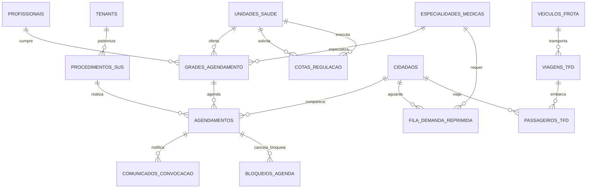

# Plano Detalhado de Execução: Etapa 06 - Agendamento Ambulatorial, Regulação Municipal de Vagas/Cotas e TFD

> **Status**: Pronto para Execução  
> **Documento Vinculado**: [DOCUMENTO_MESTRE_REFATORACAO.md](file:///d:/Projetos/Delphi/refatoracao/documentacao/DOCUMENTO_MESTRE_REFATORACAO.md)  
> **Dependências**: [Etapa 00 (Infraestrutura e RBAC)](file:///d:/Projetos/Delphi/refatoracao/documentacao/planos_etapas/etapa_00_infraestrutura_layout_rbac.md) | [Etapa 01 (Cidadãos)](file:///d:/Projetos/Delphi/refatoracao/documentacao/planos_etapas/etapa_01_cidadaos_pessoas_cadunico.md) | [Etapa 02 (Território e Parâmetros)](file:///d:/Projetos/Delphi/refatoracao/documentacao/planos_etapas/etapa_02_territorio_parametros.md) | [Etapa 03 (Unidades e Profissionais)](file:///d:/Projetos/Delphi/refatoracao/documentacao/planos_etapas/etapa_03_unidades_profissionais_lotacoes.md) | [Etapa 04 (Atendimento Clínico e PEP)](file:///d:/Projetos/Delphi/refatoracao/documentacao/planos_etapas/etapa_04_atendimento_clinico_pep.md) | [Etapa 05 (Farmácia e Estoque)](file:///d:/Projetos/Delphi/refatoracao/documentacao/planos_etapas/etapa_05_farmacia_remume_dispensacao_fefo.md)  
> **Stack Oficial**: AdonisJS v6, Lucid ORM, Inertia.js v2, React 19, TypeScript, Tailwind CSS v4, shadcn/ui, Redis 7, BullMQ, WebSockets

---

## 1. Visão Geral e Alinhamento com o Projeto Original

A **Etapa 06** é o cérebro regulatório do Sistema Municipal de Saúde. Nela se concentram a oferta de consultas médicas especializadas, exames de média e alta complexidade, a pactuação e o controle estrito de **cotas de agendamento** entre as Unidades Básicas de Saúde (solicitantes) e as Policlínicas, Centros de Especialidades e Hospitais (executantes), a gestão da **Demanda Reprimida (Fila de Espera SUS)** com critérios de gravidade clínica, o processo de comunicação e convocação de pacientes via canais digitais (**WhatsApp / SMS**), as rotinas de bloqueios, remanejamentos e transferências de agenda, e o gerenciamento das rotas sanitárias do **Tratamento Fora de Domicílio (TFD)** para transporte de pacientes a polos hospitalares regionais.

No ecossistema Delphi legado, essa camada englobava **95 telas auditadas**, além de um executável autônomo de automação denominado **`RoboAgendamento`**:
1. **Grades de Horários e Agendamento de Consultas**:
   - `UPM592` (Geração da agenda de profissionais médicos e odontológicos).
   - `UPM591` (Manutenção no horário de agendamentos e remanejamentos).
   - `UPM201` / `UPM201R` (Agendamento de Consultas e Impressão de Agendas por Especialidade).
   - `UPM848` / `UPM848R` / `UPM849` (Agendamento Odontológico e Relatório Diário de Agendas).
   - `upM047`, `UPM520`, `UPM569`, `UPM665` (Inclusão e marcação de pacientes na grade).
   - `UPM413` (Agendamento Recorrente: fisioterapia, psicologia, fonoaudiologia e sessões seriadas).
   - `UPM249` (Replicador de Agendamentos).
   - `UPM467` (Solicitações de Agendamento WEB / Portal do Cidadão).
2. **Exames Especializados e Etiquetas Diagnósticas**:
   - `UPM599`, `UPM600`, `UPM601`, `UPM601R`, `UPM987`, `UPM987R` (Geração, pesquisa, agendamento e conferência de exames).
   - `Saude.View.Form.Agenda.GuiaEspecialidade.Exame` (PM1007 - Agendamento de Exames por Guia).
   - `Saude.View.Form.Agenda.Exame.ImpressaoEtiqueta` (PM1016), `Saude.View.Relatorio.Agenda.Exame.Etiquetas` e `Brother2211` (Impressão de etiquetas térmicas de tubos/frascos em modelos Brother DK-1201 e DK-2211).
3. **Complexo Regulador Municipal e Demanda Reprimida**:
   - `Saude.View.Form.Guia` (Central de Regulação Municipal).
   - `Saude.View.Form.Agenda.GuiaEspecialidade` (PM1000 - Fila de Demanda Reprimida).
   - `Saude.View.Form.Agenda.GuiaEspecialidade.Vagas` (PM1001 - Seleção de Vagas e Agendas Reguladas).
   - `Saude.View.Form.Agenda.GuiaEspecialidade.Comunicado` e `Notificacao` (PM1006 - Comunique-se / Convocação de pacientes da fila por mensagens).
   - `UPM568`, `UPM632`, `UPM632R` (Agendamento e relação de guias especializadas autorizadas).
   - `UPM717` (Justificativa clínica do agendamento regulado).
4. **Pactuação e Gestão de Cotas (Internas, Externas e Fornecedores)**:
   - `UPM211`, `UPM211R`, `UPM212`, `UPM213` (Cadastro, itens e impressão de Cotas Externas - AME, Consórcios Intermunicipais, Hospitais Referenciados).
   - `UPM216`, `UPM216_P`, `UPM216R`, `UPM218`, `UPM218_P`, `UPM236`, `UPM236R` (Agendas de exames externos e sessões por cotas pactuadas).
   - `Prefeitura.View.Form.Agenda.ExameCota.Cancelar` (PM1019 - Cancelamento de exames por cota).
   - `UPM263`, `UPM263R`, `UPM337` (Relatório de movimentação e assistente de cópia de cotas entre meses).
   - `UPM501`, `UPM501R`, `UPM738`, `UPM738R`, `UPM739`, `UPM958`, `UPM960`, `UPM972` (Controle e relatórios de cotas municipais e laboratórios credenciados).
5. **Bloqueios, Desbloqueios, Absenteísmo e Remanejamentos**:
   - `UPM594`, `UPM606` (Bloqueio e desbloqueio de agendamentos por férias médicas, recessos ou reformas).
   - `UPM295`, `UPM296`, `UPM607`, `UPM635` (Bloqueios e liberações de exames e agendas para as unidades).
   - `UPM174` (Remanejamento automático de pacientes com consultas marcadas quando o médico falta).
   - `UPM349`, `UPM465` (Transferência de agendamentos pendentes de confirmação).
   - `UPM590`, `UPM617`, `UPM627`, `UPM664`, `UPM664R` (Cancelamentos e exclusões auditadas).
   - `UPM623` (Confirmação de Agendamentos).
   - `UPM736`, `UPM737`, `UPM022R`, `Prefeitura.View.Relatorio.AgendaConsulta.Cancelamentos` (Gestão de absenteísmo, faltas injustificadas e ocorrências).
6. **Transporte Sanitário e TFD (Tratamento Fora de Domicílio)**:
   - `UPM877`, `UPM877R`, `UPM878` (Agendamento de veículos da saúde e pacientes transportados para outros municípios).
   - `UPM816`, `UPM816R`, `UPM521`, `UPM521R` (Escala e manifesto de passageiros de ambulâncias, vans e micro-ônibus).
   - `Prefeitura.View.Relatorio.AgendaVeiculo.Log` (Auditoria e logs de viagens da saúde).
7. **Automação Inteligente (Robô de Agendamento)**:
   - O projeto autônomo `refatoracao/RoboAgendamento` é reengenheirado como uma suíte de jobs assíncronos no **BullMQ + Redis 7**: confirmação automática via WhatsApp Bot, remanejamento inteligente e estorno de vagas não confirmadas para a fila de espera.

---

### 1.1. Mapeamento dos 95 Formulários e Telas Delphi Legadas

| # | Formulário / Unit Delphi Original | Caption / Função no Delphi 7 | Papel Arquitetural na Stack Web Moderna (AdonisJS + React) |
| :-: | :--- | :--- | :--- |
| **01** | **`UPM592`** (`Forms/UPM592.dfm`) | **PM592 - Geração da agenda de profissionais** | **`/regulacao/grades/gerar` (Gerador de Grades)**: Assistente de geração em lote de horários com base na escala de trabalho da Etapa 03. |
| **02** | **`UPM591`** (`Forms/UPM591.dfm`) | **PM591 - Manutenção no Horário do Agendamento** | **Editor de Vagas**: Alteração individual de horário, sala ou profissional de uma vaga específica. |
| **03** | **`UPM593`** (`Forms/UPM593.dfm`) | **PM593 - Verificação de Agendamentos de Consultas** | **Auditoria de Vagas da Grade**: Painel de conferência de vagas ocupadas versus ociosas por posto e médico. |
| **04** | **`UPM201`** (`Forms/UPM201.dfm`) | **PM201 - Agendamento de Consultas** | **`/regulacao/agendamento` (Central de Marcação)**: Calendário reativo em React com busca rápida de vagas livres por especialidade. |
| **05** | **`UPM201R`** (`Forms/UPM201R.dfm`) | **PM201R - Impressão da Agenda das Especialidades** | **Espelho de Agenda**: Emissão em PDF da lista de pacientes agendados para a mesa do especialista. |
| **06** | **`upM047`** (`Forms/upM047.dfm`) | **PM047 - Inclusão de Agendamentos** | **Modal de Marcação Rápida**: Reserva da vaga vinculando o cidadão, procedência e emissão do comprovante. |
| **07** | **`UPM520`** (`Forms/UPM520.dfm`) | **PM520 - Incluir Agendamento** | **Formulário de Inclusão de Consulta**: Marcação direta com validação de cota da unidade solicitante. |
| **08** | **`UPM569`** (`Forms/UPM569.dfm`) | **PM569 - Incluir um Agendamento** | **Marcação por Encaminhamento**: Agendamento vinculado à guia autorizada emitida no PEP da Etapa 04. |
| **09** | **`UPM665`** (`Forms/UPM665.dfm`) | **PM665 - Inclusão de agendamentos - Agenda já gerada** | **Encaixe de Consulta**: Inclusão de vaga extraordinária (sobre-agenda) autorizada pela supervisão médica. |
| **10** | **`UPM413`** (`Forms/UPM413.dfm`) | **PM413 - Agendamento Recorrente** | **`/regulacao/agendamento/recorrente`**: Reserva automática de séries de consultas (ex: fisioterapia 2x por semana durante 2 meses). |
| **11** | **`UPM249`** (`Forms/UPM249.dfm`) | **PM249 - Replicar Agendamento** | **Duplicador de Grades**: Replicação da grade semanal de atendimento para o próximo mês em 1 clique. |
| **12** | **`UPM467`** (`Forms/UPM467.dfm`) | **PM467 - Solicitações de Agendamento WEB** | **Módulo Portal do Cidadão**: Fila de aprovação de pedidos de consulta enviados pelos munícipes pelo app municipal. |
| **13** | **`UPM848`** (`Forms/UPM848.dfm`) | **PM848 - Agendamento Odontologia** | **`/regulacao/agendamento/odontologia`**: Grade de agendamento especializada para consultórios odontológicos e CEO. |
| **14** | **`UPM848R`** (`Forms/UPM848R.dfm`) | **PM848R - Relatório Diário de Agendamento** | **Mapa Diário de Saúde Bucal**: Relação diária de pacientes com indicação do procedimento odontológico previsto. |
| **15** | **`UPM849`** (`Forms/UPM849.dfm`) | **PM849 - Agendamento de Consultas** | **Consulta Geral de Vagas**: Visualizador consolidado de ofertas de vagas na rede. |
| **16** | **`UPM599`** (`Forms/UPM599.dfm`) | **PM599 - Geração do Agendamento de Exames** | **Gerador de Grades de Exames**: Abertura de horários para aparelhos diagnósticos (Ultrassom, RX, ECG, Endoscopia). |
| **17** | **`UPM600`** (`Forms/UPM600.dfm`) | **PM600 - Pesquisa de Agendamentos de Exames** | **Localizador de Agendamento de Exames**: Busca por protocolo, número do pedido ou CPF do paciente. |
| **18** | **`UPM601`** (`Forms/UPM601.dfm`) | **PM601 - Agendamento de Exames** | **`/regulacao/agendamento/exames`**: Marcação de procedimentos diagnósticos com orientações de preparo pré-exame. |
| **19** | **`UPM601R`** (`Forms/UPM601R.dfm`) | **PM601R - Impressão dos Agendamentos de Exames** | **Comprovante de Exame com Preparo**: Emissão do preparo obrigatório (jejum, laxante, suspensão de medicamentos). |
| **20** | **`UPM987`** (`Forms/UPM987.dfm`) | **PM987 - Alteração de Agenda de Exames já Gerada** | **Manutenção de Grades de Exames**: Ajuste de intervalos de exames e capacidade por turno. |
| **21** | **`UPM987R`** (`Forms/UPM987R.dfm`) | **PM987R - Validação do Agendamento Excluido** | **Auditoria de Exclusão de Exames**: Registro com justificativa e estorno de cota. |
| **22** | **`Saude.View.Form.Agenda.GuiaEspecialidade.Exame`** | **PM1007 - Agendamento de Exames** | **Marcação Regulada de Exames**: Interface de vinculação direta entre a solicitação clínica e a vaga executante. |
| **23** | **`Saude.View.Form.Agenda.Exame.ImpressaoEtiqueta`** | **PM1016 - Agendamento de Exames - Impressão de Etiquetas** | **Emissão de Etiquetas de Coleta**: Geração de código de barras para identificação de frascos e amostras. |
| **24** | **`Saude.View.Relatorio.Agenda.Exame.Etiquetas`** | **Modelo Brother DK-1201** | **Driver de Impressão Térmica**: Template de etiqueta formato padrão Brother DK-1201. |
| **25** | **`Saude.View.Relatorio.Agenda.Exame.Etiquetas.Brother2211`** | **Modelo Brother DK2211** | **Driver de Impressão Contínua**: Template de etiqueta formato contínuo Brother DK-2211. |
| **26** | **`UPM346`** (`Forms/UPM346.dfm`) | **PM346 - Verificação de Agendamento de Exames** | **Conferência de Agenda Diagnóstica**: Painel de conferência de preparos e confirmações prévias. |
| **27** | **`Saude.View.Form.Guia`** | **Central de Regulação** | **`/regulacao/central-regulacao` (Painel do Regulador)**: Dashboard do médico regulador com triagem de solicitações e filas. |
| **28** | **`Saude.View.Form.Agenda.GuiaEspecialidade`** | **PM1000 - Demanda Reprimida** | **`/regulacao/demanda-reprimida` (Fila de Espera SUS)**: Fila única municipal ordenada por gravidade e tempo de espera. |
| **29** | **`Saude.View.Form.Agenda.GuiaEspecialidade.Vagas`** | **PM1001 - Demanda Reprimida - Seleção de Agenda** | **Motor de Alocação de Vagas**: Casamento inteligente entre a demanda reprimida e as novas vagas abertas. |
| **30** | **`Saude.View.Form.Agenda.GuiaEspecialidade.Comunicado`** | **Comunique-se** | **Módulo de Mensageria**: Convocação de pacientes da fila com aviso de vaga disponível. |
| **31** | **`Saude.View.Form.Agenda.GuiaEspecialidade.Comunicado.Notificacao`** | **PM1006 - Comunique-se - Pendentes** | **Painel de Notificações Pendentes**: Controle de avisos disparados aguardando resposta do munícipe. |
| **32** | **`UPM568`** (`Forms/UPM568.dfm`) | **PM568 - Agendamento de Guias e Exames** | **Central de Guias de Encaminhamento**: Gestão integrada das solicitações especializadas municipais. |
| **33** | **`UPM632`** (`Forms/UPM632.dfm`) | **PM632 - Guias Agendadas** | **Painel de Guias Concluídas**: Acompanhamento das guias já convertidas em agendamento efetivo. |
| **34** | **`UPM632R`** (`Forms/UPM632R.dfm`) | **PM632R - Relação de Guias de Unidades Agendadas** | **Relatório de Guias Atendidas**: Prestação de contas do atendimento da rede especializada. |
| **35** | **`UPM173`** (`Forms/UPM173.dfm`) | **PM173 - Alteração do Tipo de Atendimento** | **Reclassificação Assistencial**: Modificação do caráter da consulta (ex: de Eletivo para Prioritário/Urgente). |
| **36** | **`UPM717`** (`Forms/UPM717.dfm`) | **PM717 - Justificatica do Agendamento** | **Parecer Técnico da Regulação**: Registro de justificativa clínica do médico regulador para aprovação ou recusa. |
| **37** | **`UPM211`** (`Forms/UPM211.dfm`) | **PM211 - Cadastro de Cotas Externas** | **`/regulacao/cotas-externas`**: Pactuação com prestadores credenciados (AME, Consórcios, Santas Casas). |
| **38** | **`UPM211R`** (`Forms/UPM211R.dfm`) | **PM211R - Impressão Cotas Externas** | **Relatório de Cotas Pactuadas**: Demonstrativo de vagas contratadas fora do município por especialidade. |
| **39** | **`UPM212`** (`Forms/UPM212.dfm`) | **PM212 - Inclusão de Item da Cota Externa** | **Detalhamento de Procedimentos Externos**: Vínculo do código SIGTAP e quantidade contratada na cota. |
| **40** | **`UPM213`** (`Forms/UPM213.dfm`) | **PM213 - Pesquisa de Cotas Externas** | **Consulta de Contratos de Cotas**: Localização de convênios intermunicipais vigentes. |
| **41** | **`UPM216`** (`Forms/UPM216.dfm`) | **PM216 - Agenda de Exames Externos** | **Marcação em Prestador Externo**: Agendamento em clínicas conveniadas com consumo automático da cota. |
| **42** | **`UPM216_P`** (`Forms/UPM216_P.dfm`) | **PM216 - Agenda de Exames por Cotas** | **Matriz de Cotas por Unidade**: Controle de quantas vagas cada UBS tem direito na cota externa. |
| **43** | **`UPM216R`** (`Forms/UPM216R.dfm`) | **PM216R - Relatorios Agendamento de Exames Externos** | **Relatório de Faturamento Externo**: Conferência de exames realizados para conciliação de faturas. |
| **44** | **`UPM218`** (`Forms/UPM218.dfm`) | **PM218 - Pesquisa de Agendamentos de Exames Externos** | **Rastreamento de Exames Externos**: Busca de exames agendados em clínicas terceirizadas. |
| **45** | **`UPM218_P`** (`Forms/UPM218_P.dfm`) | **PM218 - Pesquisa de Agendamentos de Exames por Cotas** | **Painel de Saldo de Cotas**: Visualização rápida do saldo remanescente da cota da UBS. |
| **46** | **`Prefeitura.View.Form.Agenda.ExameCota.Cancelar`** | **PM1019 - Cancelamento de Agenda de Exames por Cota** | **Estorno de Cota de Exame**: Cancelamento com retorno imediato da vaga ao saldo da cota municipal. |
| **47** | **`UPM263`** (`Forms/UPM263.dfm`) | **PM263 - Relatório de Movimentações de Cotas Externas** | **Extrato de Consumo de Cotas**: Relatório analítico de utilização das cotas pactuadas. |
| **48** | **`UPM263R`** (`Forms/UPM263R.dfm`) | **PM263R - Relatório de Movimentações de Cotas Externas** | **Demonstrativo Contábil de Cotas**: Relatório para liquidação de empenhos de prestadores. |
| **49** | **`UPM337`** (`Forms/UPM337.dfm`) | **PM337 - Cópia de Cotas** | **Clonador de Pactuação Mensal**: Cópia da matriz de cotas de uma competência para a competência seguinte. |
| **50** | **`UPM501`** (`Forms/UPM501.dfm`) | **PM501 - Relatório de Cotas Externas cadastradas** | **Catálogo de Serviços Regulados Externos**: Relação de todos os procedimentos disponíveis via cota. |
| **51** | **`UPM501R`** (`Forms/UPM501R.dfm`) | **PM501R - Relatório de Cotas Externas cadastradas** | **Impressão do Catálogo de Cotas**: Listagem física para os coordenadores das unidades de saúde. |
| **52** | **`UPM738`** (`Forms/UPM738.dfm`) | **PM738 - Relatório de Cotas** | **Painel de Cotas Municipais**: Controle de cotas distribuídas entre secretarias e departamentos. |
| **53** | **`UPM738R`** (`Forms/UPM738R.dfm`) | **PM738R - Relação de Cotas** | **Espelho de Cotas por Unidade**: Tabela comparativa de limites autorizados vs consumidos. |
| **54** | **`UPM739`** (`Forms/UPM739.dfm`) | **PM739 - Cotas de Fornecedores** | **Controle de Fornecedores**: Teto financeiro e quantitativo por laboratório credenciado. |
| **55** | **`UPM958`** (`Forms/UPM958.dfm`) | **PM958 - Controle de Cotas** | **Central de Liberação de Cotas**: Ferramenta de remanejamento de cotas de UBS com sobra para UBS em déficit. |
| **56** | **`UPM960`** (`Forms/UPM960.dfm`) | **PM960 - Pesquisa de Cotas** | **Pesquisa Rápida de Cotas**: Consulta instantânea de disponibilidade antes de encaminhar o munícipe. |
| **57** | **`UPM972`** (`Forms/UPM972.dfm`) | **PM972 - Relatórios Controle de Cotas** | **Relatório Consolidado de Regulação de Cotas**: Prestação de contas trimestral para o Conselho Municipal de Saúde. |
| **58** | **`UPM594`** (`Forms/UPM594.dfm`) | **PM594 - Efetuar bloqueio de agendamentos** | **Bloqueio de Agenda**: Interrupção temporária de marcações em um médico, dia ou turno (afastamento, férias). |
| **59** | **`UPM606`** (`Forms/UPM606.dfm`) | **PM606 - Desbloqueio de agendamentos** | **Reabertura de Horários**: Desbloqueio de grade com liberação imediata das vagas para agendamento. |
| **60** | **`UPM295`** (`Forms/UPM295.dfm`) | **PM295 - Bloqueio de Agenda de Exames por Cota** | **Bloqueio Seletivo de Exames**: Impedimento de solicitações de determinado exame por estouro de cota. |
| **61** | **`UPM296`** (`Forms/UPM296.dfm`) | **PM296 - Pesquisa de Bloqueios de Agendas Externas** | **Painel de Bloqueios Vigentes**: Relação de todos os bloqueios ativos na rede municipal. |
| **62** | **`UPM607`** (`Forms/UPM607.dfm`) | **PM607 - Liberar os Agendamentos de Exames Bloqueados** | **Desbloqueio em Lote de Exames**: Retorno da oferta diagnóstica após reposição de cota ou orçamento. |
| **63** | **`UPM635`** (`Forms/UPM635.dfm`) | **PM635 - Liberação de Agendamentos para as Unidades** | **Abertura de Calendário**: Liberação das agendas do mês seguinte para marcação pelas secretárias dos postos. |
| **64** | **`UPM174`** (`Forms/UPM174.dfm`) | **PM174 - Remanejamento de Pacientes com Consulta Agendada** | **`/regulacao/remanejamento` (Assistente Inteligente)**: Transferência em massa de pacientes quando o médico falta. |
| **65** | **`UPM349`** (`Forms/UPM349.dfm`) | **PM349 - Transferência de Agendamentos** | **Transferência Entre Médicos**: Realocação de um paciente para outro profissional da mesma especialidade. |
| **66** | **`UPM465`** (`Forms/UPM465.dfm`) | **PM465 - Transferência de agendamento com status "Aguardando confirmação"** | **Fila de Confirmação Pendente**: Remanejamento de consultas pendentes para horários com confirmação confirmada. |
| **67** | **`UPM590`** (`Forms/UPM590.dfm`) | **PM590 - Cancelamento de Agendamentos** | **Cancelamento Individual**: Cancelamento com registro de motivo e notificação automática ao paciente. |
| **68** | **`UPM617`** (`Forms/UPM617.dfm`) | **PM617 - Exclusão de agendamentos gerados** | **Cancelamento de Grade Ociosa**: Exclusão de horários gerados que não foram preenchidos. |
| **69** | **`UPM627`** (`Forms/UPM627.dfm`) | **PM627 - Exclusão de Agendamentos de Exames Gerados** | **Exclusão de Horários de Exames**: Cancelamento de grades de exames ociosas. |
| **70** | **`UPM664`** (`Forms/UPM664.dfm`) | **PM664 - Alteração de Agendamentos Gerados** | **Reprogramação de Agenda**: Troca de turno ou sala de agendamentos já programados. |
| **71** | **`UPM664R`** (`Forms/UPM664R.dfm`) | **PM664R - Validação do Agendamento Excluido** | **Auditoria de Cancelamentos**: Rastreamento do operador que realizou a exclusão e justificativa. |
| **72** | **`UPM022R`** (`Forms/UPM022R.dfm`) | **PM022R - Relação de Motivos de Cancelamentos** | **Tabela de Motivos de Cancelamento**: Cadastro padronizado de motivos (desistência, melhora clínica, falecimento). |
| **73** | **`Prefeitura.View.Relatorio.AgendaConsulta.Cancelamentos`** | **Agendamentos cancelados** | **Relatório de Desistências**: Relatório de absenteísmo e cancelamentos para gestão da capacidade ociosa. |
| **74** | **`UPM623`** (`Forms/UPM623.dfm`) | **PM623 - Confirmação de Agendamentos** | **Central de Confirmação Ativa**: Painel de conferência de presenças confirmadas via telefone ou robô de WhatsApp. |
| **75** | **`UPM736`** (`Forms/UPM736.dfm`) | **PM736 - Ocorrências dos Agendamentos** | **Registro de Ocorrências**: Lançamento de intercorrências de agenda (atrasos do profissional, queda de energia). |
| **76** | **`UPM737`** (`Forms/UPM737.dfm`) | **PM737 - Ocorrências dos Agendamentos** | **Histórico de Ocorrências**: Rastreamento de falhas de atendimento para apuração administrativa. |
| **77** | **`UPM877`** (`Forms/UPM877.dfm`) | **PM877 - Agendamento de Veículos da Saúde** | **`/regulacao/tfd-veiculos` (Gestão de Viagens)**: Agendamento de transporte de pacientes e ambulâncias para cidades vizinhas. |
| **78** | **`UPM877R`** (`Forms/UPM877R.dfm`) | **PM877R - Relação de Agendamentos de Veículos** | **Manifesto de Bordo TFD**: Listagem oficial de passageiros e acompanhantes por veículo com hospital de destino. |
| **79** | **`UPM878`** (`Forms/UPM878.dfm`) | **PM878 - Agendamento de Veículo** | **Reserva de Assento em Viagem**: Associação do paciente à viagem sanitária com verificação de vaga de acompanhante. |
| **80** | **`UPM816`** (`Forms/UPM816.dfm`) | **PM816 - Relatório de Agenda de Veículos** | **Relatório Operacional de Frota Sanitária**: Quilometragem percorrida, combustível e destinos atendidos pelo TFD. |
| **81** | **`UPM816R`** (`Forms/UPM816R.dfm`) | **PM816R - Relatório de Agenda de Veiculos** | **Prestação de Contas de Viagens**: Relatório analítico para reembolso de diárias e combustível. |
| **82** | **`UPM521`** (`Forms/UPM521.dfm`) | **PM521 - Impressão dos Agendamentos** | **Comprovante de Viagem do Paciente**: Emissão do tíquete com horário de embarque, ponto de encontro e instruções. |
| **83** | **`UPM521R`** (`Forms/UPM521R.dfm`) | **PM521R - Impressão de Agendamento de Veiculos** | **Ficha de Trânsito do Motorista**: Roteiro de paradas do transporte sanitário nos hospitais referenciados. |
| **84** | **`Prefeitura.View.Relatorio.AgendaVeiculo.Log`** | **RelAgendaVeiculoLog** | **Auditoria de Transporte**: Log imutável de alterações em reservas de veículos. |
| **85** | **`Saude.View.Relatorio.Agenda.ExameExterno.Quantitativo`** | **Relatório de Agenda de Exames Externos - Quantitativo** | **Relatório Quantitativo de Exames Externos**: Total de exames contratados vs realizados por fornecedor. |
| **86** | **`UPM223`** (`Forms/UPM223.dfm`) | **PM223 - Agendamento de Atendimento** | **Marcação Integrada de Consulta/Exame**: Agendamento combinado de procedimento ambulatorial. |
| **87** | **`UPM236`** (`Forms/UPM236.dfm`) | **PM236 - Relatório de Agendamentos** | **Relatório Consolidado de Agendas**: Visão global de atendimentos agendados por posto e profissional. |
| **88** | **`UPM236R`** (`Forms/UPM236R.dfm`) | **PM236R - Relatório Agendamento de Exames Externos** | **Espelho de Exames Externos**: Listagem para autorização prévia pelo Secretário de Saúde. |
| **89** | **`UPM666`** (`Forms/UPM666.dfm`) | **PM666 - Verificação de Agendamento** | **Validador de Horários Conflitantes**: Alerta que impede agendar o paciente no mesmo horário em dois médicos diferentes. |
| **90** | **`UPM981`** (`Forms/UPM981.dfm`) | **PM981 - Consultas agendadas do paciente** | **Extrato de Compromissos do Cidadão**: Consulta de todos os agendamentos futuros do munícipe. |
| **91** | **`UPM005`** (`Forms/UPM005.dfm`) | **PM005 - Agenda de Contatos** | **Agenda Telefônica Municipal**: Catálogo de contatos de prestadores, hospitais e secretarias. |
| **92** | **`UPM010`** (`Forms/UPM010.dfm`) | **PM010 - Agenda Pessoal** | **Agenda Pessoal do Profissional**: Calendário de reuniões e compromissos internos do médico/coordenador. |
| **93** | **`UPM012R`** (`Forms/UPM012R.dfm`) | **PM012R - Impressão de Agenda** | **Impressão de Compromissos**: Relatório de compromissos administrativos. |
| **94** | **`UPM519`** (`Forms/UPM519.dfm`) | **PM519 - Agendamento Administrativo** | **Reserva de Espaços e Auditórios**: Gestão de salas de reunião e auditórios municipais. |
| **95** | **`UPM402`** (`Forms/UPM402.dfm`) | **PM402 - Dias Regulares do Calendário Escolar** | **Calendário de Feriados e Recessos**: Cadastro de pontos facultativos para bloqueio automático de agendamentos. |

---

## 2. Modelagem de Dados Relacional (Lucid ORM & Migrations)

A arquitetura relacional da Etapa 06 centraliza a oferta de vagas, o consumo de cotas e as viagens de TFD, garantindo consistência atômica e prevenção absoluta de overbooking:



### 2.1. Estrutura DDL das Tabelas

#### Tabela `procedimentos_sus` (Tabela Unificada SIGTAP do Ministério da Saúde)
```sql
CREATE TABLE procedimentos_sus (
    id SERIAL PRIMARY KEY,
    codigo_sigtap VARCHAR(10) NOT NULL UNIQUE,     -- Código de 10 dígitos (Ex: "0301010072" - Consulta Médica em Atenção Especializada)
    nome VARCHAR(200) NOT NULL,
    complexidade VARCHAR(2) DEFAULT 'MC' CHECK (complexidade IN ('AB', 'MC', 'AC')), -- Atenção Básica, Média, Alta Complexidade
    instrumento_registro VARCHAR(10) DEFAULT 'BPA_C' CHECK (instrumento_registro IN ('BPA_C', 'BPA_I', 'APAC')),
    valor_ambulatorial_sus DECIMAL(10, 2) DEFAULT 0.00,
    tempo_estimado_minutos INTEGER DEFAULT 20,
    especialidade_id UUID REFERENCES especialidades_medicas(id) ON DELETE SET NULL,
    preparo_necessario TEXT,                       -- Instruções obrigatórias para exames (jejum, laxante)
    permite_agendamento_web BOOLEAN DEFAULT FALSE,
    ativo BOOLEAN DEFAULT TRUE,
    created_at TIMESTAMP WITH TIME ZONE DEFAULT CURRENT_TIMESTAMP,
    updated_at TIMESTAMP WITH TIME ZONE DEFAULT CURRENT_TIMESTAMP
);
CREATE INDEX idx_proc_sigtap ON procedimentos_sus (codigo_sigtap);
CREATE INDEX idx_proc_nome ON procedimentos_sus (nome);
```

#### Tabela `grades_agendamento` (Mapeia `UPM592`, `UPM591`)
```sql
CREATE TABLE grades_agendamento (
    id UUID PRIMARY KEY DEFAULT gen_random_uuid(),
    tenant_id UUID NOT NULL REFERENCES tenants(id) ON DELETE RESTRICT,
    profissional_id UUID NOT NULL REFERENCES profissionais(id) ON DELETE CASCADE,
    unidade_saude_id UUID NOT NULL REFERENCES unidades_saude(id) ON DELETE CASCADE,
    especialidade_id UUID NOT NULL REFERENCES especialidades_medicas(id) ON DELETE CASCADE,
    procedimento_id INTEGER REFERENCES procedimentos_sus(id) ON DELETE SET NULL,
    sala_id UUID REFERENCES salas_unidade(id) ON DELETE SET NULL,
    
    dia_semana INTEGER NOT NULL CHECK (dia_semana BETWEEN 1 AND 7), -- 1=Domingo, 2=Segunda ... 7=Sábado
    hora_inicio TIME NOT NULL,                     -- '08:00'
    hora_fim TIME NOT NULL,                        -- '12:00'
    duracao_minutos INTEGER DEFAULT 20,
    vagas_totais INTEGER NOT NULL DEFAULT 12,
    vagas_encaixe INTEGER NOT NULL DEFAULT 2,
    vagas_retorno INTEGER NOT NULL DEFAULT 4,
    
    tipo VARCHAR(20) DEFAULT 'CONSULTA' CHECK (tipo IN ('CONSULTA', 'EXAME', 'PROCEDIMENTO', 'ODONTOLOGIA')),
    ativo BOOLEAN DEFAULT TRUE,
    created_at TIMESTAMP WITH TIME ZONE DEFAULT CURRENT_TIMESTAMP,
    updated_at TIMESTAMP WITH TIME ZONE DEFAULT CURRENT_TIMESTAMP
);
CREATE INDEX idx_grades_unidade_prof ON grades_agendamento (unidade_saude_id, profissional_id, dia_semana);
```

#### Tabela `cotas_regulacao` (Pactuação de Cotas - Mapeia `UPM211`, `UPM216_P`, `UPM738`, `UPM958`)
```sql
CREATE TABLE cotas_regulacao (
    id UUID PRIMARY KEY DEFAULT gen_random_uuid(),
    tenant_id UUID NOT NULL REFERENCES tenants(id) ON DELETE RESTRICT,
    unidade_solicitante_id UUID NOT NULL REFERENCES unidades_saude(id) ON DELETE CASCADE,
    unidade_executante_id UUID NOT NULL REFERENCES unidades_saude(id) ON DELETE CASCADE,
    especialidade_id UUID REFERENCES especialidades_medicas(id) ON DELETE SET NULL,
    procedimento_id INTEGER REFERENCES procedimentos_sus(id) ON DELETE SET NULL,
    
    mes_competencia VARCHAR(7) NOT NULL,           -- '2026-10'
    tipo_cota VARCHAR(20) DEFAULT 'MUNICIPAL' CHECK (tipo_cota IN ('MUNICIPAL', 'EXTERNA_CONSORCIO', 'FORNECEDOR_CREDENCIADO')),
    fornecedor_nome VARCHAR(150),                  -- Preenchido se cota externa
    
    quantidade_cota INTEGER NOT NULL DEFAULT 0,
    quantidade_utilizada INTEGER NOT NULL DEFAULT 0 CHECK (quantidade_utilizada <= quantidade_cota), -- Trava de overbooking
    valor_teto_financeiro DECIMAL(12, 2) DEFAULT 0.00,
    
    created_at TIMESTAMP WITH TIME ZONE DEFAULT CURRENT_TIMESTAMP,
    updated_at TIMESTAMP WITH TIME ZONE DEFAULT CURRENT_TIMESTAMP,
    CONSTRAINT uq_cota_competencia UNIQUE (tenant_id, unidade_solicitante_id, unidade_executante_id, especialidade_id, procedimento_id, mes_competencia)
);
CREATE INDEX idx_cotas_solicitante_mes ON cotas_regulacao (unidade_solicitante_id, mes_competencia);
```

#### Tabela Central `agendamentos` (Mapeia `UPM201`, `UPM601`, `upM047`)
```sql
CREATE TABLE agendamentos (
    id UUID PRIMARY KEY DEFAULT gen_random_uuid(),
    tenant_id UUID NOT NULL REFERENCES tenants(id) ON DELETE RESTRICT,
    numero_protocolo VARCHAR(30) NOT NULL UNIQUE,  -- Ex: "AG-2026-000001"
    
    cidadao_id UUID NOT NULL REFERENCES cidadaos(id) ON DELETE RESTRICT,
    profissional_id UUID NOT NULL REFERENCES profissionais(id) ON DELETE RESTRICT,
    unidade_saude_id UUID NOT NULL REFERENCES unidades_saude(id) ON DELETE RESTRICT,
    especialidade_id UUID NOT NULL REFERENCES especialidades_medicas(id) ON DELETE RESTRICT,
    procedimento_id INTEGER NOT NULL REFERENCES procedimentos_sus(id) ON DELETE RESTRICT,
    grade_agendamento_id UUID REFERENCES grades_agendamento(id) ON DELETE SET NULL,
    cota_regulacao_id UUID REFERENCES cotas_regulacao(id) ON DELETE SET NULL,
    
    data_hora TIMESTAMP WITH TIME ZONE NOT NULL,
    duracao_minutos INTEGER DEFAULT 20,
    sala VARCHAR(50),
    
    status VARCHAR(20) DEFAULT 'AGENDADO' CHECK (status IN (
        'AGENDADO', 'CONFIRMADO_WHATSAPP', 'CONFIRMADO_PRESENCIAL', 
        'ATENDIDO', 'CANCELADO', 'FALTA_INJUSTIFICADA', 'REMANEJADO'
    )),
    prioridade VARCHAR(20) DEFAULT 'ELETIVO' CHECK (prioridade IN ('ELETIVO', 'PRIORITARIO', 'URGENTE', 'RETORNO')),
    tipo_regulacao VARCHAR(30) DEFAULT 'PROPRIA' CHECK (tipo_regulacao IN ('PROPRIA', 'CENTRAL_REGULACAO', 'DEMANDA_REPRIMIDA')),
    
    -- Vínculo com Atendimento Efetivo (Etapa 04)
    atendimento_id UUID REFERENCES atendimentos(id) ON DELETE SET NULL,
    
    justificativa_clinica TEXT,
    motivo_cancelamento TEXT,
    usuario_agendador_id UUID REFERENCES users(id),
    created_at TIMESTAMP WITH TIME ZONE DEFAULT CURRENT_TIMESTAMP,
    updated_at TIMESTAMP WITH TIME ZONE DEFAULT CURRENT_TIMESTAMP
);
CREATE INDEX idx_agendamentos_data ON agendamentos (unidade_saude_id, data_hora);
CREATE INDEX idx_agendamentos_prof ON agendamentos (profissional_id, data_hora);
CREATE INDEX idx_agendamentos_cidadao ON agendamentos (cidadao_id);
```

#### Tabela `fila_demanda_reprimida` (Fila de Espera SUS - Mapeia `PM1000`, `PM1001`)
```sql
CREATE TABLE fila_demanda_reprimida (
    id UUID PRIMARY KEY DEFAULT gen_random_uuid(),
    tenant_id UUID NOT NULL REFERENCES tenants(id) ON DELETE RESTRICT,
    protocolo_fila VARCHAR(30) NOT NULL UNIQUE,    -- Ex: "FILA-2026-0001"
    
    cidadao_id UUID NOT NULL REFERENCES cidadaos(id) ON DELETE RESTRICT,
    especialidade_id UUID NOT NULL REFERENCES especialidades_medicas(id) ON DELETE RESTRICT,
    procedimento_id INTEGER REFERENCES procedimentos_sus(id) ON DELETE SET NULL,
    unidade_origem_id UUID NOT NULL REFERENCES unidades_saude(id) ON DELETE RESTRICT,
    profissional_solicitante_id UUID REFERENCES profissionais(id) ON DELETE SET NULL,
    
    prioridade_clinica VARCHAR(20) DEFAULT 'ELETIVO' CHECK (prioridade_clinica IN (
        'VERMELHO_URGENCIA', 'AMARELO_PRIORIDADE', 'VERDE_ELETIVO'
    )),
    pontuacao_gravidade INTEGER DEFAULT 0,         -- Calculado por idade, CID, gravidade e dias de espera
    data_solicitacao TIMESTAMP WITH TIME ZONE DEFAULT CURRENT_TIMESTAMP,
    
    status VARCHAR(20) DEFAULT 'AGUARDANDO' CHECK (status IN (
        'AGUARDANDO', 'CONVOCADO', 'CONFIRMADO', 'AGENDADO', 'DESISTENTE', 'RECUSADO'
    )),
    data_hora_convocacao TIMESTAMP WITH TIME ZONE,
    prazo_limite_resposta TIMESTAMP WITH TIME ZONE,
    
    motivo_clinico TEXT NOT NULL,
    cids_json JSONB DEFAULT '[]'::jsonb,
    created_at TIMESTAMP WITH TIME ZONE DEFAULT CURRENT_TIMESTAMP,
    updated_at TIMESTAMP WITH TIME ZONE DEFAULT CURRENT_TIMESTAMP
);
CREATE INDEX idx_fila_prioridade ON fila_demanda_reprimida (especialidade_id, prioridade_clinica, data_solicitacao);
```

#### Tabela `comunicados_convocacao` (Mapeia `PM1006` - Mensageria / WhatsApp)
```sql
CREATE TABLE comunicados_convocacao (
    id UUID PRIMARY KEY DEFAULT gen_random_uuid(),
    tenant_id UUID NOT NULL REFERENCES tenants(id) ON DELETE RESTRICT,
    fila_id UUID REFERENCES fila_demanda_reprimida(id) ON DELETE CASCADE,
    agendamento_id UUID REFERENCES agendamentos(id) ON DELETE CASCADE,
    cidadao_id UUID NOT NULL REFERENCES cidadaos(id) ON DELETE RESTRICT,
    
    canal VARCHAR(20) DEFAULT 'WHATSAPP' CHECK (canal IN ('WHATSAPP', 'SMS', 'LIGACAO_TELEFONICA', 'VISITA_ACS')),
    telefone_destino VARCHAR(20) NOT NULL,
    mensagem_enviada TEXT NOT NULL,
    status_entrega VARCHAR(20) DEFAULT 'PENDENTE' CHECK (status_entrega IN (
        'PENDENTE', 'ENVIADO', 'ENTREGUE', 'LIDO', 'ERRO_ENVIO'
    )),
    
    resposta_paciente VARCHAR(20) DEFAULT 'AGUARDANDO' CHECK (resposta_paciente IN (
        'AGUARDANDO', 'CONFIRMOU', 'CANCELOU', 'REMANEJAR', 'SEM_RESPOSTA'
    )),
    data_hora_disparo TIMESTAMP WITH TIME ZONE DEFAULT CURRENT_TIMESTAMP,
    data_hora_resposta TIMESTAMP WITH TIME ZONE
);
```

#### Tabela `bloqueios_agenda` (Mapeia `UPM594`, `UPM606`, `UPM402`)
```sql
CREATE TABLE bloqueios_agenda (
    id UUID PRIMARY KEY DEFAULT gen_random_uuid(),
    tenant_id UUID NOT NULL REFERENCES tenants(id) ON DELETE RESTRICT,
    tipo_bloqueio VARCHAR(20) NOT NULL CHECK (tipo_bloqueio IN ('PROFISSIONAL', 'UNIDADE', 'SALA', 'FERIADO_PONTO_FACULTATIVO')),
    
    profissional_id UUID REFERENCES profissionais(id) ON DELETE CASCADE,
    unidade_saude_id UUID REFERENCES unidades_saude(id) ON DELETE CASCADE,
    sala_id UUID REFERENCES salas_unidade(id) ON DELETE CASCADE,
    
    data_inicio DATE NOT NULL,
    data_fim DATE NOT NULL,
    hora_inicio TIME,
    hora_fim TIME,
    
    motivo VARCHAR(255) NOT NULL,                 -- Férias, Licença, Congresso, Reforma, Feriado Municipal
    remanejamento_executado BOOLEAN DEFAULT FALSE,
    usuario_bloqueador_id UUID NOT NULL REFERENCES users(id),
    created_at TIMESTAMP WITH TIME ZONE DEFAULT CURRENT_TIMESTAMP
);
CREATE INDEX idx_bloqueios_periodo ON bloqueios_agenda (data_inicio, data_fim);
```

#### Tabela `viagens_tfd` (Tratamento Fora de Domicílio - Mapeia `UPM877`, `UPM878`, `UPM816`)
```sql
CREATE TABLE viagens_tfd (
    id UUID PRIMARY KEY DEFAULT gen_random_uuid(),
    tenant_id UUID NOT NULL REFERENCES tenants(id) ON DELETE RESTRICT,
    numero_viagem VARCHAR(30) NOT NULL UNIQUE,     -- Ex: "TFD-2026-0045"
    
    municipio_destino_nome VARCHAR(100) NOT NULL, -- Ex: "Barretos", "Ribeirão Preto", "São Paulo"
    hospital_destino_nome VARCHAR(150) NOT NULL,  -- Ex: "Hospital de Amor de Barretos", "HC USP Ribeirão"
    
    data_hora_saida TIMESTAMP WITH TIME ZONE NOT NULL,
    data_hora_retorno_prevista TIMESTAMP WITH TIME ZONE NOT NULL,
    local_embarque VARCHAR(150) DEFAULT 'Secretaria Municipal de Saúde',
    
    veiculo_id UUID,                              -- Vínculo com Frota da Etapa 10
    veiculo_placa VARCHAR(10) NOT NULL,
    veiculo_modelo VARCHAR(80) NOT NULL,          -- Van 16 lugares, Ambulância UTI, Micro-ônibus
    motorista_nome VARCHAR(150) NOT NULL,
    capacidade_passageiros INTEGER NOT NULL,
    
    status VARCHAR(20) DEFAULT 'PROGRAMADA' CHECK (status IN (
        'PROGRAMADA', 'EM_TRANSITO', 'CONCLUIDA', 'CANCELADA'
    )),
    observacoes TEXT,
    created_at TIMESTAMP WITH TIME ZONE DEFAULT CURRENT_TIMESTAMP,
    updated_at TIMESTAMP WITH TIME ZONE DEFAULT CURRENT_TIMESTAMP
);
```

#### Tabela `passageiros_tfd` (Pacientes e Acompanhantes no TFD - Mapeia `UPM877R`, `UPM521`)
```sql
CREATE TABLE passageiros_tfd (
    id UUID PRIMARY KEY DEFAULT gen_random_uuid(),
    viagem_tfd_id UUID NOT NULL REFERENCES viagens_tfd(id) ON DELETE CASCADE,
    cidadao_id UUID NOT NULL REFERENCES cidadaos(id) ON DELETE RESTRICT,
    agendamento_id UUID REFERENCES agendamentos(id) ON DELETE SET NULL,
    
    requer_acompanhante BOOLEAN DEFAULT FALSE,
    nome_acompanhante VARCHAR(150),
    cpf_acompanhante VARCHAR(11),
    parentesco_acompanhante VARCHAR(50),
    
    condicao_transporte VARCHAR(30) DEFAULT 'SENTADO' CHECK (condicao_transporte IN (
        'SENTADO', 'CADEIRANTE', 'MACRIÇA_DEITADO', 'OXIGENODEPENDENTE'
    )),
    numero_poltrona VARCHAR(10),
    compareceu_embarque BOOLEAN DEFAULT FALSE,
    justificativa_ausencia TEXT,
    created_at TIMESTAMP WITH TIME ZONE DEFAULT CURRENT_TIMESTAMP
);
CREATE INDEX idx_tfd_viagem_cidadao ON passageiros_tfd (viagem_tfd_id, cidadao_id);
```

---

## 3. Serviços de Domínio, Automação e Background Jobs (AdonisJS 6 + BullMQ + Redis 7)

### 3.1. Motor Transacional de Agendamento (`MotorAgendamentoService`)
- **Prevenção Absoluta de Overbooking**:
  - A reserva da vaga é protegida por trava distribuída no Redis (`Redlock` com TTL de 5s).
  - Executa dentro de transação ACID no PostgreSQL (`db.transaction()`).
- **Validação de Cotas da UBS**:
  - Ao marcar para uma especialidade ou exame regulado por cota, o serviço verifica se `quantidade_utilizada < quantidade_cota` no mês da competência da UBS solicitante.
  - Caso a cota esteja esgotada, a operação é rejeitada com aviso detalhado de esgotamento de pactuação, direcionando para a fila de regulação.
- **Detecção de Conflitos de Agenda do Paciente (`UPM666`)**:
  - O sistema impede automaticamente que o mesmo cidadão seja agendado para dois profissionais no mesmo dia e faixa de horário compatível.

### 3.2. Central de Regulação e Matriz de Priorização (`CentralRegulacaoService`)
Substitui a tela `Saude.View.Form.Guia` e o fluxo `PM1000/PM1001`:
- **Algoritmo de Priorização Clínica**:
  - Calcula score de gravidade combinando: Cor de Risco da Guia (Vermelho: 1000 pts, Amarelo: 500 pts, Verde: 100 pts) + Dias decorridos na fila (1 pt por dia de espera) + Critérios de vulnerabilidade (Idoso > 80 anos: +150 pts, Gestante: +200 pts, Criança: +100 pts).
- **Alocação Inteligente de Vagas Ociosas**:
  - Quando uma nova grade é gerada ou ocorre desistência médica, o serviço convoca o paciente do topo da fila de demanda reprimida.

### 3.3. Robô Autônomo de Notificação e Confirmação (`RoboAgendamentoWorker` - BullMQ)
Substitui o executável Delphi `RoboAgendamento.exe`:
- **Job Cron Diário (08:00h)**:
  - Localiza todos os agendamentos dos próximos 3 dias úteis com status `AGENDADO`.
  - Dispara mensagem via WhatsApp API com botões interativos:
    - `"Olá Maria, você tem consulta com Dr. Carlos (Cardiologia) dia 15/11 às 09:20 na Policlínica Municipal. Responda: [1] Confirmar [2] Cancelar"`.
- **Processamento de Respostas**:
  - `[1] Confirmar`: Altera status para `CONFIRMADO_WHATSAPP` instantaneamente.
  - `[2] Cancelar`: Altera status para `CANCELADO`, estorna a cota para a UBS e aciona imediatamente o job `ConvocacaoDemandaReprimidaJob` para preencher a vaga ociosa com o próximo paciente da fila.

### 3.4. Assistente de Remanejamento em Massa (`RemanejamentoAgendaService`)
Substitui a tela `UPM174`:
- Quando um profissional apresenta atestado médico ou entra em licença:
  - O operador seleciona a data inicial e final do afastamento.
  - O assistente localiza todos os pacientes impactados e oferece:
    - Opção A: Transferir automaticamente para outro médico da mesma especialidade com vagas livres.
    - Opção B: Reprogramar em bloco para uma data futura na volta do profissional.
  - Notifica todos os munícipes afetados via SMS/WhatsApp com a nova data.

---

## 4. Frontend: Telas e Componentes React 19 + shadcn/ui

### 4.1. `/regulacao/agendamento` (Central Integrada de Agendamento)
- **Calendário Dinâmico Reativo**:
  - Visualizações em Mês, Semana e Dia com filtros por Especialidade, Médico e Unidade de Atendimento.
  - Vagas coloridas por status: 🟢 Livre, 🔵 Ocupada, 🟡 Bloqueada, 🔴 Encaixe.
- **Painel Rápido de Marcação**:
  - Modal com busca de munícipe por CPF/CNS, verificação instantânea de cotas da UBS e impressão imediata do comprovante térmico com QR Code.

### 4.2. `/regulacao/central-cotas` (`Index.tsx` e `CopiarCotasModal.tsx`)
- **Dashboard de Pactuação Municipal (`UPM738`, `UPM958`)**:
  - Barras de progresso com porcentagem de consumo de cotas por UBS solicitante.
  - Indicadores visuais: Verde (< 70%), Laranja (70% a 99%), Vermelho (100% - Esgotada).
  - Botão de ação executiva: *"Clonar Cotas do Mês Anterior"* (`UPM337`).

### 4.3. `/regulacao/demanda-reprimida` (Kanban da Fila de Espera SUS)
- Quadro no estilo Kanban dividido em 4 colunas:
  1. **Aguardando Vaga**: Lista ordenada pelo score de prioridade clínica.
  2. **Convocado (Mensagem Enviada)**: Pacientes aguardando prazo de resposta de 48h.
  3. **Confirmado**: Vaga aceita pronta para emissão de comprovante.
  4. **Desistente / Recusado**: Vagas liberadas de volta à rede.

### 4.4. `/regulacao/remanejamentos` (Assistente de Contingência `UPM174`)
- Interface assistida em 3 passos para realocação de pacientes em massa quando um médico se ausenta.
- Visualização do saldo de vagas alternativas disponíveis antes de confirmar a transferência.

### 4.5. `/regulacao/tfd-viagens` (Painel de Transporte Sanitário)
- Mapa de viagens programadas com card por destino (Ex: *"Barretos - Saída 04:30h - Van 03 - 14/16 passageiros"*).
- Visualizador de poltronas da van com identificação de cadeirantes e acompanhantes autorizados.
- Botão *"Emitir Manifesto de Viagem e Lista de Presença"* (`UPM877R`).

---

## 5. Roteiro Passo a Passo de Implementação (Roadmap Técnico)

| Passo | Fase Técnica | Atividades Executadas | Entregáveis |
| :---: | :--- | :--- | :--- |
| **Passo 1** | **Migrations da Etapa 06** | Estruturação do banco relacional de agendamento e regulação. | Migrations para `procedimentos_sus`, `grades_agendamento`, `cotas_regulacao`, `agendamentos`, `fila_demanda_reprimida`, `comunicados_convocacao`, `bloqueios_agenda`, `viagens_tfd` e `passageiros_tfd`. |
| **Passo 2** | **Carga de Tabelas SIGTAP e Cotas (Seeds)** | Importação oficial de procedimentos ambulatoriais do SUS. | Seeders da tabela SIGTAP básica/especializada, preparos padrão de exames e matriz inicial de cotas pactuadas. |
| **Passo 3** | **Models Lucid ORM & Tipagem TypeScript** | Criação das entidades com relacionamentos estritos. | Models `ProcedimentoSus`, `GradeAgendamento`, `CotaRegulacao`, `Agendamento`, `FilaDemandaReprimida`, `ComunicadoConvocacao`, `ViagemTfd`, etc. |
| **Passo 4** | **Serviços de Domínio e Fila BullMQ** | Lógica de alocação, travas anti-overbooking e robô de WhatsApp. | `MotorAgendamentoService`, `CentralRegulacaoService`, `RemanejamentoAgendaService`, `TfdTransporteService` e workers BullMQ. |
| **Passo 5** | **Validators e Controllers AdonisJS 6** | Endpoints de API e controladores de renderização Inertia. | `AgendamentosController`, `RegulacaoController`, `DemandaReprimidaController`, `CotasController`, `TfdController` e validadores VineJS/Zod. |
| **Passo 6** | **Interfaces React 19 + shadcn/ui** | Telas modernas de calendário, cotas e filas. | Telas completas em `inertia/pages/agendamentos/` (`index.tsx`, `novo.tsx`, `regulacao.tsx`, `demanda_reprimida.tsx`, `tfd.tsx`). |
| **Passo 7** | **Emissão de Comprovantes e Etiquetas Térmicas** | Emissão de comprovantes de consulta e etiquetas Brother DK. | Emissor de comprovante de agendamento com orientações de preparo e etiqueta de frascos de exames. |
| **Passo 8** | **Testes Automatizados e Homologação** | Bateria de testes de concorrência, travas de cota e cobertura das 95 telas. | Testes de concorrência simultânea (`Redlock`), validação do robô de WhatsApp e conferência das 95 telas legadas. |

---

## 6. Critérios de Aceitação e Homologação da Etapa 06

1. **Prevenção Rigorosa de Overbooking**:
   - Sob nenhuma hipótese o sistema permite alocar mais pacientes do que a capacidade estipulada na grade ou ultrapassar o teto de cotas da UBS solicitante.
2. **Governança da Demanda Reprimida**:
   - Pacientes na fila de espera são ordenados com estrito critério de gravidade clínica e tempo decorrido, garantindo equidade e transparência no SUS.
3. **Eficiência do Robô de Confirmação (WhatsApp)**:
   - Taxa de entrega de convocações superior a 95%; cancelamentos recebidos pelo bot liberam a vaga para a fila de espera em menos de 1 minuto.
4. **Agilidade no Remanejamento em Massa**:
   - Transferência de agendas de médicos ausentes para novas datas executada em menos de 10 segundos com disparo de comunicados aos pacientes.
5. **Rastreabilidade e Segurança no TFD**:
   - O manifesto de viagem sanitária impede embarque de passageiros sem confirmação de consulta no hospital de destino.
6. **Consistência de Procedimentos SIGTAP**:
   - Cada agendamento de consulta ou exame possui código SIGTAP válido compatível com o instrumento de faturamento da Etapa 07.

---
*Este documento é a referência técnica canônica e exaustiva para a execução da Etapa 06 do projeto de refatoração do Ecossistema Prefeitura.*
